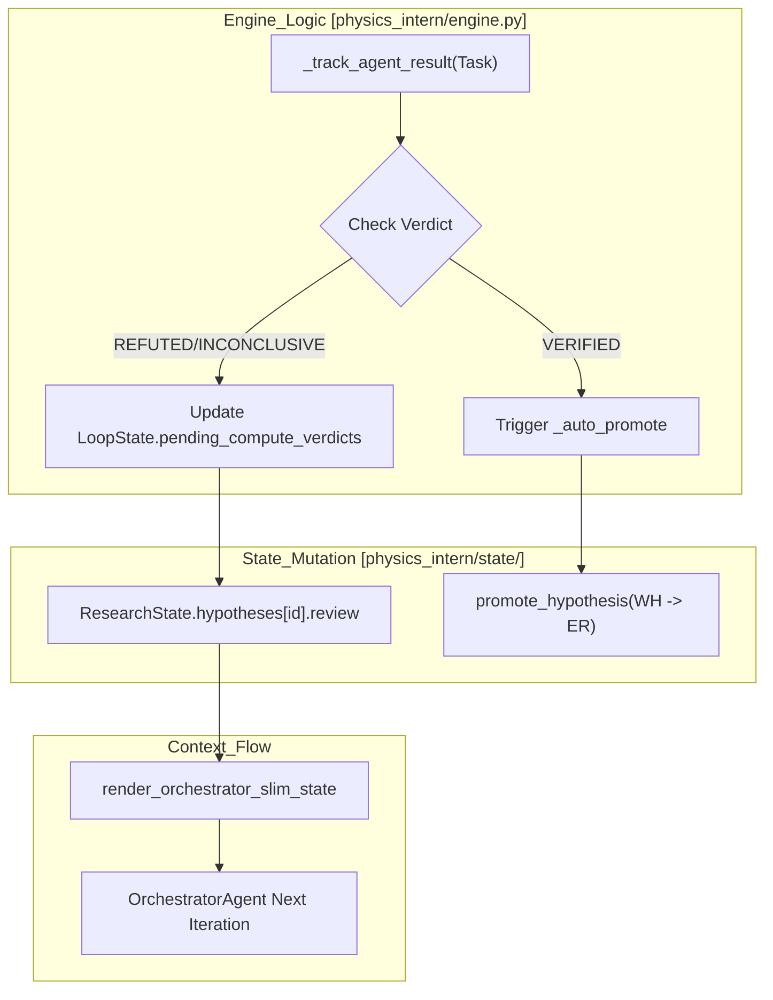

<!-- source: DeepWiki mcp.deepwiki.com · repo huggingface/physics-intern · page 10.1 Engine and State Tests · fetched 2026-10-26 -->

# Engine and State Tests

Relevant source files

The following files were used as context for generating this wiki page:

- [CLAUDE.md](CLAUDE.md)
- [tests/test_engine.py](tests/test_engine.py)
- [tests/test_orchestrator.py](tests/test_orchestrator.py)
- [tests/test_orchestrator_tools.py](tests/test_orchestrator_tools.py)
- [tests/test_renderers.py](tests/test_renderers.py)
- [tests/test_report_recommendations.py](tests/test_report_recommendations.py)
- [tests/test_research_state.py](tests/test_research_state.py)
- [tests/test_scaffold_log.py](tests/test_scaffold_log.py)
- [tests/test_state_transitions.py](tests/test_state_transitions.py)
- [tests/test_task.py](tests/test_task.py)
- [tests/test_validation.py](tests/test_validation.py)

This page details the testing infrastructure for the core PhysicsIntern engine, the `ResearchState` data model, and the associated validation and rendering subsystems. These tests ensure the reliability of the research loop, the integrity of state transitions, and the accuracy of the context provided to agents.

## Engine and Research Lifecycle Tests

The engine tests focus on the `PhysicsIntern` class, specifically its ability to manage research status, enforce budgets, and handle task enrichment.

### Core Engine Logic
The engine's ability to transition the `ResearchState.status` is verified by ensuring that calls to `_set_research_status` correctly update the state object [tests/test_engine.py:30-42]().

### Task Enrichment and Context
The `ComputerAgent` requires context from prior failures to avoid repetitive errors. The engine implements `_enrich_compute_task_with_prior_failures`, which appends failure history to the `CURRENT_TASK.md` file [tests/test_engine.py:45-112]().
- **Failure Tracking**: The engine tracks failure counts per hypothesis (e.g., "WH-003") within the `LoopState.claim_failure_count` [tests/test_engine.py:68-69]().
- **Context Injection**: If failures exist, the engine injects a "Prior Failure Context" section containing the failure count and root causes into the task description [tests/test_engine.py:90-95]().

### Verdict Tracking and Signals
The engine monitors agent results to signal the `OrchestratorAgent` when critical failures occur [tests/test_engine.py:114-126]().
- **Refutation Handling**: When a `ReviewerAgent` returns a `REFUTED` verdict, the engine adds a signal to `LoopState.pending_compute_verdicts` [tests/test_engine.py:147-162]().
- **Evidence Invalidation**: A `REFUTED` verdict triggers the engine to mark all existing evidence on that hypothesis as refuted [tests/test_engine.py:180-192]().

### Engine Data Flow and Code Entities

| System Component | Code Entity | File Reference |
| :--- | :--- | :--- |
| Main Loop | `PhysicsIntern` | [tests/test_engine.py:34]() |
| Transient State | `LoopState` | [tests/test_engine.py:6]() |
| Persistence | `WorkspaceManager` | [tests/test_engine.py:49]() |
| Task Model | `Task` | [tests/test_engine.py:13]() |

**Engine Operation Diagram**
Title: Engine Result Tracking and Orchestrator Signaling

Sources: [tests/test_engine.py:114-162](), [tests/test_state_transitions.py:172-186](), [CLAUDE.md:40-41]()

---

## ResearchState and Data Model Tests

The `ResearchState` is the single source of truth [CLAUDE.md:32](). Tests in this cluster ensure that the complex hierarchy of hypotheses, critiques, and evidence remains consistent.

### State Transitions
State transitions handle the lifecycle of hypotheses as they move between "Working" and "Established" statuses.
- **Promotion (WH → ER)**: `promote_hypothesis` renames a hypothesis from `WH-XXX` to `ER-XXX` and updates its status to `ESTABLISHED` [tests/test_state_transitions.py:172-186]().
- **Demotion (ER → WH)**: `demote_hypothesis` reverts an established result to a working hypothesis, typically following a successful critique or refuted verification [tests/test_state_transitions.py:114-128]().
- **Reference Normalization**: `normalize_references` ensures that `depends_on` lists and `ResearchQuestion.resolved_to` fields are updated to reflect renamed hypothesis IDs [tests/test_state_transitions.py:16-41]().

### Serialization and Persistence
`ResearchState` supports JSON serialization for disk persistence via `to_json` and `from_json` [tests/test_research_state.py:154-192]().
- **Round-trip Integrity**: Tests verify that evidence, critiques, and failed approaches are preserved exactly across save/load cycles [tests/test_research_state.py:181-192]().
- **Markdown Extraction**: Helper functions like `_extract_hypothesis_sections` parse the human-readable `RESEARCH_STATE.md` to reconstruct state objects during verification [tests/test_research_state.py:66-89]().

Sources: [tests/test_research_state.py:5-182](), [tests/test_state_transitions.py:1-186]()

---

## Orchestrator Tool Tests

The `OrchestratorToolExecutor` provides the mechanism for agents to mutate the `ResearchState`. Tests enforce strict guardrails on these mutations.

### Guardrails and Caps
- **WH Cap**: The system limits the number of active working hypotheses (default 2) to prevent the agent from diverging. `add_hypothesis` is blocked if the cap is reached [tests/test_orchestrator_tools.py:153-174]().
- **Critique Blocking**: The orchestrator is blocked from adding new hypotheses if there are unresolved `HIGH` severity critiques, forcing the agent to address strategic flaws first [tests/test_orchestrator_tools.py:175-209]().
- **RQ Evidence Cap**: Dispatching new tasks for a `ResearchQuestion` is blocked once it has accumulated sufficient evidence [tests/test_orchestrator_tools.py:211-213]().

### Automated Resolutions
- **RQ Auto-Resolution**: When a hypothesis is added from a research question (`from_rq`), the state of that `ResearchQuestion` is automatically set to `RESOLVED` [tests/test_orchestrator_tools.py:106-138]().

Sources: [tests/test_orchestrator_tools.py:5-213]()

---

## Validation and Control Flow Tests

The validation layer [physics_intern/control/validation.py]() runs post-integration to enforce invariants and check termination conditions.

### Invariant Checks
- **Phantom Labels**: `check_phantom_labels` detects and strips "VERIFIED" claims in derivations that are not backed by an actual `ReviewResult` in the state [tests/test_validation.py:152-177]().
- **ER Demotion Safety**: `check_er_demotion_safety` automatically demotes an `ER` hypothesis back to `WH` if a new verification result returns `REFUTED` [tests/test_validation.py:86-105]().
- **Stale Labels**: `check_stale_unverified_labels` updates "[unverified]" placeholders in text to "VERIFIED" once the backing review is completed [tests/test_validation.py:193-209]().

### Termination Gates
`can_terminate` determines if the research session has reached a successful conclusion. It requires a minimum number of `ESTABLISHED` (ER) results (configured via `min_er_for_completion`) [tests/test_validation.py:40-44]().

**Natural Language to Code Entity Space: Validation**
Title: Validation Pipeline and State Invariants
| Concept | Code Entity | Check Function |
| :--- | :--- | :--- |
| Unsubstantiated Claims | `Violation` | `check_phantom_labels` [tests/test_validation.py:9]() |
| Logical Consistency | `Violation` | `check_critique_resolution_consistency` [tests/test_validation.py:11]() |
| Safety Demotion | `demote_hypothesis` | `check_er_demotion_safety` [tests/test_validation.py:8]() |
| Exit Condition | `can_terminate` | `validate_post_integration` [tests/test_validation.py:6]() |

Sources: [tests/test_validation.py:1-209](), [tests/test_report_recommendations.py:22-25]()

---

## Renderer and Logging Tests

Renderers transform the `ResearchState` into Markdown for agent consumption and disk snapshots.

### Context Rendering
- **Slim State**: `render_orchestrator_slim_state` provides a high-level overview for the orchestrator, omitting deep derivation details to save tokens [tests/test_renderers.py:17]()
- **Critique Logs**: `render_critique_log_md` formats active and resolved critiques, ensuring severity levels are clearly visible [tests/test_renderers.py:8]()
- **Ordering**: The `render_research_state_md` function ensures that `ER` hypotheses are always displayed before `WH` hypotheses to emphasize established facts [tests/test_renderers.py:200-204]().

### Scaffold Logging (`EVENT_LOG.jsonl`)
The system logs every significant scaffold event and LLM call to a JSONL file for auditability [tests/test_scaffold_log.py:1-10]().
- **Event Categories**: Events are categorized (e.g., `loop_control`, `state_invariants`, `call_reliability`) [tests/test_scaffold_log.py:17-18]().
- **LLM Instrumentation**: `log_llm_call` captures model name, token counts (including reasoning tokens), duration, and stop reasons [tests/test_scaffold_log.py:91-118]().
- **Validation Integration**: Violations found during `validate_post_integration` are automatically logged as `state_invariants` events [tests/test_scaffold_log.py:56-85]().

Sources: [tests/test_renderers.py:1-215](), [tests/test_scaffold_log.py:1-177]()

---

