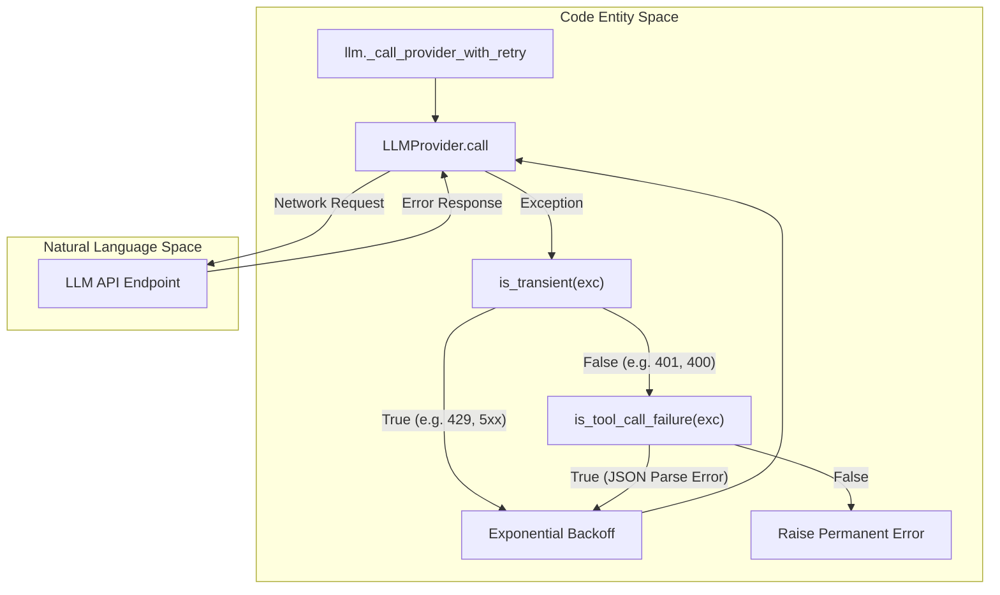
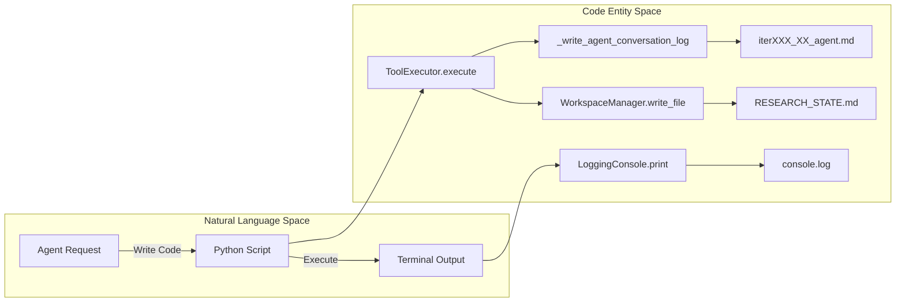

<!-- source: DeepWiki mcp.deepwiki.com · repo huggingface/physics-intern · page 10.2 Provider and Integration Tests · fetched 2026-10-26 -->

# Provider and Integration Tests

Relevant source files

The following files were used as context for generating this wiki page:

- [src/physics_intern/providers/vllm.py](src/physics_intern/providers/vllm.py)
- [tests/test_console_log.py](tests/test_console_log.py)
- [tests/test_conversation_log.py](tests/test_conversation_log.py)
- [tests/test_llm_retry.py](tests/test_llm_retry.py)
- [tests/test_sandbox.py](tests/test_sandbox.py)
- [tests/test_tools.py](tests/test_tools.py)
- [tests/test_vllm_provider.py](tests/test_vllm_provider.py)
- [tests/test_workspace.py](tests/test_workspace.py)

This page details the testing infrastructure for LLM provider abstractions, retry mechanisms, tool execution sandboxing, workspace management, and logging systems. These tests ensure the reliability of the communication layer between the multi-agent engine and external LLM services.

## LLM Provider and Retry Logic

The provider layer is tested for its ability to handle diverse API responses, parse reasoning tokens, and recover from transient failures.

### Retry Classification
The `_call_provider_with_retry` function in `physics_intern/llm.py` uses a suite of classifiers to determine if an exception warrants a retry.
*   **Transient Errors**: HTTP 429 (Rate Limit), 500, 502, 503, 504, and connection timeouts are flagged for exponential backoff `[tests/test_llm_retry.py:80-108]()`.
*   **Tool Call Failures**: Specific 400 Bad Request errors that indicate JSON parsing failures in tool arguments (common in vLLM or HuggingFace endpoints) are treated as transient to allow the model a second attempt at valid syntax `[tests/test_llm_retry.py:158-232]()`.
*   **Permanent Failures**: 401 (Unauthorized), 403 (Forbidden), and 404 (Not Found) are classified as non-transient and fail immediately `[tests/test_llm_retry.py:111-128]()`.

### vLLM Provider Tests
The `VLLMProvider` is tested for its dual-mode tool handling: `api` (native OpenAI tools) and `xml_text` (text-based XML tags) `[src/physics_intern/providers/vllm.py:4-18]()`.
*   **XML Parsing**: Tests verify that `_parse_xml_tool_calls` can extract Nemotron-style (`<function=...><parameter=...>`) and GLM-style tool calls from raw text `[tests/test_vllm_provider.py:45-138]()`.
*   **Reasoning Tokens**: Verification of `reasoning_effort` parameters ("high", "max") passed to the completions API for reasoning-capable models `[tests/test_vllm_provider.py:139-185]()`.

**Data Flow: Provider Request and Retry**

Title: Provider Request Lifecycle and Retry Logic

Sources: `[src/physics_intern/llm.py:1-20]()`, `[tests/test_llm_retry.py:9-14]()`, `[src/physics_intern/providers/vllm.py:67-108]()`.

## Tool Execution and Sandboxing

The `ToolExecutor` and its underlying `execute_python` utility are tested to ensure safe and predictable code execution within the agent's workspace.

### Python Execution Features
*   **Isolation**: Each execution occurs in a fresh process. Tests confirm that `NameError` is raised if variables from previous turns are accessed without re-definition `[tests/test_tools.py:71-77]()`.
*   **Timeouts**: The sandbox terminates scripts that exceed the configured `timeout`, returning a "TIMEOUT" error message to the agent `[tests/test_tools.py:42-48]()`.
*   **Output Truncation**: To prevent context window overflow, tool output is capped (typically at 10KB). Tests verify that a "truncated" message is appended when limits are hit `[tests/test_tools.py:49-57]()`.
*   **Matplotlib Support**: The sandbox environment forces `MPLBACKEND=Agg` to ensure `plt.show()` does not block execution in headless environments `[tests/test_sandbox.py:81-106]()`.

### Filename Sanitization
Agents provide filenames for their scripts. `ToolExecutor._sanitize_filename` is tested to ensure:
*   Path separators (`/`, `..`) are stripped to prevent directory traversal `[tests/test_tools.py:86-92]()`.
*   The `.py` extension is enforced `[tests/test_tools.py:93-96]()`.
*   Filenames are prefixed with a monotonic counter (e.g., `001_script.py`) for chronological tracking in the workspace `[tests/test_tools.py:108-119]()`.

Sources: `[tests/test_tools.py:19-84]()`, `[tests/test_sandbox.py:7-47]()`, `[physics_intern/agents/computer/tools.py:10-16]()`.

## Workspace and Persistence

The `WorkspaceManager` handles the physical directory structure and git-backed versioning of the research state.

| Feature | Verification Method |
| :--- | :--- |
| **Directory Structure** | Checks for existence of `computations/`, `derivations/`, and `logs/` `[tests/test_workspace.py:45-51]()`. |
| **Initial State** | Ensures `RESEARCH_STATE.md`, `EVIDENCE_LOG.md`, and `CRITIQUE_LOG.md` are created upon `init()` `[tests/test_workspace.py:52-58]()`. |
| **Git Integration** | Confirms `.git` initialization and the ability to perform `git_commit` after file writes `[tests/test_workspace.py:59-62, 141-153]()`. |
| **Tail Reading** | Tests `read_file_tail` for extracting the last $N$ sections of a Markdown log for context injection `[tests/test_workspace.py:122-130]()`. |

Sources: `[tests/test_workspace.py:1-62]()`, `[src/physics_intern/core/workspace.py:7-13]()`.

## Logging and Observability

### Conversation Logging
Every LLM interaction is logged as a Markdown file.
*   **Naming Convention**: Files are named `iter{iteration}_{sequence}_{agent}.md` (e.g., `iter003_01_researcher.md`) `[tests/test_conversation_log.py:27-39]()`.
*   **Content**: Logs include tagged sections for `<SYSTEM_PROMPT>`, `<USER_MESSAGE>`, and `<LLM_RESPONSE>`, along with metadata like token counts and duration `[tests/test_conversation_log.py:41-68]()`.
*   **Multi-round Support**: For agents using tools, a single log file captures the entire multi-round trajectory, including `<TOOL_CALL>` and `<TOOL_RESULT>` blocks `[tests/test_conversation_log.py:127-211]()`.

### Console Output
The `LoggingConsole` (a wrapper around `rich.console`) is tested to ensure it "tees" all terminal output to a `console.log` file in the workspace `[tests/test_console_log.py:6-15]()`.

**Entity Mapping: Execution to Persistence**

Title: Code Execution and Persistence Mapping

Sources: `[tests/test_conversation_log.py:127-179]()`, `[tests/test_console_log.py:6-15]()`, `[tests/test_tools.py:1-16]()`.

---

