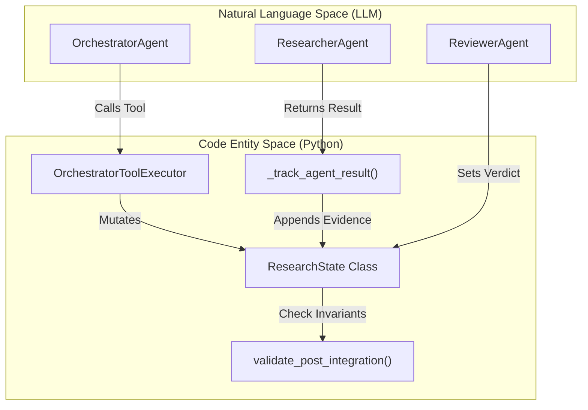

<!-- source: DeepWiki mcp.deepwiki.com · repo huggingface/physics-intern · page 2 Core Architecture · fetched 2026-10-26 -->

# Core Architecture

<details>
<summary>Relevant source files</summary>

The following files were used as context for generating this wiki page:

- [CLAUDE.md](CLAUDE.md)
- [DOCUMENTATION.md](DOCUMENTATION.md)
- [tests/test_engine.py](tests/test_engine.py)
- [tests/test_orchestrator_tools.py](tests/test_orchestrator_tools.py)
- [tests/test_report_recommendations.py](tests/test_report_recommendations.py)
- [tests/test_scaffold_log.py](tests/test_scaffold_log.py)
- [tests/test_validation.py](tests/test_validation.py)

</details>


The PhysicsIntern system is designed as an autonomous multi-agent research engine that bridges high-level scientific reasoning with low-level computational execution. The architecture centers around a state-driven loop where specialized agents interact with a unified research graph to solve complex problems in theoretical physics and mathematics.

## PhysicsIntern Engine

The `PhysicsIntern` engine is the central orchestrator of the research lifecycle. It manages the iteration loop, enforces global budgets (time, tokens, cost), and handles the transition between different research phases.

*   **Main Loop**: The engine executes a continuous loop of "Plan → Dispatch → Integrate → Validate" until a termination condition is met or a budget is exhausted [physics_intern/engine.py:34-42]().
*   **Termination Logic**: The engine determines if a problem is solved based on the presence of sufficient "Established Results" (ERs) and the absence of high-severity critiques [physics_intern/control/validation.py:7-12]().
*   **Stall Handling**: It monitors for repetitive failures (e.g., a hypothesis being refuted multiple times) and injects prior failure context into new tasks to prevent loops [tests/test_engine.py:45-113]().

For details, see [Engine and Research Lifecycle](#2.1).

## ResearchState and Data Model

The `ResearchState` class serves as the **single source of truth** for the entire system [CLAUDE.md:32](). It represents the current scientific understanding of the problem as a structured graph of entities.

| Entity | Role |
| :--- | :--- |
| **Hypothesis (WH/ER)** | Claims about the physical system. Transitions from Working Hypothesis (WH) to Established Result (ER) upon verification [physics_intern/state/research_state.py:7-12](). |
| **Research Question (RQ)** | Specific inquiries that drive the search for new evidence or hypotheses [physics_intern/state/research_state.py:8](). |
| **Evidence** | Data generated by agents (analytical derivations or code execution results) [physics_intern/state/research_state.py:8](). |
| **Critique** | Strategic or technical audits of existing claims, used to prevent premature promotion of results [physics_intern/state/research_state.py:12-14](). |

For details, see [ResearchState and Data Model](#2.2).

## Agent Interactions and Workspace

The system utilizes a "Natural Language Space" (agent prompts and reasoning) to manipulate a "Code Entity Space" (the JSON-backed ResearchState).

### System Entity Mapping
The following diagram illustrates how high-level agent actions translate into specific code-level state mutations and file operations.


Sources: [physics_intern/agents/orchestrator/tools.py:5-17](), [physics_intern/engine.py:158-180](), [physics_intern/control/validation.py:3-12]().

## LoopState and Context Management

While `ResearchState` is persistent, `LoopState` manages transient information specific to the current iteration. This includes the history of agent dispatches in the current turn and "banners" (urgent system notifications) that must be shown to the Orchestrator.

*   **Context Assembly**: Each agent receives a fresh Markdown rendering of the `ResearchState`. No conversation history is carried between iterations [CLAUDE.md:34]().
*   **Dispatch Tracking**: The system tracks which agents were sent which tasks to prevent redundant work within a single iteration [physics_intern/state/loop_state.py:6]().

For details, see [LoopState and Context Management](#2.3).

## Validation and Control Flow

To maintain scientific integrity, the system runs a validation pipeline after every state mutation. This prevents "hallucinated" progress and ensures that the research graph remains logically consistent.

### The Validation Pipeline
The engine enforces safety checks to prevent common failure modes in autonomous LLM research.

```mermaid
graph LR
    [Raw State Mutation] --> V1["check_phantom_labels()"]
    V1 --> V2["check_er_demotion_safety()"]
    V2 --> V3["check_stale_unverified_labels()"]
    V3 --> V4["check_critique_resolution_consistency()"]
    V4 --> [Final Validated State]

    subgraph "Violation Reporting"
        V1 -- "Log Event" --> EventLog["EVENT_LOG.jsonl"]
        V2 -- "Log Event" --> EventLog
    end
```
Sources: [physics_intern/control/validation.py:3-12](), [tests/test_validation.py:1-25](), [tests/test_scaffold_log.py:13-30]().

*   **Phantom Labels**: Strips claims of "VERIFIED" from text if the `ResearchState` doesn't actually contain a successful review [physics_intern/control/validation.py:152-162]().
*   **ER Demotion**: Automatically demotes an Established Result (ER) back to a Working Hypothesis (WH) if a new review refutes it [physics_intern/control/validation.py:86-105]().

For details, see [Validation and Control Flow](#2.4).

---

