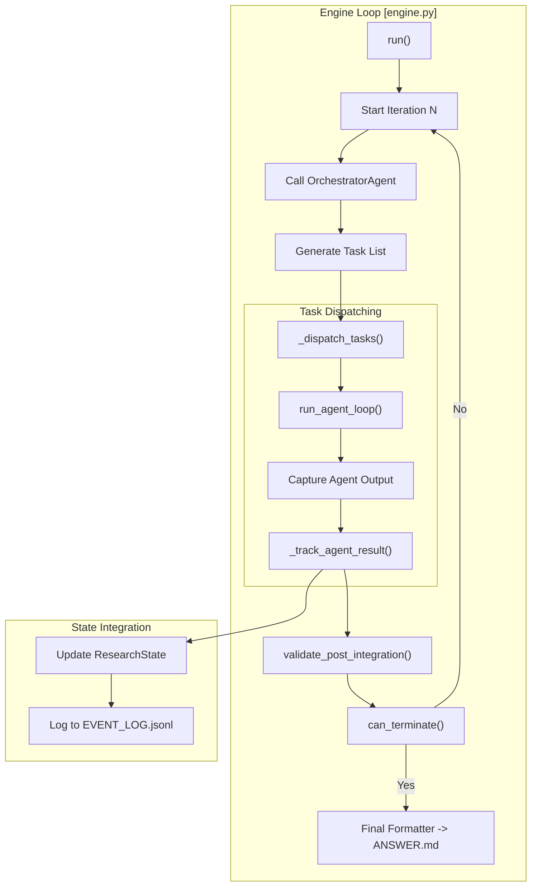
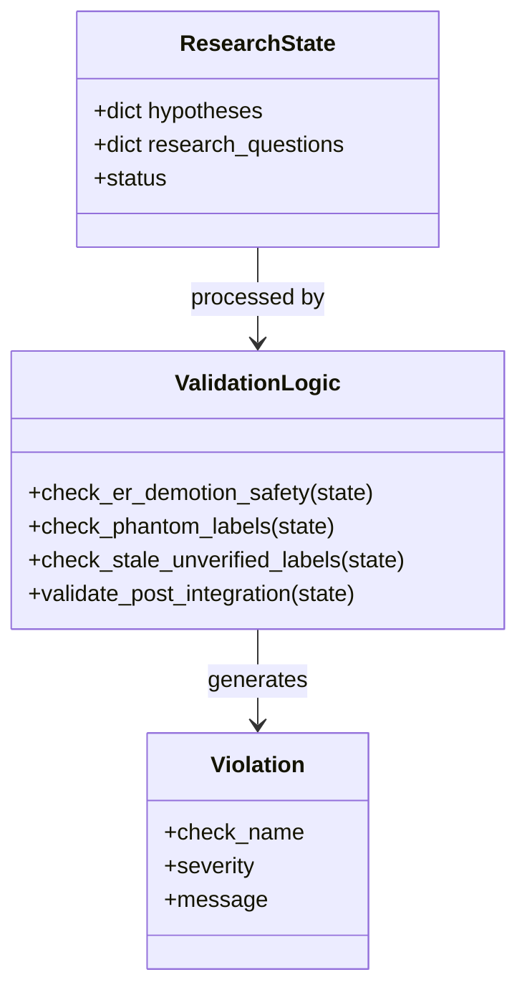

<!-- source: DeepWiki mcp.deepwiki.com · repo huggingface/physics-intern · page 2.1 Engine and Research Lifecycle · fetched 2026-10-26 -->

# Engine and Research Lifecycle

Relevant source files

The following files were used as context for generating this wiki page:

- [DOCUMENTATION.md](DOCUMENTATION.md)
- [tests/test_engine.py](tests/test_engine.py)
- [tests/test_report_recommendations.py](tests/test_report_recommendations.py)
- [tests/test_scaffold_log.py](tests/test_scaffold_log.py)
- [tests/test_validation.py](tests/test_validation.py)

The `PhysicsIntern` engine, defined in `physics_intern/engine.py`, serves as the central orchestrator for the multi-agent research process. It manages the iterative loop where a physics problem is decomposed into tasks, executed by specialized agents, and integrated into a persistent research state. The engine is responsible for maintaining the research lifecycle, enforcing budget constraints, and ensuring the scientific integrity of the evolving solution.

### Core Engine Loop and Iteration Flow

The engine operates through a high-level `run()` method that executes a sequence of iterations until a termination condition is met or a budget is exhausted [physics_intern/engine.py:101-140](). Each iteration follows a structured sequence of planning, dispatching, and integration.

**Research Lifecycle States**
The research progresses through three primary statuses [physics_intern/engine.py:35-42]():
*   `in_progress`: The default state where agents are actively working on the problem.
*   `completed`: Set when the `FormatterAgent` successfully generates a final `ANSWER.md`.
*   `partially_complete`: Set if a budget circuit-breaker (e.g., max time or tokens) is triggered before a natural conclusion.

#### The Iteration Sequence
1.  **Orchestration**: The `OrchestratorAgent` analyzes the current `ResearchState` and emits a list of `Task` objects [physics_intern/engine.py:214-221]().
2.  **Dispatch**: The engine iterates through the proposed tasks and routes them to the appropriate specialized agents [physics_intern/engine.py:230-245]().
3.  **Execution**: Agents (e.g., `Researcher`, `Computer`, `Reviewer`) execute their assigned tasks. For `ComputerAgent`, the engine may enrich the task with context from prior failures to prevent repetitive errors [physics_intern/engine.py:280-300]().
4.  **Integration**: Results from agents are processed and used to update the `ResearchState`.
5.  **Validation**: After state updates, the engine runs `validate_post_integration` to check for logical inconsistencies or "phantom" labels [physics_intern/control/validation.py:35-65]().

**Engine Dispatch and Execution Flow**

Sources: [physics_intern/engine.py:101-140](), [physics_intern/engine.py:230-245](), [physics_intern/control/validation.py:35-65]().

### Task Dispatch and Stall Handling

The engine utilizes `_dispatch_tasks` to manage the parallel or sequential execution of agent assignments. A key feature is the handling of **stalls**—situations where agents fail to make progress or repeatedly produce inconclusive results.

*   **Compute Verdict Tracking**: The engine tracks the outcomes of `REVIEW` tasks. If a hypothesis is `REFUTED` or `INCONCLUSIVE`, the engine increments a failure counter for that specific target in the `LoopState` [tests/test_engine.py:147-179]().
*   **Context Enrichment**: When a `ComputerAgent` is assigned a task that has previously failed, the engine injects "Prior Failure Context" into the `CURRENT_TASK.md` prompt, including the root cause of previous failures to guide the agent toward a different approach [tests/test_engine.py:75-95]().
*   **Progress Watchdog**: During long-running tool loops (like complex Python simulations), a progress check is injected after a configurable number of rounds (`progress_check_interval`) to ensure the agent is not stuck in an infinite loop [tests/test_report_recommendations.py:90-110]().

Sources: [physics_intern/engine.py:280-300](), [tests/test_engine.py:147-179](), [tests/test_report_recommendations.py:90-110]().

### Circuit-Breaker Mechanisms and Termination

The engine implements several "gates" to prevent runaway costs or infinite loops. These are checked at the end of every iteration.

| Mechanism | Description | Implementation |
| :--- | :--- | :--- |
| **Iteration Cap** | Stops after `max_iterations` is reached. | `physics_intern/engine.py:112` |
| **Wall Clock** | Stops if the run exceeds `max_wall_seconds`. | `DOCUMENTATION.md:33` |
| **Token Budget** | Stops if cumulative output tokens exceed `max_total_output_tokens`. | `DOCUMENTATION.md:33` |
| **Cost Gate** | Stops if cumulative USD cost exceeds `max_cost_usd`. | `DOCUMENTATION.md:33` |
| **Stall Limit** | Forces a strategy shift if a specific result is recomputed too many times. | `tests/test_engine.py:128` |

#### Termination Logic (`can_terminate`)
The `can_terminate` function determines if the research has reached a sufficient state to stop. It requires a minimum number of Established Results (ERs) as defined in the configuration (default is often 1) [tests/test_validation.py:44-46](). If a soft-exit trigger (like token budget) is hit, the engine forces a "best-effort" termination where the `FormatterAgent` is called one last time to synthesize the existing work into an `ANSWER.md` with a `partially_complete` status [DOCUMENTATION.md:33-36]().

Sources: [physics_intern/engine.py:112-120](), [physics_intern/control/validation.py:110-130](), [DOCUMENTATION.md:31-36]().

### State Validation and Consistency

To maintain the scientific "Source of Truth," the engine runs a validation pipeline after every integration phase. This pipeline identifies and fixes common LLM hallucinations or state corruptions.

**Code Entities in Validation**

1.  **ER Demotion Safety**: If an Established Result (ER) receives a `REFUTED` verdict during a later review, it is automatically demoted back to a Working Hypothesis (WH) to prevent false conclusions from persisting [tests/test_validation.py:87-105]().
2.  **Phantom Label Check**: Agents sometimes hallucinate that a hypothesis is `VERIFIED` in the text derivation before a `ReviewerAgent` has actually confirmed it. The engine scans for these "phantom" labels and replaces them with `[unverified]` [tests/test_validation.py:153-162]().
3.  **Stale Label Promotion**: Conversely, if a hypothesis has been verified but the text still says `[unverified]`, the engine updates the text to reflect the actual status [tests/test_validation.py:194-208]().
4.  **Event Logging**: All violations found during validation are logged to `EVENT_LOG.jsonl` under the `state_invariants` category for post-run auditing [tests/test_scaffold_log.py:56-85]().

Sources: [physics_intern/control/validation.py:35-100](), [tests/test_validation.py:87-105](), [tests/test_scaffold_log.py:56-85]().

---

