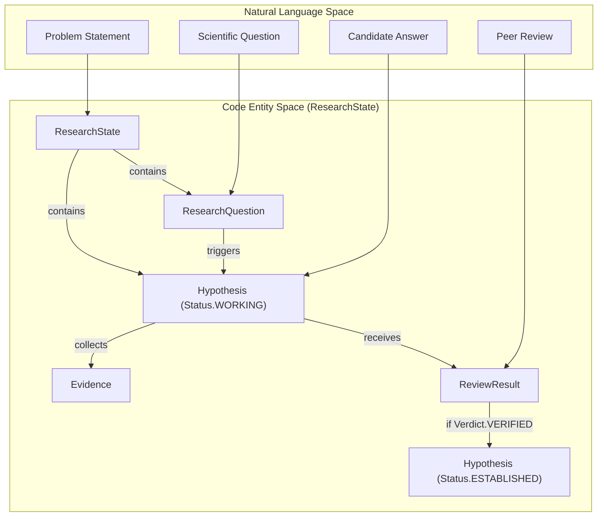
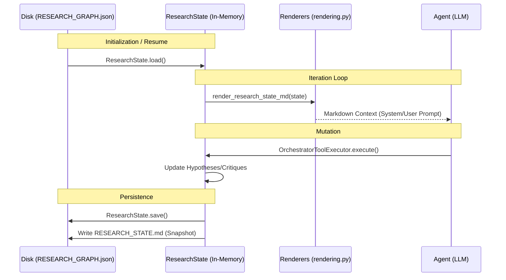

<!-- source: DeepWiki mcp.deepwiki.com · repo huggingface/physics-intern · page 2.2 ResearchState and Data Model · fetched 2026-10-26 -->

# ResearchState and Data Model

Relevant source files

The following files were used as context for generating this wiki page:

- [CLAUDE.md](CLAUDE.md)
- [tests/test_orchestrator.py](tests/test_orchestrator.py)
- [tests/test_orchestrator_tools.py](tests/test_orchestrator_tools.py)
- [tests/test_renderers.py](tests/test_renderers.py)
- [tests/test_research_state.py](tests/test_research_state.py)

The `ResearchState` class serves as the **single source of truth** for the entire multi-agent system [CLAUDE.md:32-32](). It encapsulates the complete scientific trajectory of a problem, including hypotheses, evidence, critiques, and the history of failed approaches. Unlike traditional agent frameworks that rely on long-context conversation history, PhysicsIntern uses a stateless approach where each agent is provided with a fresh context rendered directly from the current `ResearchState` [CLAUDE.md:34-34]().

## Core Data Entities

The research process is modeled through several interconnected entities defined in `physics_intern/state/research_state.py`.

### Hypotheses (WH and ER)
Hypotheses are the primary units of progress. They are identified by prefixes:
*   **WH (Working Hypothesis):** A candidate result currently under investigation [tests/test_research_state.py:39-41]().
*   **ER (Established Result):** A hypothesis that has been verified and promoted. ERs are considered immutable and can only be demoted by an Adjudicator through a valid critique [CLAUDE.md:39-39]().

| Field | Description |
| :--- | :--- |
| `id` | Unique identifier (e.g., `WH-001`, `ER-002`) [tests/test_research_state.py:99-106](). |
| `statement` | The core claim or formula [tests/test_research_state.py:101-101](). |
| `status` | One of `WORKING`, `ESTABLISHED`, or `ABANDONED` [tests/test_research_state.py:102-109](). |
| `derivation` | The logical or mathematical steps supporting the claim [tests/test_renderers.py:64-64](). |
| `evidence` | List of `Evidence` objects (computational or analytical) [tests/test_research_state.py:104-104](). |
| `review` | A `ReviewResult` containing a `Verdict` (VERIFIED, REFUTED, INCONCLUSIVE) [tests/test_research_state.py:111-111](). |

### Research Questions (RQ)
RQs guide the investigation. The Orchestrator uses them to focus research efforts. An RQ must be resolved (usually by spawning a WH) before the research moves forward [tests/test_orchestrator_tools.py:137-137]().

### Critiques and Verdicts
*   **Critiques:** Strategic or technical audits targeting specific hypotheses [tests/test_research_state.py:113-118](). They have a `Severity` (HIGH, LOW) and a `Status` (ACTIVE, RESOLVED) [tests/test_renderers.py:108-115]().
*   **Verdicts:** The outcome of a Reviewer's assessment of a hypothesis [tests/test_renderers.py:77-77]().

**Sources:** [physics_intern/state/research_state.py:1-200](), [tests/test_research_state.py:5-18](), [tests/test_renderers.py:19-32]()

## Lifecycle and Transitions

The state evolves through specific tool-driven mutations and automated scaffolding logic.

### Hypothesis Promotion (WH → ER)
Promotion occurs automatically when a `WH` receives a `VERIFIED` verdict and its dependencies are satisfied [CLAUDE.md:40-40](). This is handled by the `auto_promote` logic in `critique_routing.py` [CLAUDE.md:40-41]().

### ResearchState Lifecycle Diagram
This diagram maps the transition of research entities from creation to established fact.

**Sources:** [physics_intern/state/research_state.py:5-18](), [CLAUDE.md:39-41](), [tests/test_orchestrator_tools.py:107-138]()

## Persistence and Serialization

The `ResearchState` is persisted in two formats to the workspace:
1.  **`RESEARCH_GRAPH.json`**: A full JSON serialization of the `ResearchState` object, used for resuming sessions [tests/test_research_state.py:181-182]().
2.  **Markdown Snapshots**: Human-readable versions (`RESEARCH_STATE.md`, `EVIDENCE_LOG.md`, `CRITIQUE_LOG.md`) rendered once per iteration for git history and manual inspection [CLAUDE.md:33-33](). These are **write-only**; the system never reads them back into memory [CLAUDE.md:33-33]().

### Data Flow: Persistence and Context Injection
This diagram shows how `ResearchState` mediates between the persistent storage and the active Agent context.

**Sources:** [physics_intern/state/research_state.py:181-200](), [CLAUDE.md:32-34](), [tests/test_renderers.py:6-11]()

## Key Implementation Details

### State Mutation via OrchestratorTools
The `OrchestratorToolExecutor` is the primary mechanism for modifying the `ResearchState`. It enforces constraints such as:
*   **WH Cap:** Maximum of 2 working hypotheses at a time [tests/test_orchestrator_tools.py:153-155]().
*   **Critique Blockers:** Creation of new WHs is blocked if there are unresolved HIGH severity critiques [tests/test_orchestrator_tools.py:175-177]().
*   **RQ Resolution:** Adding a hypothesis from an RQ automatically marks that RQ as `RESOLVED` [tests/test_orchestrator_tools.py:136-137]().

### Verification and Sanity Checks
The state includes a `SanityCheck` mechanism used during the review process to ensure mathematical consistency before a verdict is finalized [tests/test_renderers.py:30-30]().

**Sources:** [tests/test_orchestrator_tools.py:1-210](), [physics_intern/state/research_state.py:30-31]()

---

