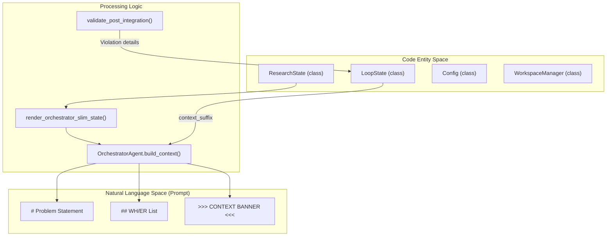
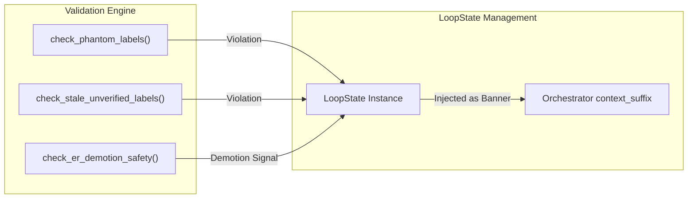

<!-- source: DeepWiki mcp.deepwiki.com · repo huggingface/physics-intern · page 2.3 LoopState and Context Management · fetched 2026-10-26 -->

# LoopState and Context Management

Relevant source files

The following files were used as context for generating this wiki page:

- [tests/test_engine.py](tests/test_engine.py)
- [tests/test_orchestrator.py](tests/test_orchestrator.py)
- [tests/test_renderers.py](tests/test_renderers.py)
- [tests/test_report_recommendations.py](tests/test_report_recommendations.py)
- [tests/test_research_state.py](tests/test_research_state.py)
- [tests/test_scaffold_log.py](tests/test_scaffold_log.py)
- [tests/test_validation.py](tests/test_validation.py)

The `LoopState` serves as the transient scratch space for the `PhysicsIntern` engine, managing data that persists across individual agent calls within a single iteration but does not necessarily belong in the long-term `ResearchState`. This page details how the orchestrator's context is assembled, how dispatch history is tracked, and how banners are used to guide agent behavior.

## LoopState Implementation

The `LoopState` class tracks the execution flow of the research loop, including dispatch records and failure counters for specific hypotheses.

### Key Data Structures
*   **`DispatchRecord`**: Stores the history of agent assignments, including the `task_id`, `assigned_to`, and the specific `target_claim` (e.g., "WH-001") [physics_intern/state/loop_state.py:6-13]().
*   **`claim_failure_count`**: A mapping of hypothesis IDs to the number of times they have failed verification or computation [physics_intern/state/loop_state.py:69-69]().
*   **`pending_compute_verdicts`**: A list of signals indicating that a specific claim needs re-computation or analytical revision following a `REFUTED` or `INCONCLUSIVE` verdict [tests/test_engine.py:160-162]().

### Workflow: Failure Tracking
When a `ReviewerAgent` issues a non-verified verdict, the engine updates the `LoopState` to influence future dispatches:
1.  **Verdict Detection**: `_track_agent_result` identifies `REFUTED` or `INCONCLUSIVE` statuses [tests/test_engine.py:147-158]().
2.  **Counter Increment**: The failure count for the target claim is incremented in `claim_failure_count` [tests/test_engine.py:69-69]().
3.  **Task Enrichment**: Subsequent tasks targeting that claim are enriched with "Prior Failure Context" to prevent the next agent from repeating the same errors [tests/test_engine.py:88-93]().

**Sources:** [physics_intern/state/loop_state.py:1-20](), [tests/test_engine.py:45-114](), [tests/test_engine.py:114-179]().

---

## Orchestrator Context Assembly

The `OrchestratorAgent` functions as the central dispatcher. Each iteration, it receives a dynamically constructed prompt that combines the global research status with transient iteration-specific data.

### Prompt Construction Flow
The `build_context` method in the orchestrator assembles the prompt in the following order:
1.  **Problem Statement**: The original physics problem and background survey [tests/test_orchestrator.py:91-120]().
2.  **Slim Research State**: A rendered version of the current `ResearchState` focusing on active hypotheses (WH/ER) and active critiques [tests/test_renderers.py:17-18](), [tests/test_renderers.py:181-212]().
3.  **Research Notes**: Filtered history of the last 5 iterations to maintain focus without exceeding context windows [tests/test_orchestrator.py:166-174]().
4.  **Context Suffix (Banners)**: Transient feedback or instructions (e.g., results of the previous iteration's tools) appended to the very end of the user message [tests/test_orchestrator.py:131-145]().

### Context Suffix and Banners
The `context_suffix` is a transient string in the `OrchestratorAgent`. Once it is consumed by `build_context`, it is cleared to ensure that iteration-specific banners do not leak into future iterations [tests/test_orchestrator.py:146-151]().

**Sources:** [tests/test_orchestrator.py:64-174](), [tests/test_renderers.py:1-32](), [physics_intern/agents/orchestrator/context.py:1-20]().

---

## Data Flow: From Code to Context

The following diagram illustrates how internal code entities and state objects are transformed into the Natural Language prompt seen by the Orchestrator.

### Diagram: Context Assembly Pipeline

**Sources:** [tests/test_renderers.py:17-18](), [tests/test_orchestrator.py:131-151](), [tests/test_validation.py:3-12]().

---

## Dispatch History and Instrumentation

The engine logs all major transitions and agent calls to `EVENT_LOG.jsonl` using the `log_scaffold_event` and `log_llm_call` utilities.

### Event Categories
| Category | Purpose | Example Event |
| :--- | :--- | :--- |
| `loop_control` | Budget and flow overrides | `p1_budget_override` [tests/test_scaffold_log.py:18-18]() |
| `state_invariants` | Validation failures | `phantom_labels` [tests/test_scaffold_log.py:81-83]() |
| `llm_call` | Token usage and model latency | `orchestrator` call [tests/test_scaffold_log.py:91-103]() |

### Implementation Details
*   **`log_llm_call`**: Captures metadata including `input_tokens`, `output_tokens`, `reasoning_tokens`, and `duration_s` [tests/test_scaffold_log.py:156-172]().
*   **`log_scaffold_event`**: Records architectural decisions, such as forced critiques or budget adjustments, to provide a trace of the engine's "thinking" [tests/test_scaffold_log.py:13-30]().

**Sources:** [tests/test_scaffold_log.py:1-177](), [physics_intern/core/workspace.py:7-8]().

---

## State Invariants and Banners

The `LoopState` interacts with the `validate_post_integration` pipeline to generate banners when the `ResearchState` violates structural rules.

### Diagram: Validation to LoopState Flow

### Banner Injection Logic
1.  **Validation**: Functions like `check_phantom_labels` detect if an agent claimed a result was `VERIFIED` in the text without a corresponding `ReviewResult` object [tests/test_validation.py:153-162]().
2.  **Logging**: Violations are logged to the `EVENT_LOG.jsonl` [tests/test_scaffold_log.py:53-85]().
3.  **Correction**: The engine may inject a `REMINDER` banner into the orchestrator's context if conventions are missing or if state inconsistencies are detected [tests/test_orchestrator.py:64-72]().

**Sources:** [tests/test_validation.py:1-150](), [tests/test_scaffold_log.py:53-85](), [tests/test_orchestrator.py:64-87]().

---

