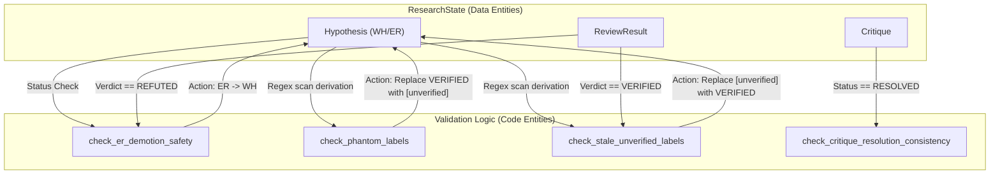
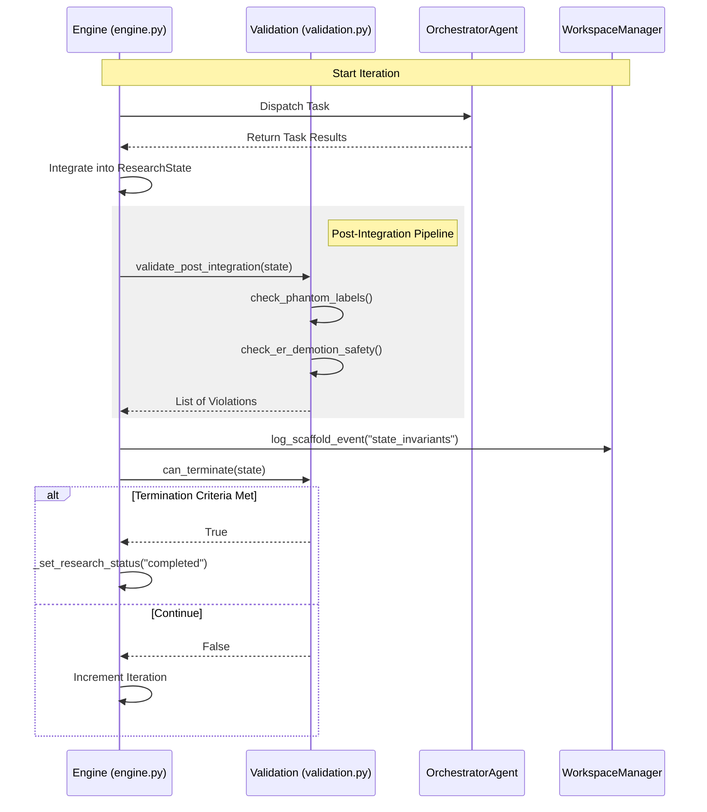

<!-- source: DeepWiki mcp.deepwiki.com · repo huggingface/physics-intern · page 2.4 Validation and Control Flow · fetched 2026-10-26 -->

# Validation and Control Flow

Relevant source files

The following files were used as context for generating this wiki page:

- [CLAUDE.md](CLAUDE.md)
- [tests/test_engine.py](tests/test_engine.py)
- [tests/test_orchestrator_tools.py](tests/test_orchestrator_tools.py)
- [tests/test_report_recommendations.py](tests/test_report_recommendations.py)
- [tests/test_scaffold_log.py](tests/test_scaffold_log.py)
- [tests/test_validation.py](tests/test_validation.py)

The **Validation and Control Flow** subsystem ensures the integrity of the `ResearchState` after agent interactions and governs the lifecycle of the research process. It acts as a safety layer that prevents state corruption (e.g., "phantom" claims), enforces structural invariants (e.g., ER demotion safety), and determines when the engine has met the criteria to stop.

## Post-Integration Validation Pipeline

The `validate_post_integration` function is the primary entry point for state sanitization, executed at the end of every research iteration [physics_intern/control/validation.py:6-12](). It runs a suite of checks that identify and, in some cases, automatically repair violations of system invariants.

### Key Validation Checks

| Check | Function | Description |
| :--- | :--- | :--- |
| **ER Demotion Safety** | `check_er_demotion_safety` | Identifies Established Hypotheses (ERs) that have been refuted by new reviews and demotes them back to Working Hypotheses (WH) [tests/test_validation.py:86-105](). |
| **Phantom Labels** | `check_phantom_labels` | Scans hypothesis derivations for the string "VERIFIED". If the hypothesis does not have a corresponding `ReviewResult` of `VERDICT.VERIFIED`, it replaces the label with `[unverified]` [tests/test_validation.py:153-162](). |
| **Stale Labels** | `check_stale_unverified_labels` | The inverse of phantom checks: if a derivation contains `[unverified]` but the hypothesis has since been verified, it promotes the text to `VERIFIED` [tests/test_validation.py:194-209](). |
| **Critique Consistency** | `check_critique_resolution_consistency` | Ensures that critiques marked as resolved in the `ResearchState` are actually consistent with the resolution text provided by agents [tests/test_validation.py:11-12](). |

### Violation Reporting
When a check fails, it generates a `Violation` object containing the severity (`WARNING` or `ERROR`), a message, and specific details [tests/test_validation.py:59-79](). These violations are logged to `EVENT_LOG.jsonl` under the `state_invariants` category for auditing [tests/test_scaffold_log.py:56-85]().

**Sources:** [physics_intern/control/validation.py:1-25](), [tests/test_validation.py:1-25](), [tests/test_scaffold_log.py:53-86]()

## Termination Gates

The `can_terminate` function determines if the research loop should exit. It evaluates the current `ResearchState` against configurable thresholds to decide if the problem is "solved" or if the system should continue iterating.

### Termination Logic
The engine can terminate under the following conditions:
1.  **Established Results (ER) Count**: The system has reached the `min_er_for_completion` threshold (default is often 1) [tests/test_validation.py:44-45]().
2.  **Critic Silence**: If the `CriticAgent` has not produced a high-severity critique for several iterations, indicating strategic convergence [tests/test_validation.py:33-37]().
3.  **Resource Exhaustion**: The iteration count or token budget has been exceeded, triggering a forced termination [CLAUDE.md:48-49]().

### Research State to Control Logic Mapping
The following diagram illustrates how entities in the `ResearchState` are mapped to the validation functions that govern them.

**Diagram: State Invariant Enforcement**

**Sources:** [physics_intern/state/research_state.py:7-25](), [physics_intern/control/validation.py:3-12](), [tests/test_validation.py:86-105]()

## ER Demotion and Safety

A critical invariant of the system is that Established Results (ERs) must be supported by valid, unrefuted evidence. However, because agents may produce new derivations or code executions that contradict earlier findings, the system must handle "Established" results that are no longer valid.

1.  **Detection**: `check_er_demotion_safety` identifies any hypothesis with `status=HypothesisStatus.ESTABLISHED` that also has a `ReviewResult` with `verdict=Verdict.REFUTED` [tests/test_validation.py:87-98]().
2.  **Demotion**: The hypothesis is renamed from `ER-XXX` to `WH-XXX` and its status is reverted to `WORKING` [tests/test_validation.py:102-104]().
3.  **Immutability Rule**: Outside of this specific validation gate, ERs are treated as immutable by the `OrchestratorAgent`. No agent is permitted to dispatch tasks directly against an ER [CLAUDE.md:39-40]().

## Control Flow Lifecycle

The research engine manages the transition between high-level phases (Mapping, Research, Synthesis).

**Diagram: Research Lifecycle Control Flow**

**Sources:** [physics_intern/engine.py:30-42](), [physics_intern/control/validation.py:3-12](), [tests/test_scaffold_log.py:53-86](), [CLAUDE.md:41-41]()

---

