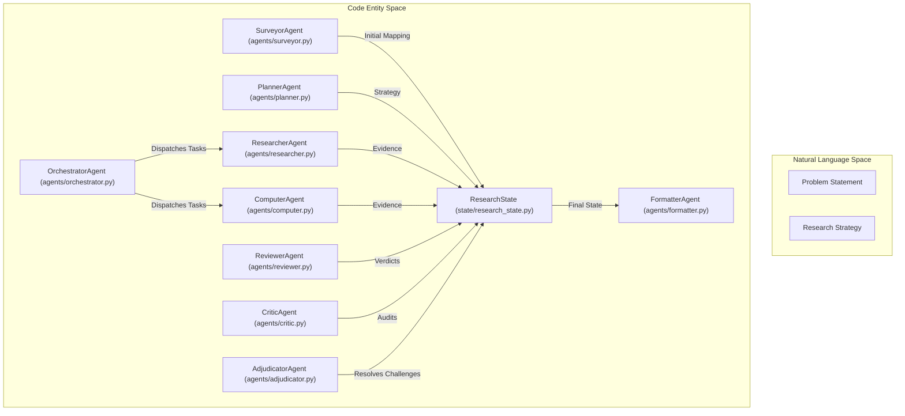
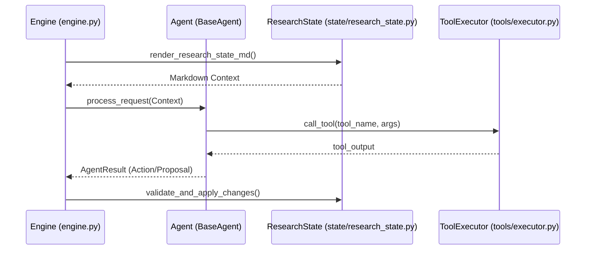

<!-- source: DeepWiki mcp.deepwiki.com · repo huggingface/physics-intern · page 3 Agent System · fetched 2026-10-26 -->

# Agent System

Relevant source files

The following files were used as context for generating this wiki page:

- [DOCUMENTATION.md](DOCUMENTATION.md)
- [README.md](README.md)
- [tests/test_agent_structure.py](tests/test_agent_structure.py)
- [tests/test_rsa.py](tests/test_rsa.py)

The PhysicsIntern agent system is a multi-agent scaffolding designed for autonomous scientific research. It decomposes complex physics problems into manageable units of work handled by nine specialized agent roles. These agents interact with a centralized `ResearchState` to build hypotheses, execute derivations, and verify results.

## BaseAgent Architecture

All agents in the system inherit from the `BaseAgent` abstract class. This class provides the standard interface for receiving state, interacting with LLM providers, and processing responses.

*   **Stateless Execution**: Agents do not maintain internal conversation history. Every turn is a fresh call where the necessary context is rendered from the `ResearchState` [README.md:13-13]().
*   **Prompt Management**: Agents use system prompts and user message templates to guide the LLM.
*   **Tool Integration**: Agents can be "one-shot" (returning structured text/JSON) or "tool-calling" (interacting with the environment or state) [tests/test_agent_structure.py:26-56]().

### Agent System Overview

**Sources:** [README.md:11-13](), [tests/test_agent_structure.py:7-21]()

## Specialized Agent Roles

The system distributes labor across specialized roles to ensure high-fidelity scientific output.

| Agent Role | Primary Responsibility | Interaction Type |
| :--- | :--- | :--- |
| **Orchestrator** | Central dispatcher; manages hypotheses and research questions. | Tool-calling (State mutation) |
| **Planner** | Formulates and revises the high-level research strategy. | One-shot |
| **Researcher** | Performs analytical derivations and mathematical reasoning. | One-shot (JSON block) |
| **Computer** | Writes and executes Python code in a sandboxed environment. | Tool-calling (Sandbox) |
| **Reviewer** | Adversarially reviews evidence to provide verdicts. | One-shot |
| **Critic** | Audits the overall research state for strategic coherence. | One-shot |
| **Adjudicator** | Resolves conflicts when established results are challenged. | One-shot |
| **Surveyor** | Maps the problem landscape before the loop begins. | One-shot |
| **Formatter** | Synthesizes the final `ANSWER.md` from the research state. | One-shot |

**Sources:** [README.md:11-11](), [tests/test_agent_structure.py:26-56]()

## ResearchState Interaction

Agents do not communicate directly. Instead, they mutate the `ResearchState` via tools or structured responses that the `Engine` integrates into the state.

1.  **Context Injection**: The `Engine` renders relevant portions of the `ResearchState` into Markdown (e.g., `RESEARCH_STATE.md`, `EVIDENCE_LOG.md`) and provides them to the agent.
2.  **Action Execution**: Agents perform work (e.g., `execute_python`) or propose state changes (e.g., `add_hypothesis`).
3.  **State Mutation**: The `Engine` validates and applies these changes to the `ResearchState` [README.md:13-13]().

### Agent-State Interaction Flow

**Sources:** [README.md:13-13](), [tests/test_agent_structure.py:61-72]()

## Child Pages

For detailed technical specifications of each agent group, see the following sub-pages:

*   [Orchestrator and Planner Agents](#3.1): Details on the `OrchestratorAgent` dispatch logic, `OrchestratorToolExecutor` guardrails (caps on hypotheses/questions), and `PlannerAgent` strategy generation.
*   [Evidence Agents: Researcher and Computer](#3.2): Details on analytical derivations via `ResearcherAgent`, sandboxed execution via `ComputerAgent`, and the `submit_result` lifecycle.
*   [Review, Critique, and Adjudication Agents](#3.3): Details on the adversarial review flow, `VERIFIED`/`REFUTED` verdict transitions, and the `AdjudicatorAgent` for resolving state challenges.
*   [Surveyor, Formatter, and Autophysicist](#3.4): Details on pre-loop mapping, final answer generation via `FormatterAgent`, and the alternative `Autophysicist` single-agent mode.

---

