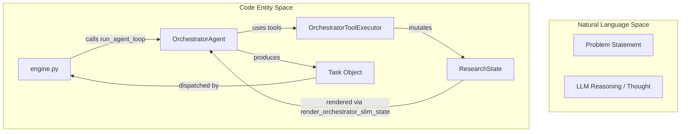
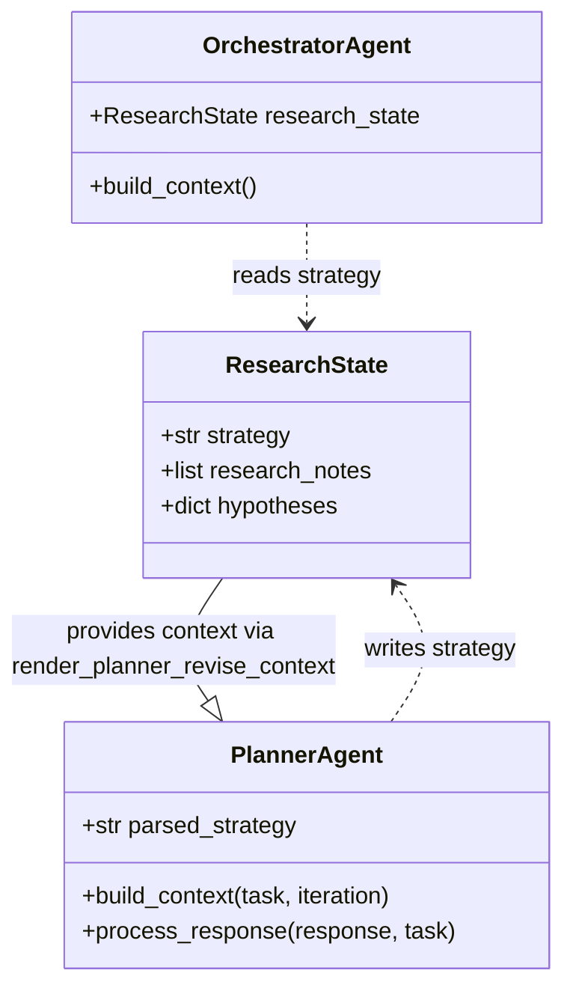

<!-- source: DeepWiki mcp.deepwiki.com · repo huggingface/physics-intern · page 3.1 Orchestrator and Planner Agents · fetched 2026-10-26 -->

# Orchestrator and Planner Agents

Relevant source files

The following files were used as context for generating this wiki page:

- [CLAUDE.md](CLAUDE.md)
- [tests/test_orchestrator.py](tests/test_orchestrator.py)
- [tests/test_orchestrator_tools.py](tests/test_orchestrator_tools.py)
- [tests/test_planner.py](tests/test_planner.py)
- [tests/test_renderers.py](tests/test_renderers.py)
- [tests/test_research_state.py](tests/test_research_state.py)
- [tests/test_surveyor.py](tests/test_surveyor.py)

The **OrchestratorAgent** and **PlannerAgent** form the decision-making core of the PhysicsIntern system. While the Orchestrator manages the immediate execution of the research loop and state mutations, the Planner maintains the long-term strategic vision, intervening only when the research direction requires significant revision.

## OrchestratorAgent: The Central Dispatcher

The `OrchestratorAgent` [physics_intern/agents/orchestrator/__init__.py]() is the primary agent responsible for analyzing the current `ResearchState` and deciding which tasks to dispatch next. It operates as an agentic loop, utilizing a suite of tools to modify the research graph and assign work to specialized agents.

### Core Responsibilities
- **Context Synthesis**: Assembles a "slim" view of the `ResearchState` [physics_intern/agents/orchestrator/context.py:17-17]() to stay within context limits while providing a comprehensive overview of hypotheses, research questions (RQs), and evidence.
- **Task Dispatch**: Generates `Task` objects [physics_intern/state/task.py:22-35]() for other agents (Researcher, Computer, Reviewer, etc.).
- **State Mutation**: Uses `OrchestratorToolExecutor` to apply changes to the `ResearchState`, such as adding hypotheses or resolving RQs.

### Implementation and Data Flow
The Orchestrator receives a fresh context every iteration [CLAUDE.md:34-34](). This context includes the problem statement, conventions, the current strategy defined by the Planner, and recent research notes [tests/test_orchestrator.py:153-164]().

**Orchestrator Logic Flow**

Sources: [physics_intern/agents/orchestrator/__init__.py](), [physics_intern/agents/orchestrator/context.py](), [physics_intern/state/research_state.py](), [CLAUDE.md:34-34]()

---

## OrchestratorToolExecutor Guardrails

The `OrchestratorToolExecutor` [physics_intern/agents/orchestrator/tools.py]() provides the functional interface for the Orchestrator to modify the `ResearchState`. It enforces strict guardrails to prevent state explosion and ensure logical consistency.

### Key Guardrails and Caps
- **Hypothesis Cap**: Prevents creating new Working Hypotheses (WH) if there are already 2 active WHs [tests/test_orchestrator_tools.py:153-174](). This forces the system to resolve existing ideas before branching.
- **Evidence Cap**: Dispatches to RQs are blocked if the question has already accumulated significant evidence without resolution [tests/test_orchestrator_tools.py:212-212]().
- **Focus Guards**: The Orchestrator is blocked from adding new hypotheses if there are unresolved high-severity critiques [tests/test_orchestrator_tools.py:175-209](). This ensures the agent addresses identified flaws before proceeding.
- **RQ Resolution**: When a hypothesis is added from an RQ, the source RQ is automatically marked as `RESOLVED` [tests/test_orchestrator_tools.py:136-137]().

### Tool Implementation Table
| Tool Name | Purpose | Key Constraint |
| :--- | :--- | :--- |
| `add_hypothesis` | Creates a new `WH` | Requires a source `RQ-ID` [tests/test_orchestrator_tools.py:139-151]() |
| `add_research_question` | Creates a new `RQ` | Limited by `RQ_CAP` |
| `resolve_critique` | Marks a `Critique` as resolved | Requires a resolution description |
| `update_conventions` | Modifies the problem's physical constants/units | Usually used in early iterations |

Sources: [physics_intern/agents/orchestrator/tools.py](), [tests/test_orchestrator_tools.py:105-212]()

---

## PlannerAgent: Strategy and Revision

The `PlannerAgent` [physics_intern/agents/planner/__init__.py]() acts as the "architect." Unlike the Orchestrator, which acts every iteration, the Planner is invoked at the start of the research (initial planning) or when the `Engine` detects a strategic failure (re-planning).

### Strategy Revision Triggers
The Planner is invoked in `PLAN_REVISE` mode [tests/test_planner.py:171-176]() when:
1. An Established Result (ER) is demoted back to WH due to a successful critique.
2. The Orchestrator fails to make progress (stalls).
3. Significant new evidence contradicts the current high-level strategy.

### Strategy Lifecycle
1. **Initial Plan**: The `SurveyorAgent` provides background, which the Planner uses to create the first `strategy` string in the `ResearchState` [tests/test_planner.py:51-58]().
2. **Execution**: The Orchestrator reads this strategy in its context to guide task selection [tests/test_orchestrator.py:142-143]().
3. **Revision**: If triggered, the Planner receives the `render_planner_revise_context` [physics_intern/agents/planner/context.py](), which includes the full history of failed approaches and active critiques to formulate a new path [tests/test_planner.py:104-167]().

**Planning Entity Association**

Sources: [physics_intern/agents/planner/__init__.py](), [physics_intern/agents/planner/context.py](), [tests/test_planner.py:67-103](), [physics_intern/state/research_state.py]()

---

## Data Flow: From Strategy to Execution

The transition from a high-level plan to concrete state changes follows a strict pipeline managed by the `Engine`.

1. **Planning**: `PlannerAgent` generates a strategy string.
2. **Contextualization**: `render_orchestrator_slim_state` [physics_intern/agents/orchestrator/context.py:17-17]() embeds the strategy into the Orchestrator's prompt.
3. **Decision**: `OrchestratorAgent` calls tools like `add_hypothesis` [tests/test_orchestrator_tools.py:118-125]().
4. **Validation**: The `Engine` runs `validate_post_integration` to ensure no invariants (like the WH cap) were violated during tool execution.

Sources: [physics_intern/agents/orchestrator/context.py](), [tests/test_orchestrator_tools.py](), [CLAUDE.md:32-41]()

---

