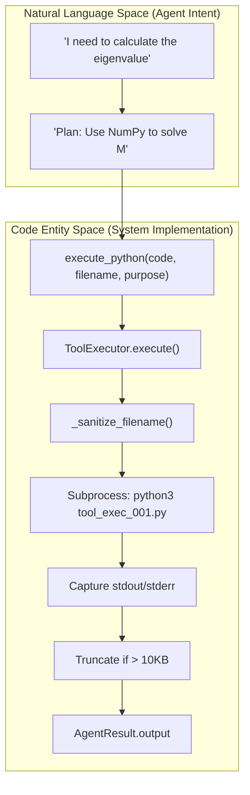
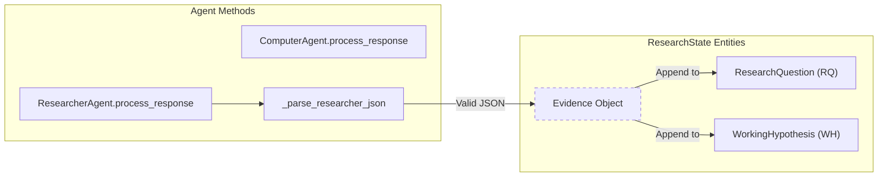

<!-- source: DeepWiki mcp.deepwiki.com · repo huggingface/physics-intern · page 3.2 Evidence Agents: Researcher and Computer · fetched 2026-10-26 -->

# Evidence Agents: Researcher and Computer

Relevant source files

The following files were used as context for generating this wiki page:

- [tests/test_researcher.py](tests/test_researcher.py)
- [tests/test_reviewer.py](tests/test_reviewer.py)
- [tests/test_tools.py](tests/test_tools.py)

Evidence agents are the primary workers responsible for generating technical content, derivations, and computational verification within the `PhysicsIntern` multi-agent system. While the **ResearcherAgent** focuses on analytical derivations and symbolic reasoning, the **ComputerAgent** operates within a sandboxed environment to execute Python code. Both agents are governed by a strict lifecycle that includes documenting approaches before submission and utilizing the `ToolExecutor` for external actions.

## ResearcherAgent: Analytical Derivations

The `ResearcherAgent` is designed for pen-and-paper style physics reasoning. It receives tasks from the `OrchestratorAgent` to address specific `ResearchQuestion` (RQ) or `Hypothesis` (WH) objects [physics_intern/agents/researcher.py:9-22]().

### Implementation and Data Flow
The agent follows a standard LLM loop but requires a structured JSON block within its output to be considered successful. This block must contain the keys `result`, `method`, `confidence`, and `summary` [physics_intern/agents/researcher.py:40-44]().

1.  **Context Construction**: The agent is provided with the current `ResearchState`, focusing on relevant RQs and WHs [physics_intern/agents/researcher.py:121-132]().
2.  **Response Processing**: Upon receiving an LLM response, the agent uses `_parse_researcher_json` to extract the structured evidence [physics_intern/agents/researcher.py:10-12]().
3.  **Evidence Integration**: The parsed data is wrapped in an `Evidence` object and appended to the `target_claim` (either an RQ or WH) in the `ResearchState` [physics_intern/agents/researcher.py:160-170]().

**Researcher Data Extraction Logic**
| Component | Description | Source |
| :--- | :--- | :--- |
| `_extract_derivation_text` | Strips the JSON block to keep only the natural language reasoning. | [physics_intern/agents/researcher.py:10]() |
| `_parse_researcher_json` | Uses regex and brace-counting to find the last valid JSON block. | [physics_intern/agents/researcher.py:31-64]() |
| `target_claim` | The ID (e.g., "RQ-001") where the evidence will be stored. | [physics_intern/agents/researcher.py:144-145]() |

Sources: [physics_intern/agents/researcher.py:9-170](), [tests/test_researcher.py:31-85]()

---

## ComputerAgent and ToolExecutor

The `ComputerAgent` provides the system with "hands" by executing Python code. It interacts with the `ToolExecutor`, which manages a dedicated workspace for scripts and outputs [physics_intern/agents/computer/tools.py:10-16]().

### The execute_python Lifecycle
Execution is not a simple "run and return" call. It follows a managed lifecycle to ensure reproducibility and safety:

1.  **Gating (document_approach)**: Before execution, the agent must describe its plan. This is enforced by the orchestrator but implemented via the `ToolExecutor` sandbox [physics_intern/agents/computer/tools.py:13-16]().
2.  **Sanitization**: Filenames provided by the agent are sanitized to prevent directory traversal and ensure `.py` extensions [tests/test_tools.py:86-102]().
3.  **Execution**: Code is run in a **fresh Python process** for every call. No state is persisted between calls except for files written to the disk [tests/test_tools.py:71-77]().
4.  **Truncation**: Standard output is capped (typically at 10KB) to prevent context window overflow in the LLM [tests/test_tools.py:49-57]().

### ToolExecutor Sandbox
The `ToolExecutor` class (defined in `physics_intern/agents/computer/tools.py`) handles the mechanics of the filesystem and subprocess management.

**Code Entity Space: ToolExecutor Internals**
| Function/Attribute | Role |
| :--- | :--- |
| `_computations_dir` | Path where all `.py` and `.output` files are stored. | [tests/test_tools.py:32]() |
| `execute_python` | The primary tool name recognized by the system. | [tests/test_tools.py:22]() |
| `_sanitize_filename` | Logic to strip `..`, `/`, and `\` from agent-suggested names. | [tests/test_tools.py:87-91]() |
| `timeout` | Prevents infinite loops (default 60s). | [tests/test_tools.py:43-48]() |

**Bridge: Natural Language to Code Entity Space (Execution Flow)**

Sources: [physics_intern/agents/computer/tools.py:10-16](), [tests/test_tools.py:19-84](), [tests/test_tools.py:85-133]()

---

## Evidence Submission and Gating

Both agents must eventually call `submit_result` (or provide the equivalent JSON block) to finalize their task. This transition moves the agent's work from "Transient Thought" to "Permanent Evidence" in the `ResearchState`.

### The submit_result Protocol
The system enforces a "Think-Plan-Execute-Submit" flow:
1.  **document_approach**: The agent writes its intended methodology to the workspace.
2.  **Action**: Researcher performs derivation; Computer runs code.
3.  **submit_result**: The agent provides the final answer. If an agent fails to provide the structured JSON, the `process_response` method raises a `ParseFailureError`, triggering a retry [tests/test_reviewer.py:189-190]().

**Bridge: Evidence Lifecycle and State Transitions**

### Validation Gates
The `ResearcherAgent` and `ComputerAgent` results are subjected to:
*   **Confidence Scoring**: Agents must self-assess as `exact`, `high`, `medium`, or `low` [physics_intern/agents/researcher.py:40-44]().
*   **Methodology Logging**: The `method` field must describe the tools or physical principles used (e.g., "SymPy", "Euclidean path integral") [physics_intern/agents/researcher.py:163-165]().
*   **Iteration Tracking**: Every piece of evidence is tagged with the `iteration` number of the research loop to allow the `ReviewerAgent` to track the evolution of the solution [physics_intern/agents/researcher.py:170]().

Sources: [physics_intern/agents/researcher.py:9-170](), [tests/test_researcher.py:137-171](), [tests/test_reviewer.py:125-149]()

---

