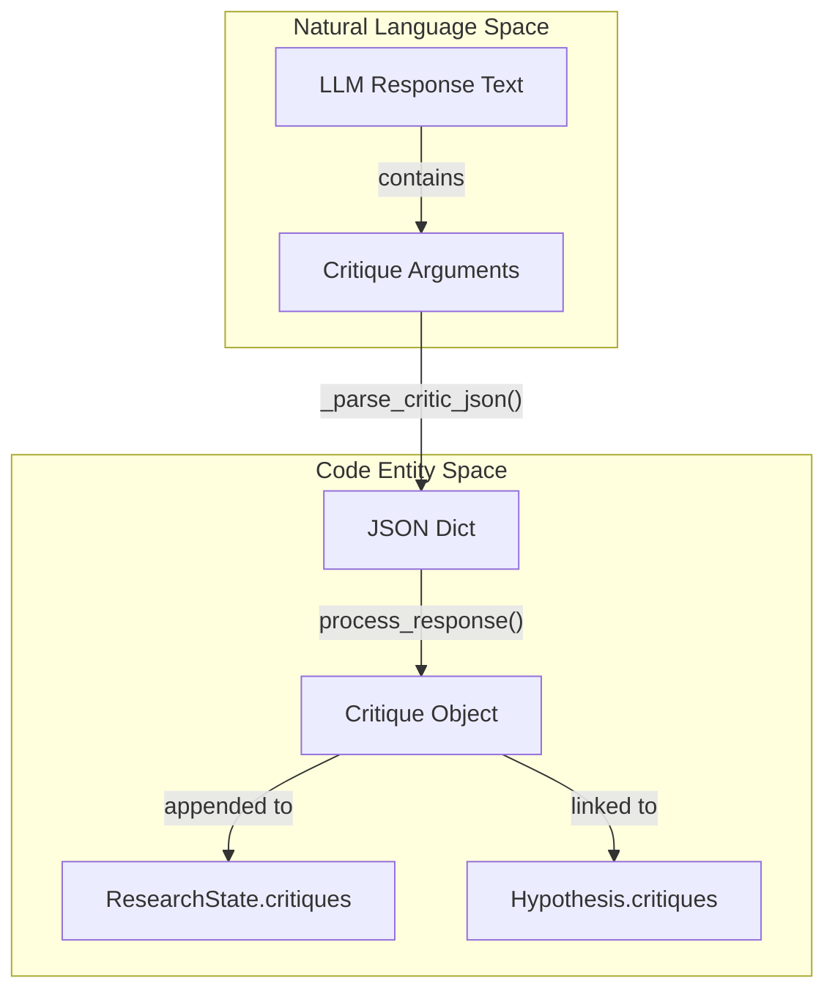
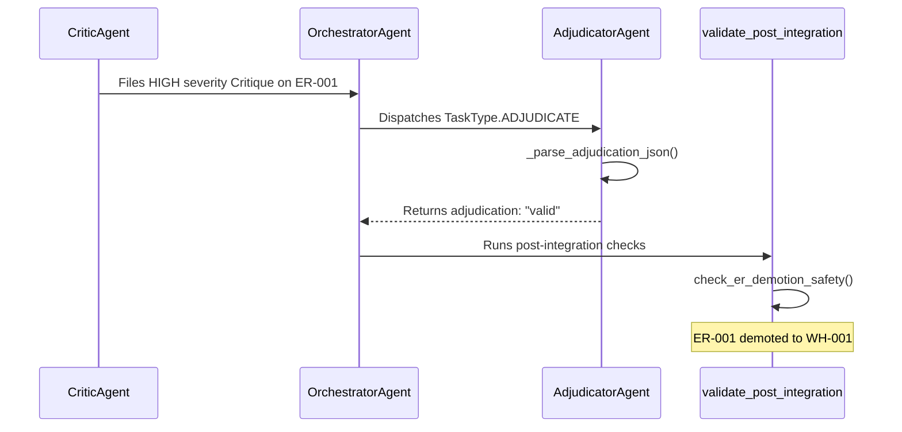

<!-- source: DeepWiki mcp.deepwiki.com · repo huggingface/physics-intern · page 3.3 Review, Critique, and Adjudication Agents · fetched 2026-10-26 -->

# Review, Critique, and Adjudication Agents

Relevant source files

The following files were used as context for generating this wiki page:

- [tests/test_adjudicator.py](tests/test_adjudicator.py)
- [tests/test_critic_tools.py](tests/test_critic_tools.py)
- [tests/test_engine.py](tests/test_engine.py)
- [tests/test_report_recommendations.py](tests/test_report_recommendations.py)
- [tests/test_researcher.py](tests/test_researcher.py)
- [tests/test_reviewer.py](tests/test_reviewer.py)
- [tests/test_scaffold_log.py](tests/test_scaffold_log.py)
- [tests/test_validation.py](tests/test_validation.py)

This section describes the specialized agents responsible for maintaining the integrity of the research graph. While evidence agents generate content, the Reviewer, Critic, and Adjudicator agents act as the quality control layer, ensuring that hypotheses are rigorously verified, strategic gaps are identified, and challenges to established results are resolved.

## ReviewerAgent: Verdict Flow and Verification

The `ReviewerAgent` is tasked with evaluating a specific hypothesis (WH) or established result (ER) against the accumulated evidence. It provides a formal verdict that determines the lifecycle of a claim.

### Implementation and Verdicts
The agent analyzes the `ResearchState` and evidence associated with a `target_claim` defined in its `Task` [physics_intern/state/task.py:12-23](). It outputs a JSON block containing a `verdict`, `summary`, and `details` [tests/test_reviewer.py:27-33]().

The possible verdicts are:
*   **`VERIFIED`**: The evidence is sufficient and the derivation is correct.
*   **`REFUTED`**: The evidence contradicts the claim or a fatal error was found.
*   **`INCONCLUSIVE`**: The evidence is insufficient or contradictory, requiring more research.

### Verification Data Flow
The `PhysicsIntern` engine tracks these verdicts to signal the `OrchestratorAgent`. If a claim is `REFUTED`, the engine marks all associated evidence as refuted to prevent the orchestrator from relying on it in future iterations [tests/test_engine.py:180-192]().

**Reviewer Processing Logic**
| Component | Function / Entity | Description |
| :--- | :--- | :--- |
| **Parsing** | `_parse_review_json` | Extracts JSON from LLM text, preferring fenced blocks [tests/test_reviewer.py:7-29](). |
| **Integration** | `ReviewerAgent.process_response` | Updates the `ReviewResult` on the target hypothesis in `ResearchState` [tests/test_reviewer.py:125-149](). |
| **Engine Signal** | `_track_agent_result` | Detects `REFUTED`/`INCONCLUSIVE` and adds to `pending_compute_verdicts` for the Orchestrator [tests/test_engine.py:147-179](). |

Sources: [physics_intern/agents/reviewer.py](), [tests/test_reviewer.py:7-192](), [tests/test_engine.py:114-192]()

---

## CriticAgent: Strategic Audits and Critique Routing

The `CriticAgent` performs a "red team" audit of the entire `ResearchState`. Unlike the Reviewer, which focuses on a single claim, the Critic looks for global inconsistencies, strategic blind spots, and derivation errors across all active hypotheses.

### Strategic Audits
The Critic identifies issues and files formal `Critique` objects. Each critique includes a `severity` (LOW, MEDIUM, HIGH), a `target_id` (a specific WH/ER or "STRATEGY"), and an `argument` [tests/test_critic_tools.py:137-147]().

### Critique Routing and Resolution
1.  **Detection**: The Critic identifies a flaw in `WH-001`.
2.  **Filing**: A new `Critique` (e.g., `CRIT-002`) is added to `ResearchState.critiques` [tests/test_critic_tools.py:122-147]().
3.  **Linking**: The critique is linked to the target hypothesis's `critiques` list [tests/test_critic_tools.py:161-179]().
4.  **Orchestration**: The `OrchestratorAgent` sees the active critique and must assign a task to resolve it (e.g., via `ResearcherAgent` or `ComputerAgent`).

**Critic Data Flow Diagram**

Sources: [physics_intern/agents/critic.py](), [tests/test_critic_tools.py:7-179]()

---

## AdjudicatorAgent: ER Challenges

The `AdjudicatorAgent` is a high-authority agent invoked only when an **Established Result (ER)** is challenged by a high-severity critique. Since ERs are considered "ground truth" for the current state, they require a formal trial before demotion.

### Adjudication Outcomes
The Adjudicator evaluates the ER, its original evidence, and the new critique to produce one of three results [tests/test_adjudicator.py:25-56]():
*   **`valid`**: The critique is correct. The ER must be refuted or demoted.
*   **`invalid`**: The critique is flawed. The ER remains established.
*   **`needs_evidence`**: The conflict cannot be resolved without new targeted research.

### Auto-Promotion and Demotion Cascade
The system maintains strict state invariants via the `validate_post_integration` pipeline:
*   **Demotion**: If an ER is refuted by adjudication, `check_er_demotion_safety` automatically strips its ER status and demotes it back to a Working Hypothesis (WH) for further correction [tests/test_validation.py:86-105]().
*   **Promotion**: Conversely, if a WH is `VERIFIED` by a Reviewer and meets the threshold for stability, it is promoted to ER status in the `ResearchState` [tests/test_report_recommendations.py:14-25]().

**Adjudication and Promotion Flow**

Sources: [physics_intern/agents/adjudicator.py](), [tests/test_adjudicator.py:7-151](), [physics_intern/control/validation.py:8-12](), [tests/test_validation.py:86-105]()

---

## Technical Summary of Agent Interactions

| Agent | Input Focus | Output Entity | Key Function |
| :--- | :--- | :--- | :--- |
| **Reviewer** | Single Hypothesis + Evidence | `ReviewResult` | `_parse_review_json` [tests/test_reviewer.py:7]() |
| **Critic** | Full `ResearchState` | `Critique` list | `_parse_critic_json` [tests/test_critic_tools.py:7]() |
| **Adjudicator** | ER + High-Severity Critique | Adjudication Verdict | `_parse_adjudication_json` [tests/test_adjudicator.py:7]() |

### State Invariant Watchdogs
The `validate_post_integration` function [physics_intern/control/validation.py:6]() runs after these agents act to ensure:
1.  **Phantom Label Check**: Strips "VERIFIED" strings from text if no `ReviewResult` exists [tests/test_validation.py:152-162]().
2.  **Stale Label Update**: Replaces `[unverified]` placeholders with `VERIFIED` once a Reviewer confirms the claim [tests/test_validation.py:193-209]().

Sources: [physics_intern/control/validation.py:3-12](), [tests/test_validation.py:152-209]()

---

