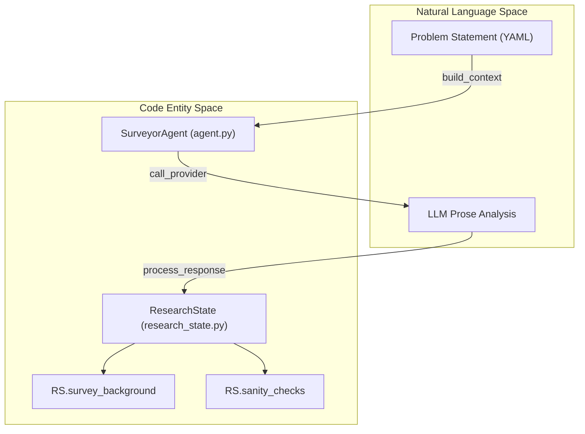
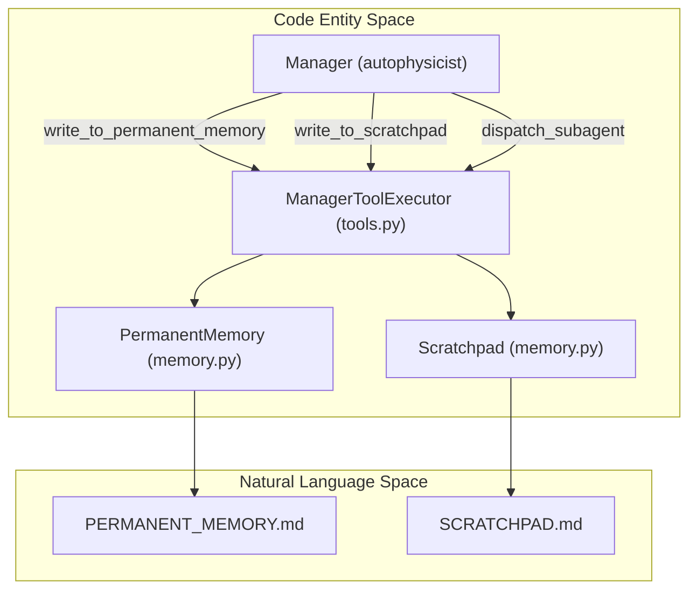

<!-- source: DeepWiki mcp.deepwiki.com · repo huggingface/physics-intern · page 3.4 Surveyor, Formatter, and Autophysicist · fetched 2026-10-26 -->

# Surveyor, Formatter, and Autophysicist

Relevant source files

The following files were used as context for generating this wiki page:

- [.claude/skills/investigate-autophysicist-run/SKILL.md](.claude/skills/investigate-autophysicist-run/SKILL.md)
- [scripts/run_critpt_physics_intern.py](scripts/run_critpt_physics_intern.py)
- [scripts/run_multiple_autophysicist.py](scripts/run_multiple_autophysicist.py)
- [src/physics_intern/agents/formatter/agent.py](src/physics_intern/agents/formatter/agent.py)
- [tests/test_autophysicist.py](tests/test_autophysicist.py)
- [tests/test_formatter.py](tests/test_formatter.py)
- [tests/test_planner.py](tests/test_planner.py)
- [tests/test_surveyor.py](tests/test_surveyor.py)

This page details three critical specialized components of the PhysicsIntern system: the **SurveyorAgent**, responsible for initial problem mapping; the **FormatterAgent**, which generates the final submission; and the **Autophysicist** mode, a standalone single-agent architecture with distinct memory systems.

## 1. SurveyorAgent: Landscape Mapping

The `SurveyorAgent` is the first agent invoked in the multi-agent research lifecycle [src/physics_intern/agents/surveyor/agent.py:11-13](). Its role is to perform a "background survey" of the physics problem, identifying key physical principles, potential pitfalls, and sanity checks before the `PlannerAgent` creates a formal strategy.

### Implementation and Data Flow
The Surveyor receives the raw problem statement and, in subsequent iterations (if re-surveying), a slimmed-down version of the research state [src/physics_intern/agents/surveyor/agent.py:38-51](). It outputs a structured analysis, often including a JSON block for programmatic extraction of pitfalls and sanity checks [src/physics_intern/agents/surveyor/agent.py:53-76]().

| Feature | Description |
| :--- | :--- |
| **Initial Context** | Includes only the `problem_statement` [tests/test_surveyor.py:32-42](). |
| **Re-plan Context** | Includes a "slim" state (one-liners for ERs/RQs, no derivations) to avoid context bloat [tests/test_surveyor.py:204-213](). |
| **Output Parsing** | Extracts `background`, `known_pitfalls`, and `sanity_checks` from LLM-generated JSON [tests/test_surveyor.py:126-154](). |

**Surveyor Data Flow**
The diagram below illustrates how the Surveyor bridges the gap between the raw problem text and the structured `ResearchState`.

Title: Surveyor Agent Entity Mapping

Sources: [src/physics_intern/agents/surveyor/agent.py:11-76](), [tests/test_surveyor.py:126-154]().

---

## 2. FormatterAgent: Answer Generation

The `FormatterAgent` transforms the accumulated `ResearchState` into a clean, standalone `ANSWER.md` [src/physics_intern/agents/formatter/agent.py:1-3](). It is responsible for adhering to the `answer_template` defined in the problem YAML.

### Rejection Handling and Template Injection
The Formatter has a unique "rejection" mechanism. If it determines the research state is insufficient to provide a complete answer, it emits a `FORMATTER_REJECTION:` prefix [src/physics_intern/agents/formatter/agent.py:21-21](). This prevents the system from committing a hallucinated or incomplete `ANSWER.md` to the workspace [src/physics_intern/agents/formatter/agent.py:72-97]().

Key functions include:
- `render_formatter_context`: Assembles a context containing only `established_results` (ERs) and `unresolved_items`, explicitly excluding working hypotheses (WHs) and strategy notes [tests/test_formatter.py:102-150]().
- `process_response`: Validates the LLM output. If it hits `max_tokens` or emits a rejection marker, it sets a `rejection_reason` instead of writing the file [src/physics_intern/agents/formatter/agent.py:80-97]().

Sources: [src/physics_intern/agents/formatter/agent.py:21-99](), [tests/test_formatter.py:102-150]().

---

## 3. Autophysicist: Single-Agent Mode

The **Autophysicist** is a distinct operational mode that collapses the multi-agent hierarchy into a single **Manager** agent that manages its own iterative loop [scripts/run_multiple_autophysicist.py:107-131](). Unlike the vanilla pipeline which uses a shared `ResearchState`, the Autophysicist relies on a dual-memory system.

### Dual Memory Architecture
The Autophysicist manages state through two Markdown-backed files:

1.  **Permanent Memory (`PERMANENT_MEMORY.md`)**: An append-only log for verified physical results and established facts [tests/test_autophysicist.py:20-32]().
2.  **Scratchpad (`SCRATCHPAD.md`)**: A rolling window of working notes. While the full history is saved to disk, the Manager only sees the last $N$ entries (the `window_size`) to prevent context overflow [tests/test_autophysicist.py:56-70]().

### Sub-agent Dispatch
The Manager agent uses a `dispatch_subagent` tool to delegate specific derivations or computations to ephemeral "sub-agents" [tests/test_autophysicist.py:137-164](). This allows the single-agent mode to still utilize code execution and analytical branching.

**Autophysicist System Architecture**
The following diagram maps the Autophysicist's conceptual memory to its implementation.

Title: Autophysicist Memory and Tool Mapping

Sources: [tests/test_autophysicist.py:20-103](), [tests/test_autophysicist.py:172-206](), [scripts/run_multiple_autophysicist.py:123-147]().

### Execution and Evaluation
Autophysicist runs are typically executed in batches using `run_multiple_autophysicist.py`, which tracks `pass@k` results by checking `VERIFICATION.md` in each generated workspace [scripts/run_multiple_autophysicist.py:1-10]().

Sources: [scripts/run_multiple_autophysicist.py:1-50](), [tests/test_autophysicist.py:1-206]().

---

