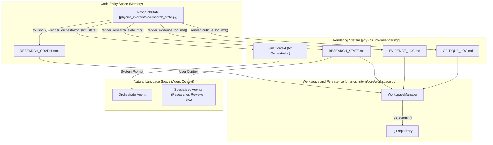
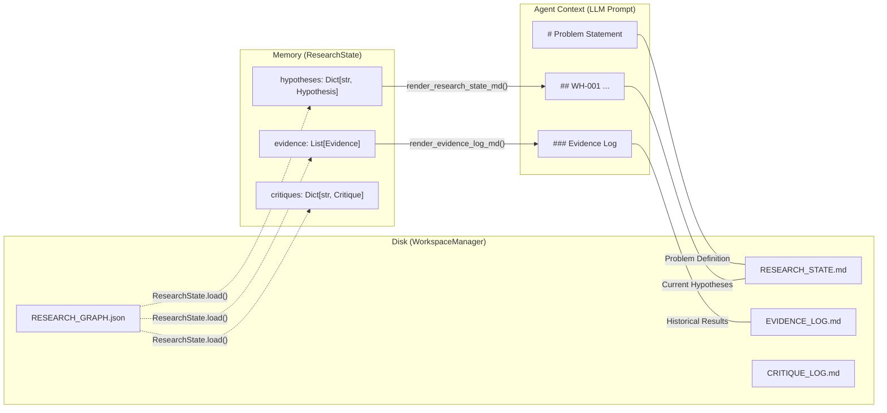

<!-- source: DeepWiki mcp.deepwiki.com · repo huggingface/physics-intern · page 4 State Rendering and Workspace · fetched 2026-10-26 -->

# State Rendering and Workspace

Relevant source files

The following files were used as context for generating this wiki page:

- [tests/test_orchestrator.py](tests/test_orchestrator.py)
- [tests/test_renderers.py](tests/test_renderers.py)
- [tests/test_research_state.py](tests/test_research_state.py)
- [tests/test_workspace.py](tests/test_workspace.py)

This section provides an overview of how the system's internal `ResearchState` is transformed into human-readable Markdown for agent consumption and how that state is persisted within a structured workspace. The interaction between the data model, the rendering engine, and the file system ensures that the research process is both observable by humans and resumable by the engine.

## Overview

The `ResearchState` serves as the single source of truth for a research session. To enable LLM agents to interact with this state, the system employs a **Rendering System** that converts complex Python objects (hypotheses, evidence, critiques) into structured Markdown. Simultaneously, a **Workspace Manager** handles the physical storage of these renderings and the underlying JSON data, providing a versioned history via Git.

### System Flow: From Objects to Disk

The following diagram illustrates how the `ResearchState` is processed into different views for agents and persisted to the file system.

**State Processing and Persistence Flow**

**Sources:** [physics_intern/state/research_state.py:181-217](), [physics_intern/core/workspace.py:7-161](), [physics_intern/rendering/__init__.py:1-15]() (inferred from imports in [tests/test_renderers.py:6-11]()).

---

## 4.1 Rendering System

The Rendering System is responsible for generating the Markdown snapshots that define the "world view" for the agents. It manages the complexity of the `ResearchState` by filtering and formatting data based on the specific needs of the agent role.

### Key Rendering Functions
*   **`render_research_state_md`**: Produces the primary `RESEARCH_STATE.md` file, including the problem statement, conventions, and the list of Working Hypotheses (WH) and Established Results (ER) [tests/test_renderers.py:181-215]().
*   **`render_orchestrator_slim_state`**: A specialized, high-level summary used by the `OrchestratorAgent` to maintain a strategic overview without being overwhelmed by technical derivations [tests/test_renderers.py:17-17]().
*   **Truncation Strategies**: To fit within LLM context windows, the system implements logic to tail logs (e.g., `EVIDENCE_LOG.md`) or filter research notes to the most recent iterations [tests/test_orchestrator.py:167-176]().

For details on all rendering functions and context construction, see [Rendering System](#4.1).

**Sources:** [tests/test_renderers.py:5-31](), [tests/test_orchestrator.py:167-176]().

---

## 4.2 Workspace and Persistence

The `WorkspaceManager` encapsulates all file I/O and version control operations. It ensures that every iteration of the research loop is recorded, allowing for auditability and the ability to resume interrupted sessions.

### Workspace Structure
When initialized via `WorkspaceManager.init()`, the system creates a structured directory:
*   **`RESEARCH_GRAPH.json`**: The serialized `ResearchState` object [physics_intern/state/research_state.py:193-204]().
*   **Markdown Snapshots**: Human-readable versions of the state (`RESEARCH_STATE.md`, `EVIDENCE_LOG.md`, `CRITIQUE_LOG.md`) [tests/test_workspace.py:52-57]().
*   **Directories**: Dedicated folders for `computations/`, `derivations/`, and `logs/` [tests/test_workspace.py:45-50]().

### Version Control
The workspace is a Git-backed repository. After every major state change or agent iteration, the `WorkspaceManager.git_commit()` method is called to create a snapshot of the entire workspace [tests/test_workspace.py:142-152]().

For details on directory structures, Git integration, and resume logic, see [Workspace and Persistence](#4.2).

**Sources:** [physics_intern/core/workspace.py:7-161](), [tests/test_workspace.py:30-62]().

---

## Workspace-to-Agent Data Mapping

This diagram bridges the physical files in the workspace to the logical entities used by the agents during an execution cycle.

**Workspace to Agent Mapping**

**Sources:** [physics_intern/state/research_state.py:193-204](), [tests/test_renderers.py:181-215](), [tests/test_workspace.py:52-57]().

---

