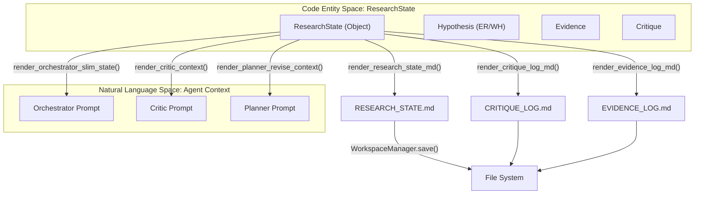
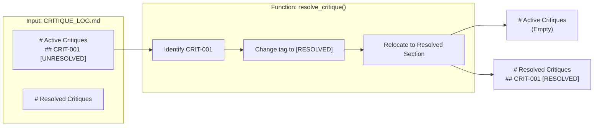

<!-- source: DeepWiki mcp.deepwiki.com · repo huggingface/physics-intern · page 4.1 Rendering System · fetched 2026-10-26 -->

# Rendering System

Relevant source files

The following files were used as context for generating this wiki page:

- [tests/test_markdown.py](tests/test_markdown.py)
- [tests/test_orchestrator.py](tests/test_orchestrator.py)
- [tests/test_renderers.py](tests/test_renderers.py)
- [tests/test_research_state.py](tests/test_research_state.py)

The Rendering System is responsible for transforming the structured data within `ResearchState` and other log entities into human-readable Markdown. These representations serve two primary purposes: providing persistent snapshots for the user/workspace and constructing the context window for LLM agents.

## Core Rendering Architecture

The system distinguishes between **Snapshot Rendering** (full state persistence) and **Context Rendering** (tailored, often truncated views for specific agent roles).

### Snapshot Rendering
Snapshot functions generate the comprehensive Markdown files found in the workspace, such as `RESEARCH_STATE.md`, `EVIDENCE_LOG.md`, and `CRITIQUE_LOG.md`.

*   **`render_research_state_md(state: ResearchState)`**: The primary renderer for the global state. It includes YAML frontmatter with metadata (title, iteration, status), the problem statement, conventions, and a categorized list of hypotheses [physics_intern/rendering.py:9-11]().
    *   **Ordering**: Established Results (ER) are always rendered before Working Hypotheses (WH) [tests/test_renderers.py:200-204]().
    *   **Hypothesis Details**: Each hypothesis includes its statement, derivation, evidence summaries, and any review verdicts [tests/test_renderers.py:60-81]().
*   **`render_evidence_log_md(state: ResearchState)`**: Generates a chronological log of all evidence collected across all hypotheses [physics_intern/rendering.py:9]().
*   **`render_critique_log_md(state: ResearchState)`**: Produces a categorized view of critiques, separated into `# Active Critiques` and `# Resolved Critiques` [tests/test_markdown.py:123-125]().

### Context Rendering
Context renderers prepare specific subsets of the state to fit within agent context windows, often applying truncation or "slim" formatting to conserve tokens.

*   **`render_orchestrator_slim_state(state: ResearchState)`**: Used by the `OrchestratorAgent`. It provides a high-level overview of hypotheses and their status without full derivations, allowing the orchestrator to maintain a "birds-eye view" of the research graph [tests/test_renderers.py:17]().
*   **`render_planner_revise_context(state: ResearchState)`**: Specifically formatted for the `PlannerAgent` to assist in strategy revision [tests/test_renderers.py:18]().
*   **`render_critic_context(state: ResearchState)`**: Provides the `CriticAgent` with the necessary depth to audit the current logic, including previous critiques and failed approaches [tests/test_renderers.py:12-15]().

Sources: [physics_intern/rendering.py:1-15](), [tests/test_renderers.py:1-32](), [tests/test_markdown.py:117-125]()

## Data Flow: State to Markdown

The following diagram illustrates how the `ResearchState` object is processed by different rendering functions to populate the agent's prompt and the workspace files.

### Rendering Pipeline Diagram
Title: ResearchState Rendering and Dispatch

Sources: [physics_intern/rendering.py:1-15](), [physics_intern/state/research_state.py:52-58](), [tests/test_renderers.py:182-215]()

## Truncation and Context Management

To prevent context window overflow, the rendering system employs several strategies to limit the size of the generated Markdown.

### Truncation Strategies
*   **Tail Entries**: The `tail_entries(text, n)` utility is used to keep only the `n` most recent entries in logs (e.g., the last 5 iterations of research notes) [tests/test_markdown.py:62-64](), [tests/test_orchestrator.py:169-174]().
*   **Slim Hypotheses**: The orchestrator context omits full derivations and detailed evidence blocks, focusing instead on the `id`, `status`, and `statement` [tests/test_renderers.py:17]().
*   **Filtered Notes**: Research notes are filtered to only include the last 5 iterations in the orchestrator's view [tests/test_orchestrator.py:169-174]().

### Context Suffixes and Banners
The `OrchestratorAgent` uses a `context_suffix` to inject transient information (like the results of the most recent tool execution) into the prompt. This suffix is appended after the rendered research state and is cleared after a single use [tests/test_orchestrator.py:134-152]().

*   **`context_suffix` Placement**: Appears after the `<strategy>` and `research-notes` sections [tests/test_orchestrator.py:142-163]().
*   **Convention Reminders**: If the `Conventions` section is empty, a "REMINDER" banner is automatically injected into the context starting at iteration 3 to prompt the agent to define units and signatures [tests/test_orchestrator.py:67-72]().

Sources: [tests/test_markdown.py:62-75](), [tests/test_orchestrator.py:134-174](), [tests/test_renderers.py:17-18]()

## Markdown Utility Functions

The system relies on a set of robust parsing and manipulation utilities in `physics_intern.utils.markdown` to manage Markdown content without full object serialization.

| Function | Purpose |
| :--- | :--- |
| `parse_frontmatter` | Extracts YAML metadata and body text from a Markdown string [tests/test_markdown.py:30-32](). |
| `extract_section_by_id` | Retrieves a specific `## ID` section (e.g., `CRIT-001`) from a larger log file [tests/test_markdown.py:76-78](). |
| `insert_into_active_critiques` | Appends a new critique into the `# Active Critiques` section of the log [tests/test_markdown.py:117-120](). |
| `resolve_critique` | Moves a critique from `# Active` to `# Resolved` and updates its status to `[RESOLVED]` [tests/test_markdown.py:144-154](). |
| `count_unresolved_critiques` | Scans a log for the `[UNRESOLVED]` tag to update metadata counts [tests/test_markdown.py:89-91](). |

### Critique Resolution Flow
Title: Markdown Transformation Logic

Sources: [tests/test_markdown.py:144-160](), [tests/test_markdown.py:205-225]()

---

