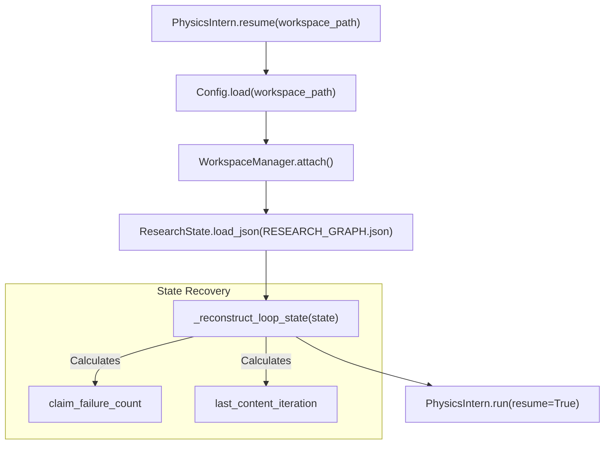
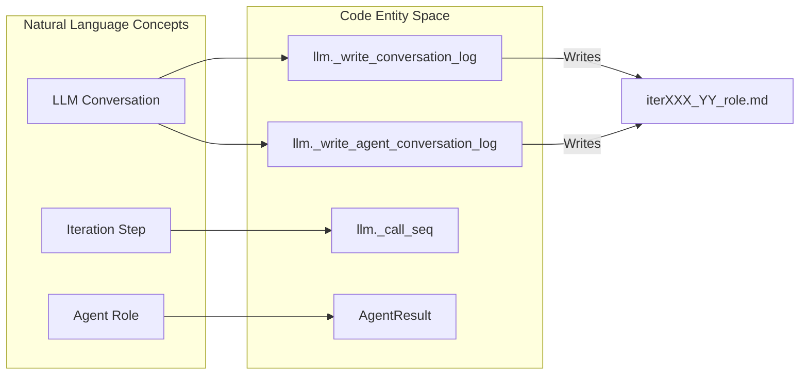
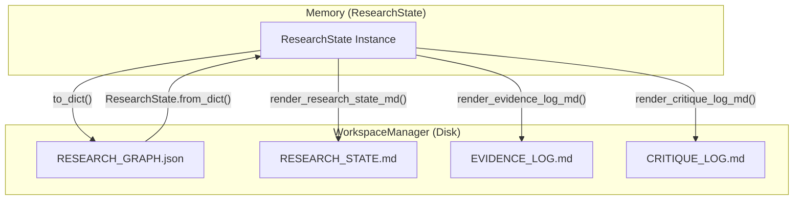

<!-- source: DeepWiki mcp.deepwiki.com · repo huggingface/physics-intern · page 4.2 Workspace and Persistence · fetched 2026-10-26 -->

# Workspace and Persistence

Relevant source files

The following files were used as context for generating this wiki page:

- [tests/test_conversation_log.py](tests/test_conversation_log.py)
- [tests/test_resume.py](tests/test_resume.py)
- [tests/test_workspace.py](tests/test_workspace.py)

The **Workspace and Persistence** layer manages the physical storage, versioning, and reconstruction of the research process. It ensures that the `ResearchState` is synchronized with human-readable Markdown snapshots and structured JSON data, while providing a Git-backed history for every iteration of the research lifecycle.

## WorkspaceManager

The `WorkspaceManager` is the primary interface for all filesystem operations. It creates a standardized directory structure and handles the persistence of both the internal state (`RESEARCH_GRAPH.json`) and the external logs used by agents.

### Initialization and Structure
When a new research task begins, `WorkspaceManager.init` creates a root directory containing several subdirectories and core files [physics_intern/core/workspace.py:74-106]().

| Directory / File | Description |
| :--- | :--- |
| `computations/` | Storage for code execution artifacts and data files [physics_intern/core/workspace.py:100-100](). |
| `derivations/` | Analytical derivations produced by the `ResearcherAgent` [physics_intern/core/workspace.py:101-101](). |
| `logs/` | Detailed conversation logs for every LLM call [physics_intern/core/workspace.py:102-102](). |
| `RESEARCH_STATE.md` | A Markdown snapshot of all Hypotheses (WH/ER) and Research Questions (RQ) [physics_intern/core/workspace.py:126-126](). |
| `EVIDENCE_LOG.md` | A chronological log of all evidence gathered [physics_intern/core/workspace.py:133-133](). |
| `CRITIQUE_LOG.md` | A chronological log of all critiques and strategic audits [physics_intern/core/workspace.py:134-134](). |
| `EVENT_LOG.jsonl` | A structured stream of all system events for metrics and debugging [physics_intern/core/workspace.py:135-135](). |

### Git Integration
Every workspace is initialized as a Git repository [physics_intern/core/workspace.py:104-105](). After each iteration of the engine loop, the `WorkspaceManager.git_commit` method is called to snapshot the current state of the filesystem [physics_intern/core/workspace.py:228-245](). This provides a granular history of how the research evolved and allows for auditing the state at any point in time.

**Sources:**
- [physics_intern/core/workspace.py:74-106]() (init)
- [physics_intern/core/workspace.py:228-245]() (git_commit)
- [tests/test_workspace.py:45-63]() (directory structure verification)

---

## State Persistence and Resume Logic

PhysicsIntern supports resuming interrupted runs by reconstructing the `ResearchState` and `LoopState` from the workspace.

### Structured Persistence: RESEARCH_GRAPH.json
While Markdown files are for agent consumption, the `RESEARCH_GRAPH.json` file serves as the ground truth for the `ResearchState` object. It contains the full serialization of all hypotheses, evidence, and research questions [physics_intern/engine.py:236-236]().

### Configuration Persistence: config.json
The `Config` object is saved to the workspace as `config.json` [physics_intern/core/config.py:186-200](). To prevent security leaks, sensitive fields like `api_key` are excluded from the saved file [tests/test_resume.py:46-53](). When resuming, the system loads this configuration and applies any CLI overrides provided by the user [tests/test_resume.py:40-44]().

### LoopState Reconstruction
When a run is resumed via `PhysicsIntern.resume`, the system does not just load the `ResearchState`; it must also reconstruct the transient `LoopState`. The function `_reconstruct_loop_state` scans the `ResearchState` to rebuild:
- **Claim Failure Counts:** How many times a specific `WH` has been refuted [tests/test_resume.py:120-142]().
- **Last Content Iteration:** The highest iteration number found in any evidence or review [tests/test_resume.py:143-162]().
- **Pending Buffers:** Re-initializing violation and termination blocker lists [tests/test_resume.py:163-172]().

**Workspace Resume Flow**

**Sources:**
- [physics_intern/engine.py:118-142]() (resume method)
- [physics_intern/core/config.py:186-218]() (save/load config)
- [tests/test_resume.py:120-172]() (loop state reconstruction logic)

---

## Logging and Observability

### Event Logging (EVENT_LOG.jsonl)
The `EVENT_LOG.jsonl` file records high-level transitions and tool executions. This is used for generating `METRICS.md` and for post-run analysis.

### Conversation Logging
Every interaction with an LLM is logged as a separate Markdown file in the `logs/` directory. These files are named using the pattern `iter{iteration}_{sequence}_{agent}.md` (e.g., `iter003_01_researcher.md`) [tests/test_conversation_log.py:27-39]().

For tool-using agents (Researcher, Computer), the log includes:
- The system and user prompts.
- The multi-round "thought" process.
- The specific code executed in `execute_python` blocks [tests/test_conversation_log.py:180-215]().
- Token usage and duration for each round [tests/test_conversation_log.py:59-63]().

**Natural Language to Code Entity Mapping: Logging**

**Sources:**
- [tests/test_conversation_log.py:27-82]() (file naming and content)
- [tests/test_conversation_log.py:127-215]() (multi-round tool logging)

---

## File I/O Operations

The `WorkspaceManager` provides abstracted I/O methods to ensure all paths are relative to the workspace root and that intermediate directories are created automatically.

| Method | Role |
| :--- | :--- |
| `write_file(path, content)` | Writes string content and creates subdirectories if needed [tests/test_workspace.py:111-114](). |
| `read_file(path)` | Returns file content or an empty string if the file is missing [tests/test_workspace.py:75-78](). |
| `append_file(path, content)` | Appends to an existing file [tests/test_workspace.py:79-83](). |
| `read_file_tail(path, n_entries)` | Specifically used to read the last `N` sections (delimited by `##`) of a log file [tests/test_workspace.py:123-130](). |

**Data Flow: State Synchronization**

**Sources:**
- [physics_intern/core/workspace.py:145-195]() (file I/O implementation)
- [tests/test_workspace.py:69-114]() (I/O behavior tests)
- [tests/test_workspace.py:122-135]() (tail reading logic)

---

