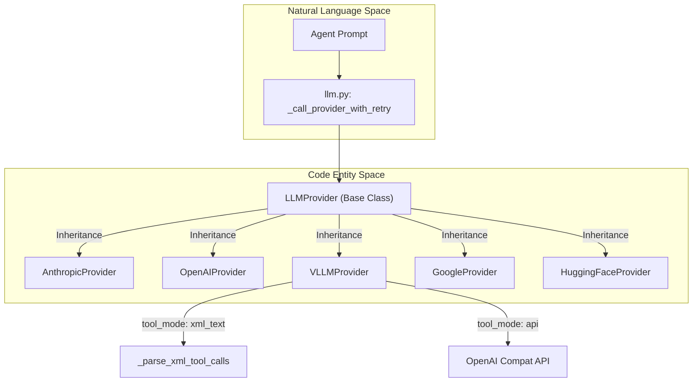
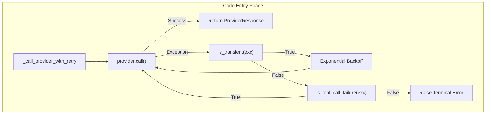

<!-- source: DeepWiki mcp.deepwiki.com · repo huggingface/physics-intern · page 5 LLM Provider Layer · fetched 2026-10-26 -->

# LLM Provider Layer

Relevant source files

The following files were used as context for generating this wiki page:

- [src/physics_intern/providers/vllm.py](src/physics_intern/providers/vllm.py)
- [tests/test_config.py](tests/test_config.py)
- [tests/test_llm_retry.py](tests/test_llm_retry.py)
- [tests/test_vllm_provider.py](tests/test_vllm_provider.py)

The **LLM Provider Layer** serves as the abstraction interface between the PhysicsIntern multi-agent system and various Large Language Model (LLM) backends. It provides a unified API for message passing, tool invocation, and reasoning token extraction, ensuring that the core engine logic remains agnostic to the specific provider (e.g., Anthropic, OpenAI, or local vLLM instances).

## Provider Abstraction

The system uses a base `LLMProvider` class to define the contract for all backend adapters. This abstraction handles the translation of canonical message formats into provider-specific payloads and normalizes responses (including usage statistics and finish reasons) back into a standard `ProviderResponse` object [[src/physics_intern/providers/base.py:15-28]]().

### Key Responsibilities
*   **Message Normalization**: Converting system, user, and assistant turns into the specific schemas required by different SDKs [[src/physics_intern/providers/base.py:31-32]]().
*   **Tool Calling Modes**: Supporting both structured API tool calling (standard OpenAI/Anthropic paths) and text-based XML tool calling (used for models like Nemotron or GLM via vLLM) [[src/physics_intern/providers/vllm.py:3-18]]().
*   **Reasoning Handling**: Extracting "thought" or "reasoning" tokens from models that support internal chain-of-thought (e.g., DeepSeek, OpenAI o1/o3) and making them available for logging without polluting the final output [[src/physics_intern/providers/base.py:29-30]]().

### LLM Provider Hierarchy
The following diagram illustrates the relationship between the core `llm.py` entry point and the specific provider implementations.

**Provider Architecture**

Sources: [src/physics_intern/llm.py:8-15](), [src/physics_intern/providers/base.py:67-75](), [src/physics_intern/providers/vllm.py:67-86]()

For details on specific adapter logic and tool-calling implementations, see [Provider Implementations](#5.1).

## Retry and Error Infrastructure

Robustness is maintained through a centralized retry pipeline, `_call_provider_with_retry`, which wraps all LLM interactions. This layer distinguishes between transient network issues, rate limits, and structural failures (like malformed tool arguments) to decide whether to attempt a re-call or propagate the error to the agent loop [[src/physics_intern/llm.py:8-15]().

### Error Classification
The system categorizes exceptions into three primary groups to manage recovery:
1.  **Transient Errors**: HTTP 429 (Rate Limit), 5xx (Server Error), and connection timeouts. These trigger exponential backoff [[tests/test_llm_retry.py:80-109]]().
2.  **Tool-Call Failures**: Specifically identified 400 errors where the model generates invalid JSON for tool arguments. These are treated as transient to allow the model a second chance to "fix" its syntax [[tests/test_llm_retry.py:162-176]]().
3.  **Terminal Errors**: Authentication failures (401/403) or persistent 400 Bad Request errors that are not tool-related [[tests/test_llm_retry.py:111-127]]().

**Retry Pipeline Flow**

Sources: [src/physics_intern/llm.py:8-15](), [tests/test_llm_retry.py:9-14](), [tests/test_llm_retry.py:233-236]()

For details on backoff strategies and error classification logic, see [Retry and Error Handling](#5.2).

## Configuration and Registry

The behavior of the provider layer is governed by two primary configuration sources:
*   `config.default.yaml`: Sets system-wide defaults like `max_iterations` and `sympy_timeout_seconds` [[tests/test_config.py:31-44]]().
*   `models.yaml`: A registry defining the specific parameters for each model, including its provider class, `max_tokens`, and `tool_mode` [[tests/test_config.py:21-23]]().

The `Config` class resolves these values at runtime, allowing the orchestrator to switch models dynamically or adjust token budgets per agent [[tests/test_config.py:124-138]]().

---
**Child Pages:**
*   [Provider Implementations](#5.1) — Detailed look at `LLMProvider` subclasses, XML parsing for vLLM, and reasoning token management.
*   [Retry and Error Handling](#5.2) — Deep dive into the retry pipeline, error classifiers, and exponential backoff implementation.

---

