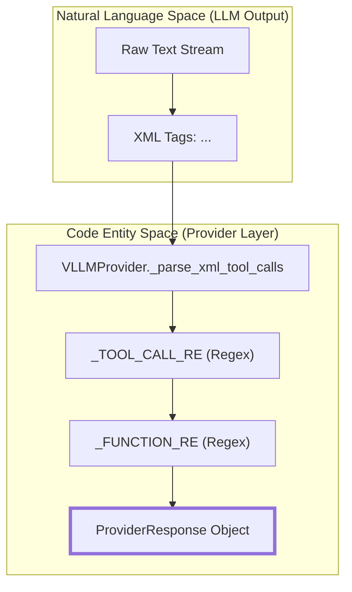
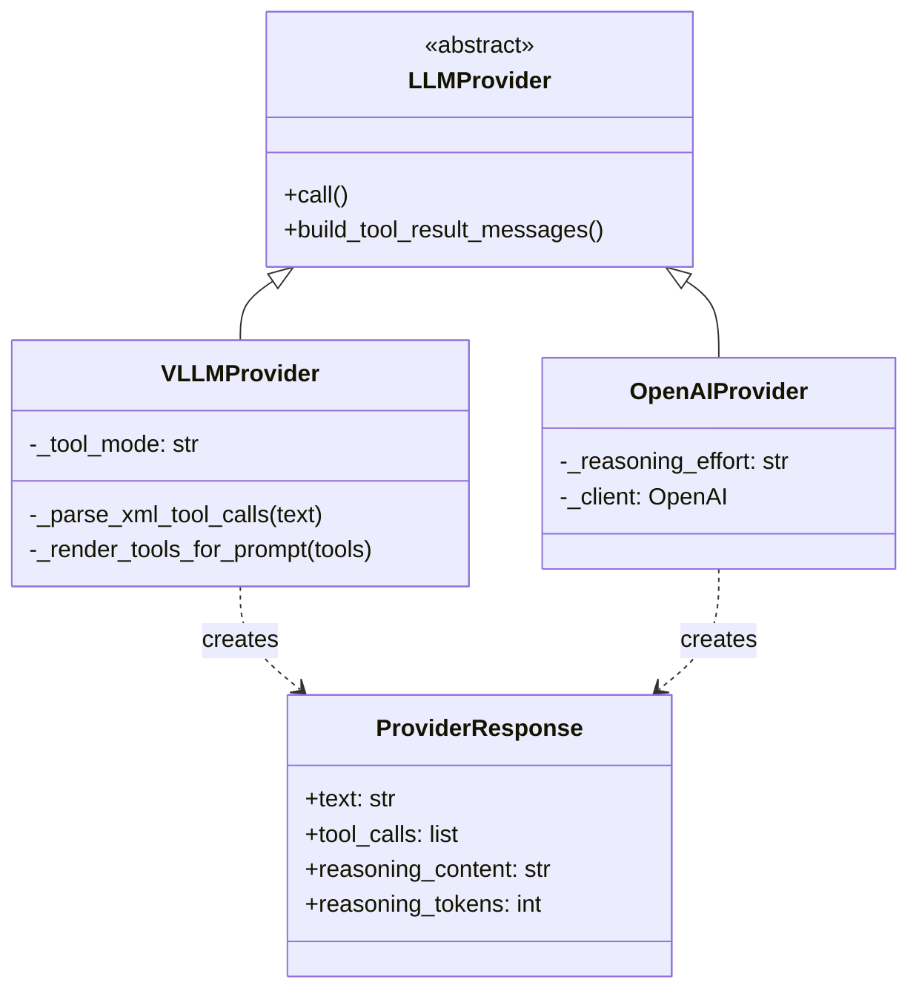

<!-- source: DeepWiki mcp.deepwiki.com · repo huggingface/physics-intern · page 5.1 Provider Implementations · fetched 2026-10-26 -->

# Provider Implementations

Relevant source files

The following files were used as context for generating this wiki page:

- [src/physics_intern/providers/vllm.py](src/physics_intern/providers/vllm.py)
- [tests/test_llm_retry.py](tests/test_llm_retry.py)
- [tests/test_openai_provider.py](tests/test_openai_provider.py)
- [tests/test_provider_smoke.py](tests/test_provider_smoke.py)
- [tests/test_reasoning_tokens.py](tests/test_reasoning_tokens.py)
- [tests/test_vllm_provider.py](tests/test_vllm_provider.py)

The Provider layer in PhysicsIntern serves as a unified abstraction over multiple LLM backends. It handles the complexities of different API schemas, tool-calling protocols (structured vs. text-based), and the extraction of reasoning tokens. This layer ensures that the core `Engine` and `BaseAgent` classes can interact with models from Anthropic, OpenAI, Google, and local vLLM deployments using a consistent interface.

## LLMProvider Base Class

All provider implementations inherit from the `LLMProvider` abstract base class. This class defines the interface for making calls, handling tool results, and managing conversation history formatting.

### Core Interface
- `call(...)`: The primary entry point for generating completions. It accepts system prompts, messages, and tool definitions, returning a `ProviderResponse` [src/physics_intern/providers/base.py:108-142]().
- `build_tool_result_messages(...)`: Converts tool execution outputs into the specific message format required by the provider for the next turn [src/physics_intern/providers/base.py:144-161]().

### ProviderResponse Data Model
The `ProviderResponse` dataclass standardizes the output across all backends:
- `text`: The final generated content (stripped of reasoning tags) [src/physics_intern/providers/base.py:21-22]().
- `tool_calls`: A list of normalized tool call dictionaries [src/physics_intern/providers/base.py:24]().
- `reasoning_content`: Raw reasoning/thought tokens if provided by the model [src/physics_intern/providers/base.py:25]().
- `reasoning_tokens` / `answer_tokens`: Token counts split between hidden reasoning and visible output [src/physics_intern/providers/base.py:28-29]().

Sources: [src/physics_intern/providers/base.py:17-105](), [src/physics_intern/providers/base.py:108-161]()

## Supported Adapters

PhysicsIntern provides specialized adapters for major LLM providers.

| Provider | Adapter Class | Key Features |
| :--- | :--- | :--- |
| **Anthropic** | `AnthropicProvider` | Native `thinking` block support via `reasoning_budget`. |
| **OpenAI** | `OpenAIProvider` | Supports `reasoning_effort` for o1/o3 models and the Responses API. |
| **Google** | `GoogleProvider` | Gemini-specific `thinking_level` and tool configuration. |
| **vLLM** | `VLLMProvider` | Dual-mode tool calling (API vs. XML) for local models like Nemotron. |
| **HuggingFace** | `HFProvider` | Integration with Inference Endpoints and TGI. |

Sources: [src/physics_intern/providers/vllm.py:67-86](), [tests/test_provider_smoke.py:44-133]()

## Tool-Calling Modes

The system supports two distinct methods for agents to invoke tools, primarily managed within the `VLLMProvider`.

### 1. API Mode (`tool_mode: api`)
The standard approach where tool definitions are passed as structured JSON to the model's API. The model returns structured `tool_calls` deltas [src/physics_intern/providers/vllm.py:6-9]().

### 2. XML Text Mode (`tool_mode: xml_text`)
Used for models (like Nemotron-340B) that perform better with text-based XML conventions.
- **Prompt Injection**: Tool definitions are rendered as a Markdown-formatted list in the system prompt using `_render_tools_for_prompt` [src/physics_intern/providers/vllm.py:113-156]().
- **Response Parsing**: The model emits `<tool_call>` tags. The provider uses regex (`_TOOL_CALL_RE`, `_FUNCTION_RE`, `_PARAMETER_RE`) to extract the function name and arguments [src/physics_intern/providers/vllm.py:37-49](), [src/physics_intern/providers/vllm.py:162-205]().

### Provider Data Flow: Text-to-Entity Mapping

This diagram illustrates how raw LLM output is transformed into code entities within the provider layer.

**Logic Flow: LLM Output to Normalized Tool Calls**

Sources: [src/physics_intern/providers/vllm.py:37-49](), [src/physics_intern/providers/vllm.py:162-205](), [tests/test_vllm_provider.py:45-138]()

## Reasoning Token Handling

PhysicsIntern meticulously tracks reasoning tokens to monitor agent "thought" budgets.

- **Native Extraction**: For providers like Anthropic or OpenAI, reasoning tokens are extracted directly from the API usage metadata [tests/test_openai_provider.py:13-18]().
- **Heuristic Estimation**: When models emit reasoning within the text (e.g., inside `<think>` tags), the system uses `estimate_reasoning_tokens` which applies a 1.3x word-to-token multiplier [tests/test_reasoning_tokens.py:14-46]().
- **Tag Stripping**: The `strip_think_tags` function ensures that the hidden reasoning content does not pollute the `text` field used for state rendering [src/physics_intern/providers/base.py:270-286]().

Sources: [src/physics_intern/providers/base.py:231-268](), [tests/test_reasoning_tokens.py:1-120]()

## Argument Sanitization

To prevent execution failures, providers perform sanitization on tool arguments before they reach the `ToolExecutor`.

- **JSON Recovery**: In XML mode, `VLLMProvider` attempts to `json.loads` parameter values. If parsing fails, it falls back to treating the value as a raw string [src/physics_intern/providers/vllm.py:183-189]().
- **OpenAI Flat Schema**: The `OpenAIProvider` transforms standard nested tool definitions into the flat schema required by the OpenAI Responses API [tests/test_openai_provider.py:116-133]().

### Provider Implementation Structure

**Entity Relationship: Provider Adapters and Base Class**

Sources: [src/physics_intern/providers/base.py:17-105](), [src/physics_intern/providers/vllm.py:67-108](), [src/physics_intern/providers/openai.py:5-10]() (implied structure)

## Retry and Error Classification

The provider layer includes a sophisticated retry pipeline (`_call_provider_with_retry`) that distinguishes between transient and fatal errors.

- **Transient Errors**: 429 (Rate Limit), 5xx (Server Error), Connection Timeouts, and specifically **Tool Call Failures** (e.g., malformed JSON from the model) are flagged for retry [tests/test_llm_retry.py:80-109](), [tests/test_llm_retry.py:233-236]().
- **Tool Call Failure Detection**: Regex and status code checks identify when a model failed to generate valid tool syntax, allowing the system to retry the generation [tests/test_llm_retry.py:162-230]().

Sources: [tests/test_llm_retry.py:8-15](), [tests/test_llm_retry.py:162-230]()

---

