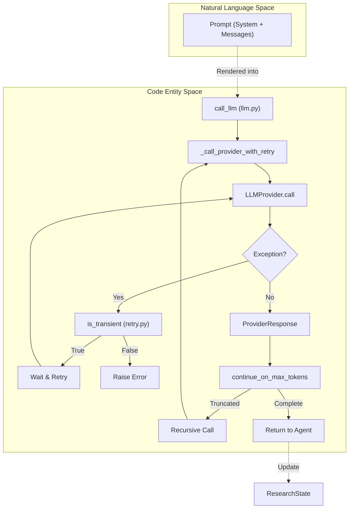
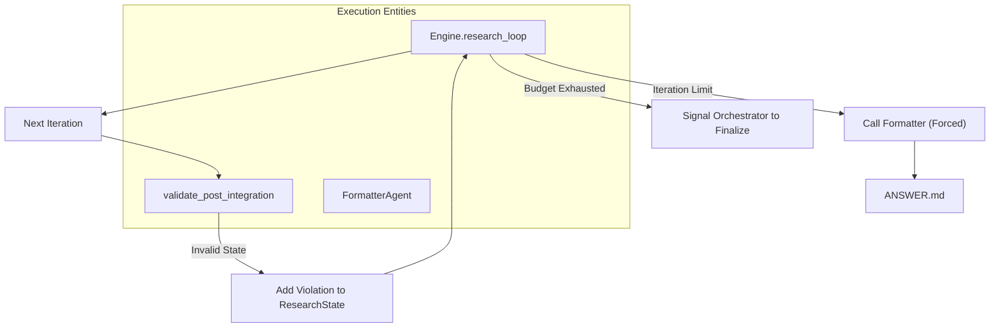

<!-- source: DeepWiki mcp.deepwiki.com · repo huggingface/physics-intern · page 5.2 Retry and Error Handling · fetched 2026-10-26 -->

# Retry and Error Handling

Relevant source files

The following files were used as context for generating this wiki page:

- [src/physics_intern/providers/vllm.py](src/physics_intern/providers/vllm.py)
- [tests/test_llm_retry.py](tests/test_llm_retry.py)
- [tests/test_max_tokens_retry.py](tests/test_max_tokens_retry.py)
- [tests/test_vllm_provider.py](tests/test_vllm_provider.py)

The PhysicsIntern system implements a multi-layered approach to robustness, ensuring that transient network issues, API rate limits, and LLM-specific generation failures (like token truncation or malformed tool calls) do not terminate a research trajectory prematurely.

## The Retry Pipeline

The primary entry point for LLM interactions is `_call_provider_with_retry` [src/physics_intern/llm.py:108-164](). This function wraps the lower-level provider calls in a retry loop governed by exponential backoff.

### Exponential Backoff Logic
The pipeline uses the following parameters from the `Config` object [src/physics_intern/core/config.py:15-113]():
*   `api_retry_max`: Total number of retry attempts (default: 8).
*   `api_retry_initial_delay`: Starting delay in seconds (default: 1.0).
*   `api_retry_max_delay`: Maximum delay cap (default: 60.0).

For each attempt, the delay is calculated as `initial_delay * (2 ** attempt_count)`, capped at `max_delay`.

### Error Classification
PhysicsIntern classifies exceptions into three categories to determine if a retry is warranted:

| Category | Description | Implementation |
| :--- | :--- | :--- |
| **Transient** | Network timeouts, connection resets, and 5xx server errors. | `is_transient` [src/physics_intern/providers/retry.py:112-146]() |
| **Tool-Call Failure** | Specific 400 errors where the model generated invalid JSON for a tool. | `is_tool_call_failure` [src/physics_intern/providers/retry.py:74-109]() |
| **Provider-Side 400** | Non-retryable client errors (Auth, Not Found, Invalid Prompt). | `is_provider_side_400` [src/physics_intern/providers/retry.py:54-71]() |

Sources: `src/physics_intern/llm.py:108-164`(), `src/physics_intern/providers/retry.py:1-146`(), `tests/test_llm_retry.py:80-130`()

## Data Flow: LLM Call to Response

The following diagram illustrates the relationship between the high-level `call_llm` interface, the retry logic, and the provider implementations.

**LLM Execution and Retry Flow**

Sources: `src/physics_intern/llm.py:46-105`(), `src/physics_intern/llm.py:108-164`(), `src/physics_intern/providers/retry.py:112-146`()

## Truncation and Continuation

A common failure mode in complex physics derivations is hitting the `max_tokens` limit. PhysicsIntern handles this via `continue_on_max_tokens` [src/physics_intern/llm.py:167-245]().

### Continuation Logic
If a `ProviderResponse` returns with `stop_reason == "max_tokens"`, the system:
1.  Strips any internal reasoning tags (e.g., `<think>`) from the partial output [src/physics_intern/llm.py:204-205]().
2.  Appends the partial assistant response to the message history.
3.  Injects a `CONTINUATION_PROMPT` ("... please continue directly from where you left off") [src/physics_intern/llm.py:14-14]().
4.  Recursively calls the provider to get the remainder of the text.
5.  Merges the results using `_merge_responses`, summing token counts and concatenating text [src/physics_intern/llm.py:248-278]().

### Constraints
*   **Tool Call Safety**: Continuation is disabled if the truncated response contains partial tool calls, as merging structured JSON across turns is error-prone [src/physics_intern/llm.py:188-191]().
*   **Empty Text**: If the model was truncated while still inside a reasoning block (producing no visible text), the continuation is skipped [src/physics_intern/llm.py:195-201]().

Sources: `src/physics_intern/llm.py:167-245`(), `tests/test_max_tokens_retry.py:69-174`()

## Agent Loop Graceful Degradation

The `Engine` manages higher-level failures within the `research_loop` [src/physics_intern/engine.py:126-177]().

### Integration Failures
When an agent returns a response, it is integrated into the `ResearchState`. If the response violates system constraints (e.g., malformed tool usage that bypassed provider-level retries), the engine logs a `Violation` [src/physics_intern/core/state.py:82-96]().
*   **Stall Detection**: If the orchestrator repeatedly fails to make progress or emits invalid tool calls, the engine detects a stall and can force a termination [src/physics_intern/engine.py:214-234]().

### Forced Final Calls
As the token budget or iteration limit approaches, the engine transitions from "Research" mode to "Finalize" mode.
1.  **Soft Exit**: The `OrchestratorAgent` is signaled to wrap up [src/physics_intern/agents/orchestrator.py:75-80]().
2.  **Forced Answer**: If the loop terminates without a final answer, the `FormatterAgent` is called with a "forced" flag, compelling it to generate the best possible `ANSWER.md` from the existing `ResearchState` evidence [src/physics_intern/agents/formatter.py:34-45]().

**Graceful Degradation Flow**

Sources: `src/physics_intern/engine.py:126-177`(), `src/physics_intern/core/state.py:695-720`(), `src/physics_intern/agents/formatter.py:34-45`()

## Provider-Specific Handling: vLLM and XML

The `VLLMProvider` implements specialized handling for `tool_mode: xml_text` [src/physics_intern/providers/vllm.py:11-18](). In this mode, tool calls are not structured API objects but XML tags within the text.

If the model produces malformed XML, the `_parse_xml_tool_calls` function [src/physics_intern/providers/vllm.py:163-207]() attempts to recover data. If parsing fails entirely, the error is bubbled up to `_call_provider_with_retry`, which may trigger a stochastic retry if the error matches `is_tool_call_failure` patterns like "Unterminated string" or "Invalid escape" [tests/test_llm_retry.py:181-228]().

Sources: `src/physics_intern/providers/vllm.py:163-207`(), `tests/test_vllm_provider.py:45-138`()

---

