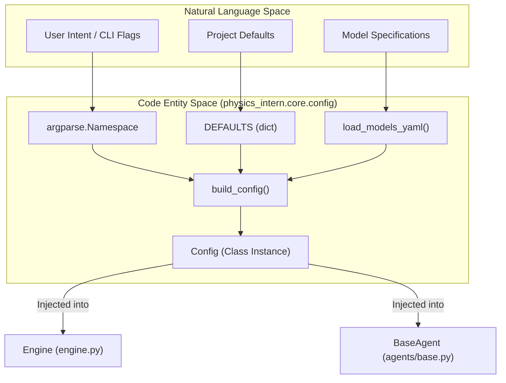
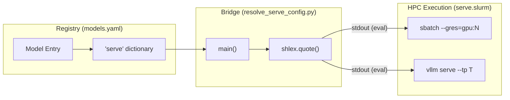

<!-- source: DeepWiki mcp.deepwiki.com · repo huggingface/physics-intern · page 6 Configuration and Model Registry · fetched 2026-10-26 -->

# Configuration and Model Registry

Relevant source files

The following files were used as context for generating this wiki page:

- [config.api.yaml](config.api.yaml)
- [scripts/run_critpt_two_steps.py](scripts/run_critpt_two_steps.py)
- [serve/resolve_serve_config.py](serve/resolve_serve_config.py)
- [src/physics_intern/models.yaml](src/physics_intern/models.yaml)
- [tests/test_config.py](tests/test_config.py)

The `PhysicsIntern` system employs a hierarchical configuration resolution strategy and a centralized model registry to manage agent parameters, LLM provider settings, and resource constraints. This system ensures that experimental settings can be defined at the global level, overridden per experiment via YAML, or specialized via CLI flags for rapid iteration.

## Configuration Resolution Hierarchy

The `Config` class serves as the single source of truth for runtime parameters [src/physics_intern/core/config.py:301-303](). It is populated through the `build_config` function, which resolves values using the following precedence (highest to lowest):

1.  **CLI Arguments**: Flags passed to the runner (e.g., `--model`, `--max-iterations`) [src/physics_intern/core/config.py:461-470]().
2.  **User Config YAML**: A local YAML file specified via `--config` [src/physics_intern/core/config.py:448-450]().
3.  **Default Config**: Hardcoded values defined in `DEFAULTS`, which are loaded from `config.default.yaml` [src/physics_intern/core/config.py:276-278]().
4.  **Model Registry**: Model-specific attributes (like `max_output_tokens`) are merged based on the selected model key [src/physics_intern/core/config.py:472-474]().

### Configuration Flow and Entity Mapping

The following diagram illustrates how natural language configuration concepts map to specific code entities and how data flows through the resolution pipeline.

**Configuration Resolution Data Flow**

Sources: [src/physics_intern/core/config.py:431-483](), [src/physics_intern/core/config.py:301-340]()

## The Model Registry (`models.yaml`)

The `models.yaml` file acts as a centralized registry for all supported LLM endpoints [src/physics_intern/models.yaml:1-5](). It maps "friendly" keys (e.g., `claude-4.6-sonnet`) to technical implementation details required by the provider layer.

### Registry Schema
Each entry in the registry defines:
*   **Provider**: The backend implementation (e.g., `anthropic`, `openai`, `google`, `vllm`) [src/physics_intern/models.yaml:21-21]().
*   **Model ID**: The actual string passed to the API [src/physics_intern/models.yaml:22-22]().
*   **Token Budgets**: `max_output_tokens` which dictates the per-agent response limit [src/physics_intern/models.yaml:26-26]().
*   **Cost Metrics**: `input_cost` and `output_cost` for financial tracking [src/physics_intern/models.yaml:24-25]().
*   **Special Features**: Flags like `thinking` (for Anthropic reasoning) or `reasoning_effort` (for OpenAI o-series) [src/physics_intern/models.yaml:17-18]().

### Per-Agent Token Budgets
While `Config.max_tokens` sets a global ceiling based on the model registry, individual agents use this value to manage their context. The `Config` class does not allow `max_tokens` to be overridden via user YAML to prevent misalignment with the model's physical capabilities [tests/test_config.py:200-202]().

Sources: [src/physics_intern/models.yaml:10-29](), [src/physics_intern/core/config.py:334-337]()

## SLURM Bridge and vLLM Integration

For high-performance computing (HPC) environments, the configuration system bridges local settings to SLURM cluster parameters via `serve/resolve_serve_config.py`.

### resolve_serve_config.py
This script extracts the `serve` sub-dictionary from `models.yaml` for a given model key [serve/resolve_serve_config.py:37-46](). It translates these into shell variables that `serve.slurm` uses to allocate resources.

| Variable | Source in `models.yaml` | Purpose |
| :--- | :--- | :--- |
| `DEFAULT_GPUS_PER_NODE` | `serve.gpus_per_node` | GPU allocation per SLURM task [serve/resolve_serve_config.py:58-58]() |
| `DEFAULT_TP` | `serve.tp` | Tensor Parallelism size [serve/resolve_serve_config.py:59-59]() |
| `DEFAULT_VLLM_ARGS` | `serve.vllm_args` | CLI flags for the vLLM server [serve/resolve_serve_config.py:63-63]() |
| `DEFAULT_REASONING_PARSER`| `serve.reasoning_parser` | Parser for `<think>` or XML tags [serve/resolve_serve_config.py:62-62]() |

**Model-to-Cluster Mapping**

Sources: [serve/resolve_serve_config.py:24-94](), [src/physics_intern/models.yaml:242-257]()

## Key Classes and Functions

### `Config` Class
Located in `src/physics_intern/core/config.py`, this class encapsulates all operational parameters.
*   **`max_iterations`**: Limits the engine's main loop [src/physics_intern/core/config.py:307-307]().
*   **`max_total_output_tokens`**: A global "circuit breaker" that stops the research if the cumulative output exceeds a threshold [src/physics_intern/core/config.py:318-318]().
*   **`stall_recompute_limit`**: Number of times the engine can retry an iteration if no state change is detected [tests/test_config.py:56-57]().

### `load_config_yaml(path)`
Loads a user-defined configuration file. It strictly validates keys against `_YAML_CONFIG_FIELDS` and issues warnings for unknown or forbidden keys (like `api_key` or `workspace_dir`) to ensure portability [src/physics_intern/core/config.py:404-428]().

### `build_config(args)`
The primary entry point for configuration construction. It performs the multi-stage merge and resolves the `max_tokens` from the registry based on the final selected model [src/physics_intern/core/config.py:431-483]().

Sources: [src/physics_intern/core/config.py:301-340](), [tests/test_config.py:86-94]()

---

