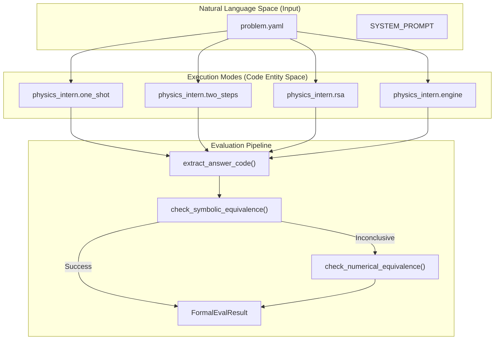
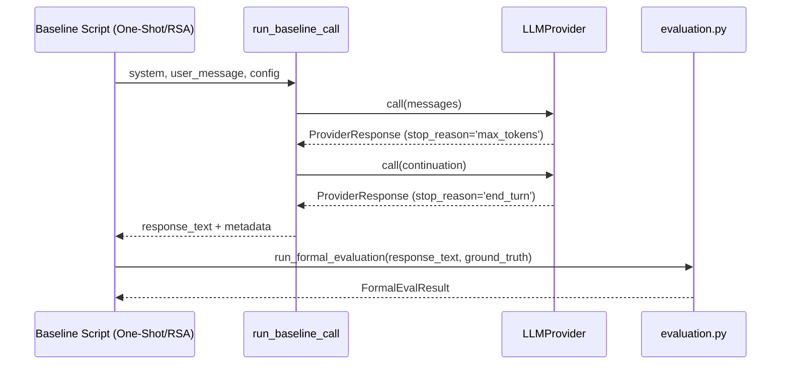

<!-- source: DeepWiki mcp.deepwiki.com · repo huggingface/physics-intern · page 7 Baseline Modes and Evaluation · fetched 2026-10-26 -->

# Baseline Modes and Evaluation

Relevant source files

The following files were used as context for generating this wiki page:

- [DOCUMENTATION.md](DOCUMENTATION.md)
- [tests/test_baselines_call.py](tests/test_baselines_call.py)
- [tests/test_baselines_prompts.py](tests/test_baselines_prompts.py)

This section provides an overview of the non-multi-agent execution modes (Baselines) and the unified evaluation framework used to verify scientific correctness across all operational modes in PhysicsIntern.

While the primary focus of the project is the multi-agent research loop, these baselines serve as critical benchmarks for measuring the performance gains provided by the agentic scaffolding. The evaluation system ensures that regardless of how a solution was generated—be it a single LLM call or a 50-iteration research cycle—the resulting answer is rigorously compared against ground truth using symbolic and numerical methods.

## Overview of Execution Modes

PhysicsIntern supports several execution modes ranging from zero-scaffold single calls to complex recursive aggregation strategies.

### One-Shot Baseline
The simplest execution mode, which performs a single LLM call using a standard system prompt. This mode is used to establish the "raw" capability of a model on the CritPt benchmark without any iterative reasoning or tool use.
For details, see [One-Shot, Two-Step, and RSA Baselines](#7.1).

### Two-Step Baseline
Mirrors the standard [CritPt benchmark](https://github.com/CriticalPathAI/benchmarks) procedure. The model is called twice: first to perform a derivation, and second to populate the specific Python answer template required by the problem definition.
For details, see [One-Shot, Two-Step, and RSA Baselines](#7.1).

### Recursive Self-Aggregation (RSA)
An advanced baseline that generates $N$ candidate solutions and then iteratively refines them over $T$ rounds. This mode tests if performance gains can be achieved through simple self-correction and majority-voting logic without the full agentic state machine.
For details, see [One-Shot, Two-Step, and RSA Baselines](#7.1).

### Autophysicist
A hybrid single-agent mode where a "Research Manager" manages its own memory (append-only permanent memory and a sliding-window scratchpad) and dispatches ephemeral sub-agents for specialized tasks.
For details, see [Surveyor, Formatter, and Autophysicist](#3.4).

## Evaluation Subsystem

The evaluation subsystem is responsible for determining if a generated answer is scientifically correct. It utilizes a cascade of checks, starting with exact symbolic matching and falling back to numerical tolerance tests.

### Formal Evaluation Flow
When a run terminates, the `run_formal_evaluation` function is invoked [physics_intern/evaluation.py:273-275](). This process involves:
1. **Answer Extraction**: Parsing the `ANSWER.md` or LLM response to find the Python code block containing the `answer()` function [physics_intern/evaluation.py:230-235]().
2. **Execution**: Running the extracted code in a sandbox to obtain the predicted value.
3. **Symbolic Comparison**: Using SymPy to check for mathematical equivalence between the prediction and the ground truth provided in the problem YAML [physics_intern/evaluation.py:115-120]().
4. **Numerical Fallback**: If symbolic comparison is inconclusive, the system evaluates the expressions numerically (often with constants like $\hbar, c, G$ substituted) and checks if they match within a defined relative tolerance [physics_intern/evaluation.py:175-180]().

For details, see [Answer Verification and Formal Evaluation](#7.2).

## Data Flow: From Execution to Evaluation

The following diagram illustrates how different execution modes feed into the unified evaluation pipeline.

### Baseline to Evaluation Mapping

**Sources:** [physics_intern/one_shot.py:1-20](), [physics_intern/two_steps.py:1-25](), [physics_intern/evaluation.py:273-310](), [physics_intern/baselines/prompts.py:3-10]()

## Baseline Call Infrastructure

All baselines utilize a shared calling utility, `run_baseline_call`, which wraps the `LLMProvider` to handle token tracking, cost calculation, and automatic continuation if a response is truncated due to `max_tokens`.

| Component | Responsibility | Code Reference |
| :--- | :--- | :--- |
| `run_baseline_call` | Standardized wrapper for single-turn LLM interactions. | [physics_intern/baselines/call.py:15-20]() |
| `continue_on_max_tokens` | Handles recursive calls to stitch together truncated LLM outputs. | [physics_intern/baselines/call.py:82-85]() |
| `SYSTEM_PROMPT` | The default scientific reasoning prompt used across baselines. | [physics_intern/baselines/prompts.py:7-15]() |
| `build_user_message` | Formats the problem text and answer template for the LLM. | [physics_intern/baselines/prompts.py:124-130]() |

### Baseline Execution Flow

**Sources:** [physics_intern/baselines/call.py:39-65](), [tests/test_baselines_call.py:32-65](), [physics_intern/evaluation.py:273-280]()

## Related Child Pages
* **[One-Shot, Two-Step, and RSA Baselines](#7.1)**: Detailed CLI arguments and internal logic for each baseline mode.
* **[Answer Verification and Formal Evaluation](#7.2)**: Deep dive into the SymPy comparison logic, numerical tolerances, and the `VERIFICATION.md` audit process.

**Sources:** [DOCUMENTATION.md:107-140](), [physics_intern/evaluation.py:1-50](), [physics_intern/baselines/call.py:1-30]()

---

