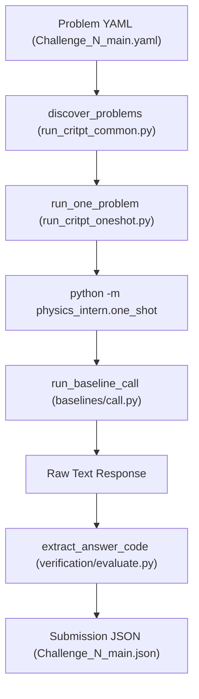
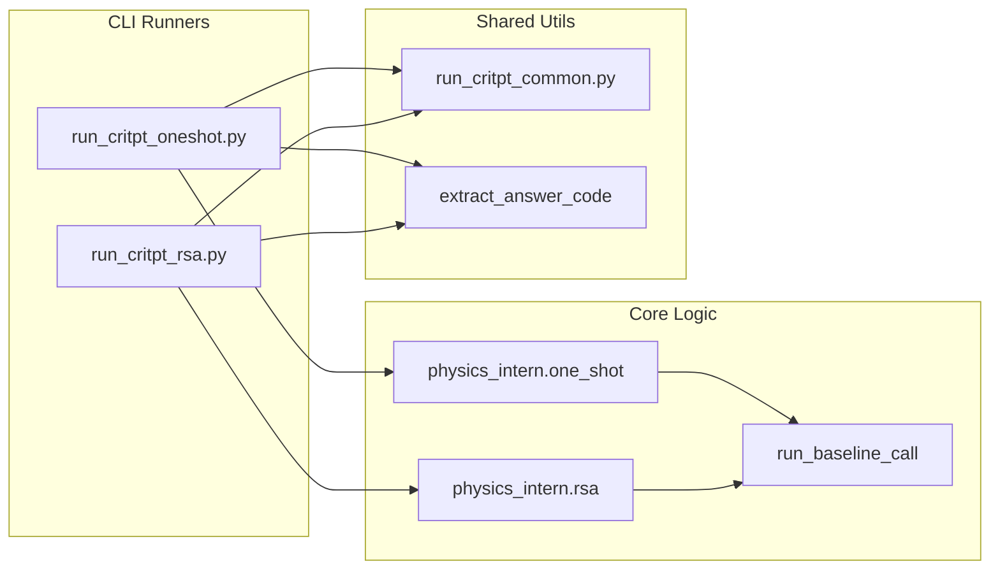

<!-- source: DeepWiki mcp.deepwiki.com · repo huggingface/physics-intern · page 7.1 One-Shot, Two-Step, and RSA Baselines · fetched 2026-10-26 -->

# One-Shot, Two-Step, and RSA Baselines

Relevant source files

The following files were used as context for generating this wiki page:

- [scripts/run_critpt_common.py](scripts/run_critpt_common.py)
- [scripts/run_critpt_oneshot.py](scripts/run_critpt_oneshot.py)
- [scripts/run_critpt_rsa.py](scripts/run_critpt_rsa.py)
- [tests/test_baselines_call.py](tests/test_baselines_call.py)
- [tests/test_baselines_prompts.py](tests/test_baselines_prompts.py)

This page details the non-multi-agent execution modes provided by the `physics-intern` codebase. These baselines serve as performance benchmarks against the full multi-agent research engine. They range from simple single-call completions to complex recursive self-aggregation strategies.

## Overview of Baseline Architectures

The baselines are implemented as standalone entry points that bypass the `ResearchState` and `Engine` loop used by the multi-agent system. Instead, they interact directly with the `LLMProvider` layer to generate solutions for physics problems defined in YAML format.

### Core Components
*   **`physics_intern.one_shot`**: A direct mapping of a problem description to an LLM completion.
*   **`physics_intern.two_steps`**: A sequential process where the model first derives a solution and then populates a specific code template.
*   **`physics_intern.rsa`**: Recursive Self-Aggregation, an advanced ensemble method that uses multiple candidates and iterative refinement.
*   **`run_baseline_call`**: A shared utility function that wraps provider calls with standardized logging, cost calculation, and truncation handling [tests/test_baselines_call.py:33-46]().

## One-Shot Baseline

The One-Shot baseline is the simplest execution mode. It constructs a single prompt containing the problem description and an optional answer template, then captures the model's response.

### Implementation Details
*   **Prompt Construction**: Uses `build_user_message` to combine the problem text with a Python code block if a template is provided [tests/test_baselines_prompts.py:25-31]().
*   **System Prompt**: Employs a specialized `SYSTEM_PROMPT` that instructs the model to use LaTeX for mathematical derivations [tests/test_baselines_prompts.py:10-13]().
*   **Execution**: The `run_critpt_oneshot.py` script manages parallel execution across the CritPt benchmark [scripts/run_critpt_oneshot.py:56-58]().

### Data Flow: One-Shot Execution
The following diagram illustrates the path from a YAML problem definition to the final submission JSON.

**One-Shot Baseline Data Flow**

Sources: [scripts/run_critpt_oneshot.py:153-162](), [scripts/run_critpt_common.py:95-112](), [tests/test_baselines_call.py:33-46]()

## Two-Step Baseline

The Two-Step baseline splits the reasoning and the formatting into distinct LLM calls. This is designed to prevent the model from losing derivation quality when forced to adhere to strict formatting constraints in a single pass.

1.  **Step 1: Derivation**: The model is asked to solve the physics problem in natural language/LaTeX.
2.  **Step 2: Formatting**: The derivation from Step 1 is fed back into the model along with the answer template to produce the final `answer()` function.

## RSA (Recursive Self-Aggregation)

RSA is a sophisticated baseline that implements a "Majority Voting" mechanism over multiple rounds. It is controlled by three parameters: $N$ (population size), $K$ (aggregation subset size), and $T$ (number of rounds).

### Key Features
*   **Parallel Candidates**: Generates $N$ independent solutions in the first round.
*   **Recursive Refinement**: In subsequent rounds, the model reviews $K$ candidates from the previous round to produce a refined version.
*   **Majority Vote**: The final answer is determined by identifying the most common numerical or symbolic result among the final $N$ candidates.

### RSA Execution Parameters
| Parameter | CLI Flag | Description | Default |
| :--- | :--- | :--- | :--- |
| Population Size | `-N` | Number of candidate solutions generated per round | 6 |
| Subset Size | `-K` | Number of previous solutions shown to the model for refinement | 2 |
| Rounds | `-T` | Number of recursive aggregation steps | 4 |

Sources: [scripts/run_critpt_rsa.py:72-78]()

## Batch Running and Parallelism

All baselines utilize a common infrastructure for running the CritPt benchmark at scale. The `run_critpt_common.py` module provides shared utilities for problem discovery and result persistence.

### Components of the Batch Runner
*   **Problem Discovery**: `discover_problems` scans the problems directory for YAML files matching the `Challenge_(\d+)_main\.yaml` pattern [scripts/run_critpt_common.py:100-105]().
*   **Concurrency Control**: Uses an `asyncio.Semaphore` to limit the number of simultaneous LLM calls or subprocesses [scripts/run_critpt_oneshot.py:152-153]().
*   **Resume Logic**: `find_completed_submissions` checks for existing `.json` files to avoid redundant work [scripts/run_critpt_common.py:185-190]().
*   **Metadata Tracking**: `batch_metadata.json` stores the configuration used for the run, including model keys and token costs [scripts/run_critpt_common.py:160-165]().

### Baseline System Mapping
The following diagram maps the logical baseline concepts to the specific Python entities and scripts that implement them.

**Baseline Implementation Map**

Sources: [scripts/run_critpt_oneshot.py:1-13](), [scripts/run_critpt_rsa.py:1-13](), [scripts/run_critpt_common.py:1-5](), [tests/test_baselines_call.py:5-7]()

## Performance and Cost Monitoring

The baselines include a best-effort parser for extracting token usage and costs from the stderr stream of the subprocesses.

*   **One-Shot Parser**: `_parse_stderr_stats` in the one-shot runner looks for "Input tokens", "Output tokens", and "Est. cost" [scripts/run_critpt_oneshot.py:121-136]().
*   **RSA Parser**: `_parse_stderr_stats` in the RSA runner handles the aggregated cost of $N \times T$ calls [scripts/run_critpt_rsa.py:131-158]().
*   **Cost Calculation**: Based on the `input_cost` and `output_cost` defined in the `Config` object, normalized per million tokens [tests/test_baselines_call.py:62-63]().

Sources: [scripts/run_critpt_oneshot.py:121-136](), [scripts/run_critpt_rsa.py:131-158](), [tests/test_baselines_call.py:62-63]()

---

