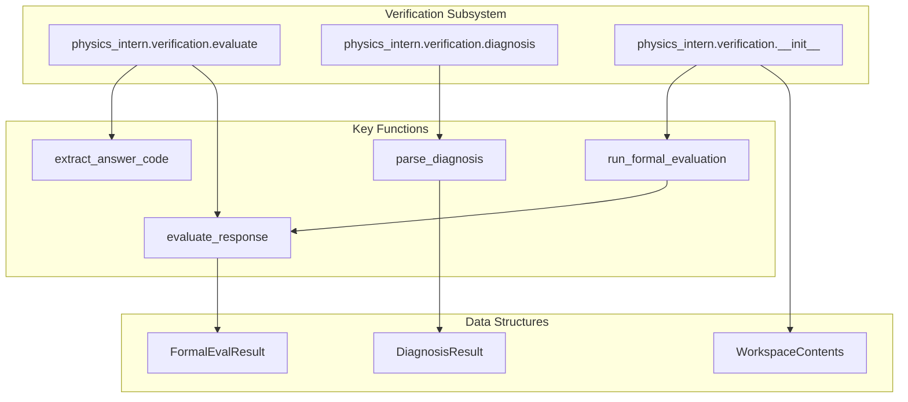
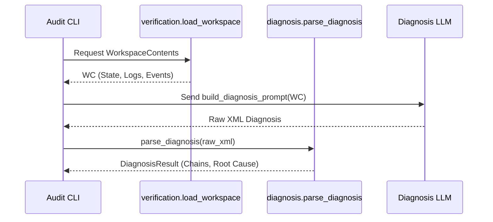

<!-- source: DeepWiki mcp.deepwiki.com · repo huggingface/physics-intern · page 7.2 Answer Verification and Formal Evaluation · fetched 2026-10-26 -->

# Answer Verification and Formal Evaluation

Relevant source files

The following files were used as context for generating this wiki page:

- [tests/test_evaluate.py](tests/test_evaluate.py)
- [tests/test_parsing.py](tests/test_parsing.py)
- [tests/test_verify.py](tests/test_verify.py)

The verification subsystem provides a robust, automated pipeline for determining the correctness of research outcomes. It bridges the gap between the natural language conclusions generated by agents (stored in `ANSWER.md`) and the ground-truth mathematical or numerical solutions defined in problem templates.

## Overview of Verification Pipeline

The verification process follows a multi-stage cascade that prioritizes symbolic mathematical equivalence via SymPy, falling back to numerical tolerance checks when symbolic simplification is inconclusive or inappropriate.

### Core Data Flow

1.  **Extraction**: The system identifies the final Python code block in a response (usually `ANSWER.md`) containing the `def answer(...)` function.
2.  **Execution**: The extracted code is executed within a controlled namespace to produce a candidate result.
3.  **Classification**: The candidate result is classified as either `numerical` or `symbolic`.
4.  **Comparison**:
    *   **Symbolic**: A sequence of SymPy strategies (simplification, ratio testing, trigonometric identity checks) is applied against the reference expression.
    *   **Numerical**: A relative tolerance check is performed.
5.  **Reporting**: Results are encapsulated in a `FormalEvalResult` object and recorded in the workspace.

### System Architecture: Verification and Diagnosis

The following diagram illustrates the relationship between the verification code entities and the evaluation lifecycle.

**Verification Entity Map**

Sources: `physics_intern/verification/evaluate.py`, `physics_intern/verification/__init__.py`, `physics_intern/verification/diagnosis.py`

## Implementation Details

### Answer Extraction
The system uses `extract_answer_code` to isolate the executable portion of the agent's final output. It specifically searches for Markdown code blocks tagged as `python` and selects the last block that contains the string `def answer` [tests/test_evaluate.py:18-46]().

### Symbolic Comparison Cascade
The `_compare_symbolic` function implements a hierarchy of comparison methods to handle the variety of ways a physics result can be expressed [tests/test_evaluate.py:125-199]():

| Strategy | Logic | Use Case |
| :--- | :--- | :--- |
| **Simplify** | `sp.simplify(candidate - reference) == 0` | Standard algebraic equivalence. |
| **Ratio** | `sp.simplify(candidate / reference) == 1` | Complex expressions where subtraction doesn't simplify easily. |
| **Equals** | `candidate.equals(reference)` | Fallback for trigonometric and special function identities. |
| **Rational** | `sp.Rational` comparison | Exact fraction matches (e.g., Buchdahl limit 8/9). |

### Numerical Fallback
If the result is a float or integer, `_compare_numerical` is used. It checks for exact matches or values within a 1% relative tolerance [tests/test_evaluate.py:100-121]().

## Formal Evaluation and Auditing

The `run_formal_evaluation` function coordinates the loading of the reference problem definition and the candidate workspace to produce a definitive correctness verdict [tests/test_verify.py:12-14]().

### Workspace and State Loading
The `load_workspace` function aggregates all artifacts from a research run into a `WorkspaceContents` object, including:
*   `RESEARCH_STATE.md` [tests/test_verify.py:157-168]()
*   `EVIDENCE_LOG.md` and `CRITIQUE_LOG.md` [tests/test_verify.py:159-170]()
*   `EVENT_LOG.jsonl` (execution history) [tests/test_verify.py:215-224]()
*   Generated computation scripts in the `computations/` directory [tests/test_verify.py:195-205]()

### Post-Run Diagnosis
Beyond binary correctness, the system includes a diagnosis engine in `physics_intern.verification.diagnosis`. This uses an LLM to analyze the `EVENT_LOG` and research logs to identify "chains" of events—successes, caught errors, or fatal failures [tests/test_verify.py:96-140]().

**Diagnosis Data Flow**

Sources: `physics_intern/verification/diagnosis.py`, `tests/test_verify.py`

### Key Data Structures

#### `FormalEvalResult`
Stores the outcome of the comparison [tests/test_verify.py:8-12]().
*   `correct`: Boolean (or None if evaluation failed).
*   `method`: The specific strategy that succeeded (e.g., "simplify", "numerical").
*   `error`: Any execution error encountered during the `answer()` call.

#### `DiagnosisResult`
Captures the qualitative analysis of the run [tests/test_verify.py:18-22]().
*   `summary`: High-level narrative of the run.
*   `chains`: List of `DiagnosisEvent` objects (e.g., "Sign error caught by reviewer").
*   `weakest_link`: The most critical point of failure or near-failure.
*   `recommendations`: Actionable feedback for agent prompt tuning.

Sources: `tests/test_verify.py`, `physics_intern/verification/evaluate.py`, `physics_intern/verification/diagnosis.py`

---

