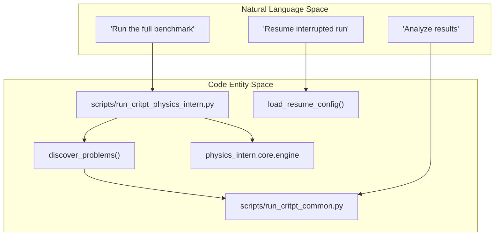
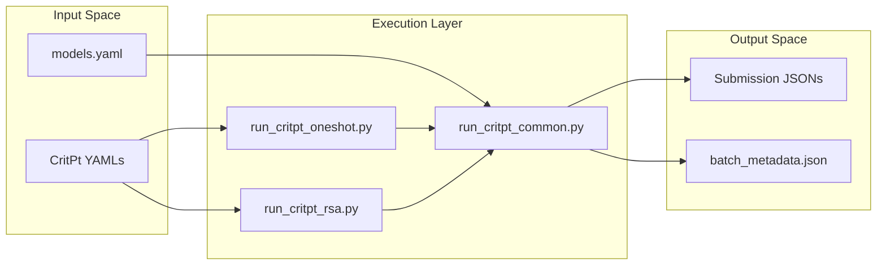

<!-- source: DeepWiki mcp.deepwiki.com · repo huggingface/physics-intern · page 8 Batch Execution and Benchmarking · fetched 2026-10-26 -->

# Batch Execution and Benchmarking

Relevant source files

The following files were used as context for generating this wiki page:

- [scripts/run_critpt_common.py](scripts/run_critpt_common.py)
- [scripts/run_critpt_oneshot.py](scripts/run_critpt_oneshot.py)
- [scripts/run_critpt_physics_intern.py](scripts/run_critpt_physics_intern.py)
- [scripts/run_critpt_rsa.py](scripts/run_critpt_rsa.py)
- [src/physics_intern/agents/formatter/agent.py](src/physics_intern/agents/formatter/agent.py)
- [tests/test_formatter.py](tests/test_formatter.py)

This page provides an overview of the infrastructure used to execute the CritPt benchmark across multiple problems and configurations. The system supports high-concurrency execution of the full `PhysicsIntern` multi-agent engine as well as several baseline modes.

## Overview of Batch Runners

The benchmarking suite is built around a set of scripts that orchestrate subprocesses to solve physics problems in parallel. These runners handle problem discovery, result persistence, and the generation of submission-ready JSON files.

### Core Components
*   **Problem Discovery**: Automatic detection of YAML-defined problems in the CritPt dataset [scripts/run_critpt_common.py:95-117]().
*   **Rolling Parallelism**: Use of `asyncio.Semaphore` to manage concurrent execution of computationally expensive physics agents [scripts/run_critpt_physics_intern.py:111-113]().
*   **Resume Capability**: Logic to detect partially completed runs and pick up from the last successful state [scripts/run_critpt_common.py:146-169]().
*   **Metadata Tracking**: Centralized `batch_metadata.json` for recording model configurations, costs, and aggregate performance metrics [scripts/run_critpt_common.py:172-182]().

### Execution Flow
The following diagram illustrates the transition from high-level benchmarking commands to the specific code entities that manage the execution lifecycle.

**Benchmark Execution Architecture**

Sources: [scripts/run_critpt_physics_intern.py:1-18](), [scripts/run_critpt_common.py:1-5]()

---

## CritPt Physics Intern Batch Runner

The primary entry point for running the full multi-agent system is `run_critpt_physics_intern.py`. This script is designed for large-scale execution on clusters, supporting up to 64 concurrent problems by default [scripts/run_critpt_physics_intern.py:112]().

### Key Features:
*   **Workspace Management**: Automatically finds and resumes existing multi-agent workspaces [scripts/run_critpt_physics_intern.py:171-194]().
*   **Action Planning**: Determines if a problem should be skipped, resumed, or started fresh based on existing `ANSWER.md` files or git-tracked state [scripts/run_critpt_physics_intern.py:198-207]().
*   **Stall Watchdog**: Monitors the engine for inactivity or lack of progress to prevent hanging jobs.
*   **Soft-Exit Handling**: Captures engine terminations caused by `max_wall_seconds` or `max_iterations` and attempts a "best-effort" answer extraction [scripts/run_critpt_physics_intern.py:135-139]().

For details, see [CritPt Physics Intern Batch Runner](#8.1).

---

## Baseline Batch Runners and Analysis

In addition to the multi-agent engine, the repository includes several baseline runners used for comparative evaluation. These scripts share a common utility library, `run_critpt_common.py`, for standardized logging and metadata.

### Baseline Modes
| Script | Description | Code Reference |
| :--- | :--- | :--- |
| `run_critpt_oneshot.py` | Single LLM call per problem. | [scripts/run_critpt_oneshot.py:4-5]() |
| `run_critpt_rsa.py` | Recursive Self-Aggregation (N candidates over T rounds). | [scripts/run_critpt_rsa.py:4-5]() |
| `run_multiple_*.py` | Simple loops for running a single problem multiple times to test variance. | [scripts/run_critpt_common.py:1-5]() |

### Metrics and Analysis
The `analyze_batch.py` tool processes the `batch_metadata.json` and individual submission JSONs to compute:
*   **Success Rates**: Based on the presence of valid Python answer code [scripts/run_critpt_common.py:126-134]().
*   **Token Usage**: Aggregated input, output, and reasoning tokens [scripts/run_critpt_oneshot.py:121-136]().
*   **Cost Analysis**: Total USD spent across the batch [scripts/run_critpt_rsa.py:131-158]().

**Baseline Data Flow**

Sources: [scripts/run_critpt_oneshot.py:26-44](), [scripts/run_critpt_rsa.py:27-45](), [scripts/run_critpt_common.py:20-25]()

For details, see [Baseline Batch Runners and Analysis](#8.2).

---

