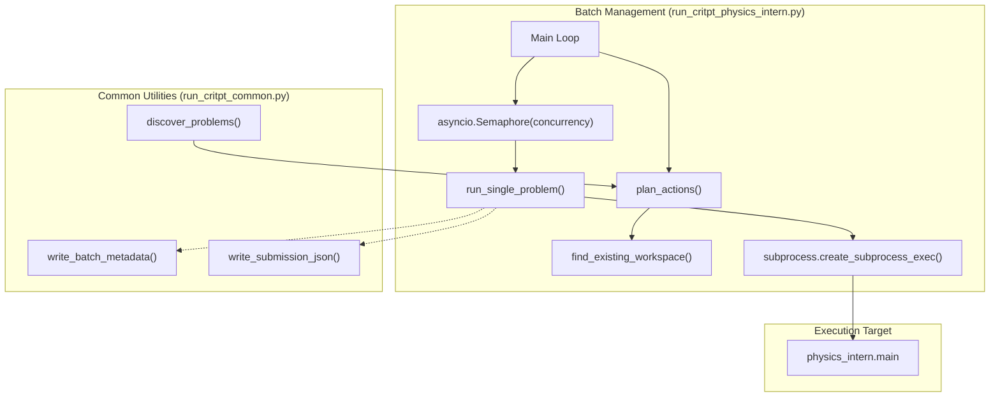
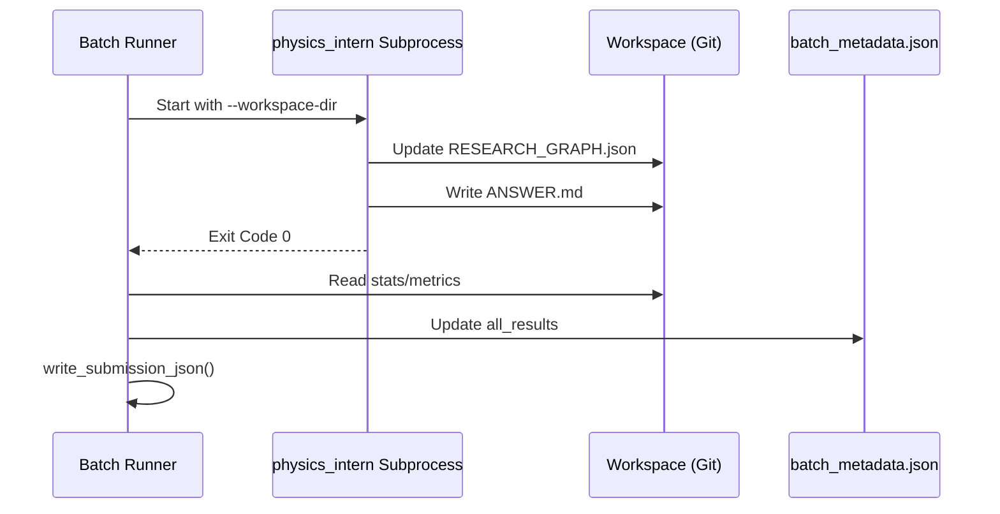

<!-- source: DeepWiki mcp.deepwiki.com · repo huggingface/physics-intern · page 8.1 CritPt Physics Intern Batch Runner · fetched 2026-10-26 -->

# CritPt Physics Intern Batch Runner

Relevant source files

The following files were used as context for generating this wiki page:

- [scripts/run_and_verify.sh](scripts/run_and_verify.sh)
- [scripts/run_critpt_physics_intern.py](scripts/run_critpt_physics_intern.py)
- [src/physics_intern/agents/formatter/agent.py](src/physics_intern/agents/formatter/agent.py)
- [tests/test_formatter.py](tests/test_formatter.py)
- [tests/test_run_critpt_common.py](tests/test_run_critpt_common.py)

The `run_critpt_physics_intern.py` script is the primary entry point for executing the CritPt benchmark suite using the full multi-agent `PhysicsIntern` engine. It manages parallel execution of all 70 benchmark problems, handles state persistence via git-backed workspaces, and implements a sophisticated resume/recovery logic to ensure robustness against hardware failures or API timeouts.

## Core Responsibilities

The batch runner orchestrates the lifecycle of a benchmark run through several distinct phases:
1.  **Problem Discovery**: Scanning the problems directory to identify target YAML files `[scripts/run_critpt_physics_intern.py:41]()`.
2.  **Action Planning**: Determining for each problem whether to skip, resume an existing workspace, extract an answer from a completed run, or start fresh `[scripts/run_critpt_physics_intern.py:198-207]()`.
3.  **Parallel Execution**: Dispatching `physics_intern` subprocesses with a concurrency cap (default 64) `[scripts/run_critpt_physics_intern.py:112]()`.
4.  **Watchdog & Signal Handling**: Monitoring subprocesses for stalls and handling `SIGINT`/`SIGTERM` for graceful shutdowns `[scripts/run_critpt_physics_intern.py:49]()`.
5.  **Metadata Management**: Maintaining `batch_metadata.json` to track aggregate statistics and submission state `[scripts/run_critpt_physics_intern.py:47-48]()`.

### System Entity Mapping: Batch Orchestration

This diagram bridges the high-level orchestration concepts to the specific functions and files implementing them.

Sources: `[scripts/run_critpt_physics_intern.py:167-207]()`, `[scripts/run_critpt_physics_intern.py:41-51]()`.

## Action Planning and Resume Logic

The `plan_actions` function is the most critical component for reliability. It inspects the `output_dir` (containing submission JSONs) and the `workspace_base` (containing git-backed research logs) to decide the fate of each problem.

### Resume Action Types
| Action | Condition | Implementation |
| :--- | :--- | :--- |
| **skip** | A valid submission JSON already exists in the output directory. | `[scripts/run_critpt_physics_intern.py:202]()` |
| **extract** | A workspace exists with a valid `ANSWER.md` but no submission JSON. | `[scripts/run_critpt_physics_intern.py:202]()` |
| **resume** | A workspace exists but is incomplete or has a "reopened" status. | `[scripts/run_critpt_physics_intern.py:202]()` |
| **fresh** | No workspace exists or `--fresh` flag is provided. | `[scripts/run_critpt_physics_intern.py:202]()` |

### Answer Cleanup Before Resume
If a workspace is marked for `resume`, the runner may perform a "cleanup" if the previous run ended in a state that prevents `physics_intern` from continuing (e.g., the graph is marked "completed" but no valid answer was written). 

The function `_commit_answer_cleanup_before_resume` handles this by:
1.  Modifying `RESEARCH_GRAPH.json` to set `status: "in_progress"` `[tests/test_run_critpt_common.py:128]()`.
2.  Deleting invalid `ANSWER.md` files (e.g., empty files or `FORMATTER_REJECTION` markers) `[scripts/run_critpt_physics_intern.py:209-212]()`.
3.  Committing these changes to the workspace git history so the engine sees a clean "in-progress" state `[tests/test_run_critpt_common.py:123-125]()`.

Sources: `[scripts/run_critpt_physics_intern.py:198-207]()`, `[tests/test_run_critpt_common.py:83-107]()`.

## Subprocess Orchestration

The runner uses `asyncio` to manage parallel subprocesses. Each subprocess executes the `physics_intern` module with specific flags.

### Execution Flow
1.  **Workspace Prep**: If resuming, the runner identifies the most recent multi-agent workspace by timestamp `[scripts/run_critpt_physics_intern.py:171-194]()`.
2.  **Command Construction**: The runner assembles the command, passing `--workspace-dir` to the engine to ensure it picks up the existing git state.
3.  **Stall Watchdog**: A watchdog monitors the `EVENT_LOG.jsonl` in the workspace. If no new events are written for a period exceeding the timeout, the subprocess is terminated `[scripts/run_critpt_physics_intern.py:14-18]()`.
4.  **Soft-Exit Handling**: The runner distinguishes between successful completions, timeouts, and crashes (e.g., SEGV). It can tolerate certain exit codes if the `RESEARCH_STATE.md` appears complete `[scripts/run_and_verify.sh:99-105]()`.

### Data Flow: Subprocess to Metadata

Sources: `[scripts/run_critpt_physics_intern.py:22-51]()`, `[scripts/run_and_verify.sh:93-112]()`.

## Formatter Rejection Handling

A unique feature of the batch runner is its interaction with the `FormatterAgent`. If the `FormatterAgent` determines that the research state is insufficient to produce a valid answer, it writes a `FORMATTER_REJECTION:` prefix instead of a standard `ANSWER.md` `[src/physics_intern/agents/formatter/agent.py:21]()`.

The batch runner detects these markers:
-   **In `plan_actions`**: If it finds a `FORMATTER_REJECTION`, it treats the run as incomplete and schedules a `resume` with cleanup `[scripts/run_critpt_physics_intern.py:209-212]()`.
-   **In `_is_formatter_rejection_answer`**: This helper identifies if the answer text starts with the rejection prefix, preventing invalid data from being included in the final submission JSON `[scripts/run_critpt_physics_intern.py:209-212]()`.

Sources: `[src/physics_intern/agents/formatter/agent.py:93-97]()`, `[scripts/run_critpt_physics_intern.py:209-212]()`.

## Metadata Lifecycle

The `batch_metadata.json` file serves as the persistence layer for the entire batch.
-   **Initial Write**: Before starting, `write_initial_batch_metadata` records the model, config, and start time `[scripts/run_critpt_common.py:48]()`.
-   **Incremental Updates**: After each problem completes, `write_batch_metadata` is called to merge the new `RunResult` into the existing list `[scripts/run_critpt_common.py:33-41]()`.
-   **Sibling History**: By default, the runner attempts to fold in results from "sibling" directories (other runs of the same model) to provide a comprehensive view of progress across multiple interrupted sessions `[scripts/run_critpt_physics_intern.py:149-153]()`.

Sources: `[scripts/run_critpt_common.py:19-23]()`, `[tests/test_run_critpt_common.py:30-42]()`.

---

