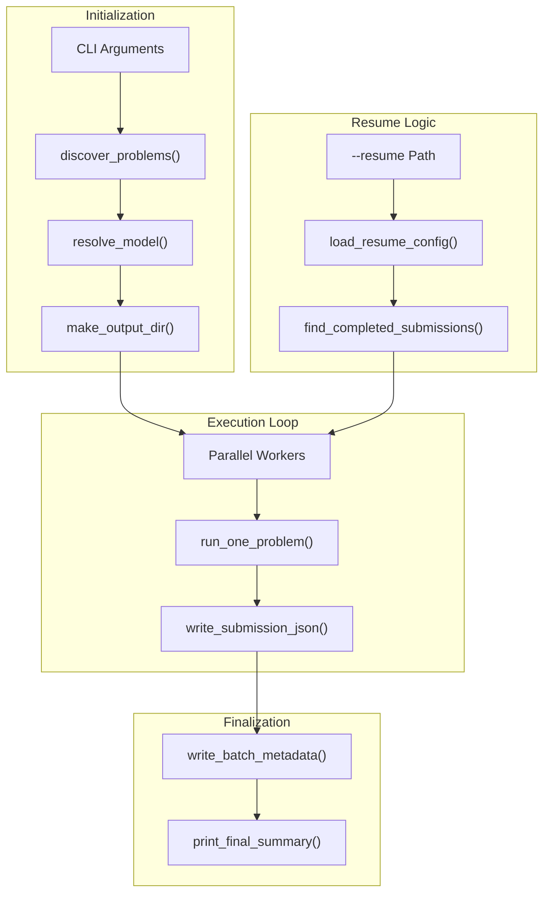

<!-- source: DeepWiki mcp.deepwiki.com · repo huggingface/physics-intern · page 8.2 Baseline Batch Runners and Analysis · fetched 2026-10-26 -->

# Baseline Batch Runners and Analysis

Relevant source files

The following files were used as context for generating this wiki page:

- [scripts/analyze_batch.py](scripts/analyze_batch.py)
- [scripts/fill_missing_critpt.py](scripts/fill_missing_critpt.py)
- [scripts/run_critpt_common.py](scripts/run_critpt_common.py)
- [scripts/run_critpt_oneshot.py](scripts/run_critpt_oneshot.py)
- [scripts/run_critpt_rsa.py](scripts/run_critpt_rsa.py)
- [scripts/run_multiple.py](scripts/run_multiple.py)
- [scripts/run_multiple_oneshot.py](scripts/run_multiple_oneshot.py)
- [scripts/run_multiple_rsa.py](scripts/run_multiple_rsa.py)
- [tests/test_metrics.py](tests/test_metrics.py)

The `physics-intern` codebase provides a suite of batch execution scripts designed to evaluate baseline performance on the CritPt benchmark. These scripts automate the execution of "one-shot" and "RSA" (Recursive Self-Aggregation) modes across multiple problems, manage parallel execution, handle resume logic, and provide post-run analysis of metrics such as token usage and cost.

## Core Batch Infrastructure: `run_critpt_common.py`

The `run_critpt_common.py` script serves as the foundational utility layer for all CritPt batch runners. It centralizes logic for problem discovery, model resolution, and result persistence.

### Key Capabilities
- **Problem Discovery**: Scans a directory for CritPt YAML files matching the `Challenge_(\d+)_main\.yaml` pattern [scripts/run_critpt_common.py:99-112](). It supports range parsing (e.g., "1-10,15") to filter the problem set [scripts/run_critpt_common.py:75-85]().
- **Model Resolution**: Implements a precedence hierarchy for selecting the LLM model: CLI flags > previous run metadata (for resumes) > config file > system defaults [scripts/run_critpt_common.py:45-67]().
- **Resume Logic**: Detects completed problems by checking for valid submission JSONs in the output directory [scripts/run_critpt_common.py:185-199](). It can recover run configurations from `batch_metadata.json` [scripts/run_critpt_common.py:172-182]().
- **Submission Formatting**: Converts PhysicsIntern model keys into the standard CritPt `provider/model_id` format [scripts/run_critpt_common.py:33-42]().

### Data Flow: Batch Orchestration
The following diagram illustrates how the common utilities support the specialized batch runners.

**Batch Execution Flow**

Sources: [scripts/run_critpt_common.py:33-118](), [scripts/run_critpt_oneshot.py:228-260]()

## Baseline Runners

The baseline runners execute non-multi-agent versions of the physics solver to establish performance benchmarks.

### One-Shot Runner (`run_critpt_oneshot.py`)
This script executes each problem as a single LLM call using `physics_intern.one_shot` [scripts/run_critpt_oneshot.py:158-162]().
- **Parallelism**: Uses an `asyncio.Semaphore` to control the number of concurrent subprocesses [scripts/run_critpt_oneshot.py:152-172]().
- **Stats Extraction**: Parses `stderr` to extract input/output tokens, reasoning tokens, and estimated cost [scripts/run_critpt_oneshot.py:121-136]().
- **Answer Extraction**: Uses `extract_answer_code` to isolate the Python solution from the LLM response [scripts/run_critpt_oneshot.py:187]().

### RSA Runner (`run_critpt_rsa.py`)
Executes problems using Recursive Self-Aggregation, involving multiple LLM calls ($N$ candidates over $T$ rounds) [scripts/run_critpt_rsa.py:183-193]().
- **RSA Metrics**: Specifically parses majority vote agreement and total calls from the RSA process logs [scripts/run_critpt_rsa.py:131-159]().
- **Concurrency**: Defaults to a lower concurrency (3) compared to one-shot due to the higher volume of calls per problem [scripts/run_critpt_rsa.py:81]().

Sources: [scripts/run_critpt_oneshot.py:55-210](), [scripts/run_critpt_rsa.py:56-223]()

## Multi-Run and Pass@k Evaluation

To evaluate stochasticity and reliability, the `run_multiple_*.py` scripts execute a single problem multiple times.

| Script | Target Mode | Key Metric |
| :--- | :--- | :--- |
| `run_multiple.py` | Multi-Agent | Pass@k based on `VERIFICATION.md` [scripts/run_multiple.py:45-50]() |
| `run_multiple_oneshot.py` | One-Shot | Pass@k based on `ANSWER.md` presence [scripts/run_multiple_oneshot.py:41-54]() |
| `run_multiple_rsa.py` | RSA | Majority vote success and round-by-round costs [scripts/run_multiple_rsa.py:44-61]() |

These scripts use `asyncio.create_subprocess_exec` to manage the runs and provide real-time iteration/round progress to `stderr` [scripts/run_multiple.py:155-167](), [scripts/run_multiple_rsa.py:176-197]().

Sources: [scripts/run_multiple.py:107-201](), [scripts/run_multiple_oneshot.py:124-183](), [scripts/run_multiple_rsa.py:116-201]()

## Analysis and Post-Processing

### Batch Analysis (`analyze_batch.py`)
This tool aggregates performance data across a completed batch run by reading `METRICS.md` and `RESEARCH_GRAPH.json` files from individual workspaces [scripts/analyze_batch.py:70-106]().

- **Aggregation**: Computes mean, median, and percentiles for iterations, LLM calls, and token types (input, output, reasoning, answer) [scripts/analyze_batch.py:129-161]().
- **Agent Breakdown**: Parses the metrics table to attribute token usage and duration to specific agent roles (e.g., Orchestrator, Researcher) [scripts/analyze_batch.py:108-119]().
- **Reporting**: Generates a Rich-formatted summary table or a JSON export [scripts/analyze_batch.py:180-218]().

### Submission Completeness (`fill_missing_critpt.py`)
For benchmarks requiring a full 70-problem submission, this script identifies problems that failed during the batch run and generates "dummy" submissions using the problem's `answer_template` [scripts/fill_missing_critpt.py:120-138]().

Sources: [scripts/analyze_batch.py:38-121](), [scripts/fill_missing_critpt.py:28-76](), [tests/test_metrics.py:188-217]()

## Metrics Data Model

The `MetricsTracker` class (tested in `test_metrics.py`) is the source of truth for the data analyzed by batch scripts.

**Metrics Mapping: Code to Report**
| Code Entity | Markdown Field | Purpose |
| :--- | :--- | :--- |
| `total_input_tokens` | `total_input_tokens` | Aggregate cost calculation [tests/test_metrics.py:11]() |
| `max_tokens_reached_count` | `max_tokens_reached_count` | Identify context window issues [tests/test_metrics.py:19]() |
| `total_tool_calls` | `total_tool_calls` | Measure agent tool-use intensity [tests/test_metrics.py:75]() |
| `total_reasoning_tokens` | `total_reasoning_tokens` | Track usage of reasoning-capable models [tests/test_metrics.py:139]() |

Sources: [tests/test_metrics.py:8-179]()

---

