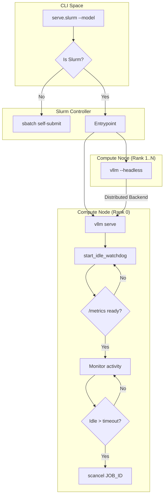
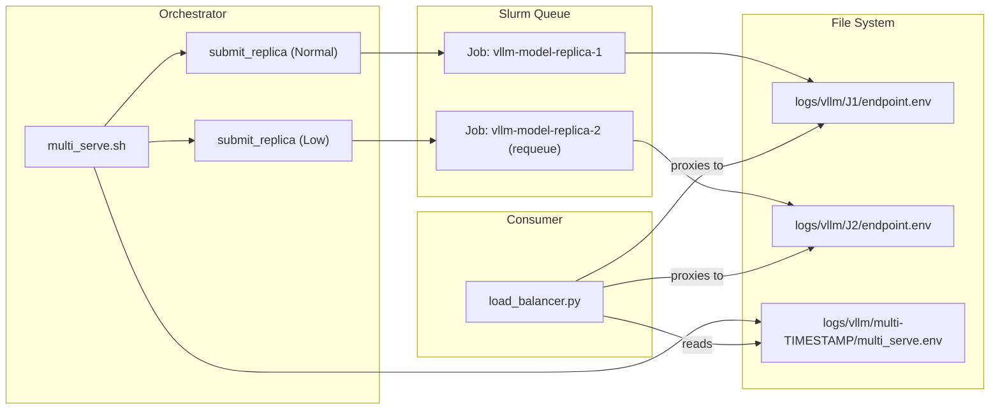

<!-- source: DeepWiki mcp.deepwiki.com · repo huggingface/physics-intern · page 9.1 vLLM Serve Scripts · fetched 2026-10-26 -->

# vLLM Serve Scripts

Relevant source files

The following files were used as context for generating this wiki page:

- [deep_gemm-2.5.0+891d57b-cp313-cp313-linux_x86_64.whl](deep_gemm-2.5.0+891d57b-cp313-cp313-linux_x86_64.whl)
- [scripts/benchmark_throughput.py](scripts/benchmark_throughput.py)
- [serve/multi_serve.sh](serve/multi_serve.sh)
- [serve/reasoning_parsers/nano_v3_reasoning_parser.py](serve/reasoning_parsers/nano_v3_reasoning_parser.py)
- [serve/reasoning_parsers/super_v3_reasoning_parser.py](serve/reasoning_parsers/super_v3_reasoning_parser.py)
- [serve/serve.slurm](serve/serve.slurm)
- [serve/upgrade_vllm.sh](serve/upgrade_vllm.sh)

The vLLM serving infrastructure provides a robust, Slurm-integrated stack for deploying large-scale language models on H100 clusters. It supports automated distributed launching, idle-based resource reclamation, and multi-replica data parallelism.

## serve.slurm: The Core Serving Script

`serve/serve.slurm` is a dual-purpose script that acts as both a CLI for local execution and a self-submitting Slurm batch script [serve/serve.slurm:1-24](). When executed outside of a Slurm environment, it automatically re-submits itself using `sbatch` with the appropriate resource requests [serve/serve.slurm:74]().

### Distributed Launch Sequence
The script handles the complexity of multi-node and multi-GPU orchestration for various parallelism strategies:

*   **Tensor Parallel (TP) & Pipeline Parallel (PP):** For models exceeding single-node memory, it coordinates multiple nodes. Rank 0 initializes the OpenAI-compatible API server, while non-zero ranks join in `--headless` mode using vLLM's multiprocessing backend [serve/serve.slurm:75-76]().
*   **Data Parallel (DP):** Native vLLM DP is supported for models that fit on a single node. Each node runs a DP replica with internal TP [serve/serve.slurm:77-78]().
*   **Resource Calculation:** Defaults for CPUs and memory are calculated based on the GPU count (e.g., 11 CPUs per GPU) to ensure balanced node utilization [serve/serve.slurm:45]().

### Idle Watchdog and Self-Healing
To prevent resource waste on expensive H100 nodes, the script implements an `idle-shutdown` watchdog:

*   **Arming:** The watchdog only arms after the vLLM `/metrics` endpoint becomes reachable, ensuring that model load time does not count against the idle window [serve/serve.slurm:79-80]().
*   **Monitoring:** It polls the Prometheus metrics every 60 seconds. It considers the server "active" if there are currently running/waiting requests or if the total completed request count has increased since the last poll [serve/serve.slurm:197-204]().
*   **Max Restarts:** If the vLLM process crashes, the script will attempt to restart it up to a configurable `max-restarts` limit (default 3) before giving up and failing the job [serve/serve.slurm:60-61]().

### Environment and JIT Management
The script manages runtime dependencies and cache locations to ensure isolation and performance:
*   **Library Path:** It automatically prepends NVIDIA libraries from the local `.venv` to `LD_LIBRARY_PATH` [serve/serve.slurm:132-160]().
*   **Cache Isolation:** `VLLM_XLA_CACHE_PATH` and `VLLM_ASSETS_CACHE` are redirected to job-specific directories in the runtime root to avoid JIT compilation collisions between concurrent jobs [serve/serve.slurm:14-16]().

**Sources:** [serve/serve.slurm:1-81](), [serve/serve.slurm:132-160](), [serve/serve.slurm:197-204]()

---

## Multi-Replica Deployment

For high-throughput requirements, `serve/multi_serve.sh` orchestrates multiple independent `serve.slurm` jobs.

### Multi-Serve Workflow
1.  **Replica Distribution:** It splits a request into "Normal" (high priority) and "Low" (opportunistic) replicas [serve/multi_serve.sh:125-127]().
2.  **Auto-Sizing:** In "auto" mode, it queries `sinfo` to detect idle nodes on the partition and fills them with low-priority replicas after satisfying the normal replica quota [serve/multi_serve.sh:105-117]().
3.  **Metadata Tracking:** It generates a `multi_serve.env` file containing all job IDs and configurations, which the load balancer uses to aggregate endpoints [serve/multi_serve.sh:178-191]().

| Feature | Description |
| :--- | :--- |
| **Normal Replicas** | Fixed count of jobs submitted with standard QOS [serve/multi_serve.sh:49](). |
| **Low Replicas** | Requeueable jobs submitted to the `low` QOS to utilize spare capacity [serve/multi_serve.sh:50-57](). |
| **Endpoints** | Each replica writes its `BASE_URL` to a job-specific `endpoint.env` [serve/multi_serve.sh:197-200](). |

**Sources:** [serve/multi_serve.sh:1-62](), [serve/multi_serve.sh:105-117](), [serve/multi_serve.sh:178-191]()

---

## Reasoning Parser Plugins

The serving stack includes custom reasoning parsers to handle models with explicit "thinking" or "reasoning" phases (e.g., DeepSeek-R1 style models). These parsers ensure that reasoning tokens are correctly extracted or suppressed based on the request parameters.

### Implementation Patterns
*   **SuperV3ReasoningParser:** Extends `DeepSeekR1ReasoningParser` to handle `enable_thinking` and `force_nonempty_content` flags in `chat_template_kwargs` [serve/reasoning_parsers/super_v3_reasoning_parser.py:6-23]().
*   **NanoV3ReasoningParser:** Provides similar logic for smaller-scale reasoning models, ensuring `final_content` is populated even if the model only produces reasoning tokens [serve/reasoning_parsers/nano_v3_reasoning_parser.py:6-20]().

**Sources:** [serve/reasoning_parsers/super_v3_reasoning_parser.py:1-24](), [serve/reasoning_parsers/nano_v3_reasoning_parser.py:1-21]()

---

## System Architecture Diagrams

### Serve Launch and Watchdog Lifecycle
This diagram illustrates the transition from a shell command to a monitored vLLM instance.

**Sources:** [serve/serve.slurm:5-13](), [serve/serve.slurm:74-80](), [serve/serve.slurm:197-204]()

### Data Parallel Replica Orchestration
Associating `multi_serve.sh` logic with the resulting Slurm entities.

**Sources:** [serve/multi_serve.sh:137-165](), [serve/multi_serve.sh:178-191](), [scripts/benchmark_throughput.py:200-212]()

---

