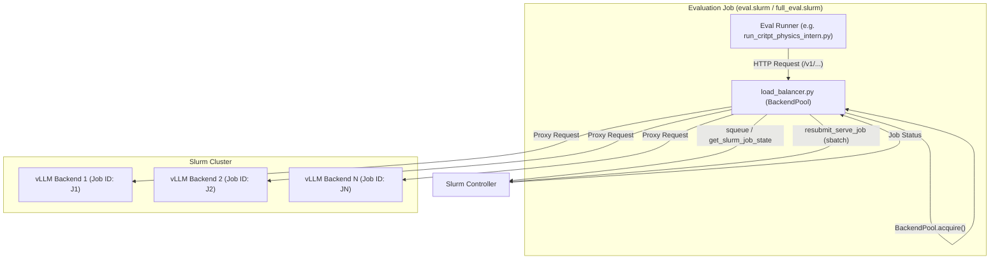
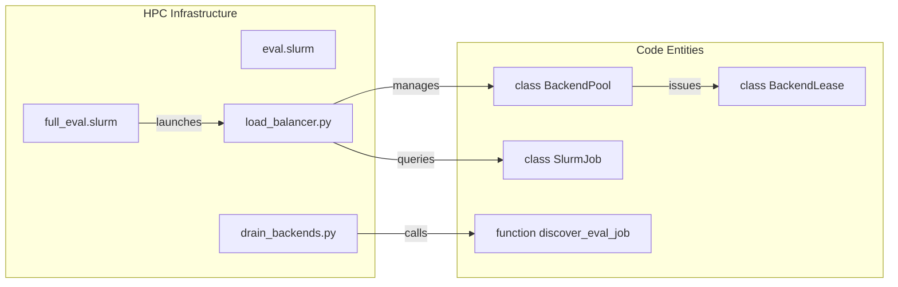

<!-- source: DeepWiki mcp.deepwiki.com · repo huggingface/physics-intern · page 9.2 Load Balancer and Evaluation Slurm Jobs · fetched 2026-10-26 -->

# Load Balancer and Evaluation Slurm Jobs

Relevant source files

The following files were used as context for generating this wiki page:

- [config.cluster.yaml](config.cluster.yaml)
- [serve/drain_backends.py](serve/drain_backends.py)
- [serve/eval.slurm](serve/eval.slurm)
- [serve/full_eval.slurm](serve/full_eval.slurm)
- [serve/load_balancer.py](serve/load_balancer.py)
- [tests/test_load_balancer.py](tests/test_load_balancer.py)

This page describes the resilient infrastructure used to manage high-throughput evaluations on Slurm clusters. It covers the asynchronous load balancer, which provides a unified OpenAI-compatible endpoint for multiple vLLM replicas, and the Slurm job scripts that orchestrate large-scale benchmarks like CritPt.

## Load Balancer Architecture

The `serve/load_balancer.py` script implements a resilient, asynchronous proxy that distributes requests across multiple vLLM backends. It is designed to handle the volatility of HPC environments, such as node failures or Slurm job preemptions.

### Backend Management

The system tracks backends through several key entities:
*   **`BackendPool`**: Manages the collection of available vLLM endpoints. It supports round-robin selection and enforces concurrency limits per backend [serve/load_balancer.py:219-223]().
*   **`Backend`**: A dataclass representing a single vLLM instance, tracked by its Slurm `job_id`. It maintains state such as `active_requests`, `draining` status, and health [serve/load_balancer.py:160-170]().
*   **`BackendLease`**: Represents a checked-out backend for a specific request [serve/load_balancer.py:173-178]().

### Resilience and Self-Healing

The load balancer implements several mechanisms to ensure continuous operation:
1.  **Dynamic Discovery**: It can auto-discover running vLLM jobs for a specific model by querying Slurm via `squeue` [serve/load_balancer.py:186-216]().
2.  **Health Monitoring**: A background loop periodically checks the `/health` endpoint of every backend. If a backend fails health checks or its Slurm job is no longer alive, it is removed from the pool [serve/load_balancer.py:532-550]().
3.  **Auto-Resubmission**: If configured with a model and node count, the load balancer can automatically call `resubmit_serve_job` to launch new vLLM instances via `serve.slurm` when backends fail [serve/load_balancer.py:102-142]().
4.  **Deduplication**: It handles node reuse by checking for URL collisions; if a new Slurm job appears with an existing URL, the old (stale) backend entry is replaced [serve/load_balancer.py:273-286]().

### Request Flow and Concurrency Control

The proxy exposes a `/v1/chat/completions` endpoint that mimics the OpenAI API [serve/load_balancer.py:568-580](). 

| Feature | Implementation |
| :--- | :--- |
| **Round Robin** | `BackendPool.acquire` selects the next available backend with the lowest index [serve/load_balancer.py:330-344](). |
| **Concurrency Limit** | `max_active_per_backend` prevents saturating individual vLLM instances [serve/load_balancer.py:335-338](). |
| **Queueing** | Requests that cannot be immediately served wait in an `asyncio.Condition` queue until capacity is released [serve/load_balancer.py:321-331](). |

### Load Balancer Data Flow

This diagram illustrates how the `load_balancer.py` bridges the eval client and the Slurm-based vLLM backends.

**Sources:** [serve/load_balancer.py:219-223](), [serve/load_balancer.py:51-66](), [serve/load_balancer.py:568-580]().

## Evaluation Slurm Jobs

The codebase provides two primary Slurm entry points for running evaluations.

### `full_eval.slurm`: Batch Execution

`full_eval.slurm` is the primary script for running the complete CritPt benchmark (70 problems) [serve/full_eval.slurm:2-19]().

*   **Load Balancer Integration**: If multiple `--serve-job` IDs are provided, it automatically starts `load_balancer.py` in the background and points the runner to `localhost:9000` [serve/full_eval.slurm:198-217]().
*   **Resume Logic**: Supports resuming interrupted runs via the `--resume` flag, which is passed to the underlying batch runner [serve/full_eval.slurm:118-119]().
*   **Self-Submission**: When executed from a login node, it uses `sbatch` to submit itself to the `hopper-prod` partition [serve/full_eval.slurm:149-170]().
*   **Cleanup**: A `trap cleanup EXIT` ensures that the background load balancer is killed and (optionally) the vLLM serve jobs are cancelled when the evaluation finishes [serve/full_eval.slurm:178-196]().

### `eval.slurm`: Single Problem Execution

`eval.slurm` is used for one-shot evaluations or debugging specific problems [serve/eval.slurm:2-5]().

*   **Endpoint Resolution**: For local vLLM models, it reads `endpoint.env` from the serve log directory to find the head node IP and sets `VLLM_BASE_URL` [serve/eval.slurm:212-222]().
*   **Wait for Ready**: It includes a retry loop that polls the vLLM `/health` endpoint for up to 4 hours, accounting for the long load times of large models [serve/eval.slurm:226-240]().

### System Component Mapping

This diagram maps the high-level concepts to the specific files and classes responsible for evaluation orchestration.

**Sources:** [serve/full_eval.slurm:198-217](), [serve/load_balancer.py:151-178](), [serve/load_balancer.py:219-223](), [serve/drain_backends.py:21-52]().

## Administrative Tools

### `drain_backends.py`

This utility allows operators to gracefully shut down vLLM backends without interrupting in-flight requests [serve/drain_backends.py:2-12]().

1.  **Discovery**: It uses `discover_eval_job` to find the running evaluation job hosting the load balancer [serve/drain_backends.py:21-52]().
2.  **Remote Call**: It uses `srun --jobid=... --overlap` to execute a python snippet inside the evaluation job's allocation. This snippet sends a `POST` request to the load balancer's `/cancel_when_drained/{job_id}` endpoint [serve/drain_backends.py:55-81]().
3.  **Draining**: The load balancer marks the specified backend as `draining`, stops sending it new requests, and cancels the Slurm job once `active_requests` reaches zero [serve/load_balancer.py:441-458]().

### Configuration

Evaluation jobs often use a cluster-specific configuration file, such as `config.cluster.yaml`, which defines extended timeouts and token budgets suitable for multi-agent research runs [config.cluster.yaml:1-3]().

| Setting | Value | Description |
| :--- | :--- | :--- |
| `max_wall_seconds` | 86400 | 24-hour limit for the research engine [config.cluster.yaml:1](). |
| `max_total_output_tokens` | 2,000,000 | Aggregate token budget across all agents [config.cluster.yaml:2](). |
| `api_timeout` | 3600 | 1-hour timeout for individual LLM provider calls [config.cluster.yaml:3](). |

**Sources:** [serve/load_balancer.py:1-600](), [serve/full_eval.slurm:1-250](), [serve/eval.slurm:1-240](), [serve/drain_backends.py:1-133](), [config.cluster.yaml:1-3]().

---

