# Page: PhysicsIntern Overview

# PhysicsIntern Overview

<details>
<summary>Relevant source files</summary>

The following files were used as context for generating this wiki page:

- [CLAUDE.md](CLAUDE.md)
- [DOCUMENTATION.md](DOCUMENTATION.md)
- [README.md](README.md)
- [tests/test_orchestrator_tools.py](tests/test_orchestrator_tools.py)

</details>


PhysicsIntern is a multi-agent scaffolding system designed for autonomous scientific research in mathematics and theoretical physics. It translates high-level natural language physics problems into verified solutions through an iterative research lifecycle involving analytical derivations, code execution, and adversarial review.

The system is built on the principle that no single agent call carries conversation history; instead, a structured **ResearchState** acts as the single source of truth, from which fresh contexts are rendered for each agent call [CLAUDE.md:32-34]().

### Research Modes
PhysicsIntern supports two primary operational modes:
*   **Multi-Agent Pipeline (Default):** A sophisticated orchestration of nine specialized agent roles (e.g., Researcher, Computer, Reviewer, Critic) that collaborate via a shared state [README.md:11-11]().
*   **Autophysicist:** A lightweight, single-agent research loop where a "Research Manager" dispatches ephemeral sub-agents and manages its own internal memory [README.md:9-9]().

For details on setting up the environment and running your first problem, see [Getting Started](#1.1).

---

### System Architecture and Data Flow

The system bridges natural language problem descriptions with structured scientific data through a continuous loop. The **PhysicsIntern Engine** manages the transitions between agent roles and ensures the **ResearchState** remains consistent.

#### From Language to Research Entities
The following diagram maps high-level research concepts to their corresponding classes and file structures within the codebase.

**Research Concept to Code Entity Mapping**
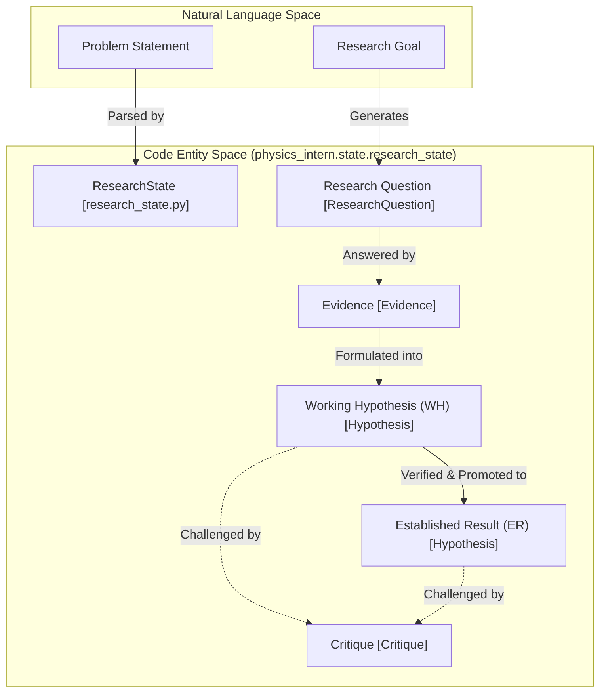
Sources: [src/physics_intern/state/research_state.py:1-200](), [README.md:11-13]()

---

### Major Subsystems

#### 1. The Multi-Agent Pipeline
The core of PhysicsIntern is a loop of nine specialized agents. This system is designed to prevent "hallucination drift" by requiring adversarial review of every hypothesis.

*   **Exploration:** The `SurveyorAgent` maps the initial landscape, followed by the `PlannerAgent` which sets the strategy [README.md:11-11]().
*   **Execution:** The `OrchestratorAgent` dispatches tasks to the `ResearcherAgent` (derivations) and `ComputerAgent` (Python execution) [README.md:11-11]().
*   **Verification:** The `ReviewerAgent` provides adversarial checks, while the `AdjudicatorAgent` handles challenges to established results [README.md:11-11]().

#### 2. State and Workspace Management
The `ResearchState` is persisted to disk using a `WorkspaceManager`. Every iteration is captured as a git commit, and snapshots are rendered into human-readable Markdown files (`RESEARCH_STATE.md`, `EVIDENCE_LOG.md`, etc.) [CLAUDE.md:32-33]().

**Agent-State Interaction Model**
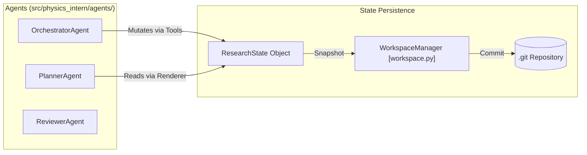
Sources: [src/physics_intern/workspace.py:1-50](), [CLAUDE.md:32-41]()

#### 3. LLM Provider Layer
PhysicsIntern abstracts model interactions through an `LLMProvider` layer, supporting Anthropic, OpenAI, Google Gemini, and local vLLM instances. It handles tool-calling transformations and implements exponential backoff for retries [README.md:15-15](), [DOCUMENTATION.md:22-22]().

---

### Problem Definitions and Tiers
Problems are defined in YAML format and categorized into tiers based on difficulty:
*   **Tier 1/2:** Standard physics and math problems.
*   **CritPt:** A specialized benchmark challenge index for complex theoretical physics [README.md:52-52]().

For more information on how to define or extend problems, see [Problem Definitions](#1.2).

---

### Comparison with Baselines
The system includes several baseline modes to evaluate the effectiveness of the multi-agent scaffolding:
*   **One-Shot:** A single LLM call [DOCUMENTATION.md:107-109]().
*   **Two-Step:** Mimics the CritPt benchmark's derivation-then-population flow [DOCUMENTATION.md:130-132]().
*   **RSA (Recursive Self-Aggregation):** Generates multiple candidates and aggregates them over several rounds [DOCUMENTATION.md:14-14]().

For details on running these evaluations, see [Baseline Modes and Evaluation](#7).

---

### Child Pages
*   **[Getting Started](#1.1)**: Installation, CLI usage, and configuration.
*   **[Problem Definitions](#1.2)**: YAML schema, tiering, and the CritPt benchmark.

---

# Page: Getting Started

# Getting Started

<details>
<summary>Relevant source files</summary>

The following files were used as context for generating this wiki page:

- [.github/workflows/testing.yml](.github/workflows/testing.yml)
- [.gitignore](.gitignore)
- [.pre-commit-config.yaml](.pre-commit-config.yaml)
- [README.md](README.md)
- [pyproject.toml](pyproject.toml)
- [tests/test_config.py](tests/test_config.py)
- [uv.lock](uv.lock)

</details>


This page covers the installation, environment configuration, and execution of the **PhysicsIntern** multi-agent research system. It provides a technical guide for setting up the local environment, understanding the configuration hierarchy, and running an initial physics research problem.

## Installation

PhysicsIntern requires **Python 3.12+** and uses `uv` for dependency management and environment isolation [README.md:19-21]().

### Local Environment Setup
To install the core system and testing dependencies:
```bash
# Clone and sync dependencies
uv sync --extra testing
```

### Provider-Specific Extras
Depending on the LLM backends you intend to use, install the corresponding optional dependencies [README.md:23-27]():
*   **OpenAI**: `uv sync --extra openai`
*   **Google Gemini**: `uv sync --extra google`
*   **HuggingFace**: `uv sync --extra huggingface`
*   **All Providers**: `uv sync --extra all-providers`

### GPU/Slurm Cluster Setup
For serving local models (e.g., DeepSeek V4) via vLLM on Linux-based GPU clusters, use the `local` extra [README.md:29-30](). This includes optimized kernels like `deep-gemm` [pyproject.toml:34-40]().
```bash
uv sync --extra local
```

**Sources:** [README.md:19-30](), [pyproject.toml:17-40]()

---

## Environment Variables

Authentication for LLM providers is managed via environment variables or a `.env` file [README.md:51-57]().

| Variable | Provider |
| :--- | :--- |
| `ANTHROPIC_API_KEY` | Anthropic |
| `OPENAI_API_KEY` | OpenAI |
| `GOOGLE_API_KEY` | Google Gemini (default) |
| `HF_TOKEN` | HuggingFace Inference Providers |

**Sources:** [README.md:60-67]()

---

## Configuration System

PhysicsIntern uses a hierarchical configuration resolution strategy managed by the `build_config` function [tests/test_config.py:18-19]().

### Configuration Hierarchy
The system resolves settings in the following order of precedence (highest to lowest):
1.  **CLI Flags**: Arguments passed directly to the `physics_intern` command [README.md:82-83]().
2.  **User Config File**: A YAML file provided via `--config FILE` [README.md:79]().
3.  **Global Defaults**: Hardcoded values in `config.default.yaml` [README.md:82]().

### Key Configuration Files
*   **`config.default.yaml`**: The single source of truth for default parameters such as `max_iterations`, `critic_every_n`, and `sympy_timeout_seconds` [tests/test_config.py:32-45]().
*   **`models.yaml`**: A registry of supported LLMs. Crucially, `max_tokens` (output limit) is sourced from this file based on the selected model, rather than from the general config [tests/test_config.py:46-48]().

### Data Flow: Config Resolution
The following diagram illustrates how the `Config` object is instantiated and how it interacts with the model registry.

**Config and Model Resolution Flow**
```mermaid
graph TD
    subgraph "Input_Sources"
        [CLI_Args] --> [build_config]
        [User_YAML] --> [load_config_yaml]
        [config.default.yaml] --> [DEFAULTS]
    end

    [load_config_yaml] -- "Filtered by _YAML_CONFIG_FIELDS" --> [build_config]
    [DEFAULTS] --> [build_config]

    subgraph "Logic_Space"
        [build_config] -- "1. Merge sources" --> [Config_Object]
        [Config_Object] -- "2. Lookup model key" --> [models.yaml]
        [models.yaml] -- "3. Return max_output_tokens" --> [Config_Object]
    end

    [Config_Object] -- "Initialize" --> [Engine]
```
**Sources:** [tests/test_config.py:13-19](), [tests/test_config.py:31-48](), [tests/test_config.py:124-153]()

---

## CLI Usage

The primary entry point is the `physics_intern` command, registered via `pyproject.toml` [pyproject.toml:43]().

### Command Syntax
```bash
physics_intern [problem.yaml] [options]
```

### Common Options
| Option | Description |
| :--- | :--- |
| `--model MODEL` | LLM model key (resolved via `models.yaml`) [README.md:74](). |
| `--max-iterations N` | Maximum number of agent loop iterations [README.md:76](). |
| `--workspace-dir DIR` | Custom path for research artifacts [README.md:77](). |
| `--resume DIR` | Resumes an interrupted research session from a workspace [README.md:78](). |
| `--replay DIR` | Replays the console log from a workspace without running the LLM [README.md:75](). |

**Sources:** [README.md:70-80](), [pyproject.toml:42-47]()

---

## Running Your First Problem

To run a research task, provide a problem definition YAML. The system defaults to a quantum error correction problem if no file is specified [README.md:72-73]().

### Execution Example
```bash
# Run a specific problem with a specific model
uv run physics_intern problems/critpt/quantum_error_correction_main.yaml --model gemini-3-flash-preview
```

### Data Flow: Execution Lifecycle
When a problem starts, the `main` entry point initializes the `WorkspaceManager` and the `Engine`. The `Engine` then orchestrates the research lifecycle across different agent roles.

**Research Execution Flow**
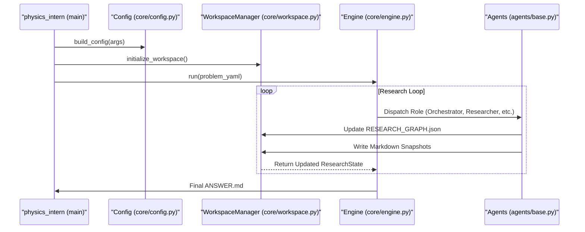
**Sources:** [README.md:51-53](), [README.md:11-13](), [pyproject.toml:43]()

---

## Development and Testing

The project enforces code quality through `ruff` and `pytest` [README.md:86-91]().

### Quality Checks
```bash
# Linting and Formatting
uv run ruff check tests src scripts serve
uv run ruff format --check tests src scripts serve

# Run Tests with Coverage
uv run python -m pytest ./tests/ --cov=physics_intern
```
Coverage is enforced at a **75%** threshold for core package code [README.md:94](), [pyproject.toml:75-76]().

**Sources:** [README.md:86-101](), [pyproject.toml:55-79]()

---

# Page: Problem Definitions

# Problem Definitions

<details>
<summary>Relevant source files</summary>

The following files were used as context for generating this wiki page:

- [problems/critpt/challenge_index.json](problems/critpt/challenge_index.json)
- [problems/critpt/quantum_error_correction_main.yaml](problems/critpt/quantum_error_correction_main.yaml)
- [problems/tier1/berry_phase_spin.yaml](problems/tier1/berry_phase_spin.yaml)
- [problems/tier1/casimir_effect.yaml](problems/tier1/casimir_effect.yaml)
- [problems/tier1/chandrasekhar_limit.yaml](problems/tier1/chandrasekhar_limit.yaml)
- [problems/tier1/hawking_temperature.yaml](problems/tier1/hawking_temperature.yaml)
- [problems/tier1/hydrogen_fine_structure.yaml](problems/tier1/hydrogen_fine_structure.yaml)
- [problems/tier1/ising_1d_transfer_matrix.yaml](problems/tier1/ising_1d_transfer_matrix.yaml)
- [problems/tier2/thomas_fermi.yaml](problems/tier2/thomas_fermi.yaml)

</details>


PhysicsIntern problems are structured as self-contained YAML files that provide the problem statement, a ground-truth answer for evaluation, and a Python-based answer template. These definitions guide the agents' research objectives and standardize the output format required for automated scoring.

## YAML Schema and Structure

Each problem definition follows a specific YAML schema. The system uses these files to initialize the `ResearchState` and to provide the `FormatterAgent` with the necessary structure to produce a final `ANSWER.md`.

### Key Components

| Field | Description |
| :--- | :--- |
| `problem` | A detailed Markdown string describing the physical system, parameters, and the specific question to be solved [problems/critpt/quantum_error_correction_main.yaml:1-17](). |
| `answer` | The ground-truth value. This can be a numerical float [problems/tier2/thomas_fermi.yaml:13]() or a symbolic SymPy expression [problems/tier1/hawking_temperature.yaml:14](). |
| `answer_template` | A Python code block defining an `answer()` function. Agents must populate this template in the final workspace [problems/tier1/casimir_effect.yaml:18-44](). |

### The Answer Template Convention
The `answer_template` serves as a contract between the agentic system and the evaluation pipeline. It typically uses `sympy` for symbolic problems to ensure mathematical equivalence can be checked regardless of algebraic form [problems/tier1/berry_phase_spin.yaml:18-43]().

```python
import sympy as sp

def answer(params):
    # ------------------ FILL IN YOUR RESULTS BELOW ------------------
    result = ... 
    # ---------------------------------------------------------------
    return result
```

## The Tier System

Problems are categorized into three tiers based on complexity and the depth of research required.

*   **Tier 1 (Standard/Textbook):** Problems involving standard formulas or derivations found in graduate-level physics (e.g., Hawking Temperature, Casimir Effect) [problems/tier1/hawking_temperature.yaml:1-10](), [problems/tier1/casimir_effect.yaml:1-12]().
*   **Tier 2 (Intermediate):** Problems requiring solid domain knowledge and often numerical computation (e.g., Thomas-Fermi model) [problems/tier2/thomas_fermi.yaml:1-10]().
*   **CritPt (Research-Level):** The "Critical Path" benchmark. These are multi-step, cross-domain challenges often requiring heavy computation or derivation of cutting-edge results [problems/critpt/challenge_index.json:4-5]().

## CritPt Benchmark Challenge Index

The `critpt` directory contains a `challenge_index.json` which acts as a registry for the benchmark. This index maps numeric IDs to problem summaries and difficulty ratings (1-5) [problems/critpt/challenge_index.json:6-11]().

### Data Flow: From YAML to Agent Workspace

The following diagram illustrates how a problem definition is ingested and transformed into the operational environment for the agents.

**Problem Ingestion and Initialization**
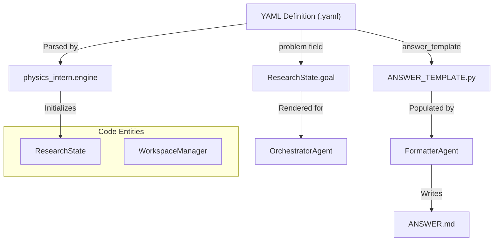
Sources: [problems/critpt/quantum_error_correction_main.yaml:1-47](), [problems/tier1/hawking_temperature.yaml:1-44]()

## Implementation Details

### Symbolic vs. Numerical Problems
The system distinguishes between problems requiring a symbolic expression and those requiring a numerical constant. 

1.  **Symbolic:** Uses `sp.symbols` within the `answer_template` to define variables like $\hbar$, $c$, or $G$ [problems/tier1/hawking_temperature.yaml:19-21]().
2.  **Numerical:** The `answer()` function returns a `float`, often requiring the agent to use `scipy` or `numpy` within its internal research steps to solve ODEs or perform integrations [problems/tier2/thomas_fermi.yaml:15-32]().

### Data Flow for Evaluation
The `answer` field in the YAML is never shown to the agents. It is reserved for the `Evaluation` subsystem to compare against the agent-generated code in `ANSWER.md`.

**Validation Flow**
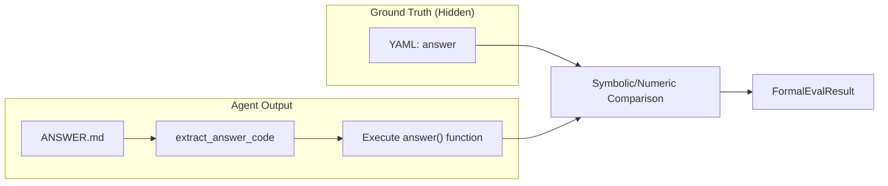
Sources: [problems/tier1/hydrogen_fine_structure.yaml:13-15](), [problems/tier1/ising_1d_transfer_matrix.yaml:13-15]()

### Challenge Index Structure
The `challenge_index.json` provides metadata used for batch running and reporting. It allows the runner to select specific subsets of the 70 research-level challenges based on difficulty or topic [problems/critpt/challenge_index.json:1-11]().

| ID | Difficulty | Summary Snippet |
| :--- | :--- | :--- |
| 1 | 5 | Holographic Weyl anomaly in 8D [problems/critpt/challenge_index.json:8-11]() |
| 2 | 5 | Stochastic bacterial growth rate [problems/critpt/challenge_index.json:13-16]() |
| 6 | 4 | Twisted bilayer MoTe2 Chern numbers [problems/critpt/challenge_index.json:33-36]() |
| 15 | 4 | Noisy spin-1 AKLT chain string order [problems/critpt/challenge_index.json:78-81]() |

Sources: [problems/critpt/challenge_index.json:1-154]()

---

# Page: Core Architecture

# Core Architecture

<details>
<summary>Relevant source files</summary>

The following files were used as context for generating this wiki page:

- [CLAUDE.md](CLAUDE.md)
- [DOCUMENTATION.md](DOCUMENTATION.md)
- [tests/test_engine.py](tests/test_engine.py)
- [tests/test_orchestrator_tools.py](tests/test_orchestrator_tools.py)
- [tests/test_report_recommendations.py](tests/test_report_recommendations.py)
- [tests/test_scaffold_log.py](tests/test_scaffold_log.py)
- [tests/test_validation.py](tests/test_validation.py)

</details>


The PhysicsIntern system is designed as an autonomous multi-agent research engine that bridges high-level scientific reasoning with low-level computational execution. The architecture centers around a state-driven loop where specialized agents interact with a unified research graph to solve complex problems in theoretical physics and mathematics.

## PhysicsIntern Engine

The `PhysicsIntern` engine is the central orchestrator of the research lifecycle. It manages the iteration loop, enforces global budgets (time, tokens, cost), and handles the transition between different research phases.

*   **Main Loop**: The engine executes a continuous loop of "Plan → Dispatch → Integrate → Validate" until a termination condition is met or a budget is exhausted [physics_intern/engine.py:34-42]().
*   **Termination Logic**: The engine determines if a problem is solved based on the presence of sufficient "Established Results" (ERs) and the absence of high-severity critiques [physics_intern/control/validation.py:7-12]().
*   **Stall Handling**: It monitors for repetitive failures (e.g., a hypothesis being refuted multiple times) and injects prior failure context into new tasks to prevent loops [tests/test_engine.py:45-113]().

For details, see [Engine and Research Lifecycle](#2.1).

## ResearchState and Data Model

The `ResearchState` class serves as the **single source of truth** for the entire system [CLAUDE.md:32](). It represents the current scientific understanding of the problem as a structured graph of entities.

| Entity | Role |
| :--- | :--- |
| **Hypothesis (WH/ER)** | Claims about the physical system. Transitions from Working Hypothesis (WH) to Established Result (ER) upon verification [physics_intern/state/research_state.py:7-12](). |
| **Research Question (RQ)** | Specific inquiries that drive the search for new evidence or hypotheses [physics_intern/state/research_state.py:8](). |
| **Evidence** | Data generated by agents (analytical derivations or code execution results) [physics_intern/state/research_state.py:8](). |
| **Critique** | Strategic or technical audits of existing claims, used to prevent premature promotion of results [physics_intern/state/research_state.py:12-14](). |

For details, see [ResearchState and Data Model](#2.2).

## Agent Interactions and Workspace

The system utilizes a "Natural Language Space" (agent prompts and reasoning) to manipulate a "Code Entity Space" (the JSON-backed ResearchState).

### System Entity Mapping
The following diagram illustrates how high-level agent actions translate into specific code-level state mutations and file operations.

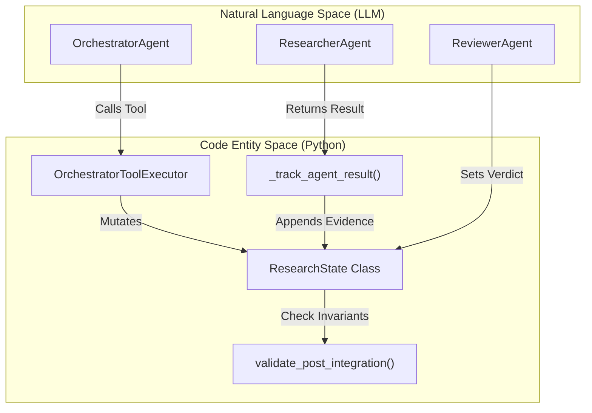
Sources: [physics_intern/agents/orchestrator/tools.py:5-17](), [physics_intern/engine.py:158-180](), [physics_intern/control/validation.py:3-12]().

## LoopState and Context Management

While `ResearchState` is persistent, `LoopState` manages transient information specific to the current iteration. This includes the history of agent dispatches in the current turn and "banners" (urgent system notifications) that must be shown to the Orchestrator.

*   **Context Assembly**: Each agent receives a fresh Markdown rendering of the `ResearchState`. No conversation history is carried between iterations [CLAUDE.md:34]().
*   **Dispatch Tracking**: The system tracks which agents were sent which tasks to prevent redundant work within a single iteration [physics_intern/state/loop_state.py:6]().

For details, see [LoopState and Context Management](#2.3).

## Validation and Control Flow

To maintain scientific integrity, the system runs a validation pipeline after every state mutation. This prevents "hallucinated" progress and ensures that the research graph remains logically consistent.

### The Validation Pipeline
The engine enforces safety checks to prevent common failure modes in autonomous LLM research.

```mermaid
graph LR
    [Raw State Mutation] --> V1["check_phantom_labels()"]
    V1 --> V2["check_er_demotion_safety()"]
    V2 --> V3["check_stale_unverified_labels()"]
    V3 --> V4["check_critique_resolution_consistency()"]
    V4 --> [Final Validated State]

    subgraph "Violation Reporting"
        V1 -- "Log Event" --> EventLog["EVENT_LOG.jsonl"]
        V2 -- "Log Event" --> EventLog
    end
```
Sources: [physics_intern/control/validation.py:3-12](), [tests/test_validation.py:1-25](), [tests/test_scaffold_log.py:13-30]().

*   **Phantom Labels**: Strips claims of "VERIFIED" from text if the `ResearchState` doesn't actually contain a successful review [physics_intern/control/validation.py:152-162]().
*   **ER Demotion**: Automatically demotes an Established Result (ER) back to a Working Hypothesis (WH) if a new review refutes it [physics_intern/control/validation.py:86-105]().

For details, see [Validation and Control Flow](#2.4).

---

# Page: Engine and Research Lifecycle

# Engine and Research Lifecycle

<details>
<summary>Relevant source files</summary>

The following files were used as context for generating this wiki page:

- [DOCUMENTATION.md](DOCUMENTATION.md)
- [tests/test_engine.py](tests/test_engine.py)
- [tests/test_report_recommendations.py](tests/test_report_recommendations.py)
- [tests/test_scaffold_log.py](tests/test_scaffold_log.py)
- [tests/test_validation.py](tests/test_validation.py)

</details>


The `PhysicsIntern` engine, defined in `physics_intern/engine.py`, serves as the central orchestrator for the multi-agent research process. It manages the iterative loop where a physics problem is decomposed into tasks, executed by specialized agents, and integrated into a persistent research state. The engine is responsible for maintaining the research lifecycle, enforcing budget constraints, and ensuring the scientific integrity of the evolving solution.

### Core Engine Loop and Iteration Flow

The engine operates through a high-level `run()` method that executes a sequence of iterations until a termination condition is met or a budget is exhausted [physics_intern/engine.py:101-140](). Each iteration follows a structured sequence of planning, dispatching, and integration.

**Research Lifecycle States**
The research progresses through three primary statuses [physics_intern/engine.py:35-42]():
*   `in_progress`: The default state where agents are actively working on the problem.
*   `completed`: Set when the `FormatterAgent` successfully generates a final `ANSWER.md`.
*   `partially_complete`: Set if a budget circuit-breaker (e.g., max time or tokens) is triggered before a natural conclusion.

#### The Iteration Sequence
1.  **Orchestration**: The `OrchestratorAgent` analyzes the current `ResearchState` and emits a list of `Task` objects [physics_intern/engine.py:214-221]().
2.  **Dispatch**: The engine iterates through the proposed tasks and routes them to the appropriate specialized agents [physics_intern/engine.py:230-245]().
3.  **Execution**: Agents (e.g., `Researcher`, `Computer`, `Reviewer`) execute their assigned tasks. For `ComputerAgent`, the engine may enrich the task with context from prior failures to prevent repetitive errors [physics_intern/engine.py:280-300]().
4.  **Integration**: Results from agents are processed and used to update the `ResearchState`.
5.  **Validation**: After state updates, the engine runs `validate_post_integration` to check for logical inconsistencies or "phantom" labels [physics_intern/control/validation.py:35-65]().

**Engine Dispatch and Execution Flow**
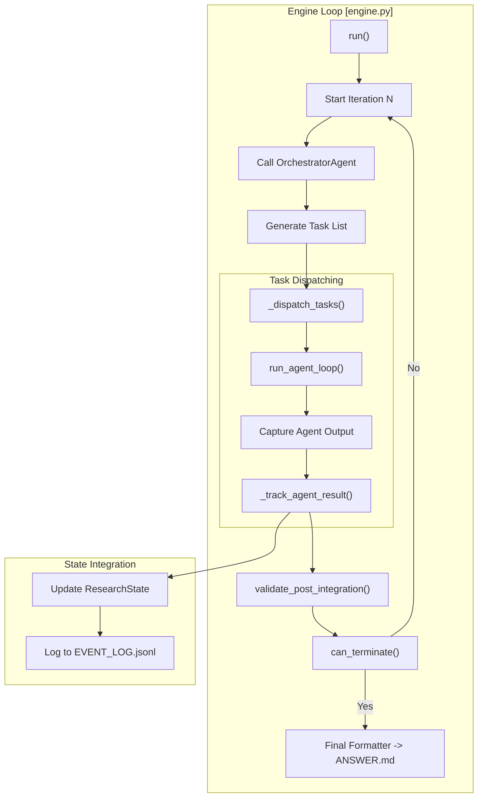
Sources: [physics_intern/engine.py:101-140](), [physics_intern/engine.py:230-245](), [physics_intern/control/validation.py:35-65]().

### Task Dispatch and Stall Handling

The engine utilizes `_dispatch_tasks` to manage the parallel or sequential execution of agent assignments. A key feature is the handling of **stalls**—situations where agents fail to make progress or repeatedly produce inconclusive results.

*   **Compute Verdict Tracking**: The engine tracks the outcomes of `REVIEW` tasks. If a hypothesis is `REFUTED` or `INCONCLUSIVE`, the engine increments a failure counter for that specific target in the `LoopState` [tests/test_engine.py:147-179]().
*   **Context Enrichment**: When a `ComputerAgent` is assigned a task that has previously failed, the engine injects "Prior Failure Context" into the `CURRENT_TASK.md` prompt, including the root cause of previous failures to guide the agent toward a different approach [tests/test_engine.py:75-95]().
*   **Progress Watchdog**: During long-running tool loops (like complex Python simulations), a progress check is injected after a configurable number of rounds (`progress_check_interval`) to ensure the agent is not stuck in an infinite loop [tests/test_report_recommendations.py:90-110]().

Sources: [physics_intern/engine.py:280-300](), [tests/test_engine.py:147-179](), [tests/test_report_recommendations.py:90-110]().

### Circuit-Breaker Mechanisms and Termination

The engine implements several "gates" to prevent runaway costs or infinite loops. These are checked at the end of every iteration.

| Mechanism | Description | Implementation |
| :--- | :--- | :--- |
| **Iteration Cap** | Stops after `max_iterations` is reached. | `physics_intern/engine.py:112` |
| **Wall Clock** | Stops if the run exceeds `max_wall_seconds`. | `DOCUMENTATION.md:33` |
| **Token Budget** | Stops if cumulative output tokens exceed `max_total_output_tokens`. | `DOCUMENTATION.md:33` |
| **Cost Gate** | Stops if cumulative USD cost exceeds `max_cost_usd`. | `DOCUMENTATION.md:33` |
| **Stall Limit** | Forces a strategy shift if a specific result is recomputed too many times. | `tests/test_engine.py:128` |

#### Termination Logic (`can_terminate`)
The `can_terminate` function determines if the research has reached a sufficient state to stop. It requires a minimum number of Established Results (ERs) as defined in the configuration (default is often 1) [tests/test_validation.py:44-46](). If a soft-exit trigger (like token budget) is hit, the engine forces a "best-effort" termination where the `FormatterAgent` is called one last time to synthesize the existing work into an `ANSWER.md` with a `partially_complete` status [DOCUMENTATION.md:33-36]().

Sources: [physics_intern/engine.py:112-120](), [physics_intern/control/validation.py:110-130](), [DOCUMENTATION.md:31-36]().

### State Validation and Consistency

To maintain the scientific "Source of Truth," the engine runs a validation pipeline after every integration phase. This pipeline identifies and fixes common LLM hallucinations or state corruptions.

**Code Entities in Validation**
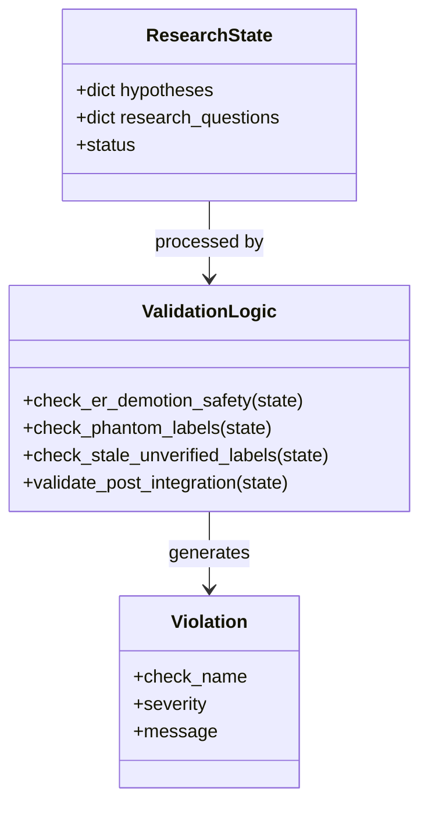

1.  **ER Demotion Safety**: If an Established Result (ER) receives a `REFUTED` verdict during a later review, it is automatically demoted back to a Working Hypothesis (WH) to prevent false conclusions from persisting [tests/test_validation.py:87-105]().
2.  **Phantom Label Check**: Agents sometimes hallucinate that a hypothesis is `VERIFIED` in the text derivation before a `ReviewerAgent` has actually confirmed it. The engine scans for these "phantom" labels and replaces them with `[unverified]` [tests/test_validation.py:153-162]().
3.  **Stale Label Promotion**: Conversely, if a hypothesis has been verified but the text still says `[unverified]`, the engine updates the text to reflect the actual status [tests/test_validation.py:194-208]().
4.  **Event Logging**: All violations found during validation are logged to `EVENT_LOG.jsonl` under the `state_invariants` category for post-run auditing [tests/test_scaffold_log.py:56-85]().

Sources: [physics_intern/control/validation.py:35-100](), [tests/test_validation.py:87-105](), [tests/test_scaffold_log.py:56-85]().

---

# Page: ResearchState and Data Model

# ResearchState and Data Model

<details>
<summary>Relevant source files</summary>

The following files were used as context for generating this wiki page:

- [CLAUDE.md](CLAUDE.md)
- [tests/test_orchestrator.py](tests/test_orchestrator.py)
- [tests/test_orchestrator_tools.py](tests/test_orchestrator_tools.py)
- [tests/test_renderers.py](tests/test_renderers.py)
- [tests/test_research_state.py](tests/test_research_state.py)

</details>


The `ResearchState` class serves as the **single source of truth** for the entire multi-agent system [CLAUDE.md:32-32](). It encapsulates the complete scientific trajectory of a problem, including hypotheses, evidence, critiques, and the history of failed approaches. Unlike traditional agent frameworks that rely on long-context conversation history, PhysicsIntern uses a stateless approach where each agent is provided with a fresh context rendered directly from the current `ResearchState` [CLAUDE.md:34-34]().

## Core Data Entities

The research process is modeled through several interconnected entities defined in `physics_intern/state/research_state.py`.

### Hypotheses (WH and ER)
Hypotheses are the primary units of progress. They are identified by prefixes:
*   **WH (Working Hypothesis):** A candidate result currently under investigation [tests/test_research_state.py:39-41]().
*   **ER (Established Result):** A hypothesis that has been verified and promoted. ERs are considered immutable and can only be demoted by an Adjudicator through a valid critique [CLAUDE.md:39-39]().

| Field | Description |
| :--- | :--- |
| `id` | Unique identifier (e.g., `WH-001`, `ER-002`) [tests/test_research_state.py:99-106](). |
| `statement` | The core claim or formula [tests/test_research_state.py:101-101](). |
| `status` | One of `WORKING`, `ESTABLISHED`, or `ABANDONED` [tests/test_research_state.py:102-109](). |
| `derivation` | The logical or mathematical steps supporting the claim [tests/test_renderers.py:64-64](). |
| `evidence` | List of `Evidence` objects (computational or analytical) [tests/test_research_state.py:104-104](). |
| `review` | A `ReviewResult` containing a `Verdict` (VERIFIED, REFUTED, INCONCLUSIVE) [tests/test_research_state.py:111-111](). |

### Research Questions (RQ)
RQs guide the investigation. The Orchestrator uses them to focus research efforts. An RQ must be resolved (usually by spawning a WH) before the research moves forward [tests/test_orchestrator_tools.py:137-137]().

### Critiques and Verdicts
*   **Critiques:** Strategic or technical audits targeting specific hypotheses [tests/test_research_state.py:113-118](). They have a `Severity` (HIGH, LOW) and a `Status` (ACTIVE, RESOLVED) [tests/test_renderers.py:108-115]().
*   **Verdicts:** The outcome of a Reviewer's assessment of a hypothesis [tests/test_renderers.py:77-77]().

**Sources:** [physics_intern/state/research_state.py:1-200](), [tests/test_research_state.py:5-18](), [tests/test_renderers.py:19-32]()

## Lifecycle and Transitions

The state evolves through specific tool-driven mutations and automated scaffolding logic.

### Hypothesis Promotion (WH → ER)
Promotion occurs automatically when a `WH` receives a `VERIFIED` verdict and its dependencies are satisfied [CLAUDE.md:40-40](). This is handled by the `auto_promote` logic in `critique_routing.py` [CLAUDE.md:40-41]().

### ResearchState Lifecycle Diagram
This diagram maps the transition of research entities from creation to established fact.

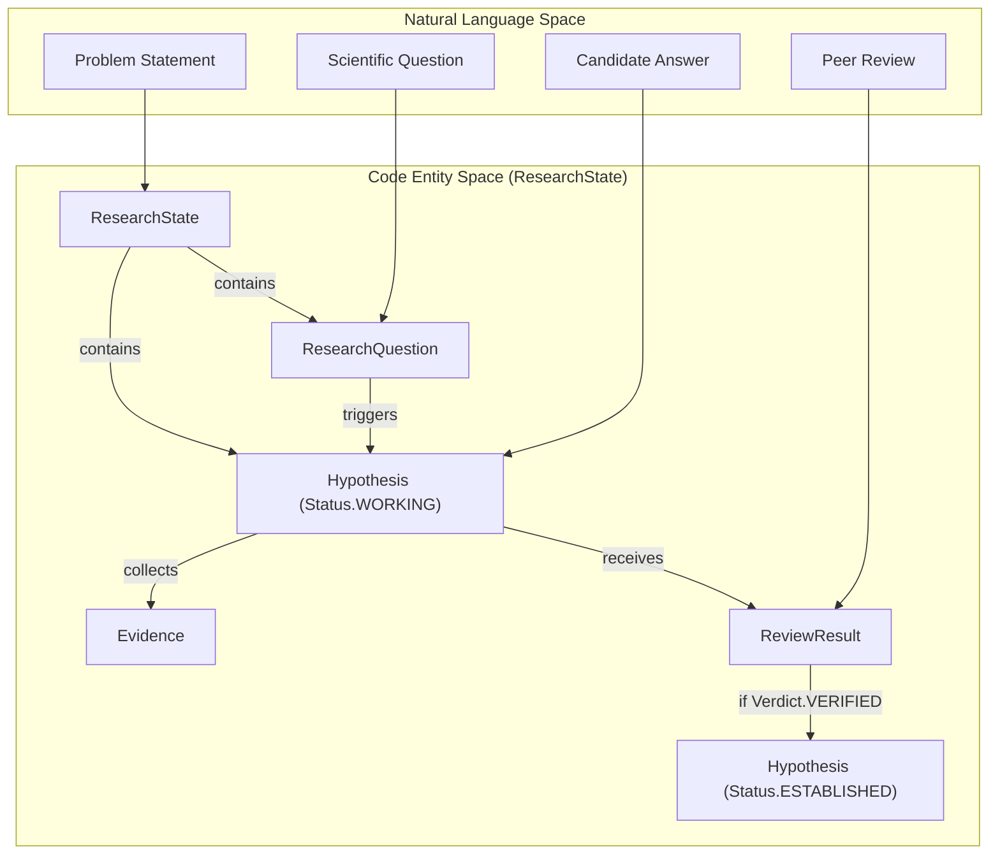
**Sources:** [physics_intern/state/research_state.py:5-18](), [CLAUDE.md:39-41](), [tests/test_orchestrator_tools.py:107-138]()

## Persistence and Serialization

The `ResearchState` is persisted in two formats to the workspace:
1.  **`RESEARCH_GRAPH.json`**: A full JSON serialization of the `ResearchState` object, used for resuming sessions [tests/test_research_state.py:181-182]().
2.  **Markdown Snapshots**: Human-readable versions (`RESEARCH_STATE.md`, `EVIDENCE_LOG.md`, `CRITIQUE_LOG.md`) rendered once per iteration for git history and manual inspection [CLAUDE.md:33-33](). These are **write-only**; the system never reads them back into memory [CLAUDE.md:33-33]().

### Data Flow: Persistence and Context Injection
This diagram shows how `ResearchState` mediates between the persistent storage and the active Agent context.

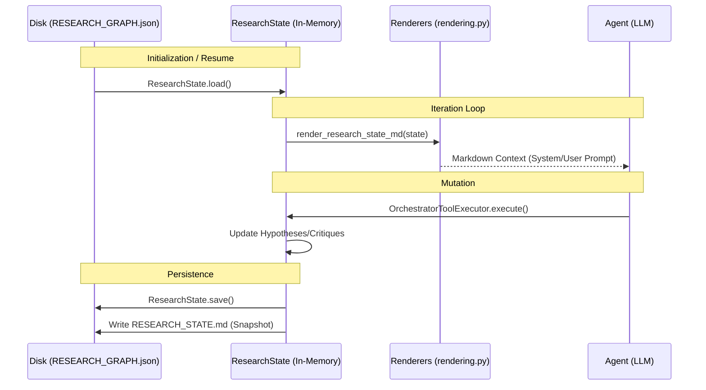
**Sources:** [physics_intern/state/research_state.py:181-200](), [CLAUDE.md:32-34](), [tests/test_renderers.py:6-11]()

## Key Implementation Details

### State Mutation via OrchestratorTools
The `OrchestratorToolExecutor` is the primary mechanism for modifying the `ResearchState`. It enforces constraints such as:
*   **WH Cap:** Maximum of 2 working hypotheses at a time [tests/test_orchestrator_tools.py:153-155]().
*   **Critique Blockers:** Creation of new WHs is blocked if there are unresolved HIGH severity critiques [tests/test_orchestrator_tools.py:175-177]().
*   **RQ Resolution:** Adding a hypothesis from an RQ automatically marks that RQ as `RESOLVED` [tests/test_orchestrator_tools.py:136-137]().

### Verification and Sanity Checks
The state includes a `SanityCheck` mechanism used during the review process to ensure mathematical consistency before a verdict is finalized [tests/test_renderers.py:30-30]().

**Sources:** [tests/test_orchestrator_tools.py:1-210](), [physics_intern/state/research_state.py:30-31]()

---

# Page: LoopState and Context Management

# LoopState and Context Management

<details>
<summary>Relevant source files</summary>

The following files were used as context for generating this wiki page:

- [tests/test_engine.py](tests/test_engine.py)
- [tests/test_orchestrator.py](tests/test_orchestrator.py)
- [tests/test_renderers.py](tests/test_renderers.py)
- [tests/test_report_recommendations.py](tests/test_report_recommendations.py)
- [tests/test_research_state.py](tests/test_research_state.py)
- [tests/test_scaffold_log.py](tests/test_scaffold_log.py)
- [tests/test_validation.py](tests/test_validation.py)

</details>


The `LoopState` serves as the transient scratch space for the `PhysicsIntern` engine, managing data that persists across individual agent calls within a single iteration but does not necessarily belong in the long-term `ResearchState`. This page details how the orchestrator's context is assembled, how dispatch history is tracked, and how banners are used to guide agent behavior.

## LoopState Implementation

The `LoopState` class tracks the execution flow of the research loop, including dispatch records and failure counters for specific hypotheses.

### Key Data Structures
*   **`DispatchRecord`**: Stores the history of agent assignments, including the `task_id`, `assigned_to`, and the specific `target_claim` (e.g., "WH-001") [physics_intern/state/loop_state.py:6-13]().
*   **`claim_failure_count`**: A mapping of hypothesis IDs to the number of times they have failed verification or computation [physics_intern/state/loop_state.py:69-69]().
*   **`pending_compute_verdicts`**: A list of signals indicating that a specific claim needs re-computation or analytical revision following a `REFUTED` or `INCONCLUSIVE` verdict [tests/test_engine.py:160-162]().

### Workflow: Failure Tracking
When a `ReviewerAgent` issues a non-verified verdict, the engine updates the `LoopState` to influence future dispatches:
1.  **Verdict Detection**: `_track_agent_result` identifies `REFUTED` or `INCONCLUSIVE` statuses [tests/test_engine.py:147-158]().
2.  **Counter Increment**: The failure count for the target claim is incremented in `claim_failure_count` [tests/test_engine.py:69-69]().
3.  **Task Enrichment**: Subsequent tasks targeting that claim are enriched with "Prior Failure Context" to prevent the next agent from repeating the same errors [tests/test_engine.py:88-93]().

**Sources:** [physics_intern/state/loop_state.py:1-20](), [tests/test_engine.py:45-114](), [tests/test_engine.py:114-179]().

---

## Orchestrator Context Assembly

The `OrchestratorAgent` functions as the central dispatcher. Each iteration, it receives a dynamically constructed prompt that combines the global research status with transient iteration-specific data.

### Prompt Construction Flow
The `build_context` method in the orchestrator assembles the prompt in the following order:
1.  **Problem Statement**: The original physics problem and background survey [tests/test_orchestrator.py:91-120]().
2.  **Slim Research State**: A rendered version of the current `ResearchState` focusing on active hypotheses (WH/ER) and active critiques [tests/test_renderers.py:17-18](), [tests/test_renderers.py:181-212]().
3.  **Research Notes**: Filtered history of the last 5 iterations to maintain focus without exceeding context windows [tests/test_orchestrator.py:166-174]().
4.  **Context Suffix (Banners)**: Transient feedback or instructions (e.g., results of the previous iteration's tools) appended to the very end of the user message [tests/test_orchestrator.py:131-145]().

### Context Suffix and Banners
The `context_suffix` is a transient string in the `OrchestratorAgent`. Once it is consumed by `build_context`, it is cleared to ensure that iteration-specific banners do not leak into future iterations [tests/test_orchestrator.py:146-151]().

**Sources:** [tests/test_orchestrator.py:64-174](), [tests/test_renderers.py:1-32](), [physics_intern/agents/orchestrator/context.py:1-20]().

---

## Data Flow: From Code to Context

The following diagram illustrates how internal code entities and state objects are transformed into the Natural Language prompt seen by the Orchestrator.

### Diagram: Context Assembly Pipeline
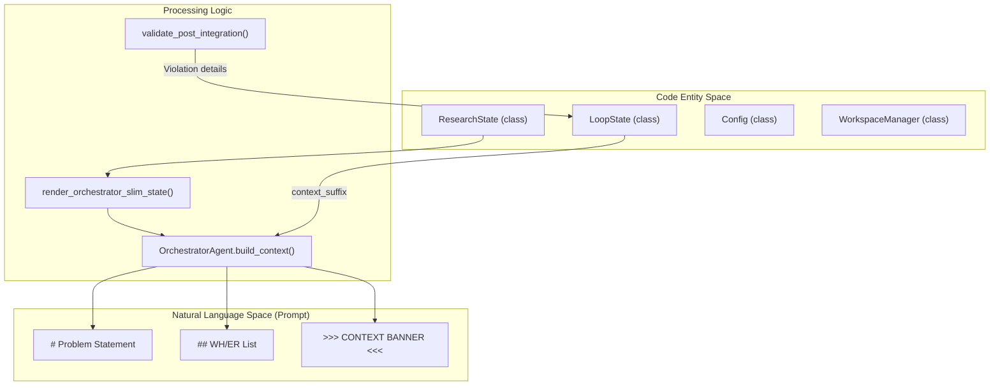
**Sources:** [tests/test_renderers.py:17-18](), [tests/test_orchestrator.py:131-151](), [tests/test_validation.py:3-12]().

---

## Dispatch History and Instrumentation

The engine logs all major transitions and agent calls to `EVENT_LOG.jsonl` using the `log_scaffold_event` and `log_llm_call` utilities.

### Event Categories
| Category | Purpose | Example Event |
| :--- | :--- | :--- |
| `loop_control` | Budget and flow overrides | `p1_budget_override` [tests/test_scaffold_log.py:18-18]() |
| `state_invariants` | Validation failures | `phantom_labels` [tests/test_scaffold_log.py:81-83]() |
| `llm_call` | Token usage and model latency | `orchestrator` call [tests/test_scaffold_log.py:91-103]() |

### Implementation Details
*   **`log_llm_call`**: Captures metadata including `input_tokens`, `output_tokens`, `reasoning_tokens`, and `duration_s` [tests/test_scaffold_log.py:156-172]().
*   **`log_scaffold_event`**: Records architectural decisions, such as forced critiques or budget adjustments, to provide a trace of the engine's "thinking" [tests/test_scaffold_log.py:13-30]().

**Sources:** [tests/test_scaffold_log.py:1-177](), [physics_intern/core/workspace.py:7-8]().

---

## State Invariants and Banners

The `LoopState` interacts with the `validate_post_integration` pipeline to generate banners when the `ResearchState` violates structural rules.

### Diagram: Validation to LoopState Flow
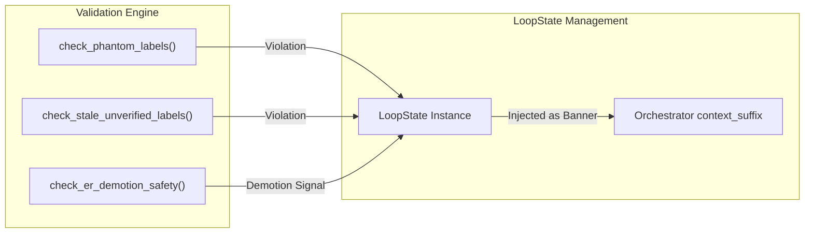

### Banner Injection Logic
1.  **Validation**: Functions like `check_phantom_labels` detect if an agent claimed a result was `VERIFIED` in the text without a corresponding `ReviewResult` object [tests/test_validation.py:153-162]().
2.  **Logging**: Violations are logged to the `EVENT_LOG.jsonl` [tests/test_scaffold_log.py:53-85]().
3.  **Correction**: The engine may inject a `REMINDER` banner into the orchestrator's context if conventions are missing or if state inconsistencies are detected [tests/test_orchestrator.py:64-72]().

**Sources:** [tests/test_validation.py:1-150](), [tests/test_scaffold_log.py:53-85](), [tests/test_orchestrator.py:64-87]().

---

# Page: Validation and Control Flow

# Validation and Control Flow

<details>
<summary>Relevant source files</summary>

The following files were used as context for generating this wiki page:

- [CLAUDE.md](CLAUDE.md)
- [tests/test_engine.py](tests/test_engine.py)
- [tests/test_orchestrator_tools.py](tests/test_orchestrator_tools.py)
- [tests/test_report_recommendations.py](tests/test_report_recommendations.py)
- [tests/test_scaffold_log.py](tests/test_scaffold_log.py)
- [tests/test_validation.py](tests/test_validation.py)

</details>


The **Validation and Control Flow** subsystem ensures the integrity of the `ResearchState` after agent interactions and governs the lifecycle of the research process. It acts as a safety layer that prevents state corruption (e.g., "phantom" claims), enforces structural invariants (e.g., ER demotion safety), and determines when the engine has met the criteria to stop.

## Post-Integration Validation Pipeline

The `validate_post_integration` function is the primary entry point for state sanitization, executed at the end of every research iteration [physics_intern/control/validation.py:6-12](). It runs a suite of checks that identify and, in some cases, automatically repair violations of system invariants.

### Key Validation Checks

| Check | Function | Description |
| :--- | :--- | :--- |
| **ER Demotion Safety** | `check_er_demotion_safety` | Identifies Established Hypotheses (ERs) that have been refuted by new reviews and demotes them back to Working Hypotheses (WH) [tests/test_validation.py:86-105](). |
| **Phantom Labels** | `check_phantom_labels` | Scans hypothesis derivations for the string "VERIFIED". If the hypothesis does not have a corresponding `ReviewResult` of `VERDICT.VERIFIED`, it replaces the label with `[unverified]` [tests/test_validation.py:153-162](). |
| **Stale Labels** | `check_stale_unverified_labels` | The inverse of phantom checks: if a derivation contains `[unverified]` but the hypothesis has since been verified, it promotes the text to `VERIFIED` [tests/test_validation.py:194-209](). |
| **Critique Consistency** | `check_critique_resolution_consistency` | Ensures that critiques marked as resolved in the `ResearchState` are actually consistent with the resolution text provided by agents [tests/test_validation.py:11-12](). |

### Violation Reporting
When a check fails, it generates a `Violation` object containing the severity (`WARNING` or `ERROR`), a message, and specific details [tests/test_validation.py:59-79](). These violations are logged to `EVENT_LOG.jsonl` under the `state_invariants` category for auditing [tests/test_scaffold_log.py:56-85]().

**Sources:** [physics_intern/control/validation.py:1-25](), [tests/test_validation.py:1-25](), [tests/test_scaffold_log.py:53-86]()

## Termination Gates

The `can_terminate` function determines if the research loop should exit. It evaluates the current `ResearchState` against configurable thresholds to decide if the problem is "solved" or if the system should continue iterating.

### Termination Logic
The engine can terminate under the following conditions:
1.  **Established Results (ER) Count**: The system has reached the `min_er_for_completion` threshold (default is often 1) [tests/test_validation.py:44-45]().
2.  **Critic Silence**: If the `CriticAgent` has not produced a high-severity critique for several iterations, indicating strategic convergence [tests/test_validation.py:33-37]().
3.  **Resource Exhaustion**: The iteration count or token budget has been exceeded, triggering a forced termination [CLAUDE.md:48-49]().

### Research State to Control Logic Mapping
The following diagram illustrates how entities in the `ResearchState` are mapped to the validation functions that govern them.

**Diagram: State Invariant Enforcement**
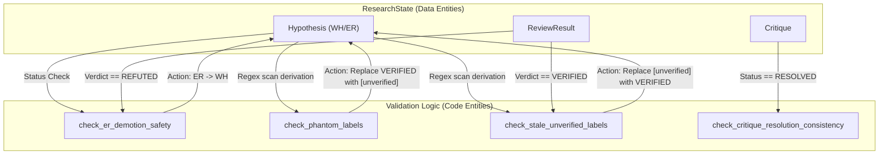
**Sources:** [physics_intern/state/research_state.py:7-25](), [physics_intern/control/validation.py:3-12](), [tests/test_validation.py:86-105]()

## ER Demotion and Safety

A critical invariant of the system is that Established Results (ERs) must be supported by valid, unrefuted evidence. However, because agents may produce new derivations or code executions that contradict earlier findings, the system must handle "Established" results that are no longer valid.

1.  **Detection**: `check_er_demotion_safety` identifies any hypothesis with `status=HypothesisStatus.ESTABLISHED` that also has a `ReviewResult` with `verdict=Verdict.REFUTED` [tests/test_validation.py:87-98]().
2.  **Demotion**: The hypothesis is renamed from `ER-XXX` to `WH-XXX` and its status is reverted to `WORKING` [tests/test_validation.py:102-104]().
3.  **Immutability Rule**: Outside of this specific validation gate, ERs are treated as immutable by the `OrchestratorAgent`. No agent is permitted to dispatch tasks directly against an ER [CLAUDE.md:39-40]().

## Control Flow Lifecycle

The research engine manages the transition between high-level phases (Mapping, Research, Synthesis).

**Diagram: Research Lifecycle Control Flow**
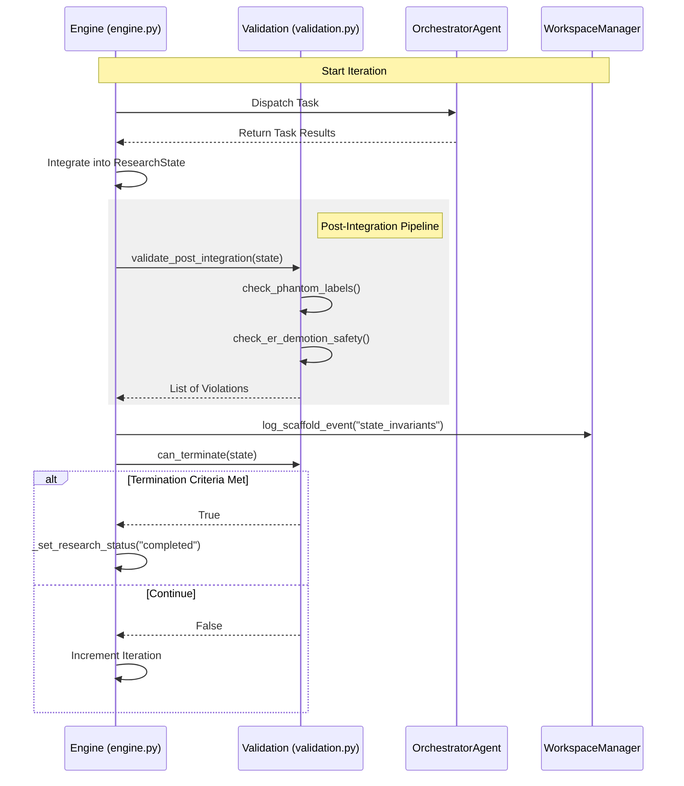
**Sources:** [physics_intern/engine.py:30-42](), [physics_intern/control/validation.py:3-12](), [tests/test_scaffold_log.py:53-86](), [CLAUDE.md:41-41]()

---

# Page: Agent System

# Agent System

<details>
<summary>Relevant source files</summary>

The following files were used as context for generating this wiki page:

- [DOCUMENTATION.md](DOCUMENTATION.md)
- [README.md](README.md)
- [tests/test_agent_structure.py](tests/test_agent_structure.py)
- [tests/test_rsa.py](tests/test_rsa.py)

</details>


The PhysicsIntern agent system is a multi-agent scaffolding designed for autonomous scientific research. It decomposes complex physics problems into manageable units of work handled by nine specialized agent roles. These agents interact with a centralized `ResearchState` to build hypotheses, execute derivations, and verify results.

## BaseAgent Architecture

All agents in the system inherit from the `BaseAgent` abstract class. This class provides the standard interface for receiving state, interacting with LLM providers, and processing responses.

*   **Stateless Execution**: Agents do not maintain internal conversation history. Every turn is a fresh call where the necessary context is rendered from the `ResearchState` [README.md:13-13]().
*   **Prompt Management**: Agents use system prompts and user message templates to guide the LLM.
*   **Tool Integration**: Agents can be "one-shot" (returning structured text/JSON) or "tool-calling" (interacting with the environment or state) [tests/test_agent_structure.py:26-56]().

### Agent System Overview
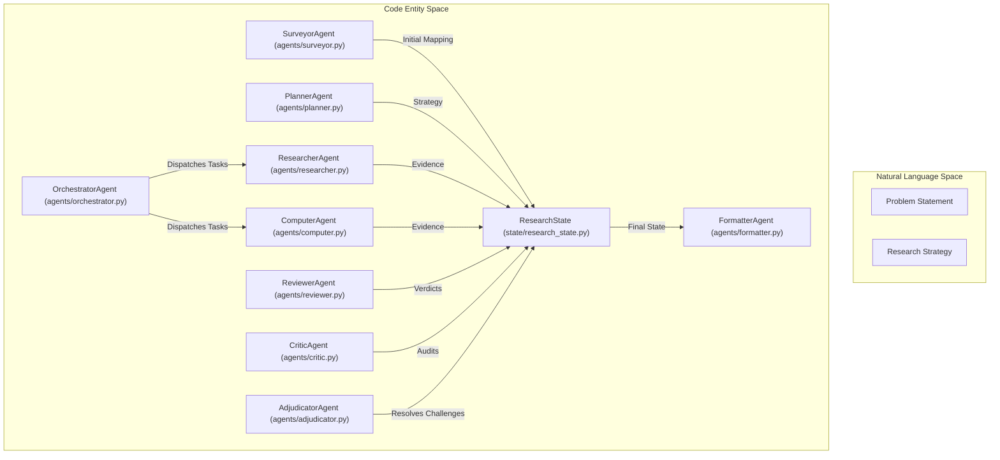
**Sources:** [README.md:11-13](), [tests/test_agent_structure.py:7-21]()

## Specialized Agent Roles

The system distributes labor across specialized roles to ensure high-fidelity scientific output.

| Agent Role | Primary Responsibility | Interaction Type |
| :--- | :--- | :--- |
| **Orchestrator** | Central dispatcher; manages hypotheses and research questions. | Tool-calling (State mutation) |
| **Planner** | Formulates and revises the high-level research strategy. | One-shot |
| **Researcher** | Performs analytical derivations and mathematical reasoning. | One-shot (JSON block) |
| **Computer** | Writes and executes Python code in a sandboxed environment. | Tool-calling (Sandbox) |
| **Reviewer** | Adversarially reviews evidence to provide verdicts. | One-shot |
| **Critic** | Audits the overall research state for strategic coherence. | One-shot |
| **Adjudicator** | Resolves conflicts when established results are challenged. | One-shot |
| **Surveyor** | Maps the problem landscape before the loop begins. | One-shot |
| **Formatter** | Synthesizes the final `ANSWER.md` from the research state. | One-shot |

**Sources:** [README.md:11-11](), [tests/test_agent_structure.py:26-56]()

## ResearchState Interaction

Agents do not communicate directly. Instead, they mutate the `ResearchState` via tools or structured responses that the `Engine` integrates into the state.

1.  **Context Injection**: The `Engine` renders relevant portions of the `ResearchState` into Markdown (e.g., `RESEARCH_STATE.md`, `EVIDENCE_LOG.md`) and provides them to the agent.
2.  **Action Execution**: Agents perform work (e.g., `execute_python`) or propose state changes (e.g., `add_hypothesis`).
3.  **State Mutation**: The `Engine` validates and applies these changes to the `ResearchState` [README.md:13-13]().

### Agent-State Interaction Flow
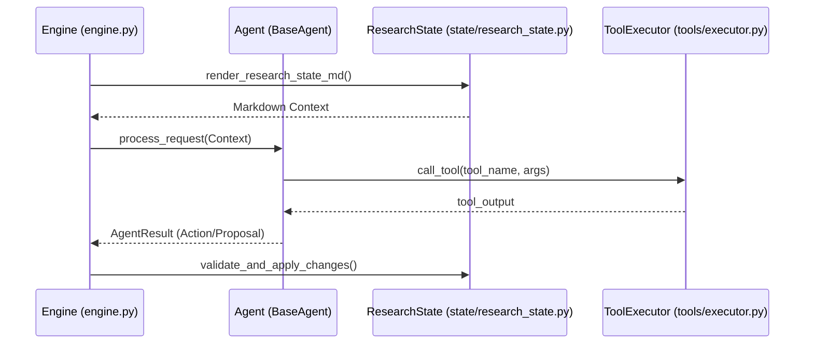
**Sources:** [README.md:13-13](), [tests/test_agent_structure.py:61-72]()

## Child Pages

For detailed technical specifications of each agent group, see the following sub-pages:

*   [Orchestrator and Planner Agents](#3.1): Details on the `OrchestratorAgent` dispatch logic, `OrchestratorToolExecutor` guardrails (caps on hypotheses/questions), and `PlannerAgent` strategy generation.
*   [Evidence Agents: Researcher and Computer](#3.2): Details on analytical derivations via `ResearcherAgent`, sandboxed execution via `ComputerAgent`, and the `submit_result` lifecycle.
*   [Review, Critique, and Adjudication Agents](#3.3): Details on the adversarial review flow, `VERIFIED`/`REFUTED` verdict transitions, and the `AdjudicatorAgent` for resolving state challenges.
*   [Surveyor, Formatter, and Autophysicist](#3.4): Details on pre-loop mapping, final answer generation via `FormatterAgent`, and the alternative `Autophysicist` single-agent mode.

---

# Page: Orchestrator and Planner Agents

# Orchestrator and Planner Agents

<details>
<summary>Relevant source files</summary>

The following files were used as context for generating this wiki page:

- [CLAUDE.md](CLAUDE.md)
- [tests/test_orchestrator.py](tests/test_orchestrator.py)
- [tests/test_orchestrator_tools.py](tests/test_orchestrator_tools.py)
- [tests/test_planner.py](tests/test_planner.py)
- [tests/test_renderers.py](tests/test_renderers.py)
- [tests/test_research_state.py](tests/test_research_state.py)
- [tests/test_surveyor.py](tests/test_surveyor.py)

</details>


The **OrchestratorAgent** and **PlannerAgent** form the decision-making core of the PhysicsIntern system. While the Orchestrator manages the immediate execution of the research loop and state mutations, the Planner maintains the long-term strategic vision, intervening only when the research direction requires significant revision.

## OrchestratorAgent: The Central Dispatcher

The `OrchestratorAgent` [physics_intern/agents/orchestrator/__init__.py]() is the primary agent responsible for analyzing the current `ResearchState` and deciding which tasks to dispatch next. It operates as an agentic loop, utilizing a suite of tools to modify the research graph and assign work to specialized agents.

### Core Responsibilities
- **Context Synthesis**: Assembles a "slim" view of the `ResearchState` [physics_intern/agents/orchestrator/context.py:17-17]() to stay within context limits while providing a comprehensive overview of hypotheses, research questions (RQs), and evidence.
- **Task Dispatch**: Generates `Task` objects [physics_intern/state/task.py:22-35]() for other agents (Researcher, Computer, Reviewer, etc.).
- **State Mutation**: Uses `OrchestratorToolExecutor` to apply changes to the `ResearchState`, such as adding hypotheses or resolving RQs.

### Implementation and Data Flow
The Orchestrator receives a fresh context every iteration [CLAUDE.md:34-34](). This context includes the problem statement, conventions, the current strategy defined by the Planner, and recent research notes [tests/test_orchestrator.py:153-164]().

**Orchestrator Logic Flow**
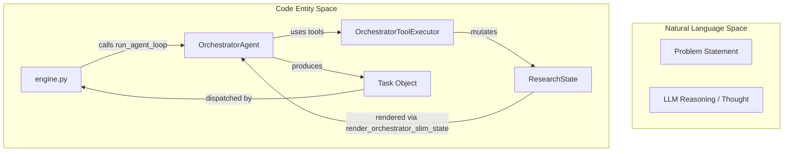
Sources: [physics_intern/agents/orchestrator/__init__.py](), [physics_intern/agents/orchestrator/context.py](), [physics_intern/state/research_state.py](), [CLAUDE.md:34-34]()

---

## OrchestratorToolExecutor Guardrails

The `OrchestratorToolExecutor` [physics_intern/agents/orchestrator/tools.py]() provides the functional interface for the Orchestrator to modify the `ResearchState`. It enforces strict guardrails to prevent state explosion and ensure logical consistency.

### Key Guardrails and Caps
- **Hypothesis Cap**: Prevents creating new Working Hypotheses (WH) if there are already 2 active WHs [tests/test_orchestrator_tools.py:153-174](). This forces the system to resolve existing ideas before branching.
- **Evidence Cap**: Dispatches to RQs are blocked if the question has already accumulated significant evidence without resolution [tests/test_orchestrator_tools.py:212-212]().
- **Focus Guards**: The Orchestrator is blocked from adding new hypotheses if there are unresolved high-severity critiques [tests/test_orchestrator_tools.py:175-209](). This ensures the agent addresses identified flaws before proceeding.
- **RQ Resolution**: When a hypothesis is added from an RQ, the source RQ is automatically marked as `RESOLVED` [tests/test_orchestrator_tools.py:136-137]().

### Tool Implementation Table
| Tool Name | Purpose | Key Constraint |
| :--- | :--- | :--- |
| `add_hypothesis` | Creates a new `WH` | Requires a source `RQ-ID` [tests/test_orchestrator_tools.py:139-151]() |
| `add_research_question` | Creates a new `RQ` | Limited by `RQ_CAP` |
| `resolve_critique` | Marks a `Critique` as resolved | Requires a resolution description |
| `update_conventions` | Modifies the problem's physical constants/units | Usually used in early iterations |

Sources: [physics_intern/agents/orchestrator/tools.py](), [tests/test_orchestrator_tools.py:105-212]()

---

## PlannerAgent: Strategy and Revision

The `PlannerAgent` [physics_intern/agents/planner/__init__.py]() acts as the "architect." Unlike the Orchestrator, which acts every iteration, the Planner is invoked at the start of the research (initial planning) or when the `Engine` detects a strategic failure (re-planning).

### Strategy Revision Triggers
The Planner is invoked in `PLAN_REVISE` mode [tests/test_planner.py:171-176]() when:
1. An Established Result (ER) is demoted back to WH due to a successful critique.
2. The Orchestrator fails to make progress (stalls).
3. Significant new evidence contradicts the current high-level strategy.

### Strategy Lifecycle
1. **Initial Plan**: The `SurveyorAgent` provides background, which the Planner uses to create the first `strategy` string in the `ResearchState` [tests/test_planner.py:51-58]().
2. **Execution**: The Orchestrator reads this strategy in its context to guide task selection [tests/test_orchestrator.py:142-143]().
3. **Revision**: If triggered, the Planner receives the `render_planner_revise_context` [physics_intern/agents/planner/context.py](), which includes the full history of failed approaches and active critiques to formulate a new path [tests/test_planner.py:104-167]().

**Planning Entity Association**
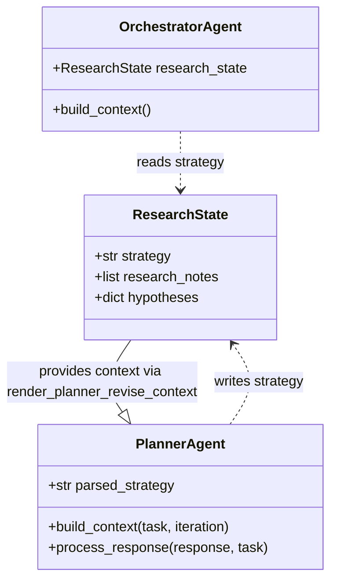
Sources: [physics_intern/agents/planner/__init__.py](), [physics_intern/agents/planner/context.py](), [tests/test_planner.py:67-103](), [physics_intern/state/research_state.py]()

---

## Data Flow: From Strategy to Execution

The transition from a high-level plan to concrete state changes follows a strict pipeline managed by the `Engine`.

1. **Planning**: `PlannerAgent` generates a strategy string.
2. **Contextualization**: `render_orchestrator_slim_state` [physics_intern/agents/orchestrator/context.py:17-17]() embeds the strategy into the Orchestrator's prompt.
3. **Decision**: `OrchestratorAgent` calls tools like `add_hypothesis` [tests/test_orchestrator_tools.py:118-125]().
4. **Validation**: The `Engine` runs `validate_post_integration` to ensure no invariants (like the WH cap) were violated during tool execution.

Sources: [physics_intern/agents/orchestrator/context.py](), [tests/test_orchestrator_tools.py](), [CLAUDE.md:32-41]()

---

# Page: Evidence Agents: Researcher and Computer

# Evidence Agents: Researcher and Computer

<details>
<summary>Relevant source files</summary>

The following files were used as context for generating this wiki page:

- [tests/test_researcher.py](tests/test_researcher.py)
- [tests/test_reviewer.py](tests/test_reviewer.py)
- [tests/test_tools.py](tests/test_tools.py)

</details>


Evidence agents are the primary workers responsible for generating technical content, derivations, and computational verification within the `PhysicsIntern` multi-agent system. While the **ResearcherAgent** focuses on analytical derivations and symbolic reasoning, the **ComputerAgent** operates within a sandboxed environment to execute Python code. Both agents are governed by a strict lifecycle that includes documenting approaches before submission and utilizing the `ToolExecutor` for external actions.

## ResearcherAgent: Analytical Derivations

The `ResearcherAgent` is designed for pen-and-paper style physics reasoning. It receives tasks from the `OrchestratorAgent` to address specific `ResearchQuestion` (RQ) or `Hypothesis` (WH) objects [physics_intern/agents/researcher.py:9-22]().

### Implementation and Data Flow
The agent follows a standard LLM loop but requires a structured JSON block within its output to be considered successful. This block must contain the keys `result`, `method`, `confidence`, and `summary` [physics_intern/agents/researcher.py:40-44]().

1.  **Context Construction**: The agent is provided with the current `ResearchState`, focusing on relevant RQs and WHs [physics_intern/agents/researcher.py:121-132]().
2.  **Response Processing**: Upon receiving an LLM response, the agent uses `_parse_researcher_json` to extract the structured evidence [physics_intern/agents/researcher.py:10-12]().
3.  **Evidence Integration**: The parsed data is wrapped in an `Evidence` object and appended to the `target_claim` (either an RQ or WH) in the `ResearchState` [physics_intern/agents/researcher.py:160-170]().

**Researcher Data Extraction Logic**
| Component | Description | Source |
| :--- | :--- | :--- |
| `_extract_derivation_text` | Strips the JSON block to keep only the natural language reasoning. | [physics_intern/agents/researcher.py:10]() |
| `_parse_researcher_json` | Uses regex and brace-counting to find the last valid JSON block. | [physics_intern/agents/researcher.py:31-64]() |
| `target_claim` | The ID (e.g., "RQ-001") where the evidence will be stored. | [physics_intern/agents/researcher.py:144-145]() |

Sources: [physics_intern/agents/researcher.py:9-170](), [tests/test_researcher.py:31-85]()

---

## ComputerAgent and ToolExecutor

The `ComputerAgent` provides the system with "hands" by executing Python code. It interacts with the `ToolExecutor`, which manages a dedicated workspace for scripts and outputs [physics_intern/agents/computer/tools.py:10-16]().

### The execute_python Lifecycle
Execution is not a simple "run and return" call. It follows a managed lifecycle to ensure reproducibility and safety:

1.  **Gating (document_approach)**: Before execution, the agent must describe its plan. This is enforced by the orchestrator but implemented via the `ToolExecutor` sandbox [physics_intern/agents/computer/tools.py:13-16]().
2.  **Sanitization**: Filenames provided by the agent are sanitized to prevent directory traversal and ensure `.py` extensions [tests/test_tools.py:86-102]().
3.  **Execution**: Code is run in a **fresh Python process** for every call. No state is persisted between calls except for files written to the disk [tests/test_tools.py:71-77]().
4.  **Truncation**: Standard output is capped (typically at 10KB) to prevent context window overflow in the LLM [tests/test_tools.py:49-57]().

### ToolExecutor Sandbox
The `ToolExecutor` class (defined in `physics_intern/agents/computer/tools.py`) handles the mechanics of the filesystem and subprocess management.

**Code Entity Space: ToolExecutor Internals**
| Function/Attribute | Role |
| :--- | :--- |
| `_computations_dir` | Path where all `.py` and `.output` files are stored. | [tests/test_tools.py:32]() |
| `execute_python` | The primary tool name recognized by the system. | [tests/test_tools.py:22]() |
| `_sanitize_filename` | Logic to strip `..`, `/`, and `\` from agent-suggested names. | [tests/test_tools.py:87-91]() |
| `timeout` | Prevents infinite loops (default 60s). | [tests/test_tools.py:43-48]() |

**Bridge: Natural Language to Code Entity Space (Execution Flow)**
```mermaid
graph TD
    subgraph "Natural Language Space (Agent Intent)"
        A["'I need to calculate the eigenvalue'"] --> B["'Plan: Use NumPy to solve M'"]
    end

    subgraph "Code Entity Space (System Implementation)"
        B --> C["execute_python(code, filename, purpose)"]
        C --> D["ToolExecutor.execute()"]
        D --> E["_sanitize_filename()"]
        E --> F["Subprocess: python3 tool_exec_001.py"]
        F --> G["Capture stdout/stderr"]
        G --> H["Truncate if > 10KB"]
        H --> I["AgentResult.output"]
    end
```
Sources: [physics_intern/agents/computer/tools.py:10-16](), [tests/test_tools.py:19-84](), [tests/test_tools.py:85-133]()

---

## Evidence Submission and Gating

Both agents must eventually call `submit_result` (or provide the equivalent JSON block) to finalize their task. This transition moves the agent's work from "Transient Thought" to "Permanent Evidence" in the `ResearchState`.

### The submit_result Protocol
The system enforces a "Think-Plan-Execute-Submit" flow:
1.  **document_approach**: The agent writes its intended methodology to the workspace.
2.  **Action**: Researcher performs derivation; Computer runs code.
3.  **submit_result**: The agent provides the final answer. If an agent fails to provide the structured JSON, the `process_response` method raises a `ParseFailureError`, triggering a retry [tests/test_reviewer.py:189-190]().

**Bridge: Evidence Lifecycle and State Transitions**
```mermaid
graph LR
    subgraph "ResearchState Entities"
        RQ["ResearchQuestion (RQ)"]
        WH["WorkingHypothesis (WH)"]
        EV["Evidence Object"]
    end

    subgraph "Agent Methods"
        PR["ResearcherAgent.process_response"]
        CP["ComputerAgent.process_response"]
        PJ["_parse_researcher_json"]
    end

    PR --> PJ
    PJ -- "Valid JSON" --> EV
    EV -- "Append to" --> RQ
    EV -- "Append to" --> WH
    
    style EV stroke-dasharray: 5 5
```

### Validation Gates
The `ResearcherAgent` and `ComputerAgent` results are subjected to:
*   **Confidence Scoring**: Agents must self-assess as `exact`, `high`, `medium`, or `low` [physics_intern/agents/researcher.py:40-44]().
*   **Methodology Logging**: The `method` field must describe the tools or physical principles used (e.g., "SymPy", "Euclidean path integral") [physics_intern/agents/researcher.py:163-165]().
*   **Iteration Tracking**: Every piece of evidence is tagged with the `iteration` number of the research loop to allow the `ReviewerAgent` to track the evolution of the solution [physics_intern/agents/researcher.py:170]().

Sources: [physics_intern/agents/researcher.py:9-170](), [tests/test_researcher.py:137-171](), [tests/test_reviewer.py:125-149]()

---

# Page: Review, Critique, and Adjudication Agents

# Review, Critique, and Adjudication Agents

<details>
<summary>Relevant source files</summary>

The following files were used as context for generating this wiki page:

- [tests/test_adjudicator.py](tests/test_adjudicator.py)
- [tests/test_critic_tools.py](tests/test_critic_tools.py)
- [tests/test_engine.py](tests/test_engine.py)
- [tests/test_report_recommendations.py](tests/test_report_recommendations.py)
- [tests/test_researcher.py](tests/test_researcher.py)
- [tests/test_reviewer.py](tests/test_reviewer.py)
- [tests/test_scaffold_log.py](tests/test_scaffold_log.py)
- [tests/test_validation.py](tests/test_validation.py)

</details>


This section describes the specialized agents responsible for maintaining the integrity of the research graph. While evidence agents generate content, the Reviewer, Critic, and Adjudicator agents act as the quality control layer, ensuring that hypotheses are rigorously verified, strategic gaps are identified, and challenges to established results are resolved.

## ReviewerAgent: Verdict Flow and Verification

The `ReviewerAgent` is tasked with evaluating a specific hypothesis (WH) or established result (ER) against the accumulated evidence. It provides a formal verdict that determines the lifecycle of a claim.

### Implementation and Verdicts
The agent analyzes the `ResearchState` and evidence associated with a `target_claim` defined in its `Task` [physics_intern/state/task.py:12-23](). It outputs a JSON block containing a `verdict`, `summary`, and `details` [tests/test_reviewer.py:27-33]().

The possible verdicts are:
*   **`VERIFIED`**: The evidence is sufficient and the derivation is correct.
*   **`REFUTED`**: The evidence contradicts the claim or a fatal error was found.
*   **`INCONCLUSIVE`**: The evidence is insufficient or contradictory, requiring more research.

### Verification Data Flow
The `PhysicsIntern` engine tracks these verdicts to signal the `OrchestratorAgent`. If a claim is `REFUTED`, the engine marks all associated evidence as refuted to prevent the orchestrator from relying on it in future iterations [tests/test_engine.py:180-192]().

**Reviewer Processing Logic**
| Component | Function / Entity | Description |
| :--- | :--- | :--- |
| **Parsing** | `_parse_review_json` | Extracts JSON from LLM text, preferring fenced blocks [tests/test_reviewer.py:7-29](). |
| **Integration** | `ReviewerAgent.process_response` | Updates the `ReviewResult` on the target hypothesis in `ResearchState` [tests/test_reviewer.py:125-149](). |
| **Engine Signal** | `_track_agent_result` | Detects `REFUTED`/`INCONCLUSIVE` and adds to `pending_compute_verdicts` for the Orchestrator [tests/test_engine.py:147-179](). |

Sources: [physics_intern/agents/reviewer.py](), [tests/test_reviewer.py:7-192](), [tests/test_engine.py:114-192]()

---

## CriticAgent: Strategic Audits and Critique Routing

The `CriticAgent` performs a "red team" audit of the entire `ResearchState`. Unlike the Reviewer, which focuses on a single claim, the Critic looks for global inconsistencies, strategic blind spots, and derivation errors across all active hypotheses.

### Strategic Audits
The Critic identifies issues and files formal `Critique` objects. Each critique includes a `severity` (LOW, MEDIUM, HIGH), a `target_id` (a specific WH/ER or "STRATEGY"), and an `argument` [tests/test_critic_tools.py:137-147]().

### Critique Routing and Resolution
1.  **Detection**: The Critic identifies a flaw in `WH-001`.
2.  **Filing**: A new `Critique` (e.g., `CRIT-002`) is added to `ResearchState.critiques` [tests/test_critic_tools.py:122-147]().
3.  **Linking**: The critique is linked to the target hypothesis's `critiques` list [tests/test_critic_tools.py:161-179]().
4.  **Orchestration**: The `OrchestratorAgent` sees the active critique and must assign a task to resolve it (e.g., via `ResearcherAgent` or `ComputerAgent`).

**Critic Data Flow Diagram**
```mermaid
graph TD
    subgraph "Natural Language Space"
        A["LLM Response Text"] -- "contains" --> B["Critique Arguments"]
    end

    subgraph "Code Entity Space"
        B -- "_parse_critic_json()" --> C["JSON Dict"]
        C -- "process_response()" --> D["Critique Object"]
        D -- "appended to" --> E["ResearchState.critiques"]
        D -- "linked to" --> F["Hypothesis.critiques"]
        
        E["ResearchState.critiques"]
        F["Hypothesis.critiques"]
    end
```
Sources: [physics_intern/agents/critic.py](), [tests/test_critic_tools.py:7-179]()

---

## AdjudicatorAgent: ER Challenges

The `AdjudicatorAgent` is a high-authority agent invoked only when an **Established Result (ER)** is challenged by a high-severity critique. Since ERs are considered "ground truth" for the current state, they require a formal trial before demotion.

### Adjudication Outcomes
The Adjudicator evaluates the ER, its original evidence, and the new critique to produce one of three results [tests/test_adjudicator.py:25-56]():
*   **`valid`**: The critique is correct. The ER must be refuted or demoted.
*   **`invalid`**: The critique is flawed. The ER remains established.
*   **`needs_evidence`**: The conflict cannot be resolved without new targeted research.

### Auto-Promotion and Demotion Cascade
The system maintains strict state invariants via the `validate_post_integration` pipeline:
*   **Demotion**: If an ER is refuted by adjudication, `check_er_demotion_safety` automatically strips its ER status and demotes it back to a Working Hypothesis (WH) for further correction [tests/test_validation.py:86-105]().
*   **Promotion**: Conversely, if a WH is `VERIFIED` by a Reviewer and meets the threshold for stability, it is promoted to ER status in the `ResearchState` [tests/test_report_recommendations.py:14-25]().

**Adjudication and Promotion Flow**
```mermaid
sequenceDiagram
    participant C as CriticAgent
    participant O as OrchestratorAgent
    participant A as AdjudicatorAgent
    participant V as validate_post_integration
    
    C->>O: Files HIGH severity Critique on ER-001
    O->>A: Dispatches TaskType.ADJUDICATE
    A->>A: _parse_adjudication_json()
    A-->>O: Returns adjudication: "valid"
    O->>V: Runs post-integration checks
    V->>V: check_er_demotion_safety()
    Note over V: ER-001 demoted to WH-001
```
Sources: [physics_intern/agents/adjudicator.py](), [tests/test_adjudicator.py:7-151](), [physics_intern/control/validation.py:8-12](), [tests/test_validation.py:86-105]()

---

## Technical Summary of Agent Interactions

| Agent | Input Focus | Output Entity | Key Function |
| :--- | :--- | :--- | :--- |
| **Reviewer** | Single Hypothesis + Evidence | `ReviewResult` | `_parse_review_json` [tests/test_reviewer.py:7]() |
| **Critic** | Full `ResearchState` | `Critique` list | `_parse_critic_json` [tests/test_critic_tools.py:7]() |
| **Adjudicator** | ER + High-Severity Critique | Adjudication Verdict | `_parse_adjudication_json` [tests/test_adjudicator.py:7]() |

### State Invariant Watchdogs
The `validate_post_integration` function [physics_intern/control/validation.py:6]() runs after these agents act to ensure:
1.  **Phantom Label Check**: Strips "VERIFIED" strings from text if no `ReviewResult` exists [tests/test_validation.py:152-162]().
2.  **Stale Label Update**: Replaces `[unverified]` placeholders with `VERIFIED` once a Reviewer confirms the claim [tests/test_validation.py:193-209]().

Sources: [physics_intern/control/validation.py:3-12](), [tests/test_validation.py:152-209]()

---

# Page: Surveyor, Formatter, and Autophysicist

# Surveyor, Formatter, and Autophysicist

<details>
<summary>Relevant source files</summary>

The following files were used as context for generating this wiki page:

- [.claude/skills/investigate-autophysicist-run/SKILL.md](.claude/skills/investigate-autophysicist-run/SKILL.md)
- [scripts/run_critpt_physics_intern.py](scripts/run_critpt_physics_intern.py)
- [scripts/run_multiple_autophysicist.py](scripts/run_multiple_autophysicist.py)
- [src/physics_intern/agents/formatter/agent.py](src/physics_intern/agents/formatter/agent.py)
- [tests/test_autophysicist.py](tests/test_autophysicist.py)
- [tests/test_formatter.py](tests/test_formatter.py)
- [tests/test_planner.py](tests/test_planner.py)
- [tests/test_surveyor.py](tests/test_surveyor.py)

</details>


This page details three critical specialized components of the PhysicsIntern system: the **SurveyorAgent**, responsible for initial problem mapping; the **FormatterAgent**, which generates the final submission; and the **Autophysicist** mode, a standalone single-agent architecture with distinct memory systems.

## 1. SurveyorAgent: Landscape Mapping

The `SurveyorAgent` is the first agent invoked in the multi-agent research lifecycle [src/physics_intern/agents/surveyor/agent.py:11-13](). Its role is to perform a "background survey" of the physics problem, identifying key physical principles, potential pitfalls, and sanity checks before the `PlannerAgent` creates a formal strategy.

### Implementation and Data Flow
The Surveyor receives the raw problem statement and, in subsequent iterations (if re-surveying), a slimmed-down version of the research state [src/physics_intern/agents/surveyor/agent.py:38-51](). It outputs a structured analysis, often including a JSON block for programmatic extraction of pitfalls and sanity checks [src/physics_intern/agents/surveyor/agent.py:53-76]().

| Feature | Description |
| :--- | :--- |
| **Initial Context** | Includes only the `problem_statement` [tests/test_surveyor.py:32-42](). |
| **Re-plan Context** | Includes a "slim" state (one-liners for ERs/RQs, no derivations) to avoid context bloat [tests/test_surveyor.py:204-213](). |
| **Output Parsing** | Extracts `background`, `known_pitfalls`, and `sanity_checks` from LLM-generated JSON [tests/test_surveyor.py:126-154](). |

**Surveyor Data Flow**
The diagram below illustrates how the Surveyor bridges the gap between the raw problem text and the structured `ResearchState`.

Title: Surveyor Agent Entity Mapping
```mermaid
graph TD
    subgraph "Natural Language Space"
        PS["Problem Statement (YAML)"]
        LLM_OUT["LLM Prose Analysis"]
    end

    subgraph "Code Entity Space"
        SA["SurveyorAgent (agent.py)"]
        RS["ResearchState (research_state.py)"]
        PS_ATTR["RS.survey_background"]
        SC_ATTR["RS.sanity_checks"]
    end

    PS -->|build_context| SA
    SA -->|call_provider| LLM_OUT
    LLM_OUT -->|process_response| RS
    RS --> PS_ATTR
    RS --> SC_ATTR
```
Sources: [src/physics_intern/agents/surveyor/agent.py:11-76](), [tests/test_surveyor.py:126-154]().

---

## 2. FormatterAgent: Answer Generation

The `FormatterAgent` transforms the accumulated `ResearchState` into a clean, standalone `ANSWER.md` [src/physics_intern/agents/formatter/agent.py:1-3](). It is responsible for adhering to the `answer_template` defined in the problem YAML.

### Rejection Handling and Template Injection
The Formatter has a unique "rejection" mechanism. If it determines the research state is insufficient to provide a complete answer, it emits a `FORMATTER_REJECTION:` prefix [src/physics_intern/agents/formatter/agent.py:21-21](). This prevents the system from committing a hallucinated or incomplete `ANSWER.md` to the workspace [src/physics_intern/agents/formatter/agent.py:72-97]().

Key functions include:
- `render_formatter_context`: Assembles a context containing only `established_results` (ERs) and `unresolved_items`, explicitly excluding working hypotheses (WHs) and strategy notes [tests/test_formatter.py:102-150]().
- `process_response`: Validates the LLM output. If it hits `max_tokens` or emits a rejection marker, it sets a `rejection_reason` instead of writing the file [src/physics_intern/agents/formatter/agent.py:80-97]().

Sources: [src/physics_intern/agents/formatter/agent.py:21-99](), [tests/test_formatter.py:102-150]().

---

## 3. Autophysicist: Single-Agent Mode

The **Autophysicist** is a distinct operational mode that collapses the multi-agent hierarchy into a single **Manager** agent that manages its own iterative loop [scripts/run_multiple_autophysicist.py:107-131](). Unlike the vanilla pipeline which uses a shared `ResearchState`, the Autophysicist relies on a dual-memory system.

### Dual Memory Architecture
The Autophysicist manages state through two Markdown-backed files:

1.  **Permanent Memory (`PERMANENT_MEMORY.md`)**: An append-only log for verified physical results and established facts [tests/test_autophysicist.py:20-32]().
2.  **Scratchpad (`SCRATCHPAD.md`)**: A rolling window of working notes. While the full history is saved to disk, the Manager only sees the last $N$ entries (the `window_size`) to prevent context overflow [tests/test_autophysicist.py:56-70]().

### Sub-agent Dispatch
The Manager agent uses a `dispatch_subagent` tool to delegate specific derivations or computations to ephemeral "sub-agents" [tests/test_autophysicist.py:137-164](). This allows the single-agent mode to still utilize code execution and analytical branching.

**Autophysicist System Architecture**
The following diagram maps the Autophysicist's conceptual memory to its implementation.

Title: Autophysicist Memory and Tool Mapping
```mermaid
graph TD
    subgraph "Natural Language Space"
        PM_MD["PERMANENT_MEMORY.md"]
        SP_MD["SCRATCHPAD.md"]
    end

    subgraph "Code Entity Space"
        MGR["Manager (autophysicist)"]
        PM_CLASS["PermanentMemory (memory.py)"]
        SP_CLASS["Scratchpad (memory.py)"]
        MTE["ManagerToolExecutor (tools.py)"]
    end

    MGR -->|write_to_permanent_memory| MTE
    MTE --> PM_CLASS
    PM_CLASS --> PM_MD

    MGR -->|write_to_scratchpad| MTE
    MTE --> SP_CLASS
    SP_CLASS --> SP_MD

    MGR -->|dispatch_subagent| MTE
```
Sources: [tests/test_autophysicist.py:20-103](), [tests/test_autophysicist.py:172-206](), [scripts/run_multiple_autophysicist.py:123-147]().

### Execution and Evaluation
Autophysicist runs are typically executed in batches using `run_multiple_autophysicist.py`, which tracks `pass@k` results by checking `VERIFICATION.md` in each generated workspace [scripts/run_multiple_autophysicist.py:1-10]().

Sources: [scripts/run_multiple_autophysicist.py:1-50](), [tests/test_autophysicist.py:1-206]().

---

# Page: State Rendering and Workspace

# State Rendering and Workspace

<details>
<summary>Relevant source files</summary>

The following files were used as context for generating this wiki page:

- [tests/test_orchestrator.py](tests/test_orchestrator.py)
- [tests/test_renderers.py](tests/test_renderers.py)
- [tests/test_research_state.py](tests/test_research_state.py)
- [tests/test_workspace.py](tests/test_workspace.py)

</details>


This section provides an overview of how the system's internal `ResearchState` is transformed into human-readable Markdown for agent consumption and how that state is persisted within a structured workspace. The interaction between the data model, the rendering engine, and the file system ensures that the research process is both observable by humans and resumable by the engine.

## Overview

The `ResearchState` serves as the single source of truth for a research session. To enable LLM agents to interact with this state, the system employs a **Rendering System** that converts complex Python objects (hypotheses, evidence, critiques) into structured Markdown. Simultaneously, a **Workspace Manager** handles the physical storage of these renderings and the underlying JSON data, providing a versioned history via Git.

### System Flow: From Objects to Disk

The following diagram illustrates how the `ResearchState` is processed into different views for agents and persisted to the file system.

**State Processing and Persistence Flow**
```mermaid
graph TD
    subgraph "Code Entity Space (Memory)"
        RS["ResearchState [physics_intern/state/research_state.py]"]
        RS -->|"to_json()"| JS["RESEARCH_GRAPH.json"]
    end

    subgraph "Rendering System [physics_intern/rendering/]"
        RS -->|"render_research_state_md()"| RS_MD["RESEARCH_STATE.md"]
        RS -->|"render_evidence_log_md()"| EV_MD["EVIDENCE_LOG.md"]
        RS -->|"render_critique_log_md()"| CR_MD["CRITIQUE_LOG.md"]
        RS -->|"render_orchestrator_slim_state()"| SLIM["Slim Context (for Orchestrator)"]
    end

    subgraph "Workspace and Persistence [physics_intern/core/workspace.py]"
        WSM["WorkspaceManager"]
        JS --> WSM
        RS_MD --> WSM
        EV_MD --> WSM
        CR_MD --> WSM
        WSM -->|"git_commit()"| GIT[".git repository"]
    end

    subgraph "Natural Language Space (Agent Context)"
        SLIM -->|"System Prompt"| ORCH["OrchestratorAgent"]
        RS_MD -->|"User Context"| AGENTS["Specialized Agents (Researcher, Reviewer, etc.)"]
    end
```
**Sources:** [physics_intern/state/research_state.py:181-217](), [physics_intern/core/workspace.py:7-161](), [physics_intern/rendering/__init__.py:1-15]() (inferred from imports in [tests/test_renderers.py:6-11]()).

---

## 4.1 Rendering System

The Rendering System is responsible for generating the Markdown snapshots that define the "world view" for the agents. It manages the complexity of the `ResearchState` by filtering and formatting data based on the specific needs of the agent role.

### Key Rendering Functions
*   **`render_research_state_md`**: Produces the primary `RESEARCH_STATE.md` file, including the problem statement, conventions, and the list of Working Hypotheses (WH) and Established Results (ER) [tests/test_renderers.py:181-215]().
*   **`render_orchestrator_slim_state`**: A specialized, high-level summary used by the `OrchestratorAgent` to maintain a strategic overview without being overwhelmed by technical derivations [tests/test_renderers.py:17-17]().
*   **Truncation Strategies**: To fit within LLM context windows, the system implements logic to tail logs (e.g., `EVIDENCE_LOG.md`) or filter research notes to the most recent iterations [tests/test_orchestrator.py:167-176]().

For details on all rendering functions and context construction, see [Rendering System](#4.1).

**Sources:** [tests/test_renderers.py:5-31](), [tests/test_orchestrator.py:167-176]().

---

## 4.2 Workspace and Persistence

The `WorkspaceManager` encapsulates all file I/O and version control operations. It ensures that every iteration of the research loop is recorded, allowing for auditability and the ability to resume interrupted sessions.

### Workspace Structure
When initialized via `WorkspaceManager.init()`, the system creates a structured directory:
*   **`RESEARCH_GRAPH.json`**: The serialized `ResearchState` object [physics_intern/state/research_state.py:193-204]().
*   **Markdown Snapshots**: Human-readable versions of the state (`RESEARCH_STATE.md`, `EVIDENCE_LOG.md`, `CRITIQUE_LOG.md`) [tests/test_workspace.py:52-57]().
*   **Directories**: Dedicated folders for `computations/`, `derivations/`, and `logs/` [tests/test_workspace.py:45-50]().

### Version Control
The workspace is a Git-backed repository. After every major state change or agent iteration, the `WorkspaceManager.git_commit()` method is called to create a snapshot of the entire workspace [tests/test_workspace.py:142-152]().

For details on directory structures, Git integration, and resume logic, see [Workspace and Persistence](#4.2).

**Sources:** [physics_intern/core/workspace.py:7-161](), [tests/test_workspace.py:30-62]().

---

## Workspace-to-Agent Data Mapping

This diagram bridges the physical files in the workspace to the logical entities used by the agents during an execution cycle.

**Workspace to Agent Mapping**
```mermaid
graph LR
    subgraph "Disk (WorkspaceManager)"
        F1["RESEARCH_STATE.md"]
        F2["EVIDENCE_LOG.md"]
        F3["CRITIQUE_LOG.md"]
        F4["RESEARCH_GRAPH.json"]
    end

    subgraph "Memory (ResearchState)"
        H["hypotheses: Dict[str, Hypothesis]"]
        E["evidence: List[Evidence]"]
        C["critiques: Dict[str, Critique]"]
    end

    subgraph "Agent Context (LLM Prompt)"
        P1["# Problem Statement"]
        P2["## WH-001 ..."]
        P3["### Evidence Log"]
    end

    F4 -.->|"ResearchState.load()"| H
    F4 -.->|"ResearchState.load()"| E
    F4 -.->|"ResearchState.load()"| C

    H -->|"render_research_state_md()"| P2
    E -->|"render_evidence_log_md()"| P3
    P1 ---|"Problem Definition"| F1
    P2 ---|"Current Hypotheses"| F1
    P3 ---|"Historical Results"| F2
```
**Sources:** [physics_intern/state/research_state.py:193-204](), [tests/test_renderers.py:181-215](), [tests/test_workspace.py:52-57]().

---

# Page: Rendering System

# Rendering System

<details>
<summary>Relevant source files</summary>

The following files were used as context for generating this wiki page:

- [tests/test_markdown.py](tests/test_markdown.py)
- [tests/test_orchestrator.py](tests/test_orchestrator.py)
- [tests/test_renderers.py](tests/test_renderers.py)
- [tests/test_research_state.py](tests/test_research_state.py)

</details>


The Rendering System is responsible for transforming the structured data within `ResearchState` and other log entities into human-readable Markdown. These representations serve two primary purposes: providing persistent snapshots for the user/workspace and constructing the context window for LLM agents.

## Core Rendering Architecture

The system distinguishes between **Snapshot Rendering** (full state persistence) and **Context Rendering** (tailored, often truncated views for specific agent roles).

### Snapshot Rendering
Snapshot functions generate the comprehensive Markdown files found in the workspace, such as `RESEARCH_STATE.md`, `EVIDENCE_LOG.md`, and `CRITIQUE_LOG.md`.

*   **`render_research_state_md(state: ResearchState)`**: The primary renderer for the global state. It includes YAML frontmatter with metadata (title, iteration, status), the problem statement, conventions, and a categorized list of hypotheses [physics_intern/rendering.py:9-11]().
    *   **Ordering**: Established Results (ER) are always rendered before Working Hypotheses (WH) [tests/test_renderers.py:200-204]().
    *   **Hypothesis Details**: Each hypothesis includes its statement, derivation, evidence summaries, and any review verdicts [tests/test_renderers.py:60-81]().
*   **`render_evidence_log_md(state: ResearchState)`**: Generates a chronological log of all evidence collected across all hypotheses [physics_intern/rendering.py:9]().
*   **`render_critique_log_md(state: ResearchState)`**: Produces a categorized view of critiques, separated into `# Active Critiques` and `# Resolved Critiques` [tests/test_markdown.py:123-125]().

### Context Rendering
Context renderers prepare specific subsets of the state to fit within agent context windows, often applying truncation or "slim" formatting to conserve tokens.

*   **`render_orchestrator_slim_state(state: ResearchState)`**: Used by the `OrchestratorAgent`. It provides a high-level overview of hypotheses and their status without full derivations, allowing the orchestrator to maintain a "birds-eye view" of the research graph [tests/test_renderers.py:17]().
*   **`render_planner_revise_context(state: ResearchState)`**: Specifically formatted for the `PlannerAgent` to assist in strategy revision [tests/test_renderers.py:18]().
*   **`render_critic_context(state: ResearchState)`**: Provides the `CriticAgent` with the necessary depth to audit the current logic, including previous critiques and failed approaches [tests/test_renderers.py:12-15]().

Sources: [physics_intern/rendering.py:1-15](), [tests/test_renderers.py:1-32](), [tests/test_markdown.py:117-125]()

## Data Flow: State to Markdown

The following diagram illustrates how the `ResearchState` object is processed by different rendering functions to populate the agent's prompt and the workspace files.

### Rendering Pipeline Diagram
Title: ResearchState Rendering and Dispatch
```mermaid
graph TD
    subgraph "Code Entity Space: ResearchState"
        RS["ResearchState (Object)"]
        HYP["Hypothesis (ER/WH)"]
        EV["Evidence"]
        CRIT["Critique"]
    end

    RS -->|"render_research_state_md()"| RSMD["RESEARCH_STATE.md"]
    RS -->|"render_critique_log_md()"| CLMD["CRITIQUE_LOG.md"]
    RS -->|"render_evidence_log_md()"| ELMD["EVIDENCE_LOG.md"]

    subgraph "Natural Language Space: Agent Context"
        RS -->|"render_orchestrator_slim_state()"| ORCH_P["Orchestrator Prompt"]
        RS -->|"render_critic_context()"| CRIT_P["Critic Prompt"]
        RS -->|"render_planner_revise_context()"| PLAN_P["Planner Prompt"]
    end

    RSMD -->|"WorkspaceManager.save()"| Disk["File System"]
    CLMD --> Disk
    ELMD --> Disk
```
Sources: [physics_intern/rendering.py:1-15](), [physics_intern/state/research_state.py:52-58](), [tests/test_renderers.py:182-215]()

## Truncation and Context Management

To prevent context window overflow, the rendering system employs several strategies to limit the size of the generated Markdown.

### Truncation Strategies
*   **Tail Entries**: The `tail_entries(text, n)` utility is used to keep only the `n` most recent entries in logs (e.g., the last 5 iterations of research notes) [tests/test_markdown.py:62-64](), [tests/test_orchestrator.py:169-174]().
*   **Slim Hypotheses**: The orchestrator context omits full derivations and detailed evidence blocks, focusing instead on the `id`, `status`, and `statement` [tests/test_renderers.py:17]().
*   **Filtered Notes**: Research notes are filtered to only include the last 5 iterations in the orchestrator's view [tests/test_orchestrator.py:169-174]().

### Context Suffixes and Banners
The `OrchestratorAgent` uses a `context_suffix` to inject transient information (like the results of the most recent tool execution) into the prompt. This suffix is appended after the rendered research state and is cleared after a single use [tests/test_orchestrator.py:134-152]().

*   **`context_suffix` Placement**: Appears after the `<strategy>` and `research-notes` sections [tests/test_orchestrator.py:142-163]().
*   **Convention Reminders**: If the `Conventions` section is empty, a "REMINDER" banner is automatically injected into the context starting at iteration 3 to prompt the agent to define units and signatures [tests/test_orchestrator.py:67-72]().

Sources: [tests/test_markdown.py:62-75](), [tests/test_orchestrator.py:134-174](), [tests/test_renderers.py:17-18]()

## Markdown Utility Functions

The system relies on a set of robust parsing and manipulation utilities in `physics_intern.utils.markdown` to manage Markdown content without full object serialization.

| Function | Purpose |
| :--- | :--- |
| `parse_frontmatter` | Extracts YAML metadata and body text from a Markdown string [tests/test_markdown.py:30-32](). |
| `extract_section_by_id` | Retrieves a specific `## ID` section (e.g., `CRIT-001`) from a larger log file [tests/test_markdown.py:76-78](). |
| `insert_into_active_critiques` | Appends a new critique into the `# Active Critiques` section of the log [tests/test_markdown.py:117-120](). |
| `resolve_critique` | Moves a critique from `# Active` to `# Resolved` and updates its status to `[RESOLVED]` [tests/test_markdown.py:144-154](). |
| `count_unresolved_critiques` | Scans a log for the `[UNRESOLVED]` tag to update metadata counts [tests/test_markdown.py:89-91](). |

### Critique Resolution Flow
Title: Markdown Transformation Logic
```mermaid
graph LR
    subgraph "Input: CRITIQUE_LOG.md"
        Active["# Active Critiques<br/>## CRIT-001 [UNRESOLVED]"]
        Resolved["# Resolved Critiques"]
    end

    subgraph "Function: resolve_critique()"
        Target["Identify CRIT-001"]
        Update["Change tag to [RESOLVED]"]
        Move["Relocate to Resolved Section"]
    end

    Active --> Target
    Target --> Update
    Update --> Move
    Move --> OutActive["# Active Critiques<br/>(Empty)"]
    Move --> OutResolved["# Resolved Critiques<br/>## CRIT-001 [RESOLVED]"]
```
Sources: [tests/test_markdown.py:144-160](), [tests/test_markdown.py:205-225]()

---

# Page: Workspace and Persistence

# Workspace and Persistence

<details>
<summary>Relevant source files</summary>

The following files were used as context for generating this wiki page:

- [tests/test_conversation_log.py](tests/test_conversation_log.py)
- [tests/test_resume.py](tests/test_resume.py)
- [tests/test_workspace.py](tests/test_workspace.py)

</details>


The **Workspace and Persistence** layer manages the physical storage, versioning, and reconstruction of the research process. It ensures that the `ResearchState` is synchronized with human-readable Markdown snapshots and structured JSON data, while providing a Git-backed history for every iteration of the research lifecycle.

## WorkspaceManager

The `WorkspaceManager` is the primary interface for all filesystem operations. It creates a standardized directory structure and handles the persistence of both the internal state (`RESEARCH_GRAPH.json`) and the external logs used by agents.

### Initialization and Structure
When a new research task begins, `WorkspaceManager.init` creates a root directory containing several subdirectories and core files [physics_intern/core/workspace.py:74-106]().

| Directory / File | Description |
| :--- | :--- |
| `computations/` | Storage for code execution artifacts and data files [physics_intern/core/workspace.py:100-100](). |
| `derivations/` | Analytical derivations produced by the `ResearcherAgent` [physics_intern/core/workspace.py:101-101](). |
| `logs/` | Detailed conversation logs for every LLM call [physics_intern/core/workspace.py:102-102](). |
| `RESEARCH_STATE.md` | A Markdown snapshot of all Hypotheses (WH/ER) and Research Questions (RQ) [physics_intern/core/workspace.py:126-126](). |
| `EVIDENCE_LOG.md` | A chronological log of all evidence gathered [physics_intern/core/workspace.py:133-133](). |
| `CRITIQUE_LOG.md` | A chronological log of all critiques and strategic audits [physics_intern/core/workspace.py:134-134](). |
| `EVENT_LOG.jsonl` | A structured stream of all system events for metrics and debugging [physics_intern/core/workspace.py:135-135](). |

### Git Integration
Every workspace is initialized as a Git repository [physics_intern/core/workspace.py:104-105](). After each iteration of the engine loop, the `WorkspaceManager.git_commit` method is called to snapshot the current state of the filesystem [physics_intern/core/workspace.py:228-245](). This provides a granular history of how the research evolved and allows for auditing the state at any point in time.

**Sources:**
- [physics_intern/core/workspace.py:74-106]() (init)
- [physics_intern/core/workspace.py:228-245]() (git_commit)
- [tests/test_workspace.py:45-63]() (directory structure verification)

---

## State Persistence and Resume Logic

PhysicsIntern supports resuming interrupted runs by reconstructing the `ResearchState` and `LoopState` from the workspace.

### Structured Persistence: RESEARCH_GRAPH.json
While Markdown files are for agent consumption, the `RESEARCH_GRAPH.json` file serves as the ground truth for the `ResearchState` object. It contains the full serialization of all hypotheses, evidence, and research questions [physics_intern/engine.py:236-236]().

### Configuration Persistence: config.json
The `Config` object is saved to the workspace as `config.json` [physics_intern/core/config.py:186-200](). To prevent security leaks, sensitive fields like `api_key` are excluded from the saved file [tests/test_resume.py:46-53](). When resuming, the system loads this configuration and applies any CLI overrides provided by the user [tests/test_resume.py:40-44]().

### LoopState Reconstruction
When a run is resumed via `PhysicsIntern.resume`, the system does not just load the `ResearchState`; it must also reconstruct the transient `LoopState`. The function `_reconstruct_loop_state` scans the `ResearchState` to rebuild:
- **Claim Failure Counts:** How many times a specific `WH` has been refuted [tests/test_resume.py:120-142]().
- **Last Content Iteration:** The highest iteration number found in any evidence or review [tests/test_resume.py:143-162]().
- **Pending Buffers:** Re-initializing violation and termination blocker lists [tests/test_resume.py:163-172]().

**Workspace Resume Flow**
```mermaid
graph TD
    A["PhysicsIntern.resume(workspace_path)"] --> B["Config.load(workspace_path)"]
    B --> C["WorkspaceManager.attach()"]
    C --> D["ResearchState.load_json(RESEARCH_GRAPH.json)"]
    D --> E["_reconstruct_loop_state(state)"]
    E --> F["PhysicsIntern.run(resume=True)"]
    
    subgraph "State Recovery"
    E -- "Calculates" --> E1["claim_failure_count"]
    E -- "Calculates" --> E2["last_content_iteration"]
    end
```
**Sources:**
- [physics_intern/engine.py:118-142]() (resume method)
- [physics_intern/core/config.py:186-218]() (save/load config)
- [tests/test_resume.py:120-172]() (loop state reconstruction logic)

---

## Logging and Observability

### Event Logging (EVENT_LOG.jsonl)
The `EVENT_LOG.jsonl` file records high-level transitions and tool executions. This is used for generating `METRICS.md` and for post-run analysis.

### Conversation Logging
Every interaction with an LLM is logged as a separate Markdown file in the `logs/` directory. These files are named using the pattern `iter{iteration}_{sequence}_{agent}.md` (e.g., `iter003_01_researcher.md`) [tests/test_conversation_log.py:27-39]().

For tool-using agents (Researcher, Computer), the log includes:
- The system and user prompts.
- The multi-round "thought" process.
- The specific code executed in `execute_python` blocks [tests/test_conversation_log.py:180-215]().
- Token usage and duration for each round [tests/test_conversation_log.py:59-63]().

**Natural Language to Code Entity Mapping: Logging**
```mermaid
graph LR
    subgraph "Natural Language Concepts"
    N1["LLM Conversation"]
    N2["Iteration Step"]
    N3["Agent Role"]
    end

    subgraph "Code Entity Space"
    C1["llm._write_conversation_log"]
    C2["llm._write_agent_conversation_log"]
    C3["llm._call_seq"]
    C4["AgentResult"]
    end

    N1 --> C1
    N1 --> C2
    N2 --> C3
    N3 --> C4
    C1 -- "Writes" --> F1["iterXXX_YY_role.md"]
    C2 -- "Writes" --> F1
```
**Sources:**
- [tests/test_conversation_log.py:27-82]() (file naming and content)
- [tests/test_conversation_log.py:127-215]() (multi-round tool logging)

---

## File I/O Operations

The `WorkspaceManager` provides abstracted I/O methods to ensure all paths are relative to the workspace root and that intermediate directories are created automatically.

| Method | Role |
| :--- | :--- |
| `write_file(path, content)` | Writes string content and creates subdirectories if needed [tests/test_workspace.py:111-114](). |
| `read_file(path)` | Returns file content or an empty string if the file is missing [tests/test_workspace.py:75-78](). |
| `append_file(path, content)` | Appends to an existing file [tests/test_workspace.py:79-83](). |
| `read_file_tail(path, n_entries)` | Specifically used to read the last `N` sections (delimited by `##`) of a log file [tests/test_workspace.py:123-130](). |

**Data Flow: State Synchronization**
```mermaid
graph TD
    subgraph "Memory (ResearchState)"
    RS["ResearchState Instance"]
    end

    subgraph "WorkspaceManager (Disk)"
    W1["RESEARCH_GRAPH.json"]
    W2["RESEARCH_STATE.md"]
    W3["EVIDENCE_LOG.md"]
    W4["CRITIQUE_LOG.md"]
    end

    RS -- "to_dict()" --> W1
    RS -- "render_research_state_md()" --> W2
    RS -- "render_evidence_log_md()" --> W3
    RS -- "render_critique_log_md()" --> W4

    W1 -- "ResearchState.from_dict()" --> RS
```
**Sources:**
- [physics_intern/core/workspace.py:145-195]() (file I/O implementation)
- [tests/test_workspace.py:69-114]() (I/O behavior tests)
- [tests/test_workspace.py:122-135]() (tail reading logic)

---

# Page: LLM Provider Layer

# LLM Provider Layer

<details>
<summary>Relevant source files</summary>

The following files were used as context for generating this wiki page:

- [src/physics_intern/providers/vllm.py](src/physics_intern/providers/vllm.py)
- [tests/test_config.py](tests/test_config.py)
- [tests/test_llm_retry.py](tests/test_llm_retry.py)
- [tests/test_vllm_provider.py](tests/test_vllm_provider.py)

</details>


The **LLM Provider Layer** serves as the abstraction interface between the PhysicsIntern multi-agent system and various Large Language Model (LLM) backends. It provides a unified API for message passing, tool invocation, and reasoning token extraction, ensuring that the core engine logic remains agnostic to the specific provider (e.g., Anthropic, OpenAI, or local vLLM instances).

## Provider Abstraction

The system uses a base `LLMProvider` class to define the contract for all backend adapters. This abstraction handles the translation of canonical message formats into provider-specific payloads and normalizes responses (including usage statistics and finish reasons) back into a standard `ProviderResponse` object [[src/physics_intern/providers/base.py:15-28]]().

### Key Responsibilities
*   **Message Normalization**: Converting system, user, and assistant turns into the specific schemas required by different SDKs [[src/physics_intern/providers/base.py:31-32]]().
*   **Tool Calling Modes**: Supporting both structured API tool calling (standard OpenAI/Anthropic paths) and text-based XML tool calling (used for models like Nemotron or GLM via vLLM) [[src/physics_intern/providers/vllm.py:3-18]]().
*   **Reasoning Handling**: Extracting "thought" or "reasoning" tokens from models that support internal chain-of-thought (e.g., DeepSeek, OpenAI o1/o3) and making them available for logging without polluting the final output [[src/physics_intern/providers/base.py:29-30]]().

### LLM Provider Hierarchy
The following diagram illustrates the relationship between the core `llm.py` entry point and the specific provider implementations.

**Provider Architecture**
```mermaid
graph TD
    subgraph "Natural Language Space"
        A["Agent Prompt"] --> B["llm.py: _call_provider_with_retry"]
    end

    subgraph "Code Entity Space"
        B --> C["LLMProvider (Base Class)"]
        C -- "Inheritance" --> D["AnthropicProvider"]
        C -- "Inheritance" --> E["OpenAIProvider"]
        C -- "Inheritance" --> F["VLLMProvider"]
        C -- "Inheritance" --> G["GoogleProvider"]
        C -- "Inheritance" --> H["HuggingFaceProvider"]
    end

    F -- "tool_mode: xml_text" --> I["_parse_xml_tool_calls"]
    F -- "tool_mode: api" --> J["OpenAI Compat API"]
```
Sources: [src/physics_intern/llm.py:8-15](), [src/physics_intern/providers/base.py:67-75](), [src/physics_intern/providers/vllm.py:67-86]()

For details on specific adapter logic and tool-calling implementations, see [Provider Implementations](#5.1).

## Retry and Error Infrastructure

Robustness is maintained through a centralized retry pipeline, `_call_provider_with_retry`, which wraps all LLM interactions. This layer distinguishes between transient network issues, rate limits, and structural failures (like malformed tool arguments) to decide whether to attempt a re-call or propagate the error to the agent loop [[src/physics_intern/llm.py:8-15]().

### Error Classification
The system categorizes exceptions into three primary groups to manage recovery:
1.  **Transient Errors**: HTTP 429 (Rate Limit), 5xx (Server Error), and connection timeouts. These trigger exponential backoff [[tests/test_llm_retry.py:80-109]]().
2.  **Tool-Call Failures**: Specifically identified 400 errors where the model generates invalid JSON for tool arguments. These are treated as transient to allow the model a second chance to "fix" its syntax [[tests/test_llm_retry.py:162-176]]().
3.  **Terminal Errors**: Authentication failures (401/403) or persistent 400 Bad Request errors that are not tool-related [[tests/test_llm_retry.py:111-127]]().

**Retry Pipeline Flow**
```mermaid
flowchart TD
    subgraph "Code Entity Space"
        START["_call_provider_with_retry"] --> CALL["provider.call()"]
        CALL -- "Success" --> RET["Return ProviderResponse"]
        CALL -- "Exception" --> CLASS["is_transient(exc)"]
        
        CLASS -- "True" --> WAIT["Exponential Backoff"]
        WAIT --> CALL
        
        CLASS -- "False" --> TOOL_CHECK["is_tool_call_failure(exc)"]
        TOOL_CHECK -- "True" --> CALL
        TOOL_CHECK -- "False" --> FAIL["Raise Terminal Error"]
    end
```
Sources: [src/physics_intern/llm.py:8-15](), [tests/test_llm_retry.py:9-14](), [tests/test_llm_retry.py:233-236]()

For details on backoff strategies and error classification logic, see [Retry and Error Handling](#5.2).

## Configuration and Registry

The behavior of the provider layer is governed by two primary configuration sources:
*   `config.default.yaml`: Sets system-wide defaults like `max_iterations` and `sympy_timeout_seconds` [[tests/test_config.py:31-44]]().
*   `models.yaml`: A registry defining the specific parameters for each model, including its provider class, `max_tokens`, and `tool_mode` [[tests/test_config.py:21-23]]().

The `Config` class resolves these values at runtime, allowing the orchestrator to switch models dynamically or adjust token budgets per agent [[tests/test_config.py:124-138]]().

---
**Child Pages:**
*   [Provider Implementations](#5.1) — Detailed look at `LLMProvider` subclasses, XML parsing for vLLM, and reasoning token management.
*   [Retry and Error Handling](#5.2) — Deep dive into the retry pipeline, error classifiers, and exponential backoff implementation.

---

# Page: Provider Implementations

# Provider Implementations

<details>
<summary>Relevant source files</summary>

The following files were used as context for generating this wiki page:

- [src/physics_intern/providers/vllm.py](src/physics_intern/providers/vllm.py)
- [tests/test_llm_retry.py](tests/test_llm_retry.py)
- [tests/test_openai_provider.py](tests/test_openai_provider.py)
- [tests/test_provider_smoke.py](tests/test_provider_smoke.py)
- [tests/test_reasoning_tokens.py](tests/test_reasoning_tokens.py)
- [tests/test_vllm_provider.py](tests/test_vllm_provider.py)

</details>


The Provider layer in PhysicsIntern serves as a unified abstraction over multiple LLM backends. It handles the complexities of different API schemas, tool-calling protocols (structured vs. text-based), and the extraction of reasoning tokens. This layer ensures that the core `Engine` and `BaseAgent` classes can interact with models from Anthropic, OpenAI, Google, and local vLLM deployments using a consistent interface.

## LLMProvider Base Class

All provider implementations inherit from the `LLMProvider` abstract base class. This class defines the interface for making calls, handling tool results, and managing conversation history formatting.

### Core Interface
- `call(...)`: The primary entry point for generating completions. It accepts system prompts, messages, and tool definitions, returning a `ProviderResponse` [src/physics_intern/providers/base.py:108-142]().
- `build_tool_result_messages(...)`: Converts tool execution outputs into the specific message format required by the provider for the next turn [src/physics_intern/providers/base.py:144-161]().

### ProviderResponse Data Model
The `ProviderResponse` dataclass standardizes the output across all backends:
- `text`: The final generated content (stripped of reasoning tags) [src/physics_intern/providers/base.py:21-22]().
- `tool_calls`: A list of normalized tool call dictionaries [src/physics_intern/providers/base.py:24]().
- `reasoning_content`: Raw reasoning/thought tokens if provided by the model [src/physics_intern/providers/base.py:25]().
- `reasoning_tokens` / `answer_tokens`: Token counts split between hidden reasoning and visible output [src/physics_intern/providers/base.py:28-29]().

Sources: [src/physics_intern/providers/base.py:17-105](), [src/physics_intern/providers/base.py:108-161]()

## Supported Adapters

PhysicsIntern provides specialized adapters for major LLM providers.

| Provider | Adapter Class | Key Features |
| :--- | :--- | :--- |
| **Anthropic** | `AnthropicProvider` | Native `thinking` block support via `reasoning_budget`. |
| **OpenAI** | `OpenAIProvider` | Supports `reasoning_effort` for o1/o3 models and the Responses API. |
| **Google** | `GoogleProvider` | Gemini-specific `thinking_level` and tool configuration. |
| **vLLM** | `VLLMProvider` | Dual-mode tool calling (API vs. XML) for local models like Nemotron. |
| **HuggingFace** | `HFProvider` | Integration with Inference Endpoints and TGI. |

Sources: [src/physics_intern/providers/vllm.py:67-86](), [tests/test_provider_smoke.py:44-133]()

## Tool-Calling Modes

The system supports two distinct methods for agents to invoke tools, primarily managed within the `VLLMProvider`.

### 1. API Mode (`tool_mode: api`)
The standard approach where tool definitions are passed as structured JSON to the model's API. The model returns structured `tool_calls` deltas [src/physics_intern/providers/vllm.py:6-9]().

### 2. XML Text Mode (`tool_mode: xml_text`)
Used for models (like Nemotron-340B) that perform better with text-based XML conventions.
- **Prompt Injection**: Tool definitions are rendered as a Markdown-formatted list in the system prompt using `_render_tools_for_prompt` [src/physics_intern/providers/vllm.py:113-156]().
- **Response Parsing**: The model emits `<tool_call>` tags. The provider uses regex (`_TOOL_CALL_RE`, `_FUNCTION_RE`, `_PARAMETER_RE`) to extract the function name and arguments [src/physics_intern/providers/vllm.py:37-49](), [src/physics_intern/providers/vllm.py:162-205]().

### Provider Data Flow: Text-to-Entity Mapping

This diagram illustrates how raw LLM output is transformed into code entities within the provider layer.

**Logic Flow: LLM Output to Normalized Tool Calls**
```mermaid
graph TD
    subgraph "Natural Language Space (LLM Output)"
        A["Raw Text Stream"]
        B["XML Tags: <tool_call>..."]
    end

    subgraph "Code Entity Space (Provider Layer)"
        C["VLLMProvider._parse_xml_tool_calls"]
        D["_TOOL_CALL_RE (Regex)"]
        E["_FUNCTION_RE (Regex)"]
        F["ProviderResponse Object"]
    end

    A --> B
    B --> C
    C --> D
    D --> E
    E --> F
    
    style F stroke-width:4px
```
Sources: [src/physics_intern/providers/vllm.py:37-49](), [src/physics_intern/providers/vllm.py:162-205](), [tests/test_vllm_provider.py:45-138]()

## Reasoning Token Handling

PhysicsIntern meticulously tracks reasoning tokens to monitor agent "thought" budgets.

- **Native Extraction**: For providers like Anthropic or OpenAI, reasoning tokens are extracted directly from the API usage metadata [tests/test_openai_provider.py:13-18]().
- **Heuristic Estimation**: When models emit reasoning within the text (e.g., inside `<think>` tags), the system uses `estimate_reasoning_tokens` which applies a 1.3x word-to-token multiplier [tests/test_reasoning_tokens.py:14-46]().
- **Tag Stripping**: The `strip_think_tags` function ensures that the hidden reasoning content does not pollute the `text` field used for state rendering [src/physics_intern/providers/base.py:270-286]().

Sources: [src/physics_intern/providers/base.py:231-268](), [tests/test_reasoning_tokens.py:1-120]()

## Argument Sanitization

To prevent execution failures, providers perform sanitization on tool arguments before they reach the `ToolExecutor`.

- **JSON Recovery**: In XML mode, `VLLMProvider` attempts to `json.loads` parameter values. If parsing fails, it falls back to treating the value as a raw string [src/physics_intern/providers/vllm.py:183-189]().
- **OpenAI Flat Schema**: The `OpenAIProvider` transforms standard nested tool definitions into the flat schema required by the OpenAI Responses API [tests/test_openai_provider.py:116-133]().

### Provider Implementation Structure

**Entity Relationship: Provider Adapters and Base Class**
```mermaid
classDiagram
    class LLMProvider {
        <<abstract>>
        +call()
        +build_tool_result_messages()
    }
    class VLLMProvider {
        -_tool_mode: str
        -_parse_xml_tool_calls(text)
        -_render_tools_for_prompt(tools)
    }
    class OpenAIProvider {
        -_reasoning_effort: str
        -_client: OpenAI
    }
    class ProviderResponse {
        +text: str
        +tool_calls: list
        +reasoning_content: str
        +reasoning_tokens: int
    }

    LLMProvider <|-- VLLMProvider
    LLMProvider <|-- OpenAIProvider
    VLLMProvider ..> ProviderResponse : creates
    OpenAIProvider ..> ProviderResponse : creates
```
Sources: [src/physics_intern/providers/base.py:17-105](), [src/physics_intern/providers/vllm.py:67-108](), [src/physics_intern/providers/openai.py:5-10]() (implied structure)

## Retry and Error Classification

The provider layer includes a sophisticated retry pipeline (`_call_provider_with_retry`) that distinguishes between transient and fatal errors.

- **Transient Errors**: 429 (Rate Limit), 5xx (Server Error), Connection Timeouts, and specifically **Tool Call Failures** (e.g., malformed JSON from the model) are flagged for retry [tests/test_llm_retry.py:80-109](), [tests/test_llm_retry.py:233-236]().
- **Tool Call Failure Detection**: Regex and status code checks identify when a model failed to generate valid tool syntax, allowing the system to retry the generation [tests/test_llm_retry.py:162-230]().

Sources: [tests/test_llm_retry.py:8-15](), [tests/test_llm_retry.py:162-230]()

---

# Page: Retry and Error Handling

# Retry and Error Handling

<details>
<summary>Relevant source files</summary>

The following files were used as context for generating this wiki page:

- [src/physics_intern/providers/vllm.py](src/physics_intern/providers/vllm.py)
- [tests/test_llm_retry.py](tests/test_llm_retry.py)
- [tests/test_max_tokens_retry.py](tests/test_max_tokens_retry.py)
- [tests/test_vllm_provider.py](tests/test_vllm_provider.py)

</details>


The PhysicsIntern system implements a multi-layered approach to robustness, ensuring that transient network issues, API rate limits, and LLM-specific generation failures (like token truncation or malformed tool calls) do not terminate a research trajectory prematurely.

## The Retry Pipeline

The primary entry point for LLM interactions is `_call_provider_with_retry` [src/physics_intern/llm.py:108-164](). This function wraps the lower-level provider calls in a retry loop governed by exponential backoff.

### Exponential Backoff Logic
The pipeline uses the following parameters from the `Config` object [src/physics_intern/core/config.py:15-113]():
*   `api_retry_max`: Total number of retry attempts (default: 8).
*   `api_retry_initial_delay`: Starting delay in seconds (default: 1.0).
*   `api_retry_max_delay`: Maximum delay cap (default: 60.0).

For each attempt, the delay is calculated as `initial_delay * (2 ** attempt_count)`, capped at `max_delay`.

### Error Classification
PhysicsIntern classifies exceptions into three categories to determine if a retry is warranted:

| Category | Description | Implementation |
| :--- | :--- | :--- |
| **Transient** | Network timeouts, connection resets, and 5xx server errors. | `is_transient` [src/physics_intern/providers/retry.py:112-146]() |
| **Tool-Call Failure** | Specific 400 errors where the model generated invalid JSON for a tool. | `is_tool_call_failure` [src/physics_intern/providers/retry.py:74-109]() |
| **Provider-Side 400** | Non-retryable client errors (Auth, Not Found, Invalid Prompt). | `is_provider_side_400` [src/physics_intern/providers/retry.py:54-71]() |

Sources: `src/physics_intern/llm.py:108-164`(), `src/physics_intern/providers/retry.py:1-146`(), `tests/test_llm_retry.py:80-130`()

## Data Flow: LLM Call to Response

The following diagram illustrates the relationship between the high-level `call_llm` interface, the retry logic, and the provider implementations.

**LLM Execution and Retry Flow**
```mermaid
graph TD
    subgraph "Natural Language Space"
        P["Prompt (System + Messages)"]
    end

    subgraph "Code Entity Space"
        A["call_llm (llm.py)"] --> B["_call_provider_with_retry"]
        B --> C["LLMProvider.call"]
        C --> D{Exception?}
        
        D -- "Yes" --> E["is_transient (retry.py)"]
        E -- "True" --> F["Wait & Retry"]
        F --> C
        E -- "False" --> G["Raise Error"]
        
        D -- "No" --> H["ProviderResponse"]
        H --> I["continue_on_max_tokens"]
        I -- "Truncated" --> J["Recursive Call"]
        J --> B
        I -- "Complete" --> K["Return to Agent"]
    end
    
    P -. "Rendered into" .-> A
    K -. "Update" .-> RS["ResearchState"]
```
Sources: `src/physics_intern/llm.py:46-105`(), `src/physics_intern/llm.py:108-164`(), `src/physics_intern/providers/retry.py:112-146`()

## Truncation and Continuation

A common failure mode in complex physics derivations is hitting the `max_tokens` limit. PhysicsIntern handles this via `continue_on_max_tokens` [src/physics_intern/llm.py:167-245]().

### Continuation Logic
If a `ProviderResponse` returns with `stop_reason == "max_tokens"`, the system:
1.  Strips any internal reasoning tags (e.g., `<think>`) from the partial output [src/physics_intern/llm.py:204-205]().
2.  Appends the partial assistant response to the message history.
3.  Injects a `CONTINUATION_PROMPT` ("... please continue directly from where you left off") [src/physics_intern/llm.py:14-14]().
4.  Recursively calls the provider to get the remainder of the text.
5.  Merges the results using `_merge_responses`, summing token counts and concatenating text [src/physics_intern/llm.py:248-278]().

### Constraints
*   **Tool Call Safety**: Continuation is disabled if the truncated response contains partial tool calls, as merging structured JSON across turns is error-prone [src/physics_intern/llm.py:188-191]().
*   **Empty Text**: If the model was truncated while still inside a reasoning block (producing no visible text), the continuation is skipped [src/physics_intern/llm.py:195-201]().

Sources: `src/physics_intern/llm.py:167-245`(), `tests/test_max_tokens_retry.py:69-174`()

## Agent Loop Graceful Degradation

The `Engine` manages higher-level failures within the `research_loop` [src/physics_intern/engine.py:126-177]().

### Integration Failures
When an agent returns a response, it is integrated into the `ResearchState`. If the response violates system constraints (e.g., malformed tool usage that bypassed provider-level retries), the engine logs a `Violation` [src/physics_intern/core/state.py:82-96]().
*   **Stall Detection**: If the orchestrator repeatedly fails to make progress or emits invalid tool calls, the engine detects a stall and can force a termination [src/physics_intern/engine.py:214-234]().

### Forced Final Calls
As the token budget or iteration limit approaches, the engine transitions from "Research" mode to "Finalize" mode.
1.  **Soft Exit**: The `OrchestratorAgent` is signaled to wrap up [src/physics_intern/agents/orchestrator.py:75-80]().
2.  **Forced Answer**: If the loop terminates without a final answer, the `FormatterAgent` is called with a "forced" flag, compelling it to generate the best possible `ANSWER.md` from the existing `ResearchState` evidence [src/physics_intern/agents/formatter.py:34-45]().

**Graceful Degradation Flow**
```mermaid
graph TD
    subgraph "Execution Entities"
        E["Engine.research_loop"]
        V["validate_post_integration"]
        F["FormatterAgent"]
    end

    E --> Iter["Next Iteration"]
    Iter --> V
    V -- "Invalid State" --> Report["Add Violation to ResearchState"]
    Report --> E
    
    E -- "Budget Exhausted" --> Soft["Signal Orchestrator to Finalize"]
    E -- "Iteration Limit" --> Force["Call Formatter (Forced)"]
    Force --> Final["ANSWER.md"]
```
Sources: `src/physics_intern/engine.py:126-177`(), `src/physics_intern/core/state.py:695-720`(), `src/physics_intern/agents/formatter.py:34-45`()

## Provider-Specific Handling: vLLM and XML

The `VLLMProvider` implements specialized handling for `tool_mode: xml_text` [src/physics_intern/providers/vllm.py:11-18](). In this mode, tool calls are not structured API objects but XML tags within the text.

If the model produces malformed XML, the `_parse_xml_tool_calls` function [src/physics_intern/providers/vllm.py:163-207]() attempts to recover data. If parsing fails entirely, the error is bubbled up to `_call_provider_with_retry`, which may trigger a stochastic retry if the error matches `is_tool_call_failure` patterns like "Unterminated string" or "Invalid escape" [tests/test_llm_retry.py:181-228]().

Sources: `src/physics_intern/providers/vllm.py:163-207`(), `tests/test_vllm_provider.py:45-138`()

---

# Page: Configuration and Model Registry

# Configuration and Model Registry

<details>
<summary>Relevant source files</summary>

The following files were used as context for generating this wiki page:

- [config.api.yaml](config.api.yaml)
- [scripts/run_critpt_two_steps.py](scripts/run_critpt_two_steps.py)
- [serve/resolve_serve_config.py](serve/resolve_serve_config.py)
- [src/physics_intern/models.yaml](src/physics_intern/models.yaml)
- [tests/test_config.py](tests/test_config.py)

</details>


The `PhysicsIntern` system employs a hierarchical configuration resolution strategy and a centralized model registry to manage agent parameters, LLM provider settings, and resource constraints. This system ensures that experimental settings can be defined at the global level, overridden per experiment via YAML, or specialized via CLI flags for rapid iteration.

## Configuration Resolution Hierarchy

The `Config` class serves as the single source of truth for runtime parameters [src/physics_intern/core/config.py:301-303](). It is populated through the `build_config` function, which resolves values using the following precedence (highest to lowest):

1.  **CLI Arguments**: Flags passed to the runner (e.g., `--model`, `--max-iterations`) [src/physics_intern/core/config.py:461-470]().
2.  **User Config YAML**: A local YAML file specified via `--config` [src/physics_intern/core/config.py:448-450]().
3.  **Default Config**: Hardcoded values defined in `DEFAULTS`, which are loaded from `config.default.yaml` [src/physics_intern/core/config.py:276-278]().
4.  **Model Registry**: Model-specific attributes (like `max_output_tokens`) are merged based on the selected model key [src/physics_intern/core/config.py:472-474]().

### Configuration Flow and Entity Mapping

The following diagram illustrates how natural language configuration concepts map to specific code entities and how data flows through the resolution pipeline.

**Configuration Resolution Data Flow**
```mermaid
graph TD
    subgraph "Natural Language Space"
        UserIntent["User Intent / CLI Flags"]
        ProjectDefaults["Project Defaults"]
        ModelSpecs["Model Specifications"]
    end

    subgraph "Code Entity Space (physics_intern.core.config)"
        CLI["argparse.Namespace"]
        DEFAULTS["DEFAULTS (dict)"]
        Registry["load_models_yaml()"]
        Build["build_config()"]
        ConfigObj["Config (Class Instance)"]
    end

    UserIntent --> CLI
    ProjectDefaults --> DEFAULTS
    ModelSpecs --> Registry
    
    CLI --> Build
    DEFAULTS --> Build
    Registry --> Build
    
    Build --> ConfigObj
    
    ConfigObj -->|"Injected into"| Engine["Engine (engine.py)"]
    ConfigObj -->|"Injected into"| Agent["BaseAgent (agents/base.py)"]
```
Sources: [src/physics_intern/core/config.py:431-483](), [src/physics_intern/core/config.py:301-340]()

## The Model Registry (`models.yaml`)

The `models.yaml` file acts as a centralized registry for all supported LLM endpoints [src/physics_intern/models.yaml:1-5](). It maps "friendly" keys (e.g., `claude-4.6-sonnet`) to technical implementation details required by the provider layer.

### Registry Schema
Each entry in the registry defines:
*   **Provider**: The backend implementation (e.g., `anthropic`, `openai`, `google`, `vllm`) [src/physics_intern/models.yaml:21-21]().
*   **Model ID**: The actual string passed to the API [src/physics_intern/models.yaml:22-22]().
*   **Token Budgets**: `max_output_tokens` which dictates the per-agent response limit [src/physics_intern/models.yaml:26-26]().
*   **Cost Metrics**: `input_cost` and `output_cost` for financial tracking [src/physics_intern/models.yaml:24-25]().
*   **Special Features**: Flags like `thinking` (for Anthropic reasoning) or `reasoning_effort` (for OpenAI o-series) [src/physics_intern/models.yaml:17-18]().

### Per-Agent Token Budgets
While `Config.max_tokens` sets a global ceiling based on the model registry, individual agents use this value to manage their context. The `Config` class does not allow `max_tokens` to be overridden via user YAML to prevent misalignment with the model's physical capabilities [tests/test_config.py:200-202]().

Sources: [src/physics_intern/models.yaml:10-29](), [src/physics_intern/core/config.py:334-337]()

## SLURM Bridge and vLLM Integration

For high-performance computing (HPC) environments, the configuration system bridges local settings to SLURM cluster parameters via `serve/resolve_serve_config.py`.

### resolve_serve_config.py
This script extracts the `serve` sub-dictionary from `models.yaml` for a given model key [serve/resolve_serve_config.py:37-46](). It translates these into shell variables that `serve.slurm` uses to allocate resources.

| Variable | Source in `models.yaml` | Purpose |
| :--- | :--- | :--- |
| `DEFAULT_GPUS_PER_NODE` | `serve.gpus_per_node` | GPU allocation per SLURM task [serve/resolve_serve_config.py:58-58]() |
| `DEFAULT_TP` | `serve.tp` | Tensor Parallelism size [serve/resolve_serve_config.py:59-59]() |
| `DEFAULT_VLLM_ARGS` | `serve.vllm_args` | CLI flags for the vLLM server [serve/resolve_serve_config.py:63-63]() |
| `DEFAULT_REASONING_PARSER`| `serve.reasoning_parser` | Parser for `<think>` or XML tags [serve/resolve_serve_config.py:62-62]() |

**Model-to-Cluster Mapping**
```mermaid
graph LR
    subgraph "Registry (models.yaml)"
        Entry["Model Entry"]
        ServeBlock["'serve' dictionary"]
    end

    subgraph "Bridge (resolve_serve_config.py)"
        Parser["main()"]
        Shlex["shlex.quote()"]
    end

    subgraph "HPC Execution (serve.slurm)"
        Sbatch["sbatch --gres=gpu:N"]
        Vllm["vllm serve --tp T"]
    end

    Entry --> ServeBlock
    ServeBlock --> Parser
    Parser --> Shlex
    Shlex -->|"stdout (eval)"| Sbatch
    Shlex -->|"stdout (eval)"| Vllm
```
Sources: [serve/resolve_serve_config.py:24-94](), [src/physics_intern/models.yaml:242-257]()

## Key Classes and Functions

### `Config` Class
Located in `src/physics_intern/core/config.py`, this class encapsulates all operational parameters.
*   **`max_iterations`**: Limits the engine's main loop [src/physics_intern/core/config.py:307-307]().
*   **`max_total_output_tokens`**: A global "circuit breaker" that stops the research if the cumulative output exceeds a threshold [src/physics_intern/core/config.py:318-318]().
*   **`stall_recompute_limit`**: Number of times the engine can retry an iteration if no state change is detected [tests/test_config.py:56-57]().

### `load_config_yaml(path)`
Loads a user-defined configuration file. It strictly validates keys against `_YAML_CONFIG_FIELDS` and issues warnings for unknown or forbidden keys (like `api_key` or `workspace_dir`) to ensure portability [src/physics_intern/core/config.py:404-428]().

### `build_config(args)`
The primary entry point for configuration construction. It performs the multi-stage merge and resolves the `max_tokens` from the registry based on the final selected model [src/physics_intern/core/config.py:431-483]().

Sources: [src/physics_intern/core/config.py:301-340](), [tests/test_config.py:86-94]()

---

# Page: Baseline Modes and Evaluation

# Baseline Modes and Evaluation

<details>
<summary>Relevant source files</summary>

The following files were used as context for generating this wiki page:

- [DOCUMENTATION.md](DOCUMENTATION.md)
- [tests/test_baselines_call.py](tests/test_baselines_call.py)
- [tests/test_baselines_prompts.py](tests/test_baselines_prompts.py)

</details>


This section provides an overview of the non-multi-agent execution modes (Baselines) and the unified evaluation framework used to verify scientific correctness across all operational modes in PhysicsIntern.

While the primary focus of the project is the multi-agent research loop, these baselines serve as critical benchmarks for measuring the performance gains provided by the agentic scaffolding. The evaluation system ensures that regardless of how a solution was generated—be it a single LLM call or a 50-iteration research cycle—the resulting answer is rigorously compared against ground truth using symbolic and numerical methods.

## Overview of Execution Modes

PhysicsIntern supports several execution modes ranging from zero-scaffold single calls to complex recursive aggregation strategies.

### One-Shot Baseline
The simplest execution mode, which performs a single LLM call using a standard system prompt. This mode is used to establish the "raw" capability of a model on the CritPt benchmark without any iterative reasoning or tool use.
For details, see [One-Shot, Two-Step, and RSA Baselines](#7.1).

### Two-Step Baseline
Mirrors the standard [CritPt benchmark](https://github.com/CriticalPathAI/benchmarks) procedure. The model is called twice: first to perform a derivation, and second to populate the specific Python answer template required by the problem definition.
For details, see [One-Shot, Two-Step, and RSA Baselines](#7.1).

### Recursive Self-Aggregation (RSA)
An advanced baseline that generates $N$ candidate solutions and then iteratively refines them over $T$ rounds. This mode tests if performance gains can be achieved through simple self-correction and majority-voting logic without the full agentic state machine.
For details, see [One-Shot, Two-Step, and RSA Baselines](#7.1).

### Autophysicist
A hybrid single-agent mode where a "Research Manager" manages its own memory (append-only permanent memory and a sliding-window scratchpad) and dispatches ephemeral sub-agents for specialized tasks.
For details, see [Surveyor, Formatter, and Autophysicist](#3.4).

## Evaluation Subsystem

The evaluation subsystem is responsible for determining if a generated answer is scientifically correct. It utilizes a cascade of checks, starting with exact symbolic matching and falling back to numerical tolerance tests.

### Formal Evaluation Flow
When a run terminates, the `run_formal_evaluation` function is invoked [physics_intern/evaluation.py:273-275](). This process involves:
1. **Answer Extraction**: Parsing the `ANSWER.md` or LLM response to find the Python code block containing the `answer()` function [physics_intern/evaluation.py:230-235]().
2. **Execution**: Running the extracted code in a sandbox to obtain the predicted value.
3. **Symbolic Comparison**: Using SymPy to check for mathematical equivalence between the prediction and the ground truth provided in the problem YAML [physics_intern/evaluation.py:115-120]().
4. **Numerical Fallback**: If symbolic comparison is inconclusive, the system evaluates the expressions numerically (often with constants like $\hbar, c, G$ substituted) and checks if they match within a defined relative tolerance [physics_intern/evaluation.py:175-180]().

For details, see [Answer Verification and Formal Evaluation](#7.2).

## Data Flow: From Execution to Evaluation

The following diagram illustrates how different execution modes feed into the unified evaluation pipeline.

### Baseline to Evaluation Mapping
```mermaid
graph TD
    subgraph "Natural Language Space (Input)"
        ProblemYAML["problem.yaml"]
        SysPrompt["SYSTEM_PROMPT"]
    end

    subgraph "Execution Modes (Code Entity Space)"
        OneShot["physics_intern.one_shot"]
        TwoStep["physics_intern.two_steps"]
        RSA["physics_intern.rsa"]
        MultiAgent["physics_intern.engine"]
    end

    subgraph "Evaluation Pipeline"
        Extractor["extract_answer_code()"]
        SymPyCheck["check_symbolic_equivalence()"]
        NumCheck["check_numerical_equivalence()"]
        Result["FormalEvalResult"]
    end

    ProblemYAML --> OneShot
    ProblemYAML --> TwoStep
    ProblemYAML --> RSA
    ProblemYAML --> MultiAgent

    OneShot --> Extractor
    TwoStep --> Extractor
    RSA --> Extractor
    MultiAgent --> Extractor

    Extractor --> SymPyCheck
    SymPyCheck -- "Inconclusive" --> NumCheck
    SymPyCheck -- "Success" --> Result
    NumCheck --> Result
```
**Sources:** [physics_intern/one_shot.py:1-20](), [physics_intern/two_steps.py:1-25](), [physics_intern/evaluation.py:273-310](), [physics_intern/baselines/prompts.py:3-10]()

## Baseline Call Infrastructure

All baselines utilize a shared calling utility, `run_baseline_call`, which wraps the `LLMProvider` to handle token tracking, cost calculation, and automatic continuation if a response is truncated due to `max_tokens`.

| Component | Responsibility | Code Reference |
| :--- | :--- | :--- |
| `run_baseline_call` | Standardized wrapper for single-turn LLM interactions. | [physics_intern/baselines/call.py:15-20]() |
| `continue_on_max_tokens` | Handles recursive calls to stitch together truncated LLM outputs. | [physics_intern/baselines/call.py:82-85]() |
| `SYSTEM_PROMPT` | The default scientific reasoning prompt used across baselines. | [physics_intern/baselines/prompts.py:7-15]() |
| `build_user_message` | Formats the problem text and answer template for the LLM. | [physics_intern/baselines/prompts.py:124-130]() |

### Baseline Execution Flow
```mermaid
sequenceDiagram
    participant B as Baseline Script (One-Shot/RSA)
    participant C as run_baseline_call
    participant P as LLMProvider
    participant E as evaluation.py

    B->>C: system, user_message, config
    C->>P: call(messages)
    P-->>C: ProviderResponse (stop_reason='max_tokens')
    C->>P: call(continuation)
    P-->>C: ProviderResponse (stop_reason='end_turn')
    C-->>B: response_text + metadata
    B->>E: run_formal_evaluation(response_text, ground_truth)
    E-->>B: FormalEvalResult
```
**Sources:** [physics_intern/baselines/call.py:39-65](), [tests/test_baselines_call.py:32-65](), [physics_intern/evaluation.py:273-280]()

## Related Child Pages
* **[One-Shot, Two-Step, and RSA Baselines](#7.1)**: Detailed CLI arguments and internal logic for each baseline mode.
* **[Answer Verification and Formal Evaluation](#7.2)**: Deep dive into the SymPy comparison logic, numerical tolerances, and the `VERIFICATION.md` audit process.

**Sources:** [DOCUMENTATION.md:107-140](), [physics_intern/evaluation.py:1-50](), [physics_intern/baselines/call.py:1-30]()

---

# Page: One-Shot, Two-Step, and RSA Baselines

# One-Shot, Two-Step, and RSA Baselines

<details>
<summary>Relevant source files</summary>

The following files were used as context for generating this wiki page:

- [scripts/run_critpt_common.py](scripts/run_critpt_common.py)
- [scripts/run_critpt_oneshot.py](scripts/run_critpt_oneshot.py)
- [scripts/run_critpt_rsa.py](scripts/run_critpt_rsa.py)
- [tests/test_baselines_call.py](tests/test_baselines_call.py)
- [tests/test_baselines_prompts.py](tests/test_baselines_prompts.py)

</details>


This page details the non-multi-agent execution modes provided by the `physics-intern` codebase. These baselines serve as performance benchmarks against the full multi-agent research engine. They range from simple single-call completions to complex recursive self-aggregation strategies.

## Overview of Baseline Architectures

The baselines are implemented as standalone entry points that bypass the `ResearchState` and `Engine` loop used by the multi-agent system. Instead, they interact directly with the `LLMProvider` layer to generate solutions for physics problems defined in YAML format.

### Core Components
*   **`physics_intern.one_shot`**: A direct mapping of a problem description to an LLM completion.
*   **`physics_intern.two_steps`**: A sequential process where the model first derives a solution and then populates a specific code template.
*   **`physics_intern.rsa`**: Recursive Self-Aggregation, an advanced ensemble method that uses multiple candidates and iterative refinement.
*   **`run_baseline_call`**: A shared utility function that wraps provider calls with standardized logging, cost calculation, and truncation handling [tests/test_baselines_call.py:33-46]().

## One-Shot Baseline

The One-Shot baseline is the simplest execution mode. It constructs a single prompt containing the problem description and an optional answer template, then captures the model's response.

### Implementation Details
*   **Prompt Construction**: Uses `build_user_message` to combine the problem text with a Python code block if a template is provided [tests/test_baselines_prompts.py:25-31]().
*   **System Prompt**: Employs a specialized `SYSTEM_PROMPT` that instructs the model to use LaTeX for mathematical derivations [tests/test_baselines_prompts.py:10-13]().
*   **Execution**: The `run_critpt_oneshot.py` script manages parallel execution across the CritPt benchmark [scripts/run_critpt_oneshot.py:56-58]().

### Data Flow: One-Shot Execution
The following diagram illustrates the path from a YAML problem definition to the final submission JSON.

**One-Shot Baseline Data Flow**
```mermaid
graph TD
    YAML["Problem YAML (Challenge_N_main.yaml)"] --> Discovery["discover_problems (run_critpt_common.py)"]
    Discovery --> Worker["run_one_problem (run_critpt_oneshot.py)"]
    Worker --> Subprocess["python -m physics_intern.one_shot"]
    Subprocess --> LLM["run_baseline_call (baselines/call.py)"]
    LLM --> Response["Raw Text Response"]
    Response --> Extract["extract_answer_code (verification/evaluate.py)"]
    Extract --> JSON["Submission JSON (Challenge_N_main.json)"]
```
Sources: [scripts/run_critpt_oneshot.py:153-162](), [scripts/run_critpt_common.py:95-112](), [tests/test_baselines_call.py:33-46]()

## Two-Step Baseline

The Two-Step baseline splits the reasoning and the formatting into distinct LLM calls. This is designed to prevent the model from losing derivation quality when forced to adhere to strict formatting constraints in a single pass.

1.  **Step 1: Derivation**: The model is asked to solve the physics problem in natural language/LaTeX.
2.  **Step 2: Formatting**: The derivation from Step 1 is fed back into the model along with the answer template to produce the final `answer()` function.

## RSA (Recursive Self-Aggregation)

RSA is a sophisticated baseline that implements a "Majority Voting" mechanism over multiple rounds. It is controlled by three parameters: $N$ (population size), $K$ (aggregation subset size), and $T$ (number of rounds).

### Key Features
*   **Parallel Candidates**: Generates $N$ independent solutions in the first round.
*   **Recursive Refinement**: In subsequent rounds, the model reviews $K$ candidates from the previous round to produce a refined version.
*   **Majority Vote**: The final answer is determined by identifying the most common numerical or symbolic result among the final $N$ candidates.

### RSA Execution Parameters
| Parameter | CLI Flag | Description | Default |
| :--- | :--- | :--- | :--- |
| Population Size | `-N` | Number of candidate solutions generated per round | 6 |
| Subset Size | `-K` | Number of previous solutions shown to the model for refinement | 2 |
| Rounds | `-T` | Number of recursive aggregation steps | 4 |

Sources: [scripts/run_critpt_rsa.py:72-78]()

## Batch Running and Parallelism

All baselines utilize a common infrastructure for running the CritPt benchmark at scale. The `run_critpt_common.py` module provides shared utilities for problem discovery and result persistence.

### Components of the Batch Runner
*   **Problem Discovery**: `discover_problems` scans the problems directory for YAML files matching the `Challenge_(\d+)_main\.yaml` pattern [scripts/run_critpt_common.py:100-105]().
*   **Concurrency Control**: Uses an `asyncio.Semaphore` to limit the number of simultaneous LLM calls or subprocesses [scripts/run_critpt_oneshot.py:152-153]().
*   **Resume Logic**: `find_completed_submissions` checks for existing `.json` files to avoid redundant work [scripts/run_critpt_common.py:185-190]().
*   **Metadata Tracking**: `batch_metadata.json` stores the configuration used for the run, including model keys and token costs [scripts/run_critpt_common.py:160-165]().

### Baseline System Mapping
The following diagram maps the logical baseline concepts to the specific Python entities and scripts that implement them.

**Baseline Implementation Map**
```mermaid
graph LR
    subgraph "CLI Runners"
        R_ONE["run_critpt_oneshot.py"]
        R_RSA["run_critpt_rsa.py"]
    end

    subgraph "Core Logic"
        M_ONE["physics_intern.one_shot"]
        M_RSA["physics_intern.rsa"]
        CALL["run_baseline_call"]
    end

    subgraph "Shared Utils"
        COMMON["run_critpt_common.py"]
        EVAL["extract_answer_code"]
    end

    R_ONE --> M_ONE
    R_RSA --> M_RSA
    M_ONE --> CALL
    M_RSA --> CALL
    R_ONE & R_RSA --> COMMON
    R_ONE & R_RSA --> EVAL
```
Sources: [scripts/run_critpt_oneshot.py:1-13](), [scripts/run_critpt_rsa.py:1-13](), [scripts/run_critpt_common.py:1-5](), [tests/test_baselines_call.py:5-7]()

## Performance and Cost Monitoring

The baselines include a best-effort parser for extracting token usage and costs from the stderr stream of the subprocesses.

*   **One-Shot Parser**: `_parse_stderr_stats` in the one-shot runner looks for "Input tokens", "Output tokens", and "Est. cost" [scripts/run_critpt_oneshot.py:121-136]().
*   **RSA Parser**: `_parse_stderr_stats` in the RSA runner handles the aggregated cost of $N \times T$ calls [scripts/run_critpt_rsa.py:131-158]().
*   **Cost Calculation**: Based on the `input_cost` and `output_cost` defined in the `Config` object, normalized per million tokens [tests/test_baselines_call.py:62-63]().

Sources: [scripts/run_critpt_oneshot.py:121-136](), [scripts/run_critpt_rsa.py:131-158](), [tests/test_baselines_call.py:62-63]()

---

# Page: Answer Verification and Formal Evaluation

# Answer Verification and Formal Evaluation

<details>
<summary>Relevant source files</summary>

The following files were used as context for generating this wiki page:

- [tests/test_evaluate.py](tests/test_evaluate.py)
- [tests/test_parsing.py](tests/test_parsing.py)
- [tests/test_verify.py](tests/test_verify.py)

</details>


The verification subsystem provides a robust, automated pipeline for determining the correctness of research outcomes. It bridges the gap between the natural language conclusions generated by agents (stored in `ANSWER.md`) and the ground-truth mathematical or numerical solutions defined in problem templates.

## Overview of Verification Pipeline

The verification process follows a multi-stage cascade that prioritizes symbolic mathematical equivalence via SymPy, falling back to numerical tolerance checks when symbolic simplification is inconclusive or inappropriate.

### Core Data Flow

1.  **Extraction**: The system identifies the final Python code block in a response (usually `ANSWER.md`) containing the `def answer(...)` function.
2.  **Execution**: The extracted code is executed within a controlled namespace to produce a candidate result.
3.  **Classification**: The candidate result is classified as either `numerical` or `symbolic`.
4.  **Comparison**:
    *   **Symbolic**: A sequence of SymPy strategies (simplification, ratio testing, trigonometric identity checks) is applied against the reference expression.
    *   **Numerical**: A relative tolerance check is performed.
5.  **Reporting**: Results are encapsulated in a `FormalEvalResult` object and recorded in the workspace.

### System Architecture: Verification and Diagnosis

The following diagram illustrates the relationship between the verification code entities and the evaluation lifecycle.

**Verification Entity Map**
```mermaid
graph TD
    subgraph "Verification Subsystem"
        EVAL_MOD["physics_intern.verification.evaluate"]
        DIAG_MOD["physics_intern.verification.diagnosis"]
        VERIFY_MOD["physics_intern.verification.__init__"]
    end

    subgraph "Key Functions"
        EXTRACT["extract_answer_code"]
        EVAL_RESP["evaluate_response"]
        RUN_FORMAL["run_formal_evaluation"]
        PARSE_DIAG["parse_diagnosis"]
    end

    subgraph "Data Structures"
        FER["FormalEvalResult"]
        WC["WorkspaceContents"]
        DR["DiagnosisResult"]
    end

    EVAL_MOD --> EXTRACT
    EVAL_MOD --> EVAL_RESP
    VERIFY_MOD --> RUN_FORMAL
    RUN_FORMAL --> EVAL_RESP
    EVAL_RESP --> FER
    DIAG_MOD --> PARSE_DIAG
    PARSE_DIAG --> DR
    VERIFY_MOD --> WC
```
Sources: `physics_intern/verification/evaluate.py`, `physics_intern/verification/__init__.py`, `physics_intern/verification/diagnosis.py`

## Implementation Details

### Answer Extraction
The system uses `extract_answer_code` to isolate the executable portion of the agent's final output. It specifically searches for Markdown code blocks tagged as `python` and selects the last block that contains the string `def answer` [tests/test_evaluate.py:18-46]().

### Symbolic Comparison Cascade
The `_compare_symbolic` function implements a hierarchy of comparison methods to handle the variety of ways a physics result can be expressed [tests/test_evaluate.py:125-199]():

| Strategy | Logic | Use Case |
| :--- | :--- | :--- |
| **Simplify** | `sp.simplify(candidate - reference) == 0` | Standard algebraic equivalence. |
| **Ratio** | `sp.simplify(candidate / reference) == 1` | Complex expressions where subtraction doesn't simplify easily. |
| **Equals** | `candidate.equals(reference)` | Fallback for trigonometric and special function identities. |
| **Rational** | `sp.Rational` comparison | Exact fraction matches (e.g., Buchdahl limit 8/9). |

### Numerical Fallback
If the result is a float or integer, `_compare_numerical` is used. It checks for exact matches or values within a 1% relative tolerance [tests/test_evaluate.py:100-121]().

## Formal Evaluation and Auditing

The `run_formal_evaluation` function coordinates the loading of the reference problem definition and the candidate workspace to produce a definitive correctness verdict [tests/test_verify.py:12-14]().

### Workspace and State Loading
The `load_workspace` function aggregates all artifacts from a research run into a `WorkspaceContents` object, including:
*   `RESEARCH_STATE.md` [tests/test_verify.py:157-168]()
*   `EVIDENCE_LOG.md` and `CRITIQUE_LOG.md` [tests/test_verify.py:159-170]()
*   `EVENT_LOG.jsonl` (execution history) [tests/test_verify.py:215-224]()
*   Generated computation scripts in the `computations/` directory [tests/test_verify.py:195-205]()

### Post-Run Diagnosis
Beyond binary correctness, the system includes a diagnosis engine in `physics_intern.verification.diagnosis`. This uses an LLM to analyze the `EVENT_LOG` and research logs to identify "chains" of events—successes, caught errors, or fatal failures [tests/test_verify.py:96-140]().

**Diagnosis Data Flow**
```mermaid
sequenceDiagram
    participant CLI as Audit CLI
    participant VER as verification.load_workspace
    participant DIAG as diagnosis.parse_diagnosis
    participant LLM as Diagnosis LLM

    CLI->>VER: Request WorkspaceContents
    VER-->>CLI: WC (State, Logs, Events)
    CLI->>LLM: Send build_diagnosis_prompt(WC)
    LLM-->>CLI: Raw XML Diagnosis
    CLI->>DIAG: parse_diagnosis(raw_xml)
    DIAG-->>CLI: DiagnosisResult (Chains, Root Cause)
```
Sources: `physics_intern/verification/diagnosis.py`, `tests/test_verify.py`

### Key Data Structures

#### `FormalEvalResult`
Stores the outcome of the comparison [tests/test_verify.py:8-12]().
*   `correct`: Boolean (or None if evaluation failed).
*   `method`: The specific strategy that succeeded (e.g., "simplify", "numerical").
*   `error`: Any execution error encountered during the `answer()` call.

#### `DiagnosisResult`
Captures the qualitative analysis of the run [tests/test_verify.py:18-22]().
*   `summary`: High-level narrative of the run.
*   `chains`: List of `DiagnosisEvent` objects (e.g., "Sign error caught by reviewer").
*   `weakest_link`: The most critical point of failure or near-failure.
*   `recommendations`: Actionable feedback for agent prompt tuning.

Sources: `tests/test_verify.py`, `physics_intern/verification/evaluate.py`, `physics_intern/verification/diagnosis.py`

---

# Page: Batch Execution and Benchmarking

# Batch Execution and Benchmarking

<details>
<summary>Relevant source files</summary>

The following files were used as context for generating this wiki page:

- [scripts/run_critpt_common.py](scripts/run_critpt_common.py)
- [scripts/run_critpt_oneshot.py](scripts/run_critpt_oneshot.py)
- [scripts/run_critpt_physics_intern.py](scripts/run_critpt_physics_intern.py)
- [scripts/run_critpt_rsa.py](scripts/run_critpt_rsa.py)
- [src/physics_intern/agents/formatter/agent.py](src/physics_intern/agents/formatter/agent.py)
- [tests/test_formatter.py](tests/test_formatter.py)

</details>


This page provides an overview of the infrastructure used to execute the CritPt benchmark across multiple problems and configurations. The system supports high-concurrency execution of the full `PhysicsIntern` multi-agent engine as well as several baseline modes.

## Overview of Batch Runners

The benchmarking suite is built around a set of scripts that orchestrate subprocesses to solve physics problems in parallel. These runners handle problem discovery, result persistence, and the generation of submission-ready JSON files.

### Core Components
*   **Problem Discovery**: Automatic detection of YAML-defined problems in the CritPt dataset [scripts/run_critpt_common.py:95-117]().
*   **Rolling Parallelism**: Use of `asyncio.Semaphore` to manage concurrent execution of computationally expensive physics agents [scripts/run_critpt_physics_intern.py:111-113]().
*   **Resume Capability**: Logic to detect partially completed runs and pick up from the last successful state [scripts/run_critpt_common.py:146-169]().
*   **Metadata Tracking**: Centralized `batch_metadata.json` for recording model configurations, costs, and aggregate performance metrics [scripts/run_critpt_common.py:172-182]().

### Execution Flow
The following diagram illustrates the transition from high-level benchmarking commands to the specific code entities that manage the execution lifecycle.

**Benchmark Execution Architecture**
```mermaid
graph TD
    subgraph "Natural Language Space"
        A["'Run the full benchmark'"]
        B["'Resume interrupted run'"]
        C["'Analyze results'"]
    end

    subgraph "Code Entity Space"
        Runner["scripts/run_critpt_physics_intern.py"]
        Common["scripts/run_critpt_common.py"]
        Engine["physics_intern.core.engine"]
        Discovery["discover_problems()"]
        Resume["load_resume_config()"]
    end

    A --> Runner
    B --> Resume
    C --> Common
    Runner --> Discovery
    Runner --> Engine
    Discovery --> Common
```
Sources: [scripts/run_critpt_physics_intern.py:1-18](), [scripts/run_critpt_common.py:1-5]()

---

## CritPt Physics Intern Batch Runner

The primary entry point for running the full multi-agent system is `run_critpt_physics_intern.py`. This script is designed for large-scale execution on clusters, supporting up to 64 concurrent problems by default [scripts/run_critpt_physics_intern.py:112]().

### Key Features:
*   **Workspace Management**: Automatically finds and resumes existing multi-agent workspaces [scripts/run_critpt_physics_intern.py:171-194]().
*   **Action Planning**: Determines if a problem should be skipped, resumed, or started fresh based on existing `ANSWER.md` files or git-tracked state [scripts/run_critpt_physics_intern.py:198-207]().
*   **Stall Watchdog**: Monitors the engine for inactivity or lack of progress to prevent hanging jobs.
*   **Soft-Exit Handling**: Captures engine terminations caused by `max_wall_seconds` or `max_iterations` and attempts a "best-effort" answer extraction [scripts/run_critpt_physics_intern.py:135-139]().

For details, see [CritPt Physics Intern Batch Runner](#8.1).

---

## Baseline Batch Runners and Analysis

In addition to the multi-agent engine, the repository includes several baseline runners used for comparative evaluation. These scripts share a common utility library, `run_critpt_common.py`, for standardized logging and metadata.

### Baseline Modes
| Script | Description | Code Reference |
| :--- | :--- | :--- |
| `run_critpt_oneshot.py` | Single LLM call per problem. | [scripts/run_critpt_oneshot.py:4-5]() |
| `run_critpt_rsa.py` | Recursive Self-Aggregation (N candidates over T rounds). | [scripts/run_critpt_rsa.py:4-5]() |
| `run_multiple_*.py` | Simple loops for running a single problem multiple times to test variance. | [scripts/run_critpt_common.py:1-5]() |

### Metrics and Analysis
The `analyze_batch.py` tool processes the `batch_metadata.json` and individual submission JSONs to compute:
*   **Success Rates**: Based on the presence of valid Python answer code [scripts/run_critpt_common.py:126-134]().
*   **Token Usage**: Aggregated input, output, and reasoning tokens [scripts/run_critpt_oneshot.py:121-136]().
*   **Cost Analysis**: Total USD spent across the batch [scripts/run_critpt_rsa.py:131-158]().

**Baseline Data Flow**
```mermaid
graph LR
    subgraph "Input Space"
        YAML["CritPt YAMLs"]
        Config["models.yaml"]
    end

    subgraph "Execution Layer"
        Oneshot["run_critpt_oneshot.py"]
        RSA["run_critpt_rsa.py"]
        Common["run_critpt_common.py"]
    end

    subgraph "Output Space"
        JSON["Submission JSONs"]
        Meta["batch_metadata.json"]
    end

    YAML --> Oneshot
    YAML --> RSA
    Config --> Common
    Oneshot --> Common
    RSA --> Common
    Common --> JSON
    Common --> Meta
```
Sources: [scripts/run_critpt_oneshot.py:26-44](), [scripts/run_critpt_rsa.py:27-45](), [scripts/run_critpt_common.py:20-25]()

For details, see [Baseline Batch Runners and Analysis](#8.2).

---

# Page: CritPt Physics Intern Batch Runner

# CritPt Physics Intern Batch Runner

<details>
<summary>Relevant source files</summary>

The following files were used as context for generating this wiki page:

- [scripts/run_and_verify.sh](scripts/run_and_verify.sh)
- [scripts/run_critpt_physics_intern.py](scripts/run_critpt_physics_intern.py)
- [src/physics_intern/agents/formatter/agent.py](src/physics_intern/agents/formatter/agent.py)
- [tests/test_formatter.py](tests/test_formatter.py)
- [tests/test_run_critpt_common.py](tests/test_run_critpt_common.py)

</details>


The `run_critpt_physics_intern.py` script is the primary entry point for executing the CritPt benchmark suite using the full multi-agent `PhysicsIntern` engine. It manages parallel execution of all 70 benchmark problems, handles state persistence via git-backed workspaces, and implements a sophisticated resume/recovery logic to ensure robustness against hardware failures or API timeouts.

## Core Responsibilities

The batch runner orchestrates the lifecycle of a benchmark run through several distinct phases:
1.  **Problem Discovery**: Scanning the problems directory to identify target YAML files `[scripts/run_critpt_physics_intern.py:41]()`.
2.  **Action Planning**: Determining for each problem whether to skip, resume an existing workspace, extract an answer from a completed run, or start fresh `[scripts/run_critpt_physics_intern.py:198-207]()`.
3.  **Parallel Execution**: Dispatching `physics_intern` subprocesses with a concurrency cap (default 64) `[scripts/run_critpt_physics_intern.py:112]()`.
4.  **Watchdog & Signal Handling**: Monitoring subprocesses for stalls and handling `SIGINT`/`SIGTERM` for graceful shutdowns `[scripts/run_critpt_physics_intern.py:49]()`.
5.  **Metadata Management**: Maintaining `batch_metadata.json` to track aggregate statistics and submission state `[scripts/run_critpt_physics_intern.py:47-48]()`.

### System Entity Mapping: Batch Orchestration

This diagram bridges the high-level orchestration concepts to the specific functions and files implementing them.

```mermaid
graph TD
    subgraph "Batch Management (run_critpt_physics_intern.py)"
        A["Main Loop"] --> B["plan_actions()"]
        B --> C["find_existing_workspace()"]
        A --> D["asyncio.Semaphore(concurrency)"]
        D --> E["run_single_problem()"]
        E --> F["subprocess.create_subprocess_exec()"]
    end

    subgraph "Common Utilities (run_critpt_common.py)"
        G["discover_problems()"] --> B
        H["write_batch_metadata()"]
        I["write_submission_json()"]
    end

    subgraph "Execution Target"
        F --> J["physics_intern.main"]
    end

    E -.-> H
    E -.-> I
```
Sources: `[scripts/run_critpt_physics_intern.py:167-207]()`, `[scripts/run_critpt_physics_intern.py:41-51]()`.

## Action Planning and Resume Logic

The `plan_actions` function is the most critical component for reliability. It inspects the `output_dir` (containing submission JSONs) and the `workspace_base` (containing git-backed research logs) to decide the fate of each problem.

### Resume Action Types
| Action | Condition | Implementation |
| :--- | :--- | :--- |
| **skip** | A valid submission JSON already exists in the output directory. | `[scripts/run_critpt_physics_intern.py:202]()` |
| **extract** | A workspace exists with a valid `ANSWER.md` but no submission JSON. | `[scripts/run_critpt_physics_intern.py:202]()` |
| **resume** | A workspace exists but is incomplete or has a "reopened" status. | `[scripts/run_critpt_physics_intern.py:202]()` |
| **fresh** | No workspace exists or `--fresh` flag is provided. | `[scripts/run_critpt_physics_intern.py:202]()` |

### Answer Cleanup Before Resume
If a workspace is marked for `resume`, the runner may perform a "cleanup" if the previous run ended in a state that prevents `physics_intern` from continuing (e.g., the graph is marked "completed" but no valid answer was written). 

The function `_commit_answer_cleanup_before_resume` handles this by:
1.  Modifying `RESEARCH_GRAPH.json` to set `status: "in_progress"` `[tests/test_run_critpt_common.py:128]()`.
2.  Deleting invalid `ANSWER.md` files (e.g., empty files or `FORMATTER_REJECTION` markers) `[scripts/run_critpt_physics_intern.py:209-212]()`.
3.  Committing these changes to the workspace git history so the engine sees a clean "in-progress" state `[tests/test_run_critpt_common.py:123-125]()`.

Sources: `[scripts/run_critpt_physics_intern.py:198-207]()`, `[tests/test_run_critpt_common.py:83-107]()`.

## Subprocess Orchestration

The runner uses `asyncio` to manage parallel subprocesses. Each subprocess executes the `physics_intern` module with specific flags.

### Execution Flow
1.  **Workspace Prep**: If resuming, the runner identifies the most recent multi-agent workspace by timestamp `[scripts/run_critpt_physics_intern.py:171-194]()`.
2.  **Command Construction**: The runner assembles the command, passing `--workspace-dir` to the engine to ensure it picks up the existing git state.
3.  **Stall Watchdog**: A watchdog monitors the `EVENT_LOG.jsonl` in the workspace. If no new events are written for a period exceeding the timeout, the subprocess is terminated `[scripts/run_critpt_physics_intern.py:14-18]()`.
4.  **Soft-Exit Handling**: The runner distinguishes between successful completions, timeouts, and crashes (e.g., SEGV). It can tolerate certain exit codes if the `RESEARCH_STATE.md` appears complete `[scripts/run_and_verify.sh:99-105]()`.

### Data Flow: Subprocess to Metadata
```mermaid
sequenceDiagram
    participant R as Batch Runner
    participant P as physics_intern Subprocess
    participant W as Workspace (Git)
    participant M as batch_metadata.json

    R->>P: Start with --workspace-dir
    P->>W: Update RESEARCH_GRAPH.json
    P->>W: Write ANSWER.md
    P-->>R: Exit Code 0
    R->>W: Read stats/metrics
    R->>M: Update all_results
    R->>R: write_submission_json()
```
Sources: `[scripts/run_critpt_physics_intern.py:22-51]()`, `[scripts/run_and_verify.sh:93-112]()`.

## Formatter Rejection Handling

A unique feature of the batch runner is its interaction with the `FormatterAgent`. If the `FormatterAgent` determines that the research state is insufficient to produce a valid answer, it writes a `FORMATTER_REJECTION:` prefix instead of a standard `ANSWER.md` `[src/physics_intern/agents/formatter/agent.py:21]()`.

The batch runner detects these markers:
-   **In `plan_actions`**: If it finds a `FORMATTER_REJECTION`, it treats the run as incomplete and schedules a `resume` with cleanup `[scripts/run_critpt_physics_intern.py:209-212]()`.
-   **In `_is_formatter_rejection_answer`**: This helper identifies if the answer text starts with the rejection prefix, preventing invalid data from being included in the final submission JSON `[scripts/run_critpt_physics_intern.py:209-212]()`.

Sources: `[src/physics_intern/agents/formatter/agent.py:93-97]()`, `[scripts/run_critpt_physics_intern.py:209-212]()`.

## Metadata Lifecycle

The `batch_metadata.json` file serves as the persistence layer for the entire batch.
-   **Initial Write**: Before starting, `write_initial_batch_metadata` records the model, config, and start time `[scripts/run_critpt_common.py:48]()`.
-   **Incremental Updates**: After each problem completes, `write_batch_metadata` is called to merge the new `RunResult` into the existing list `[scripts/run_critpt_common.py:33-41]()`.
-   **Sibling History**: By default, the runner attempts to fold in results from "sibling" directories (other runs of the same model) to provide a comprehensive view of progress across multiple interrupted sessions `[scripts/run_critpt_physics_intern.py:149-153]()`.

Sources: `[scripts/run_critpt_common.py:19-23]()`, `[tests/test_run_critpt_common.py:30-42]()`.

---

# Page: Baseline Batch Runners and Analysis

# Baseline Batch Runners and Analysis

<details>
<summary>Relevant source files</summary>

The following files were used as context for generating this wiki page:

- [scripts/analyze_batch.py](scripts/analyze_batch.py)
- [scripts/fill_missing_critpt.py](scripts/fill_missing_critpt.py)
- [scripts/run_critpt_common.py](scripts/run_critpt_common.py)
- [scripts/run_critpt_oneshot.py](scripts/run_critpt_oneshot.py)
- [scripts/run_critpt_rsa.py](scripts/run_critpt_rsa.py)
- [scripts/run_multiple.py](scripts/run_multiple.py)
- [scripts/run_multiple_oneshot.py](scripts/run_multiple_oneshot.py)
- [scripts/run_multiple_rsa.py](scripts/run_multiple_rsa.py)
- [tests/test_metrics.py](tests/test_metrics.py)

</details>


The `physics-intern` codebase provides a suite of batch execution scripts designed to evaluate baseline performance on the CritPt benchmark. These scripts automate the execution of "one-shot" and "RSA" (Recursive Self-Aggregation) modes across multiple problems, manage parallel execution, handle resume logic, and provide post-run analysis of metrics such as token usage and cost.

## Core Batch Infrastructure: `run_critpt_common.py`

The `run_critpt_common.py` script serves as the foundational utility layer for all CritPt batch runners. It centralizes logic for problem discovery, model resolution, and result persistence.

### Key Capabilities
- **Problem Discovery**: Scans a directory for CritPt YAML files matching the `Challenge_(\d+)_main\.yaml` pattern [scripts/run_critpt_common.py:99-112](). It supports range parsing (e.g., "1-10,15") to filter the problem set [scripts/run_critpt_common.py:75-85]().
- **Model Resolution**: Implements a precedence hierarchy for selecting the LLM model: CLI flags > previous run metadata (for resumes) > config file > system defaults [scripts/run_critpt_common.py:45-67]().
- **Resume Logic**: Detects completed problems by checking for valid submission JSONs in the output directory [scripts/run_critpt_common.py:185-199](). It can recover run configurations from `batch_metadata.json` [scripts/run_critpt_common.py:172-182]().
- **Submission Formatting**: Converts PhysicsIntern model keys into the standard CritPt `provider/model_id` format [scripts/run_critpt_common.py:33-42]().

### Data Flow: Batch Orchestration
The following diagram illustrates how the common utilities support the specialized batch runners.

**Batch Execution Flow**
```mermaid
graph TD
    subgraph "Initialization"
        A["CLI Arguments"] --> B["discover_problems()"]
        B --> C["resolve_model()"]
        C --> D["make_output_dir()"]
    end

    subgraph "Execution Loop"
        D --> E["Parallel Workers"]
        E --> F["run_one_problem()"]
        F --> G["write_submission_json()"]
    end

    subgraph "Finalization"
        G --> H["write_batch_metadata()"]
        H --> I["print_final_summary()"]
    end

    subgraph "Resume Logic"
        J["--resume Path"] --> K["load_resume_config()"]
        K --> L["find_completed_submissions()"]
        L --> E
    end
```
Sources: [scripts/run_critpt_common.py:33-118](), [scripts/run_critpt_oneshot.py:228-260]()

## Baseline Runners

The baseline runners execute non-multi-agent versions of the physics solver to establish performance benchmarks.

### One-Shot Runner (`run_critpt_oneshot.py`)
This script executes each problem as a single LLM call using `physics_intern.one_shot` [scripts/run_critpt_oneshot.py:158-162]().
- **Parallelism**: Uses an `asyncio.Semaphore` to control the number of concurrent subprocesses [scripts/run_critpt_oneshot.py:152-172]().
- **Stats Extraction**: Parses `stderr` to extract input/output tokens, reasoning tokens, and estimated cost [scripts/run_critpt_oneshot.py:121-136]().
- **Answer Extraction**: Uses `extract_answer_code` to isolate the Python solution from the LLM response [scripts/run_critpt_oneshot.py:187]().

### RSA Runner (`run_critpt_rsa.py`)
Executes problems using Recursive Self-Aggregation, involving multiple LLM calls ($N$ candidates over $T$ rounds) [scripts/run_critpt_rsa.py:183-193]().
- **RSA Metrics**: Specifically parses majority vote agreement and total calls from the RSA process logs [scripts/run_critpt_rsa.py:131-159]().
- **Concurrency**: Defaults to a lower concurrency (3) compared to one-shot due to the higher volume of calls per problem [scripts/run_critpt_rsa.py:81]().

Sources: [scripts/run_critpt_oneshot.py:55-210](), [scripts/run_critpt_rsa.py:56-223]()

## Multi-Run and Pass@k Evaluation

To evaluate stochasticity and reliability, the `run_multiple_*.py` scripts execute a single problem multiple times.

| Script | Target Mode | Key Metric |
| :--- | :--- | :--- |
| `run_multiple.py` | Multi-Agent | Pass@k based on `VERIFICATION.md` [scripts/run_multiple.py:45-50]() |
| `run_multiple_oneshot.py` | One-Shot | Pass@k based on `ANSWER.md` presence [scripts/run_multiple_oneshot.py:41-54]() |
| `run_multiple_rsa.py` | RSA | Majority vote success and round-by-round costs [scripts/run_multiple_rsa.py:44-61]() |

These scripts use `asyncio.create_subprocess_exec` to manage the runs and provide real-time iteration/round progress to `stderr` [scripts/run_multiple.py:155-167](), [scripts/run_multiple_rsa.py:176-197]().

Sources: [scripts/run_multiple.py:107-201](), [scripts/run_multiple_oneshot.py:124-183](), [scripts/run_multiple_rsa.py:116-201]()

## Analysis and Post-Processing

### Batch Analysis (`analyze_batch.py`)
This tool aggregates performance data across a completed batch run by reading `METRICS.md` and `RESEARCH_GRAPH.json` files from individual workspaces [scripts/analyze_batch.py:70-106]().

- **Aggregation**: Computes mean, median, and percentiles for iterations, LLM calls, and token types (input, output, reasoning, answer) [scripts/analyze_batch.py:129-161]().
- **Agent Breakdown**: Parses the metrics table to attribute token usage and duration to specific agent roles (e.g., Orchestrator, Researcher) [scripts/analyze_batch.py:108-119]().
- **Reporting**: Generates a Rich-formatted summary table or a JSON export [scripts/analyze_batch.py:180-218]().

### Submission Completeness (`fill_missing_critpt.py`)
For benchmarks requiring a full 70-problem submission, this script identifies problems that failed during the batch run and generates "dummy" submissions using the problem's `answer_template` [scripts/fill_missing_critpt.py:120-138]().

Sources: [scripts/analyze_batch.py:38-121](), [scripts/fill_missing_critpt.py:28-76](), [tests/test_metrics.py:188-217]()

## Metrics Data Model

The `MetricsTracker` class (tested in `test_metrics.py`) is the source of truth for the data analyzed by batch scripts.

**Metrics Mapping: Code to Report**
| Code Entity | Markdown Field | Purpose |
| :--- | :--- | :--- |
| `total_input_tokens` | `total_input_tokens` | Aggregate cost calculation [tests/test_metrics.py:11]() |
| `max_tokens_reached_count` | `max_tokens_reached_count` | Identify context window issues [tests/test_metrics.py:19]() |
| `total_tool_calls` | `total_tool_calls` | Measure agent tool-use intensity [tests/test_metrics.py:75]() |
| `total_reasoning_tokens` | `total_reasoning_tokens` | Track usage of reasoning-capable models [tests/test_metrics.py:139]() |

Sources: [tests/test_metrics.py:8-179]()

---

# Page: HPC Serving Infrastructure

# HPC Serving Infrastructure

<details>
<summary>Relevant source files</summary>

The following files were used as context for generating this wiki page:

- [serve/drain_backends.py](serve/drain_backends.py)
- [serve/load_balancer.py](serve/load_balancer.py)
- [serve/serve.slurm](serve/serve.slurm)

</details>


The PhysicsIntern codebase utilizes a robust, vLLM-based serving infrastructure designed for large-scale physics reasoning benchmarks on HPC clusters (specifically Slurm-managed H100 nodes). This infrastructure provides automated deployment, distributed inference, and a resilient load-balancing layer to handle the high throughput required by multi-agent research loops.

The stack is divided into two primary components: the **vLLM Serve Scripts** for managing individual model instances, and the **Load Balancer** for orchestrating a pool of replicas.

## High-Level Serving Architecture

The following diagram illustrates the relationship between the evaluation jobs, the load balancer, and the distributed vLLM backends.

**Serving Stack Overview**
```mermaid
graph TD
    subgraph "Slurm Evaluation Job"
        [Batch_Runner] --> |"localhost:9000"| [load_balancer.py]
    end

    subgraph "Distributed vLLM Replicas (Slurm Jobs)"
        [load_balancer.py] --> |"Round Robin /v1"| B1["serve.slurm (Replica 1)"]
        [load_balancer.py] --> |"Round Robin /v1"| B2["serve.slurm (Replica 2)"]
        [load_balancer.py] --> |"Round Robin /v1"| B3["serve.slurm (Replica N)"]
    end

    B1 --> |"TP/PP"| G1["H100 GPUs"]
    B2 --> |"TP/PP"| G2["H100 GPUs"]
    B3 --> |"TP/PP"| G3["H100 GPUs"]

    [load_balancer.py] -.-> |"squeue/scancel"| B1
    [load_balancer.py] -.-> |"sbatch"| B1
```
Sources: [serve/serve.slurm:1-81](), [serve/load_balancer.py:1-20]()

## vLLM Serve Scripts

The `serve.slurm` script is the core entry point for deploying models. It is designed to be "self-submitting," meaning it can be executed directly as a shell script, which then calculates required resources and submits itself to Slurm via `sbatch` [serve/serve.slurm:74-81]().

Key features include:
*   **Distributed Launch Sequence**: Supports Tensor Parallelism (TP), Pipeline Parallelism (PP), and Data Parallelism (DP) configurations [serve/serve.slurm:40-55]().
*   **Idle Watchdog**: A background process monitors the `/metrics` endpoint and automatically cancels the Slurm job if the server remains idle for a configurable period (default 2 hours) [serve/serve.slurm:57-59](), [serve/serve.slurm:197-204]().
*   **Self-Healing**: Includes a `max-restarts` mechanism to recover from vLLM crashes without losing the Slurm allocation [serve/serve.slurm:60-61]().
*   **Multi-Replica Dispatch**: The `multi_serve.sh` script (invoked by `serve.slurm`) can launch multiple replicas across different Slurm Quality of Service (QOS) levels, such as combining high-priority "normal" replicas with "low" priority preemptible ones [serve/serve.slurm:64-69]().

For details on configuration and distributed launch logic, see [vLLM Serve Scripts](#9.1).

Sources: [serve/serve.slurm:19-81](), [serve/serve.slurm:197-210]()

## Load Balancer and Management

The `load_balancer.py` script acts as a resilient proxy that sits between the PhysicsIntern agents and the vLLM backends. It exposes an OpenAI-compatible API and distributes requests across the healthy pool of Slurm jobs.

**Code Entity Mapping: Load Balancer Internals**
```mermaid
graph LR
    subgraph "load_balancer.py"
        [BackendPool] --> |"tracks"| [Backend]
        [BackendPool] --> |"vends"| [BackendLease]
        [BackendPool] -.-> |"monitors"| [get_slurm_job_state]
        [BackendPool] -.-> |"recovers"| [resubmit_serve_job]
    end

    [BackendPool] -- "HTTP Proxy" --> VLLM["vLLM Endpoint"]
```
Sources: [serve/load_balancer.py:51-66](), [serve/load_balancer.py:102-142](), [serve/load_balancer.py:160-178](), [serve/load_balancer.py:219-225]()

### Key Capabilities
*   **Backend Pool Management**: The `BackendPool` class tracks the health and request load of every `Backend` [serve/load_balancer.py:219-225]().
*   **Auto-Resubmission**: If a backend job fails or is cancelled, the load balancer can automatically call `resubmit_serve_job` to maintain the desired replica count [serve/load_balancer.py:102-142]().
*   **Graceful Draining**: The `drain_backends.py` utility allows administrators to signal a backend to stop accepting new requests and shut down only after finishing in-flight work [serve/drain_backends.py:85-91]().
*   **Evaluation Integration**: Slurm evaluation jobs (e.g., `full_eval.slurm`) typically launch the load balancer within their own allocation to provide a stable endpoint for the duration of the benchmark [serve/drain_backends.py:21-52]().

For details on the round-robin logic and self-healing mechanisms, see [Load Balancer and Evaluation Slurm Jobs](#9.2).

Sources: [serve/load_balancer.py:1-20](), [serve/load_balancer.py:150-178](), [serve/drain_backends.py:1-13]()

## Summary of Components

| Component | File | Role |
| :--- | :--- | :--- |
| **Serve Script** | `serve/serve.slurm` | Main entry point for launching a vLLM instance on Slurm. |
| **Load Balancer** | `serve/load_balancer.py` | Round-robin proxy with auto-resubmit and health checks. |
| **Drain Utility** | `serve/drain_backends.py` | CLI tool to gracefully decommission backends. |
| **Replica Manager** | `serve/multi_serve.sh` | Orchestrates multiple `serve.slurm` instances for DP. |

Sources: [serve/serve.slurm:1-13](), [serve/load_balancer.py:1-20](), [serve/drain_backends.py:1-13]()

---

# Page: vLLM Serve Scripts

# vLLM Serve Scripts

<details>
<summary>Relevant source files</summary>

The following files were used as context for generating this wiki page:

- [deep_gemm-2.5.0+891d57b-cp313-cp313-linux_x86_64.whl](deep_gemm-2.5.0+891d57b-cp313-cp313-linux_x86_64.whl)
- [scripts/benchmark_throughput.py](scripts/benchmark_throughput.py)
- [serve/multi_serve.sh](serve/multi_serve.sh)
- [serve/reasoning_parsers/nano_v3_reasoning_parser.py](serve/reasoning_parsers/nano_v3_reasoning_parser.py)
- [serve/reasoning_parsers/super_v3_reasoning_parser.py](serve/reasoning_parsers/super_v3_reasoning_parser.py)
- [serve/serve.slurm](serve/serve.slurm)
- [serve/upgrade_vllm.sh](serve/upgrade_vllm.sh)

</details>


The vLLM serving infrastructure provides a robust, Slurm-integrated stack for deploying large-scale language models on H100 clusters. It supports automated distributed launching, idle-based resource reclamation, and multi-replica data parallelism.

## serve.slurm: The Core Serving Script

`serve/serve.slurm` is a dual-purpose script that acts as both a CLI for local execution and a self-submitting Slurm batch script [serve/serve.slurm:1-24](). When executed outside of a Slurm environment, it automatically re-submits itself using `sbatch` with the appropriate resource requests [serve/serve.slurm:74]().

### Distributed Launch Sequence
The script handles the complexity of multi-node and multi-GPU orchestration for various parallelism strategies:

*   **Tensor Parallel (TP) & Pipeline Parallel (PP):** For models exceeding single-node memory, it coordinates multiple nodes. Rank 0 initializes the OpenAI-compatible API server, while non-zero ranks join in `--headless` mode using vLLM's multiprocessing backend [serve/serve.slurm:75-76]().
*   **Data Parallel (DP):** Native vLLM DP is supported for models that fit on a single node. Each node runs a DP replica with internal TP [serve/serve.slurm:77-78]().
*   **Resource Calculation:** Defaults for CPUs and memory are calculated based on the GPU count (e.g., 11 CPUs per GPU) to ensure balanced node utilization [serve/serve.slurm:45]().

### Idle Watchdog and Self-Healing
To prevent resource waste on expensive H100 nodes, the script implements an `idle-shutdown` watchdog:

*   **Arming:** The watchdog only arms after the vLLM `/metrics` endpoint becomes reachable, ensuring that model load time does not count against the idle window [serve/serve.slurm:79-80]().
*   **Monitoring:** It polls the Prometheus metrics every 60 seconds. It considers the server "active" if there are currently running/waiting requests or if the total completed request count has increased since the last poll [serve/serve.slurm:197-204]().
*   **Max Restarts:** If the vLLM process crashes, the script will attempt to restart it up to a configurable `max-restarts` limit (default 3) before giving up and failing the job [serve/serve.slurm:60-61]().

### Environment and JIT Management
The script manages runtime dependencies and cache locations to ensure isolation and performance:
*   **Library Path:** It automatically prepends NVIDIA libraries from the local `.venv` to `LD_LIBRARY_PATH` [serve/serve.slurm:132-160]().
*   **Cache Isolation:** `VLLM_XLA_CACHE_PATH` and `VLLM_ASSETS_CACHE` are redirected to job-specific directories in the runtime root to avoid JIT compilation collisions between concurrent jobs [serve/serve.slurm:14-16]().

**Sources:** [serve/serve.slurm:1-81](), [serve/serve.slurm:132-160](), [serve/serve.slurm:197-204]()

---

## Multi-Replica Deployment

For high-throughput requirements, `serve/multi_serve.sh` orchestrates multiple independent `serve.slurm` jobs.

### Multi-Serve Workflow
1.  **Replica Distribution:** It splits a request into "Normal" (high priority) and "Low" (opportunistic) replicas [serve/multi_serve.sh:125-127]().
2.  **Auto-Sizing:** In "auto" mode, it queries `sinfo` to detect idle nodes on the partition and fills them with low-priority replicas after satisfying the normal replica quota [serve/multi_serve.sh:105-117]().
3.  **Metadata Tracking:** It generates a `multi_serve.env` file containing all job IDs and configurations, which the load balancer uses to aggregate endpoints [serve/multi_serve.sh:178-191]().

| Feature | Description |
| :--- | :--- |
| **Normal Replicas** | Fixed count of jobs submitted with standard QOS [serve/multi_serve.sh:49](). |
| **Low Replicas** | Requeueable jobs submitted to the `low` QOS to utilize spare capacity [serve/multi_serve.sh:50-57](). |
| **Endpoints** | Each replica writes its `BASE_URL` to a job-specific `endpoint.env` [serve/multi_serve.sh:197-200](). |

**Sources:** [serve/multi_serve.sh:1-62](), [serve/multi_serve.sh:105-117](), [serve/multi_serve.sh:178-191]()

---

## Reasoning Parser Plugins

The serving stack includes custom reasoning parsers to handle models with explicit "thinking" or "reasoning" phases (e.g., DeepSeek-R1 style models). These parsers ensure that reasoning tokens are correctly extracted or suppressed based on the request parameters.

### Implementation Patterns
*   **SuperV3ReasoningParser:** Extends `DeepSeekR1ReasoningParser` to handle `enable_thinking` and `force_nonempty_content` flags in `chat_template_kwargs` [serve/reasoning_parsers/super_v3_reasoning_parser.py:6-23]().
*   **NanoV3ReasoningParser:** Provides similar logic for smaller-scale reasoning models, ensuring `final_content` is populated even if the model only produces reasoning tokens [serve/reasoning_parsers/nano_v3_reasoning_parser.py:6-20]().

**Sources:** [serve/reasoning_parsers/super_v3_reasoning_parser.py:1-24](), [serve/reasoning_parsers/nano_v3_reasoning_parser.py:1-21]()

---

## System Architecture Diagrams

### Serve Launch and Watchdog Lifecycle
This diagram illustrates the transition from a shell command to a monitored vLLM instance.

```mermaid
graph TD
    subgraph "CLI Space"
        A["serve.slurm --model"] --> B{"Is Slurm?"}
    end

    subgraph "Slurm Controller"
        B -- "No" --> C["sbatch self-submit"]
        B -- "Yes" --> D["Entrypoint"]
    end

    subgraph "Compute Node (Rank 0)"
        D --> E["vllm serve"]
        E --> F["start_idle_watchdog"]
        F --> G{"/metrics ready?"}
        G -- "No" --> F
        G -- "Yes" --> H["Monitor activity"]
        H --> I{"Idle > timeout?"}
        I -- "Yes" --> J["scancel JOB_ID"]
        I -- "No" --> H
    end

    subgraph "Compute Node (Rank 1..N)"
        D --> K["vllm --headless"]
        K -- "Distributed Backend" --> E
    end
```
**Sources:** [serve/serve.slurm:5-13](), [serve/serve.slurm:74-80](), [serve/serve.slurm:197-204]()

### Data Parallel Replica Orchestration
Associating `multi_serve.sh` logic with the resulting Slurm entities.

```mermaid
graph LR
    subgraph "Orchestrator"
        MS["multi_serve.sh"] --> P1["submit_replica (Normal)"]
        MS --> P2["submit_replica (Low)"]
    end

    subgraph "Slurm Queue"
        P1 --> J1["Job: vllm-model-replica-1"]
        P2 --> J2["Job: vllm-model-replica-2 (requeue)"]
    end

    subgraph "File System"
        J1 --> E1["logs/vllm/J1/endpoint.env"]
        J2 --> E2["logs/vllm/J2/endpoint.env"]
        MS --> M1["logs/vllm/multi-TIMESTAMP/multi_serve.env"]
    end

    subgraph "Consumer"
        LB["load_balancer.py"] -- "reads" --> M1
        LB -- "proxies to" --> E1
        LB -- "proxies to" --> E2
    end
```
**Sources:** [serve/multi_serve.sh:137-165](), [serve/multi_serve.sh:178-191](), [scripts/benchmark_throughput.py:200-212]()

---

# Page: Load Balancer and Evaluation Slurm Jobs

# Load Balancer and Evaluation Slurm Jobs

<details>
<summary>Relevant source files</summary>

The following files were used as context for generating this wiki page:

- [config.cluster.yaml](config.cluster.yaml)
- [serve/drain_backends.py](serve/drain_backends.py)
- [serve/eval.slurm](serve/eval.slurm)
- [serve/full_eval.slurm](serve/full_eval.slurm)
- [serve/load_balancer.py](serve/load_balancer.py)
- [tests/test_load_balancer.py](tests/test_load_balancer.py)

</details>


This page describes the resilient infrastructure used to manage high-throughput evaluations on Slurm clusters. It covers the asynchronous load balancer, which provides a unified OpenAI-compatible endpoint for multiple vLLM replicas, and the Slurm job scripts that orchestrate large-scale benchmarks like CritPt.

## Load Balancer Architecture

The `serve/load_balancer.py` script implements a resilient, asynchronous proxy that distributes requests across multiple vLLM backends. It is designed to handle the volatility of HPC environments, such as node failures or Slurm job preemptions.

### Backend Management

The system tracks backends through several key entities:
*   **`BackendPool`**: Manages the collection of available vLLM endpoints. It supports round-robin selection and enforces concurrency limits per backend [serve/load_balancer.py:219-223]().
*   **`Backend`**: A dataclass representing a single vLLM instance, tracked by its Slurm `job_id`. It maintains state such as `active_requests`, `draining` status, and health [serve/load_balancer.py:160-170]().
*   **`BackendLease`**: Represents a checked-out backend for a specific request [serve/load_balancer.py:173-178]().

### Resilience and Self-Healing

The load balancer implements several mechanisms to ensure continuous operation:
1.  **Dynamic Discovery**: It can auto-discover running vLLM jobs for a specific model by querying Slurm via `squeue` [serve/load_balancer.py:186-216]().
2.  **Health Monitoring**: A background loop periodically checks the `/health` endpoint of every backend. If a backend fails health checks or its Slurm job is no longer alive, it is removed from the pool [serve/load_balancer.py:532-550]().
3.  **Auto-Resubmission**: If configured with a model and node count, the load balancer can automatically call `resubmit_serve_job` to launch new vLLM instances via `serve.slurm` when backends fail [serve/load_balancer.py:102-142]().
4.  **Deduplication**: It handles node reuse by checking for URL collisions; if a new Slurm job appears with an existing URL, the old (stale) backend entry is replaced [serve/load_balancer.py:273-286]().

### Request Flow and Concurrency Control

The proxy exposes a `/v1/chat/completions` endpoint that mimics the OpenAI API [serve/load_balancer.py:568-580](). 

| Feature | Implementation |
| :--- | :--- |
| **Round Robin** | `BackendPool.acquire` selects the next available backend with the lowest index [serve/load_balancer.py:330-344](). |
| **Concurrency Limit** | `max_active_per_backend` prevents saturating individual vLLM instances [serve/load_balancer.py:335-338](). |
| **Queueing** | Requests that cannot be immediately served wait in an `asyncio.Condition` queue until capacity is released [serve/load_balancer.py:321-331](). |

### Load Balancer Data Flow

This diagram illustrates how the `load_balancer.py` bridges the eval client and the Slurm-based vLLM backends.

```mermaid
graph TD
    subgraph "Evaluation Job (eval.slurm / full_eval.slurm)"
        CLIENT["Eval Runner (e.g. run_critpt_physics_intern.py)"]
        LB["load_balancer.py (BackendPool)"]
    end

    subgraph "Slurm Cluster"
        S1["vLLM Backend 1 (Job ID: J1)"]
        S2["vLLM Backend 2 (Job ID: J2)"]
        SN["vLLM Backend N (Job ID: JN)"]
    end

    CLIENT -- "HTTP Request (/v1/...)" --> LB
    LB -- "BackendPool.acquire()" --> LB
    LB -- "Proxy Request" --> S1
    LB -- "Proxy Request" --> S2
    LB -- "Proxy Request" --> SN
    
    LB -- "squeue / get_slurm_job_state" --> SlurmAPI["Slurm Controller"]
    SlurmAPI -- "Job Status" --> LB
    LB -- "resubmit_serve_job (sbatch)" --> SlurmAPI
```
**Sources:** [serve/load_balancer.py:219-223](), [serve/load_balancer.py:51-66](), [serve/load_balancer.py:568-580]().

## Evaluation Slurm Jobs

The codebase provides two primary Slurm entry points for running evaluations.

### `full_eval.slurm`: Batch Execution

`full_eval.slurm` is the primary script for running the complete CritPt benchmark (70 problems) [serve/full_eval.slurm:2-19]().

*   **Load Balancer Integration**: If multiple `--serve-job` IDs are provided, it automatically starts `load_balancer.py` in the background and points the runner to `localhost:9000` [serve/full_eval.slurm:198-217]().
*   **Resume Logic**: Supports resuming interrupted runs via the `--resume` flag, which is passed to the underlying batch runner [serve/full_eval.slurm:118-119]().
*   **Self-Submission**: When executed from a login node, it uses `sbatch` to submit itself to the `hopper-prod` partition [serve/full_eval.slurm:149-170]().
*   **Cleanup**: A `trap cleanup EXIT` ensures that the background load balancer is killed and (optionally) the vLLM serve jobs are cancelled when the evaluation finishes [serve/full_eval.slurm:178-196]().

### `eval.slurm`: Single Problem Execution

`eval.slurm` is used for one-shot evaluations or debugging specific problems [serve/eval.slurm:2-5]().

*   **Endpoint Resolution**: For local vLLM models, it reads `endpoint.env` from the serve log directory to find the head node IP and sets `VLLM_BASE_URL` [serve/eval.slurm:212-222]().
*   **Wait for Ready**: It includes a retry loop that polls the vLLM `/health` endpoint for up to 4 hours, accounting for the long load times of large models [serve/eval.slurm:226-240]().

### System Component Mapping

This diagram maps the high-level concepts to the specific files and classes responsible for evaluation orchestration.

```mermaid
graph LR
    subgraph "HPC Infrastructure"
        direction TB
        FE["full_eval.slurm"]
        E["eval.slurm"]
        LB_PY["load_balancer.py"]
        DR["drain_backends.py"]
    end

    subgraph "Code Entities"
        direction TB
        BP["class BackendPool"]
        SJ["class SlurmJob"]
        BL["class BackendLease"]
        DEJ["function discover_eval_job"]
    end

    FE -- "launches" --> LB_PY
    LB_PY -- "manages" --> BP
    LB_PY -- "queries" --> SJ
    BP -- "issues" --> BL
    DR -- "calls" --> DEJ
```
**Sources:** [serve/full_eval.slurm:198-217](), [serve/load_balancer.py:151-178](), [serve/load_balancer.py:219-223](), [serve/drain_backends.py:21-52]().

## Administrative Tools

### `drain_backends.py`

This utility allows operators to gracefully shut down vLLM backends without interrupting in-flight requests [serve/drain_backends.py:2-12]().

1.  **Discovery**: It uses `discover_eval_job` to find the running evaluation job hosting the load balancer [serve/drain_backends.py:21-52]().
2.  **Remote Call**: It uses `srun --jobid=... --overlap` to execute a python snippet inside the evaluation job's allocation. This snippet sends a `POST` request to the load balancer's `/cancel_when_drained/{job_id}` endpoint [serve/drain_backends.py:55-81]().
3.  **Draining**: The load balancer marks the specified backend as `draining`, stops sending it new requests, and cancels the Slurm job once `active_requests` reaches zero [serve/load_balancer.py:441-458]().

### Configuration

Evaluation jobs often use a cluster-specific configuration file, such as `config.cluster.yaml`, which defines extended timeouts and token budgets suitable for multi-agent research runs [config.cluster.yaml:1-3]().

| Setting | Value | Description |
| :--- | :--- | :--- |
| `max_wall_seconds` | 86400 | 24-hour limit for the research engine [config.cluster.yaml:1](). |
| `max_total_output_tokens` | 2,000,000 | Aggregate token budget across all agents [config.cluster.yaml:2](). |
| `api_timeout` | 3600 | 1-hour timeout for individual LLM provider calls [config.cluster.yaml:3](). |

**Sources:** [serve/load_balancer.py:1-600](), [serve/full_eval.slurm:1-250](), [serve/eval.slurm:1-240](), [serve/drain_backends.py:1-133](), [config.cluster.yaml:1-3]().

---

# Page: Testing Infrastructure

# Testing Infrastructure

<details>
<summary>Relevant source files</summary>

The following files were used as context for generating this wiki page:

- [.github/workflows/testing.yml](.github/workflows/testing.yml)
- [.gitignore](.gitignore)
- [.pre-commit-config.yaml](.pre-commit-config.yaml)
- [tests/__init__.py](tests/__init__.py)
- [tests/conftest.py](tests/conftest.py)
- [tests/fixtures/research_state.md](tests/fixtures/research_state.md)

</details>


The `physics-intern` codebase employs a comprehensive testing suite designed to ensure the stability of the multi-agent research loop, the integrity of the `ResearchState`, and the reliability of LLM provider integrations. The infrastructure is built around `pytest` and integrated into a CI/CD pipeline that enforces code quality and coverage.

## Overview of Testing Organization

The testing infrastructure is organized into functional clusters located in the `tests/` directory. It utilizes shared configuration and fixtures to simulate complex research states without requiring live LLM calls in unit tests.

### CI/CD and Quality Control
The project uses GitHub Actions to automate testing across multiple Python versions (3.12, 3.13) [`.github/workflows/testing.yml`:63-69](). The pipeline includes:
*   **Static Analysis**: `ruff` for linting and formatting checks [`.github/workflows/testing.yml`:58-61]().
*   **Test Execution**: `pytest` with coverage reporting via `pytest-cov` [`.github/workflows/testing.yml`:84-89]().
*   **Environment Management**: `uv` for fast dependency synchronization [`.github/workflows/testing.yml`:51-57]().

### Configuration and Fixtures
*   **Global Setup**: `tests/conftest.py` ensures that environment variables are loaded from `.env` before any tests are collected [`tests/conftest.py`:1-6]().
*   **State Fixtures**: The suite uses Markdown-based templates to mock the `ResearchState`. This allows testing the parser and renderer against realistic "snapshots" of a research process [`tests/fixtures/research_state.md`:1-35]().

## System Testing Architecture

The following diagram illustrates how the testing infrastructure bridges the natural language requirements of physics research with the code entities that implement them.

### Mapping Research Concepts to Test Entities
```mermaid
graph TD
    subgraph "Natural Language Space"
        A["Research Progress"]
        B["Agent Interactions"]
        C["LLM Responses"]
        D["Code Execution"]
    end

    subgraph "Code Entity Space"
        A1["ResearchState"]
        B1["Engine / Orchestrator"]
        C1["LLMProvider / Retry Logic"]
        D1["ComputerAgent / ToolExecutor"]
    end

    subgraph "Test Suite (tests/)"
        A2["Engine & State Tests"]
        B2["Provider & Integration Tests"]
    end

    A --> A1 --> A2
    B --> B1 --> A2
    C --> C1 --> B2
    D --> D1 --> B2
```
**Sources:** [`.github/workflows/testing.yml`:89-89](), [`tests/conftest.py`:1-6](), [`tests/fixtures/research_state.md`:1-7]()

## Core Test Components

The test suite is divided into two primary areas of focus to balance granular unit testing with high-level integration verification.

### Engine and State Tests
These tests focus on the internal logic of the research loop and the data structures that track progress. They ensure that transitions between Working Hypotheses (WH) and Established Results (ER) follow defined protocols and that the `Engine` correctly handles iteration limits and termination conditions.

For details, see [Engine and State Tests](#10.1).

### Provider and Integration Tests
These tests validate the external boundaries of the system. This includes the `LLMProvider` adapters for different backends (Anthropic, OpenAI, etc.), the tool execution sandbox used by the `ComputerAgent`, and the workspace persistence layer that saves `RESEARCH_GRAPH.json`.

For details, see [Provider and Integration Tests](#10.2).

## Testing Patterns

The codebase follows specific patterns to maintain testability in a non-deterministic LLM environment:

| Pattern | Implementation | Purpose |
| :--- | :--- | :--- |
| **State Mocking** | Loading `research_state.md` fixtures | Decouples logic testing from agent generation. |
| **Coverage Enforcement** | `pytest-cov` in CI | Ensures critical paths in `engine.py` are exercised. |
| **Environment Isolation** | `MPLBACKEND: Agg` | Prevents GUI issues during plotting tests in CI [`.github/workflows/testing.yml`:87-87](). |
| **Multi-Version Testing** | Matrix builds in GitHub Actions | Ensures compatibility with Python 3.12 and 3.13 [`.github/workflows/testing.yml`:68-69](). |

### Test Infrastructure Components
```mermaid
graph LR
    subgraph "Execution"
        "pytest"
        "ruff"
    end

    subgraph "Environment"
        "uv"
        ".env"
        "conftest.py"
    end

    subgraph "Data"
        "fixtures/*.md"
        "coverage.xml"
    end

    "uv" --> "pytest"
    ".env" --> "conftest.py"
    "conftest.py" --> "pytest"
    "fixtures/*.md" --> "pytest"
    "pytest" --> "coverage.xml"
```
**Sources:** [`.github/workflows/testing.yml`:51-61](), [`tests/conftest.py`:3-5](), [`.pre-commit-config.yaml`:1-8]()

**Sources:**
- [`.github/workflows/testing.yml`:1-99]()
- [`tests/conftest.py`:1-6]()
- [`tests/fixtures/research_state.md`:1-35]()
- [`.pre-commit-config.yaml`:1-9]()

---

# Page: Engine and State Tests

# Engine and State Tests

<details>
<summary>Relevant source files</summary>

The following files were used as context for generating this wiki page:

- [CLAUDE.md](CLAUDE.md)
- [tests/test_engine.py](tests/test_engine.py)
- [tests/test_orchestrator.py](tests/test_orchestrator.py)
- [tests/test_orchestrator_tools.py](tests/test_orchestrator_tools.py)
- [tests/test_renderers.py](tests/test_renderers.py)
- [tests/test_report_recommendations.py](tests/test_report_recommendations.py)
- [tests/test_research_state.py](tests/test_research_state.py)
- [tests/test_scaffold_log.py](tests/test_scaffold_log.py)
- [tests/test_state_transitions.py](tests/test_state_transitions.py)
- [tests/test_task.py](tests/test_task.py)
- [tests/test_validation.py](tests/test_validation.py)

</details>


This page details the testing infrastructure for the core PhysicsIntern engine, the `ResearchState` data model, and the associated validation and rendering subsystems. These tests ensure the reliability of the research loop, the integrity of state transitions, and the accuracy of the context provided to agents.

## Engine and Research Lifecycle Tests

The engine tests focus on the `PhysicsIntern` class, specifically its ability to manage research status, enforce budgets, and handle task enrichment.

### Core Engine Logic
The engine's ability to transition the `ResearchState.status` is verified by ensuring that calls to `_set_research_status` correctly update the state object [tests/test_engine.py:30-42]().

### Task Enrichment and Context
The `ComputerAgent` requires context from prior failures to avoid repetitive errors. The engine implements `_enrich_compute_task_with_prior_failures`, which appends failure history to the `CURRENT_TASK.md` file [tests/test_engine.py:45-112]().
- **Failure Tracking**: The engine tracks failure counts per hypothesis (e.g., "WH-003") within the `LoopState.claim_failure_count` [tests/test_engine.py:68-69]().
- **Context Injection**: If failures exist, the engine injects a "Prior Failure Context" section containing the failure count and root causes into the task description [tests/test_engine.py:90-95]().

### Verdict Tracking and Signals
The engine monitors agent results to signal the `OrchestratorAgent` when critical failures occur [tests/test_engine.py:114-126]().
- **Refutation Handling**: When a `ReviewerAgent` returns a `REFUTED` verdict, the engine adds a signal to `LoopState.pending_compute_verdicts` [tests/test_engine.py:147-162]().
- **Evidence Invalidation**: A `REFUTED` verdict triggers the engine to mark all existing evidence on that hypothesis as refuted [tests/test_engine.py:180-192]().

### Engine Data Flow and Code Entities

| System Component | Code Entity | File Reference |
| :--- | :--- | :--- |
| Main Loop | `PhysicsIntern` | [tests/test_engine.py:34]() |
| Transient State | `LoopState` | [tests/test_engine.py:6]() |
| Persistence | `WorkspaceManager` | [tests/test_engine.py:49]() |
| Task Model | `Task` | [tests/test_engine.py:13]() |

**Engine Operation Diagram**
Title: Engine Result Tracking and Orchestrator Signaling
```mermaid
graph TD
    subgraph "Engine_Logic [physics_intern/engine.py]"
        A["_track_agent_result(Task)"] --> B{"Check Verdict"}
        B -- "REFUTED/INCONCLUSIVE" --> C["Update LoopState.pending_compute_verdicts"]
        B -- "VERIFIED" --> D["Trigger _auto_promote"]
    end

    subgraph "State_Mutation [physics_intern/state/]"
        C --> E["ResearchState.hypotheses[id].review"]
        D --> F["promote_hypothesis(WH -> ER)"]
    end

    subgraph "Context_Flow"
        E --> G["render_orchestrator_slim_state"]
        G --> H["OrchestratorAgent Next Iteration"]
    end
```
Sources: [tests/test_engine.py:114-162](), [tests/test_state_transitions.py:172-186](), [CLAUDE.md:40-41]()

---

## ResearchState and Data Model Tests

The `ResearchState` is the single source of truth [CLAUDE.md:32](). Tests in this cluster ensure that the complex hierarchy of hypotheses, critiques, and evidence remains consistent.

### State Transitions
State transitions handle the lifecycle of hypotheses as they move between "Working" and "Established" statuses.
- **Promotion (WH → ER)**: `promote_hypothesis` renames a hypothesis from `WH-XXX` to `ER-XXX` and updates its status to `ESTABLISHED` [tests/test_state_transitions.py:172-186]().
- **Demotion (ER → WH)**: `demote_hypothesis` reverts an established result to a working hypothesis, typically following a successful critique or refuted verification [tests/test_state_transitions.py:114-128]().
- **Reference Normalization**: `normalize_references` ensures that `depends_on` lists and `ResearchQuestion.resolved_to` fields are updated to reflect renamed hypothesis IDs [tests/test_state_transitions.py:16-41]().

### Serialization and Persistence
`ResearchState` supports JSON serialization for disk persistence via `to_json` and `from_json` [tests/test_research_state.py:154-192]().
- **Round-trip Integrity**: Tests verify that evidence, critiques, and failed approaches are preserved exactly across save/load cycles [tests/test_research_state.py:181-192]().
- **Markdown Extraction**: Helper functions like `_extract_hypothesis_sections` parse the human-readable `RESEARCH_STATE.md` to reconstruct state objects during verification [tests/test_research_state.py:66-89]().

Sources: [tests/test_research_state.py:5-182](), [tests/test_state_transitions.py:1-186]()

---

## Orchestrator Tool Tests

The `OrchestratorToolExecutor` provides the mechanism for agents to mutate the `ResearchState`. Tests enforce strict guardrails on these mutations.

### Guardrails and Caps
- **WH Cap**: The system limits the number of active working hypotheses (default 2) to prevent the agent from diverging. `add_hypothesis` is blocked if the cap is reached [tests/test_orchestrator_tools.py:153-174]().
- **Critique Blocking**: The orchestrator is blocked from adding new hypotheses if there are unresolved `HIGH` severity critiques, forcing the agent to address strategic flaws first [tests/test_orchestrator_tools.py:175-209]().
- **RQ Evidence Cap**: Dispatching new tasks for a `ResearchQuestion` is blocked once it has accumulated sufficient evidence [tests/test_orchestrator_tools.py:211-213]().

### Automated Resolutions
- **RQ Auto-Resolution**: When a hypothesis is added from a research question (`from_rq`), the state of that `ResearchQuestion` is automatically set to `RESOLVED` [tests/test_orchestrator_tools.py:106-138]().

Sources: [tests/test_orchestrator_tools.py:5-213]()

---

## Validation and Control Flow Tests

The validation layer [physics_intern/control/validation.py]() runs post-integration to enforce invariants and check termination conditions.

### Invariant Checks
- **Phantom Labels**: `check_phantom_labels` detects and strips "VERIFIED" claims in derivations that are not backed by an actual `ReviewResult` in the state [tests/test_validation.py:152-177]().
- **ER Demotion Safety**: `check_er_demotion_safety` automatically demotes an `ER` hypothesis back to `WH` if a new verification result returns `REFUTED` [tests/test_validation.py:86-105]().
- **Stale Labels**: `check_stale_unverified_labels` updates "[unverified]" placeholders in text to "VERIFIED" once the backing review is completed [tests/test_validation.py:193-209]().

### Termination Gates
`can_terminate` determines if the research session has reached a successful conclusion. It requires a minimum number of `ESTABLISHED` (ER) results (configured via `min_er_for_completion`) [tests/test_validation.py:40-44]().

**Natural Language to Code Entity Space: Validation**
Title: Validation Pipeline and State Invariants
| Concept | Code Entity | Check Function |
| :--- | :--- | :--- |
| Unsubstantiated Claims | `Violation` | `check_phantom_labels` [tests/test_validation.py:9]() |
| Logical Consistency | `Violation` | `check_critique_resolution_consistency` [tests/test_validation.py:11]() |
| Safety Demotion | `demote_hypothesis` | `check_er_demotion_safety` [tests/test_validation.py:8]() |
| Exit Condition | `can_terminate` | `validate_post_integration` [tests/test_validation.py:6]() |

Sources: [tests/test_validation.py:1-209](), [tests/test_report_recommendations.py:22-25]()

---

## Renderer and Logging Tests

Renderers transform the `ResearchState` into Markdown for agent consumption and disk snapshots.

### Context Rendering
- **Slim State**: `render_orchestrator_slim_state` provides a high-level overview for the orchestrator, omitting deep derivation details to save tokens [tests/test_renderers.py:17]()
- **Critique Logs**: `render_critique_log_md` formats active and resolved critiques, ensuring severity levels are clearly visible [tests/test_renderers.py:8]()
- **Ordering**: The `render_research_state_md` function ensures that `ER` hypotheses are always displayed before `WH` hypotheses to emphasize established facts [tests/test_renderers.py:200-204]().

### Scaffold Logging (`EVENT_LOG.jsonl`)
The system logs every significant scaffold event and LLM call to a JSONL file for auditability [tests/test_scaffold_log.py:1-10]().
- **Event Categories**: Events are categorized (e.g., `loop_control`, `state_invariants`, `call_reliability`) [tests/test_scaffold_log.py:17-18]().
- **LLM Instrumentation**: `log_llm_call` captures model name, token counts (including reasoning tokens), duration, and stop reasons [tests/test_scaffold_log.py:91-118]().
- **Validation Integration**: Violations found during `validate_post_integration` are automatically logged as `state_invariants` events [tests/test_scaffold_log.py:56-85]().

Sources: [tests/test_renderers.py:1-215](), [tests/test_scaffold_log.py:1-177]()

---

# Page: Provider and Integration Tests

# Provider and Integration Tests

<details>
<summary>Relevant source files</summary>

The following files were used as context for generating this wiki page:

- [src/physics_intern/providers/vllm.py](src/physics_intern/providers/vllm.py)
- [tests/test_console_log.py](tests/test_console_log.py)
- [tests/test_conversation_log.py](tests/test_conversation_log.py)
- [tests/test_llm_retry.py](tests/test_llm_retry.py)
- [tests/test_sandbox.py](tests/test_sandbox.py)
- [tests/test_tools.py](tests/test_tools.py)
- [tests/test_vllm_provider.py](tests/test_vllm_provider.py)
- [tests/test_workspace.py](tests/test_workspace.py)

</details>


This page details the testing infrastructure for LLM provider abstractions, retry mechanisms, tool execution sandboxing, workspace management, and logging systems. These tests ensure the reliability of the communication layer between the multi-agent engine and external LLM services.

## LLM Provider and Retry Logic

The provider layer is tested for its ability to handle diverse API responses, parse reasoning tokens, and recover from transient failures.

### Retry Classification
The `_call_provider_with_retry` function in `physics_intern/llm.py` uses a suite of classifiers to determine if an exception warrants a retry.
*   **Transient Errors**: HTTP 429 (Rate Limit), 500, 502, 503, 504, and connection timeouts are flagged for exponential backoff `[tests/test_llm_retry.py:80-108]()`.
*   **Tool Call Failures**: Specific 400 Bad Request errors that indicate JSON parsing failures in tool arguments (common in vLLM or HuggingFace endpoints) are treated as transient to allow the model a second attempt at valid syntax `[tests/test_llm_retry.py:158-232]()`.
*   **Permanent Failures**: 401 (Unauthorized), 403 (Forbidden), and 404 (Not Found) are classified as non-transient and fail immediately `[tests/test_llm_retry.py:111-128]()`.

### vLLM Provider Tests
The `VLLMProvider` is tested for its dual-mode tool handling: `api` (native OpenAI tools) and `xml_text` (text-based XML tags) `[src/physics_intern/providers/vllm.py:4-18]()`.
*   **XML Parsing**: Tests verify that `_parse_xml_tool_calls` can extract Nemotron-style (`<function=...><parameter=...>`) and GLM-style tool calls from raw text `[tests/test_vllm_provider.py:45-138]()`.
*   **Reasoning Tokens**: Verification of `reasoning_effort` parameters ("high", "max") passed to the completions API for reasoning-capable models `[tests/test_vllm_provider.py:139-185]()`.

**Data Flow: Provider Request and Retry**

Title: Provider Request Lifecycle and Retry Logic
```mermaid
graph TD
    subgraph "Code Entity Space"
        A["llm._call_provider_with_retry"] --> B["LLMProvider.call"]
        B -- "Exception" --> C["is_transient(exc)"]
        C -- "True (e.g. 429, 5xx)" --> D["Exponential Backoff"]
        D --> B
        C -- "False (e.g. 401, 400)" --> E["is_tool_call_failure(exc)"]
        E -- "True (JSON Parse Error)" --> D
        E -- "False" --> F["Raise Permanent Error"]
    end
    
    subgraph "Natural Language Space"
        B -- "Network Request" --> G["LLM API Endpoint"]
        G -- "Error Response" --> B
    end
```
Sources: `[src/physics_intern/llm.py:1-20]()`, `[tests/test_llm_retry.py:9-14]()`, `[src/physics_intern/providers/vllm.py:67-108]()`.

## Tool Execution and Sandboxing

The `ToolExecutor` and its underlying `execute_python` utility are tested to ensure safe and predictable code execution within the agent's workspace.

### Python Execution Features
*   **Isolation**: Each execution occurs in a fresh process. Tests confirm that `NameError` is raised if variables from previous turns are accessed without re-definition `[tests/test_tools.py:71-77]()`.
*   **Timeouts**: The sandbox terminates scripts that exceed the configured `timeout`, returning a "TIMEOUT" error message to the agent `[tests/test_tools.py:42-48]()`.
*   **Output Truncation**: To prevent context window overflow, tool output is capped (typically at 10KB). Tests verify that a "truncated" message is appended when limits are hit `[tests/test_tools.py:49-57]()`.
*   **Matplotlib Support**: The sandbox environment forces `MPLBACKEND=Agg` to ensure `plt.show()` does not block execution in headless environments `[tests/test_sandbox.py:81-106]()`.

### Filename Sanitization
Agents provide filenames for their scripts. `ToolExecutor._sanitize_filename` is tested to ensure:
*   Path separators (`/`, `..`) are stripped to prevent directory traversal `[tests/test_tools.py:86-92]()`.
*   The `.py` extension is enforced `[tests/test_tools.py:93-96]()`.
*   Filenames are prefixed with a monotonic counter (e.g., `001_script.py`) for chronological tracking in the workspace `[tests/test_tools.py:108-119]()`.

Sources: `[tests/test_tools.py:19-84]()`, `[tests/test_sandbox.py:7-47]()`, `[physics_intern/agents/computer/tools.py:10-16]()`.

## Workspace and Persistence

The `WorkspaceManager` handles the physical directory structure and git-backed versioning of the research state.

| Feature | Verification Method |
| :--- | :--- |
| **Directory Structure** | Checks for existence of `computations/`, `derivations/`, and `logs/` `[tests/test_workspace.py:45-51]()`. |
| **Initial State** | Ensures `RESEARCH_STATE.md`, `EVIDENCE_LOG.md`, and `CRITIQUE_LOG.md` are created upon `init()` `[tests/test_workspace.py:52-58]()`. |
| **Git Integration** | Confirms `.git` initialization and the ability to perform `git_commit` after file writes `[tests/test_workspace.py:59-62, 141-153]()`. |
| **Tail Reading** | Tests `read_file_tail` for extracting the last $N$ sections of a Markdown log for context injection `[tests/test_workspace.py:122-130]()`. |

Sources: `[tests/test_workspace.py:1-62]()`, `[src/physics_intern/core/workspace.py:7-13]()`.

## Logging and Observability

### Conversation Logging
Every LLM interaction is logged as a Markdown file.
*   **Naming Convention**: Files are named `iter{iteration}_{sequence}_{agent}.md` (e.g., `iter003_01_researcher.md`) `[tests/test_conversation_log.py:27-39]()`.
*   **Content**: Logs include tagged sections for `<SYSTEM_PROMPT>`, `<USER_MESSAGE>`, and `<LLM_RESPONSE>`, along with metadata like token counts and duration `[tests/test_conversation_log.py:41-68]()`.
*   **Multi-round Support**: For agents using tools, a single log file captures the entire multi-round trajectory, including `<TOOL_CALL>` and `<TOOL_RESULT>` blocks `[tests/test_conversation_log.py:127-211]()`.

### Console Output
The `LoggingConsole` (a wrapper around `rich.console`) is tested to ensure it "tees" all terminal output to a `console.log` file in the workspace `[tests/test_console_log.py:6-15]()`.

**Entity Mapping: Execution to Persistence**

Title: Code Execution and Persistence Mapping
```mermaid
graph LR
    subgraph "Natural Language Space"
        A["Agent Request"] -- "Write Code" --> B["Python Script"]
        B -- "Execute" --> C["Terminal Output"]
    end

    subgraph "Code Entity Space"
        B --> D["ToolExecutor.execute"]
        D --> E["WorkspaceManager.write_file"]
        E --> F["RESEARCH_STATE.md"]
        C --> G["LoggingConsole.print"]
        G --> H["console.log"]
        D --> I["_write_agent_conversation_log"]
        I --> J["iterXXX_XX_agent.md"]
    end
```
Sources: `[tests/test_conversation_log.py:127-179]()`, `[tests/test_console_log.py:6-15]()`, `[tests/test_tools.py:1-16]()`.

---

# Page: Glossary

# Glossary

<details>
<summary>Relevant source files</summary>

The following files were used as context for generating this wiki page:

- [CLAUDE.md](CLAUDE.md)
- [DOCUMENTATION.md](DOCUMENTATION.md)
- [README.md](README.md)
- [scripts/run_critpt_common.py](scripts/run_critpt_common.py)
- [scripts/run_critpt_oneshot.py](scripts/run_critpt_oneshot.py)
- [scripts/run_critpt_rsa.py](scripts/run_critpt_rsa.py)
- [serve/drain_backends.py](serve/drain_backends.py)
- [serve/load_balancer.py](serve/load_balancer.py)
- [serve/serve.slurm](serve/serve.slurm)
- [tests/test_config.py](tests/test_config.py)
- [tests/test_engine.py](tests/test_engine.py)
- [tests/test_orchestrator.py](tests/test_orchestrator.py)
- [tests/test_orchestrator_tools.py](tests/test_orchestrator_tools.py)
- [tests/test_renderers.py](tests/test_renderers.py)
- [tests/test_report_recommendations.py](tests/test_report_recommendations.py)
- [tests/test_research_state.py](tests/test_research_state.py)
- [tests/test_scaffold_log.py](tests/test_scaffold_log.py)
- [tests/test_validation.py](tests/test_validation.py)

</details>


This page provides definitions for codebase-specific terminology, domain concepts, and architectural components within the PhysicsIntern system. It serves as a technical reference for onboarding engineers to map natural language concepts to specific code entities and implementation logic.

## Core Architectural Concepts

The PhysicsIntern engine operates on a structured research lifecycle where state is mutated by specialized agents through tool calls.

| Term | Definition | Code Pointer |
| :--- | :--- | :--- |
| **ResearchState** | The single source of truth for the entire research session. Contains all hypotheses, evidence, and critiques. | [src/physics_intern/state/research_state.py:7-31]() |
| **Working Hypothesis (WH)** | A tentative physical or mathematical claim currently under investigation. | [src/physics_intern/state/research_state.py:38-42]() |
| **Established Result (ER)** | A hypothesis that has been promoted after passing formal review and satisfying dependencies. | [src/physics_intern/state/research_state.py:63-66]() |
| **LoopState** | Transient scratch space for the current engine iteration, tracking pending verdicts and context banners. | [src/physics_intern/state/loop_state.py:68-72]() |
| **Research Question (RQ)** | A specific sub-problem dispatched by the Orchestrator to Evidence Agents. | [src/physics_intern/state/research_state.py:112-117]() |

### System Data Flow: State to Context
The following diagram illustrates how the `ResearchState` is transformed into specialized Markdown contexts for different agent roles.

**Research State Rendering Pipeline**
```mermaid
graph TD
    subgraph "State Storage"
        RS["ResearchState (Single Source of Truth)"]
    end

    subgraph "Renderers (src/physics_intern/rendering/)"
        RRSM["render_research_state_md"]
        RELM["render_evidence_log_md"]
        RCLM["render_critique_log_md"]
    end

    subgraph "Agent Context Builders"
        ORC["render_orchestrator_slim_state"]
        PLC["render_planner_revise_context"]
        CTC["render_critic_context"]
    end

    RS --> RRSM
    RS --> RELM
    RS --> RCLM
    
    RRSM --> ORC
    RELM --> ORC
    
    RS --> PLC
    RS --> CTC
    
    ORC --> OA["OrchestratorAgent"]
    PLC --> PA["PlannerAgent"]
    CTC --> CA["CriticAgent"]
```
Sources: [src/physics_intern/rendering/index.py:6-18](), [src/physics_intern/agents/orchestrator/context.py:17-18](), [src/physics_intern/agents/planner/context.py:18-19](), [src/physics_intern/agents/critic/context.py:12-15](), [CLAUDE.md:32-34]()

---

## Agent Roles and Dispatch

PhysicsIntern utilizes a multi-agent system where roles are defined by their system prompts and available tools.

*   **OrchestratorAgent**: The central dispatcher. Uses `OrchestratorToolExecutor` to manage `WH` and `RQ` lifecycles [src/physics_intern/agents/orchestrator/tools.py:5-17]().
*   **ResearcherAgent**: Performs analytical derivations and literature-style reasoning.
*   **ComputerAgent**: Executes Python code in a sandboxed `ToolExecutor` to verify claims numerically or symbolically [tests/test_report_recommendations.py:21-21]().
*   **ReviewerAgent**: Provides adversarial review (VERIFIED/REFUTED/INCONCLUSIVE) on `WH` targets [tests/test_engine.py:11-12]().
*   **CriticAgent**: Performs strategic audits and files `Critique` objects to flag inconsistencies or logical gaps [tests/test_orchestrator_tools.py:12-14]().
*   **AdjudicatorAgent**: Resolves challenges to `ER` objects; the only agent capable of demoting an Established Result [CLAUDE.md:39-39]().
*   **SurveyorAgent**: Runs once at session start to map the research landscape [README.md:11-11]().
*   **FormatterAgent**: Generates the final `ANSWER.md` from the `ResearchState` [README.md:11-11]().

### Code Entity Mapping: Agent Dispatch
This diagram maps the high-level agent roles to their specific implementation classes and tool executors.

**Agent Implementation Mapping**
```mermaid
graph LR
    subgraph "Orchestration Layer"
        OA["OrchestratorAgent"] --> OTE["OrchestratorToolExecutor"]
        PA["PlannerAgent"]
    end

    subgraph "Evidence Layer"
        RA["ResearcherAgent"]
        CA["ComputerAgent"] --> CTE["ToolExecutor (Sandbox)"]
    end

    subgraph "Validation Layer"
        REVA["ReviewerAgent"]
        CRIA["CriticAgent"]
        ADJA["AdjudicatorAgent"]
    end

    OTE -- "mutates" --> RS["ResearchState"]
    CTE -- "executes" --> PY["python_executor"]
```
Sources: [src/physics_intern/agents/orchestrator/tools.py:5-6](), [src/physics_intern/agents/computer/tools.py:21-21](), [README.md:11-11](), [CLAUDE.md:42-42]()

---

## Technical Terms & Abbreviations

### WH and ER Lifecycle
*   **Auto-promotion**: The process where a `WH` is converted to an `ER`. This is handled by `auto_promote` in `critique_routing.py` and requires a `VERIFIED` status and resolved dependencies [CLAUDE.md:40-40]().
*   **Demotion Safety**: A check performed by `check_er_demotion_safety` to ensure `ER` results are not improperly reverted to `WH` without valid adjudication [tests/test_report_recommendations.py:23-23]().
*   **Phantom Label**: A validation error where an agent refers to a hypothesis ID (e.g., `WH-999`) that does not exist in the `ResearchState` [tests/test_report_recommendations.py:24-25]().

### Execution & Infrastructure
*   **Soft-exit**: A loop termination triggered by cumulative budgets (`max_wall_seconds`, `max_total_output_tokens`, `max_cost_usd`) rather than `max_iterations` [DOCUMENTATION.md:31-33]().
*   **Stall Recompute**: An engine mechanism that forces a re-evaluation of the strategy if the research state hasn't progressed after `stall_recompute_limit` iterations [tests/test_engine.py:128-132]().
*   **vLLM Serve**: The Slurm-based serving infrastructure for hosting local models like DeepSeek or Qwen [serve/serve.slurm:23-34]().
*   **Load Balancer**: A resilient proxy (`load_balancer.py`) that round-robins requests across multiple vLLM backends and handles auto-resubmission of failed Slurm jobs [serve/load_balancer.py:2-12]().

### Verification & Evaluation
*   **Formal Evaluation**: A post-run process using SymPy to compare the agent's `ANSWER.md` against ground-truth mathematical expressions [DOCUMENTATION.md:65-65]().
*   **RSA (Recursive Self-Aggregation)**: A baseline mode that generates $N$ candidates over $T$ rounds to improve answer quality through consensus [DOCUMENTATION.md:14-14]().
*   **One-shot**: A baseline execution mode consisting of a single LLM call with no scaffolding [DOCUMENTATION.md:107-112]().

| Abbreviation | Full Term | Context |
| :--- | :--- | :--- |
| **TP** | Tensor Parallel | Model sharding across GPUs [serve/serve.slurm:50-51]() |
| **PP** | Pipeline Parallel | Model sharding across nodes [serve/serve.slurm:52-53]() |
| **DP** | Data Parallel | Replicating models for throughput [serve/serve.slurm:54-55]() |
| **QOS** | Quality of Service | Slurm job priority levels [README.md:33-33]() |

Sources: [src/physics_intern/state/research_state.py:38-66](), [CLAUDE.md:39-41](), [DOCUMENTATION.md:31-65](), [serve/serve.slurm:50-55](), [tests/test_engine.py:128-132]()