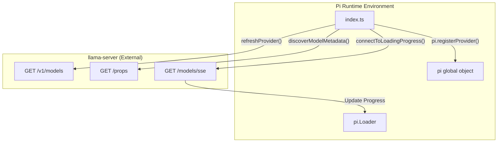
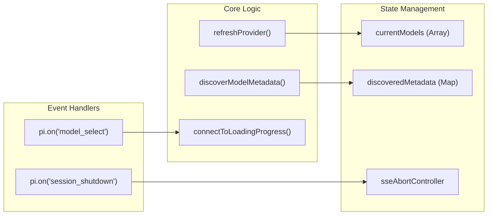

<!-- source: DeepWiki mcp.deepwiki.com · repo huggingface/pi-llama · page 1 Overview · fetched 2026-10-26 -->

# Overview

Relevant source files

The following files were used as context for generating this wiki page:

- [README.md](README.md)
- [package.json](package.json)

The `pi-llama` extension bridges the gap between the [pi](https://pi.dev) coding agent and a running `llama-server` (from the `llama.cpp` project). It enables `pi` to auto-discover local or remote models, handle real-time loading progress via Server-Sent Events (SSE), and manage model-specific metadata such as context windows and reasoning capabilities.

## System Purpose

The primary goal of `pi-llama` is to register `llama.cpp` as a first-class provider within the `pi` ecosystem. It eliminates the need for manual configuration by polling the `llama-server` API and dynamically registering available models with the `pi` runtime.

### Key Capabilities
- **Auto-Discovery**: Periodically polls the `llama.cpp` `/v1/models` endpoint to detect available models [index.ts:250-252]().
- **Metadata Management**: Fetches model-specific properties (context window, chat templates) via the `/props` endpoint [index.ts:312-315]().
- **Progress Tracking**: Provides visual feedback in the `pi` TUI while a model is being loaded into VRAM by consuming the `/models/sse` stream [index.ts:401-404]().
- **Reasoning Support**: Detects and enables "thinking" modes for models like Qwen or DeepSeek based on their chat templates [index.ts:161-163]().

## System Architecture

The extension is designed as a lightweight ESM module that interacts with two main entities: the `pi` global runtime and the external `llama-server` process.

### Logical Component Mapping

The following diagram illustrates how the natural language concepts of "Provider Registration" and "Model Loading" map to specific code entities and API interactions.

**Diagram: System Interaction Flow**

Sources: [index.ts:250-275](), [index.ts:312-320](), [index.ts:401-410](), [index.ts:440-450]()

### Code Entity Space

The extension logic is contained entirely within `index.ts`. It uses a set of internal state variables and event hooks to manage the lifecycle of the provider.

**Diagram: Code Entity Relationships**

Sources: [index.ts:130-135](), [index.ts:137-142](), [index.ts:501-510](), [index.ts:543-550]()

## Project Structure

The repository follows the standard `pi-package` structure, allowing it to be installed directly via Git.

| File | Role |
| :--- | :--- |
| `index.ts` | The entrypoint and entire implementation of the extension logic [package.json:13](). |
| `package.json` | Defines the `pi-package` manifest and optional peer dependencies [package.json:12-20](). |
| `.oxlintrc.json` | Configuration for static analysis (enforcing curly braces) [package.json:1-5](). |
| `.oxfmtrc.json` | Configuration for the `oxfmt` formatter (tab-based indentation). |

## Navigation

For detailed information on specific areas of the codebase, refer to the following child pages:

- **[Getting Started](#1.1)**: Instructions for installation via `pi install` or developer mode, and environment variable configuration (`LLAMA_BASE_URL`).
- **[Extension Architecture Overview](#1.2)**: Details on the `pi-package` manifest format, ESM requirements, and how the extension integrates with the `pi` plugin system.

Sources: [README.md:6-30](), [package.json:12-14]()

---

