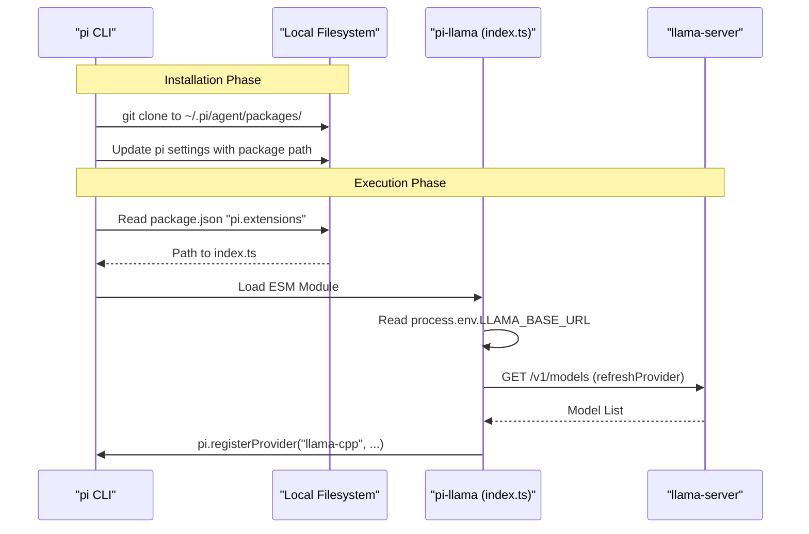
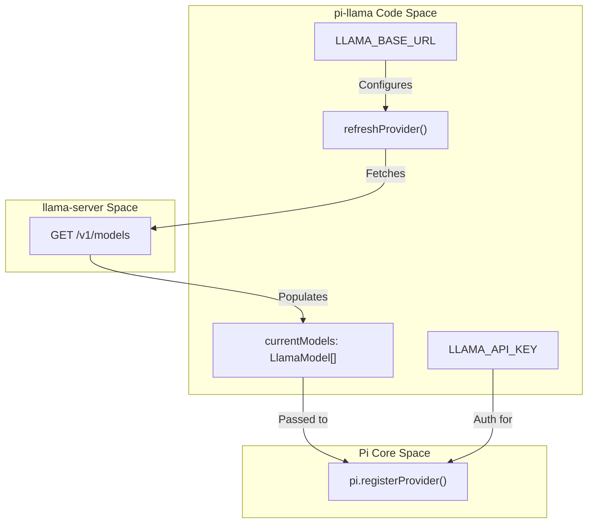

<!-- source: DeepWiki mcp.deepwiki.com · repo huggingface/pi-llama · page 1.1 Getting Started · fetched 2026-10-26 -->

# Getting Started

<details>
<summary>Relevant source files</summary>

The following files were used as context for generating this wiki page:

- [README.md](README.md)
- [package.json](package.json)

</details>


This page provides a technical guide for installing, configuring, and running the `pi-llama` extension. It covers the standard installation path for end-users, developer mode for contributors, and the environment variables that govern communication between the extension and the `llama-server`.

## Installation Methods

The `pi-llama` extension can be installed either as a persistent package or loaded temporarily for development. The extension is identified by the `pi` field in its `package.json` [package.json:12-14](), which points to the entrypoint `index.ts`.

### Standard Installation
The standard installation clones the repository into the local pi agent directory and registers it for all future sessions.

| Method | Command | Effect |
| :--- | :--- | :--- |
| **Shell** | `pi install git:github.com/huggingface/pi-llama` | Clones to `~/.pi/agent/packages/pi-llama/` [README.md:10-15](). |
| **Interactive** | `!pi install git:github.com/huggingface/pi-llama` | Installs from within a `pi` session; requires `/reload` [README.md:20-23](). |

### Developer Mode
For developers modifying `index.ts`, use the `-e` flag to load the extension from a local path without permanent installation. This is useful for rapid iteration as it only affects the current session [README.md:25-33]().

```bash
git clone https://github.com/huggingface/pi-llama ~/code/pi-llama
pi -e ~/code/pi-llama/index.ts
```

Sources: [README.md:6-33](), [package.json:12-14]()

## Configuration and Environment

The extension relies on environment variables to locate and authenticate with the `llama.cpp` server. These variables are read during the extension's initialization phase to configure the base URL for API requests.

### Environment Variables

| Variable | Default Value | Description |
| :--- | :--- | :--- |
| `LLAMA_BASE_URL` | `http://localhost:8080/v1` | The base URL of the `llama-server`. The extension handles URL normalization (e.g., stripping trailing slashes) [README.md:39](). |
| `LLAMA_API_KEY` | `no-key` | The API key passed in the `Authorization` header if the server requires it [README.md:40](). |

### Data Flow: Installation to Execution

The following diagram illustrates how the `pi` CLI interacts with the filesystem and the `llama-server` to activate the extension.

**System Initialization Flow**


Sources: [README.md:1-15](), [README.md:35-40](), [package.json:12-14]()

## Running the Extension

To use the extension, a `llama-server` must be active and accessible via the configured `LLAMA_BASE_URL`.

### Step-by-Step Execution
1.  **Start llama-server**: Ensure the server is running (e.g., via `llama serve`) [README.md:45-49]().
2.  **Configure Environment**: (Optional) If the server is remote, export `LLAMA_BASE_URL` [README.md:51-52]().
3.  **Launch Pi**: Run the `pi` command in your terminal [README.md:54-55]().
4.  **Select Model**: Use the `/model` command within the interactive session and search for `llama-cpp` to browse discovered models [README.md:57-58]().

### Code-Space Mapping: Provider Registration

The extension registers itself with the `pi` core using the `pi.registerProvider` function. The following diagram maps the logical "Provider" concept to the specific code entities in `index.ts`.

**Provider Registration Entities**


Sources: [README.md:35-59](), [package.json:1-14]()

---

