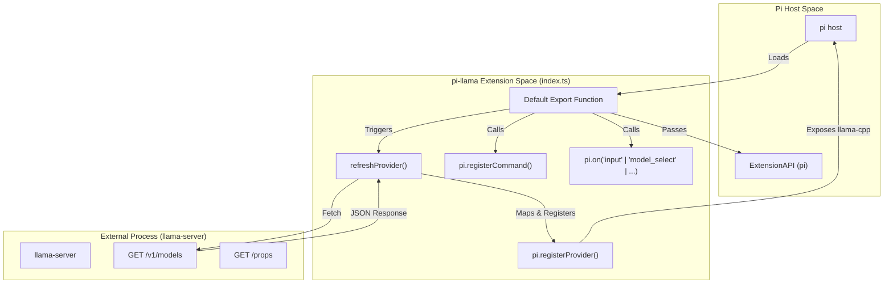
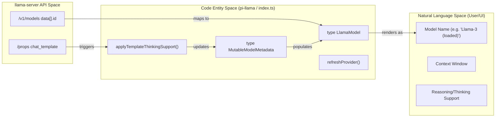

<!-- source: DeepWiki mcp.deepwiki.com · repo huggingface/pi-llama · page 1.2 Extension Architecture Overview · fetched 2026-10-26 -->

# Extension Architecture Overview

Relevant source files

The following files were used as context for generating this wiki page:

- [index.ts](index.ts)
- [package.json](package.json)

The `pi-llama` extension is a specialized provider for the `pi` ecosystem that enables seamless integration with `llama-server` (from the [llama.cpp](https://github.com/ggerganov/llama.cpp) project). It acts as a bridge, translating `llama.cpp`'s specific API endpoints and model states into the standardized `ExtensionAPI` format used by `pi`.

## The pi-package Manifest

The extension is defined as a `pi-package` via its `package.json`. This manifest informs the `pi` host how to load and execute the extension code.

| Field | Value | Purpose |
| :--- | :--- | :--- |
| `type` | `"module"` | Specifies the use of the ESM (ECMAScript Modules) format [package.json:5-5](). |
| `pi.extensions` | `["./index.ts"]` | Declares the entrypoint for the extension logic [package.json:12-14](). |
| `peerDependencies` | `@earendil-works/pi-coding-agent` | Provides type definitions for the `ExtensionAPI` [package.json:15-17](). |

The `@earendil-works/pi-coding-agent` dependency is marked as optional in `peerDependenciesMeta` [package.json:18-20](), as the actual API is provided by the `pi` host at runtime.

Sources: [package.json:1-22]()

## Module Format and Entrypoint

`pi-llama` follows the ESM module standard. It exports a single default asynchronous function as its entrypoint within `index.ts`.

### The `index.ts` Entrypoint
The entrypoint function receives an instance of `ExtensionAPI` (aliased as `pi`), which serves as the primary interface for registering commands, providers, and event hooks [index.ts:140-140]().

### Extension Lifecycle and Data Flow
The following diagram illustrates how the extension initializes and interacts with both the `pi` host and the external `llama-server`.

**Diagram: pi-llama Extension Initialization and Data Flow**

Sources: [index.ts:140-143](), [index.ts:174-177](), [index.ts:221-221]()

## Key Architectural Components

### 1. Provider Registration
The core responsibility of `pi-llama` is to register itself as a provider with the ID `llama-cpp` [index.ts:15-15](). It does this by polling the `llama-server` `/v1/models` endpoint and mapping the results to the `LlamaModel` type [index.ts:101-101](), [index.ts:176-176]().

### 2. Type-Safe Validation
To ensure robustness against variations in `llama-server` versions, the extension uses `TypeBox` for schema validation:
*   `ModelsResponseSchema`: Validates the list of available models and their statuses [index.ts:25-58]().
*   `PropsResponseSchema`: Validates detailed model metadata and server build info [index.ts:62-70]().

### 3. State Management
The extension maintains internal state to track models and avoid redundant network calls:
*   `currentModels`: An array of `LlamaModel` objects currently registered with the host [index.ts:141-141]().
*   `discoveredMetadata`: A `Map` caching metadata (like context window and chat templates) retrieved via the `/props` endpoint [index.ts:213-215]().

### 4. Natural Language to Code Mapping
The extension bridges user-facing model concepts (Natural Language Space) to the underlying `llama-server` structures (Code Entity Space).

**Diagram: Model Metadata Mapping**

Sources: [index.ts:101-101](), [index.ts:113-119](), [index.ts:122-131](), [index.ts:204-212]()

## Peer Dependencies and Environment
The extension relies on environment variables for configuration, allowing it to adapt to different network environments without code changes:
*   `LLAMA_BASE_URL`: The root URL of the `llama-server` (defaults to `http://localhost:8080/v1`) [index.ts:16-16](), [index.ts:171-171]().
*   `LLAMA_API_KEY`: The API key for authenticated requests (defaults to `no-key`) [index.ts:172-172]().

Sources: [index.ts:15-23](), [index.ts:171-172]()

---

