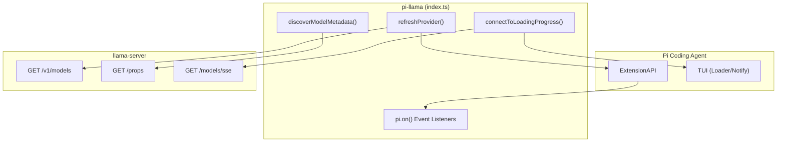
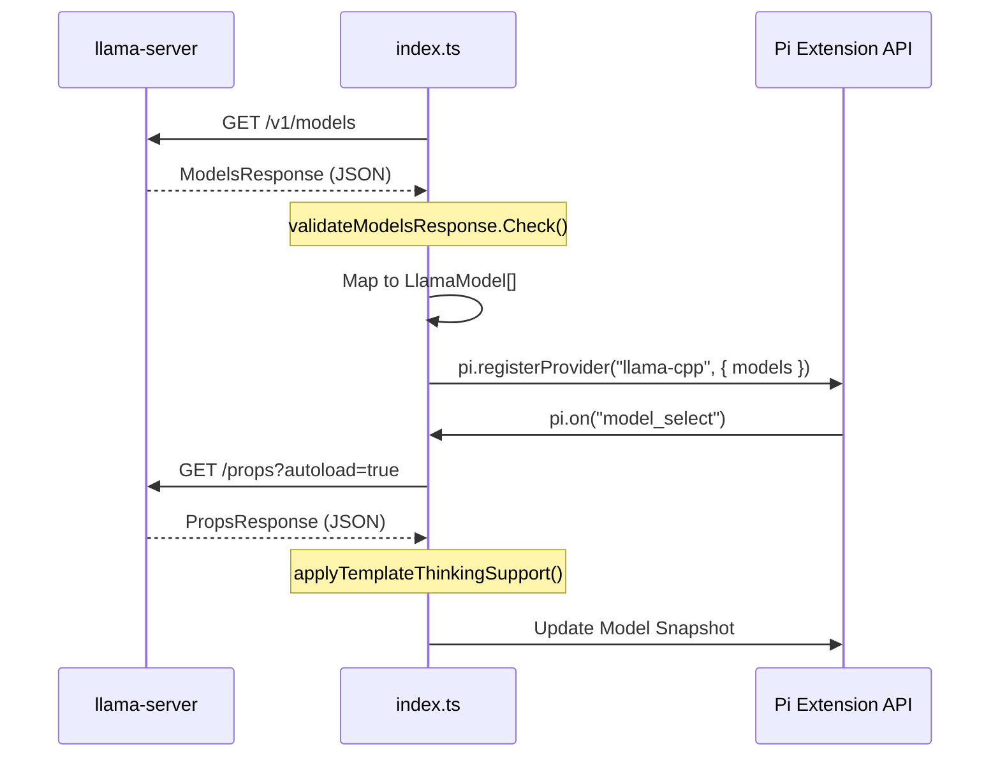

<!-- source: DeepWiki mcp.deepwiki.com · repo huggingface/pi-llama · page 2 Core Extension Logic · fetched 2026-10-26 -->

# Core Extension Logic

Relevant source files

The following files were used as context for generating this wiki page:

- [index.ts](index.ts)

The `pi-llama` extension is implemented as a single-file ESM module that bridges the gap between the Pi coding agent and a local or remote `llama.cpp` server. It acts as a specialized adapter for the `llama-cpp` provider, handling model discovery, real-time loading feedback, and reasoning capabilities.

The core logic resides entirely in `index.ts` [[index.ts:1-8]](). It manages the lifecycle of the provider by polling the server's state, registering available models with the Pi system, and intercepting session events to ensure the UI remains synchronized with the backend model status.

### System Architecture Overview

The following diagram illustrates how the core logic in `index.ts` orchestrates the interaction between the Pi Extension API and the `llama-server` endpoints.

**Extension Component Interaction**

Sources: [index.ts:140-143](), [index.ts:174-176](), [index.ts:251-255](), [index.ts:318-322]()

---

### Key Subsystems

The extension logic is divided into several functional areas, each managed by the main entry point function [[index.ts:140]]().

#### Provider Registration and Model Discovery
The extension identifies as the `llama-cpp` provider [[index.ts:15]](). It periodically polls the `/v1/models` endpoint to detect available GGUF models. These models are validated against a TypeBox schema (`ModelsResponseSchema`) and transformed into the `LlamaModel` type required by Pi.
*   For details, see [Provider Registration and Model Discovery](#2.1)

#### Model Metadata Discovery and Autoloading
While `/v1/models` provides a list of files, specific capabilities like context window size and chat templates are fetched via the `/props` endpoint. The `discoverModelMetadata` function handles this, including triggering the `autoload=true` parameter to force the server to load a model into memory when selected.
*   For details, see [Model Metadata Discovery and Autoloading](#2.2)

#### Real-Time Loading Progress
Since LLMs can take significant time to load from disk to VRAM, the extension utilizes the `/models/sse` stream. It parses Server-Sent Events to provide the user with a visual progress bar and stage labels (e.g., "Loading weights") using the Pi `Loader` widget.
*   For details, see [Real-Time Loading Progress via SSE](#2.3)

#### Event Hooks and Lifecycle
The extension responds to several Pi system events via `pi.on(...)`. This includes `model_select` for triggering loads, `input` for ensuring metadata is fresh before a prompt is sent, and `session_shutdown` for cleanup. It also manages `AbortController` instances to cancel pending network requests if the user switches models rapidly.
*   For details, see [Event Hooks and Lifecycle Management](#2.4)

#### Thinking and Reasoning Support
The extension detects if a model supports reasoning by inspecting the `chat_template` for `enable_thinking` markers. It maps these to Pi's reasoning UI, allowing users to toggle "Thinking" mode for models that support it (like DeepSeek-R1 or specialized Qwen variants).
*   For details, see [Thinking and Reasoning Support](#2.5)

---

### State Management and Data Flow

The extension maintains internal state to track known models and prevent redundant network calls. The primary state resides in `currentModels` and metadata caches.

**Data Flow: Discovery to Registration**

Sources: [index.ts:60-61](), [index.ts:174-210](), [index.ts:251-260](), [index.ts:400-410]()

### Core Configuration Constants
The extension relies on several default values when the server does not provide explicit metadata:

| Constant | Value | Description |
| :--- | :--- | :--- |
| `PROVIDER_ID` | `"llama-cpp"` | The unique ID used to register the provider in Pi. |
| `DEFAULT_BASE_URL` | `http://localhost:8080/v1` | Default endpoint if `LLAMA_BASE_URL` is unset. |
| `DEFAULT_CONTEXT_WINDOW` | `8192` | Fallback if `n_ctx` is missing from the server. |
| `DEFAULT_MAX_TOKENS` | `16384` | Fallback for output token limits. |
| `PROPS_TIMEOUT_MS` | `120,000` | 2-minute timeout for model property discovery. |

Sources: [index.ts:15-23]()

---

