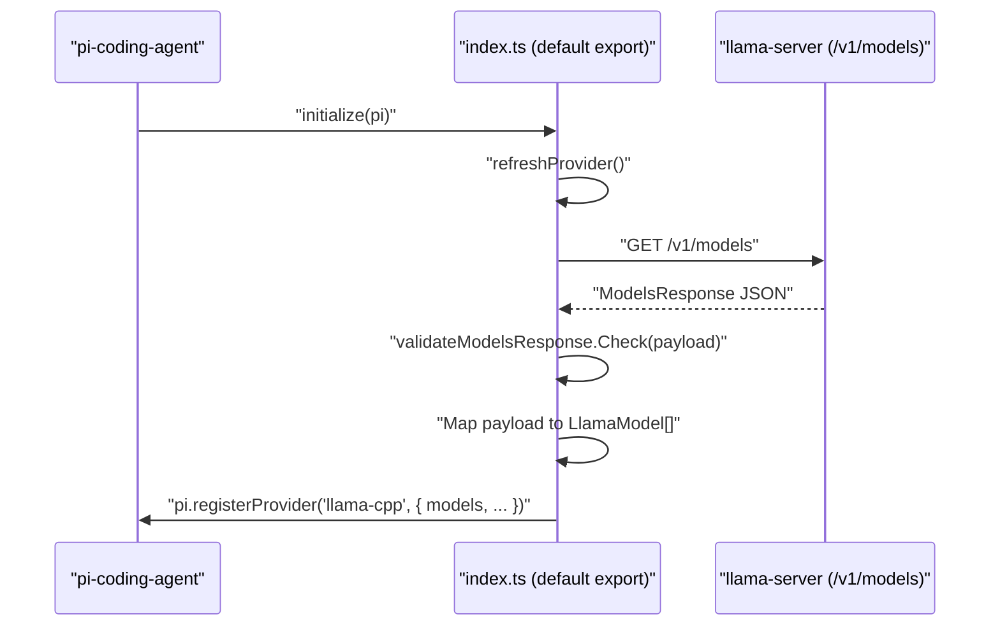
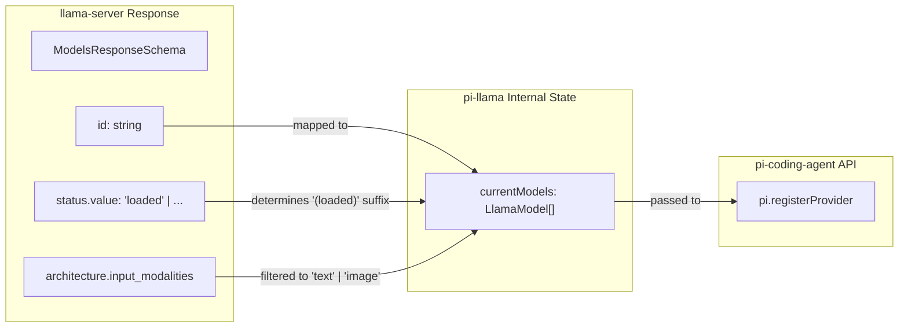

<!-- source: DeepWiki mcp.deepwiki.com · repo huggingface/pi-llama · page 2.1 Provider Registration and Model Discovery · fetched 2026-10-26 -->

# Provider Registration and Model Discovery

Relevant source files

The following files were used as context for generating this wiki page:

- [index.ts](index.ts)

The `pi-llama` extension integrates `llama.cpp` as a first-class model provider within the `pi` ecosystem. This process involves establishing a connection to a running `llama-server`, validating its capabilities, and dynamically registering available models so they appear in the `pi` user interface.

## Provider Registration Flow

Registration is handled within the extension's entry point. The extension normalizes the `LLAMA_BASE_URL` and uses the `LLAMA_API_KEY` to authenticate with the `llama.cpp` server [index.ts:171-172](). 

The core of the registration logic resides in `refreshProvider()`, which polls the server's OpenAI-compatible `/v1/models` endpoint [index.ts:174-176](). Once models are retrieved and validated, the extension calls `pi.registerProvider` to inform `pi` about the `llama-cpp` provider and its associated models [index.ts:227-234]().

### Registration Logic and Data Flow

The following diagram illustrates the sequence from extension initialization to successful provider registration.

**Provider Initialization Sequence**

**Sources:** [index.ts:140-141](), [index.ts:174-177](), [index.ts:183-193](), [index.ts:227-234]()

## Model Discovery and Mapping

The extension maintains a local state array `currentModels` to track the models reported by the server [index.ts:141](). When `refreshProvider()` is called, it performs a diffing and mapping operation to transform the `llama.cpp` internal representation into the `LlamaModel` type required by the `ExtensionAPI` [index.ts:191-225]().

### Mapping Logic
1.  **Identity**: The `id` is taken directly from the llama.cpp model ID [index.ts:211]().
2.  **Display Name**: The name is derived from `aliases[0]` or the `id`, appended with suffixes like `(image)` if the architecture supports vision, or `(loaded)` if the model is currently in memory [index.ts:200-212]().
3.  **Context Window**: Prefers `meta.n_ctx` from the API, falling back to previously discovered values or the `DEFAULT_CONTEXT_WINDOW` (8192) [index.ts:18-208]().
4.  **Capabilities**: Input modalities are filtered to include only `text` and `image` [index.ts:197-199]().

### Code Entity Mapping
This diagram bridges the network response objects to the internal TypeScript types used for registration.

**Data Transformation Map**

**Sources:** [index.ts:25-58](), [index.ts:101-101](), [index.ts:141-141](), [index.ts:193-225]()

## Schema Validation via TypeBox

To ensure stability against various `llama-server` versions, `pi-llama` uses `TypeBox` for runtime schema validation. This prevents the extension from crashing if the server returns unexpected JSON structures.

| Schema | Purpose | Key Fields Validated |
| :--- | :--- | :--- |
| `ModelsResponseSchema` | Validates the `/v1/models` payload. | `data`, `id`, `status.value`, `architecture.input_modalities`, `meta.n_ctx` |
| `PropsResponseSchema` | Validates the `/props` payload. | `default_generation_settings.n_ctx`, `chat_template`, `build_info` |

The validation is performed using `validateModelsResponse.Check(payload)` [index.ts:60-183](). If validation fails, the extension logs the specific validation errors to the console and aborts the refresh to prevent corrupting the model registry [index.ts:184-189]().

**Sources:** [index.ts:25-58](), [index.ts:60-60](), [index.ts:62-70](), [index.ts:72-72](), [index.ts:183-189]()

## Polling and State Persistence

`refreshProvider` is called during the initial setup and can be triggered by lifecycle events. Because `/v1/models` does not return advanced metadata (like reasoning capabilities or specific chat templates), the mapping logic is designed to preserve metadata discovered via the `/props` endpoint across refreshes [index.ts:213-216]().

*   **`currentModels`**: An array of `LlamaModel` objects representing the current known state of the provider [index.ts:141]().
*   **`previousById`**: A temporary map created during `refreshProvider` to allow the extension to carry over `reasoning`, `contextWindow`, and `maxTokens` from the existing state if the new API response is missing them [index.ts:191-225]().

**Sources:** [index.ts:141-141](), [index.ts:191-191](), [index.ts:213-225]()

---

