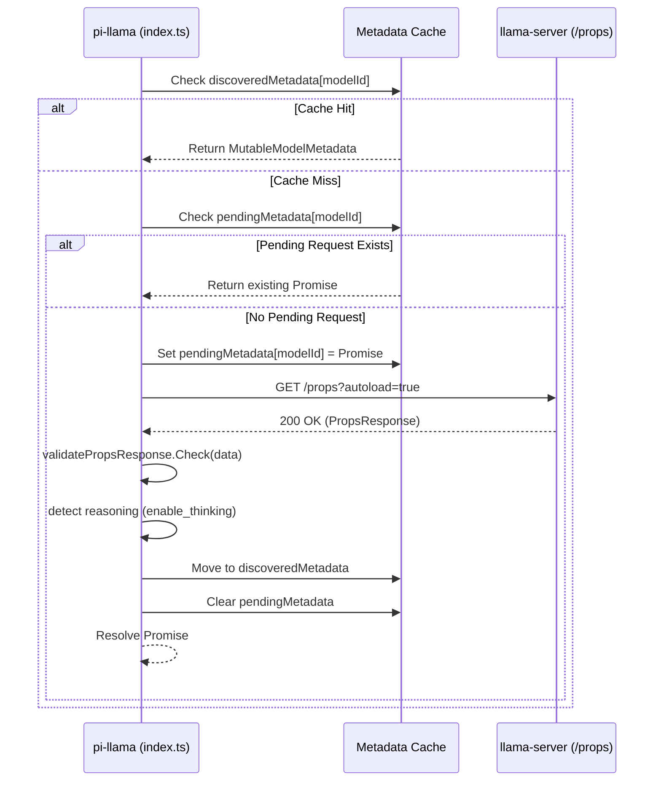
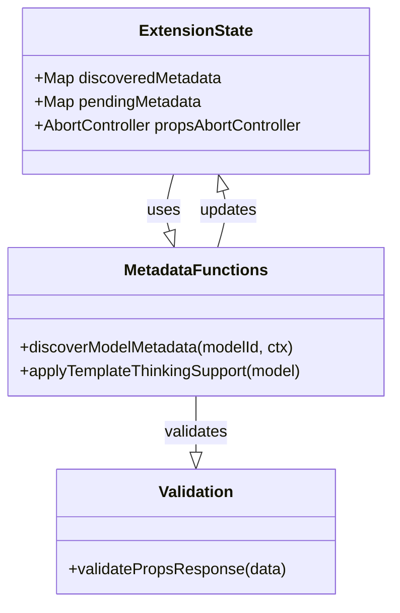

<!-- source: DeepWiki mcp.deepwiki.com · repo huggingface/pi-llama · page 2.2 Model Metadata Discovery and Autoloading · fetched 2026-10-26 -->

# Model Metadata Discovery and Autoloading

Relevant source files

The following files were used as context for generating this wiki page:

- [index.ts](index.ts)

This section describes the `discoverModelMetadata` function and its supporting logic. While `refreshProvider` polls the standard `/v1/models` endpoint for basic model listing, `discoverModelMetadata` performs deep inspection of a specific model's capabilities and triggers the server-side loading process.

## Metadata Discovery Lifecycle

The discovery process is responsible for bridging the gap between the generic OpenAI-compatible `/v1/models` response and the rich internal state of `llama-server`. It manages model-specific configuration like context window sizes and advanced features like reasoning/thinking support.

### The `discoverModelMetadata` Function

The `discoverModelMetadata` function [index.ts:333-408]() is invoked whenever a model is selected or a request is about to be made. It performs the following sequence:

1.  **Cache Check**: It checks `discoveredMetadata` [index.ts:241]() to see if the model has already been fully inspected.
2.  **Concurrency Management**: If a request for the same model is already in flight (tracked in `pendingMetadata` [index.ts:242]()), it returns the existing promise to avoid redundant network traffic.
3.  **Request Initiation**: It constructs a request to the `/props` endpoint [index.ts:353](). Crucially, it appends `autoload=true` to the query parameters [index.ts:353](). This triggers `llama-server` to begin loading the model into VRAM if it is currently in an `unloaded` state.
4.  **Schema Validation**: The response is validated against `PropsResponseSchema` [index.ts:62-70]() using the `validatePropsResponse` compiler [index.ts:72]().
5.  **Capability Mapping**: It extracts the `n_ctx` (context window) and inspects the `chat_template` to detect advanced features like reasoning.

### Data Flow: Metadata Extraction

| Data Point | Source Path in `/props` | Fallback Logic |
| :--- | :--- | :--- |
| **Context Window** | `default_generation_settings.n_ctx` [index.ts:63-67]() | `DEFAULT_CONTEXT_WINDOW` (8192) [index.ts:18]() |
| **Max Tokens** | N/A (llama.cpp is unbounded) | `DEFAULT_MAX_TOKENS` (16384) [index.ts:22]() |
| **Reasoning Support** | `chat_template` string [index.ts:68]() | `false` |

**Sources:** [index.ts:15-23](), [index.ts:62-72](), [index.ts:333-408]()

## System Architecture: Discovery and Autoloading

The following diagram illustrates how the extension logic interacts with the `llama-server` and the internal cache state.

### Metadata Flow and Cache State

**Sources:** [index.ts:241-242](), [index.ts:333-408]()

## Thinking and Reasoning Detection

The extension automatically detects if a model supports "thinking" (reasoning) by inspecting the Jinja2 `chat_template` returned by the server.

### Template Inspection
The function `discoverModelMetadata` searches for the string `enable_thinking` within the `chat_template` [index.ts:377](). If found, it invokes `applyTemplateThinkingSupport` [index.ts:122-131]().

### Thinking Configuration
When reasoning is detected, the model's metadata is updated with:
*   **`reasoning: true`**: Enables the reasoning UI in the Pi interface [index.ts:123]().
*   **`thinkingLevelMap`**: Maps Pi's thinking levels to llama.cpp's boolean toggle [index.ts:105-110]().
*   **`thinkingFormat: "qwen-chat-template"`**: Tells the Pi core to use the `chat_template_kwargs` structure for sending the thinking toggle to the provider [index.ts:129]().

**Sources:** [index.ts:105-110](), [index.ts:122-131](), [index.ts:377-380]()

## Redundant Request Management

To ensure performance and stability, the extension employs several strategies to manage the lifecycle of metadata requests.

### Cache Structures
The extension maintains two primary state variables for metadata:
1.  `discoveredMetadata`: A `Map<string, MutableModelMetadata>` [index.ts:241]() that stores finalized information about models, ensuring that `/props` is only called once per model per session.
2.  `pendingMetadata`: A `Map<string, Promise<MutableModelMetadata>>` [index.ts:242]() that stores active requests. This prevents "thundering herd" issues where multiple event hooks (e.g., `model_select` and `before_provider_request`) trigger simultaneous fetches for the same model.

### Lifecycle Hooks
Discovery is triggered by two main Pi event hooks:
*   `pi.on("model_select", ...)` [index.ts:468-472](): Triggers discovery as soon as a user selects a model in the UI.
*   `pi.on("before_provider_request", ...)` [index.ts:474-480](): Acts as a safety net to ensure metadata (especially context window size) is loaded before a prompt is sent.

### Abort Handling
To prevent race conditions when a user rapidly switches models, the extension uses `propsAbortController` [index.ts:244](). Before starting a new discovery request, any existing request is aborted [index.ts:348-351]().

### Implementation Entities

**Sources:** [index.ts:241-244](), [index.ts:333-351](), [index.ts:468-480]()

---

