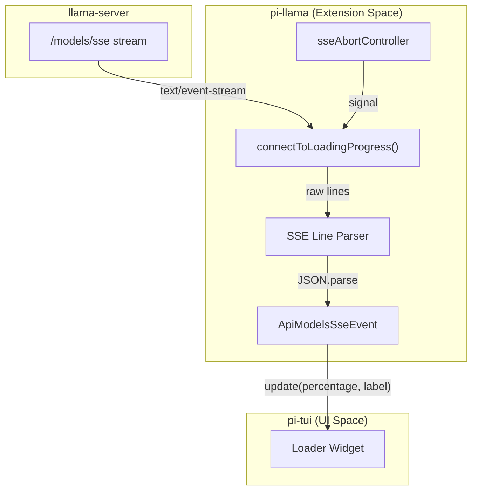
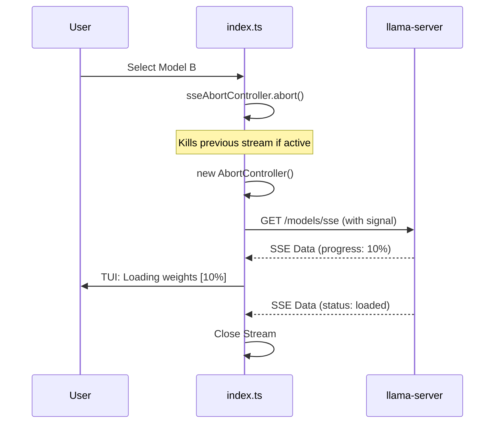

<!-- source: DeepWiki mcp.deepwiki.com · repo huggingface/pi-llama · page 2.3 Real-Time Loading Progress via SSE · fetched 2026-10-26 -->

# Real-Time Loading Progress via SSE

Relevant source files

The following files were used as context for generating this wiki page:

- [index.ts](index.ts)

The `pi-llama` extension provides real-time feedback during model instantiation by consuming the `llama-server` Server-Sent Events (SSE) stream. This ensures that when a user selects a model that is not yet in memory, the Pi TUI displays a progress bar and stage-specific information rather than appearing frozen.

### Architecture and Data Flow

The loading progress system bridges the gap between the asynchronous loading process in `llama-server` and the Pi Terminal User Interface (TUI). It utilizes a dedicated SSE endpoint to receive granular updates about weight loading, draft models, and vision projectors.

#### System Interaction Diagram

This diagram illustrates how the `connectToLoadingProgress` function mediates between the server stream and the Pi UI components.

**Sources:** [index.ts:74-93](), [index.ts:285-300](), [index.ts:320-330]()

---

### Data Structures and Types

The extension defines specific types to handle the structured data returned by the llama.cpp SSE endpoint.

#### SSE Event Types
The stream emits events containing status updates and progress metrics:

*   **`ApiModelLoadStage`**: Defines the specific component being loaded.
    *   `text_model`: The primary LLM weights.
    *   `spec_model`: Draft model weights for speculative decoding.
    *   `mmproj_model`: Multi-modal projection weights (e.g., for vision support).
*   **`ApiModelsSseProgress`**: Contains the numeric progress and stage list.
    *   `value`: A float from `0.0` to `100.0`.
    *   `current`: The active `ApiModelLoadStage`.
*   **`ApiModelsSseEvent`**: The top-level object representing a single SSE message.

**Sources:** [index.ts:75-93]()

#### Stage Labels
To make the technical stage names user-friendly, the extension maps them to human-readable strings via `MODEL_LOAD_STAGE_LABELS`:

| Stage (`ApiModelLoadStage`) | UI Label |
| :--- | :--- |
| `text_model` | "Loading weights" |
| `spec_model` | "Loading draft" |
| `mmproj_model` | "Loading projector" |

**Sources:** [index.ts:95-99]()

---

### Implementation Details

#### The `connectToLoadingProgress` Function
This function manages the lifecycle of the SSE connection. It is responsible for fetching the stream, handling errors, and updating the UI loader.

1.  **Connection Management**: It initializes a `fetch` request to `${baseUrl.replace(/\/v1$/, "")}/models/sse` [index.ts:291-292]().
2.  **Stream Parsing**: It reads the response body as a stream and splits the incoming chunks into individual lines [index.ts:303-313]().
3.  **Event Filtering**: It looks for lines starting with `data: ` and parses the subsequent JSON [index.ts:316-320]().
4.  **UI Updates**:
    *   If the event contains `progress` data, it calculates the display string using `MODEL_LOAD_STAGE_LABELS` [index.ts:321-325]().
    *   It updates the `Loader` widget with the current percentage and the stage label [index.ts:327-327]().
5.  **Termination**: The loop breaks if the `status` in the event data is `"loaded"`, `"unloaded"`, or if an `exit_code` is present [index.ts:332-334]().

**Sources:** [index.ts:285-350]()

#### Lifecycle and Abort Handling
To prevent multiple progress streams from overlapping (e.g., if a user switches models twice rapidly), the extension uses a global `sseAbortController`.

**Sources:** [index.ts:286-292](), [index.ts:352-355]()

### Error Handling
The implementation includes robust error checking for the SSE stream:
*   **Stale Contexts**: If the Pi session is replaced during loading, `isStaleContextError` catches the exception to prevent extension crashes [index.ts:136-138](), [index.ts:344-347]().
*   **Network Failures**: If the SSE endpoint is unreachable or returns a non-OK status, the function exits silently, as the model discovery polling will eventually reflect the state [index.ts:293-296]().

**Sources:** [index.ts:285-350]()

---

