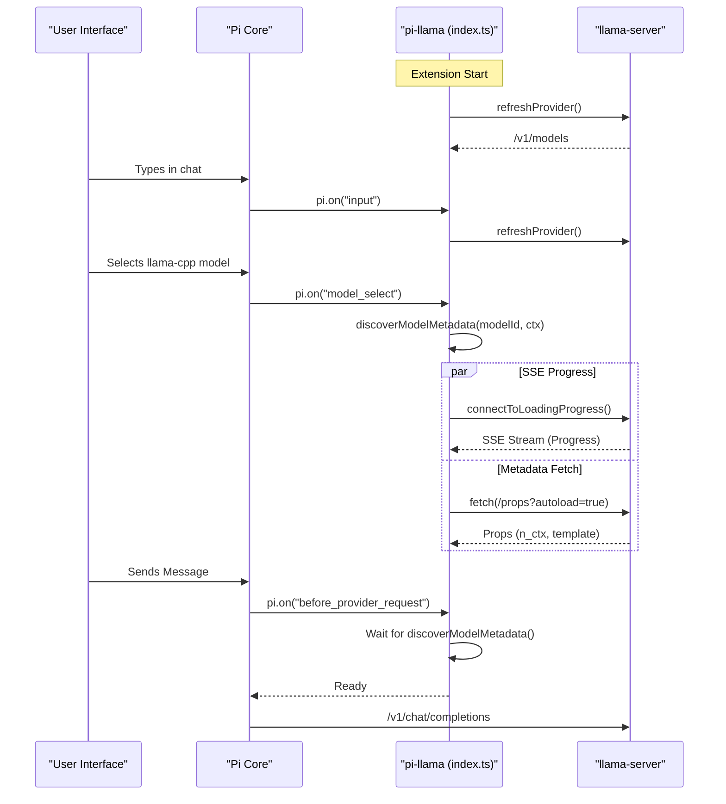
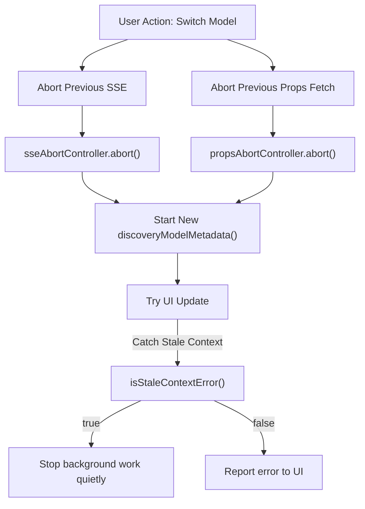

<!-- source: DeepWiki mcp.deepwiki.com · repo huggingface/pi-llama · page 2.4 Event Hooks and Lifecycle Management · fetched 2026-10-26 -->

# Event Hooks and Lifecycle Management

Relevant source files

The following files were used as context for generating this wiki page:

- [index.ts](index.ts)

This section describes how the `pi-llama` extension manages its lifecycle and responds to user interactions through the Pi extension event system. The extension utilizes four primary event hooks to ensure the local `llama-server` state remains synchronized with the Pi interface and to manage asynchronous operations safely.

## Overview of Event Listeners

The extension registers four listeners using the `pi.on(...)` API. These hooks handle everything from model discovery on startup to resource cleanup when the session terminates.

| Event | Purpose | Implementation |
| :--- | :--- | :--- |
| `input` | Triggers a provider refresh when the user types, ensuring new models are discovered. | [index.ts:246-248]() |
| `model_select` | Triggers metadata discovery and autoloading when a user selects a `llama-cpp` model. | [index.ts:250-252]() |
| `before_provider_request` | Ensures model metadata is loaded before a generation request is dispatched. | [index.ts:254-263]() |
| `session_shutdown` | Cleans up active SSE streams and pending metadata fetches. | [index.ts:265-269]() |

### Lifecycle Flow Diagram

The following diagram illustrates the relationship between user actions, event hooks, and the internal state of the extension.

**Event-Driven Model Lifecycle**

**Sources:** [index.ts:140-143](), [index.ts:246-269](), [index.ts:272-340]()

---

## Race Condition Prevention

Rapid model switching or session resets can lead to "stale context" errors or race conditions where multiple metadata fetches compete for the same model. `pi-llama` employs `AbortController` instances and state tracking to mitigate these issues.

### Abort Management

The extension maintains two specific `AbortController` instances within the extension scope:
1.  `sseAbortController`: Used to terminate the Server-Sent Events stream for loading progress when a model finishes loading or a new model is selected [index.ts:238-244]().
2.  `propsAbortController`: Used to cancel pending `/props` requests if the user switches models before the previous request completes [index.ts:342-345]().

### Stale Context Handling

When a Pi session is replaced (e.g., via a `new_session` command), existing context (`ctx`) objects become invalid. The helper function `isStaleContextError` identifies these failures so the extension can stop background tasks quietly without crashing the UI [index.ts:136-138]().

**Resource Cleanup Logic**

**Sources:** [index.ts:136-138](), [index.ts:238-244](), [index.ts:342-345]()

---

## Command: `llama-version`

In addition to event hooks, the extension registers a management command to help users debug their local `llama-server` environment.

*   **Registration**: Registered via `pi.registerCommand("llama-version", ...)` [index.ts:143-169]().
*   **Implementation**: It fetches the `/props` endpoint from the base URL (stripping the `/v1` suffix) to access the `build_info` field [index.ts:146-152]().
*   **Parsing**: It uses a regex `^b([a-zA-Z0-9]+)-([a-zA-Z0-9]+)$` to extract the build number and commit hash from the server response [index.ts:161-167]().

---

## Technical Implementation Details

### `before_provider_request`
This hook is critical for ensuring that generation parameters (like `contextWindow`) are accurate before Pi sends the request to the provider. If a model selection is still being processed (tracked in `pendingMetadata`), this hook `await`s that specific promise [index.ts:257-262]().

### `session_shutdown`
Ensures that when the extension is unloaded or the session ends, all active network connections are severed. It calls `.abort()` on both controllers and clears the `pendingMetadata` map [index.ts:265-269]().

### `model_select`
This listener serves as the entry point for the heavy lifting of model preparation. It calls `discoverModelMetadata`, which handles the parallel tasks of tracking SSE progress and fetching generation settings [index.ts:250-252]().

**Sources:**
- Event Registration: [index.ts:246-269]()
- Command Implementation: [index.ts:143-169]()
- Metadata Logic: [index.ts:342-380]()
- Error Handling: [index.ts:136-138]()

---

