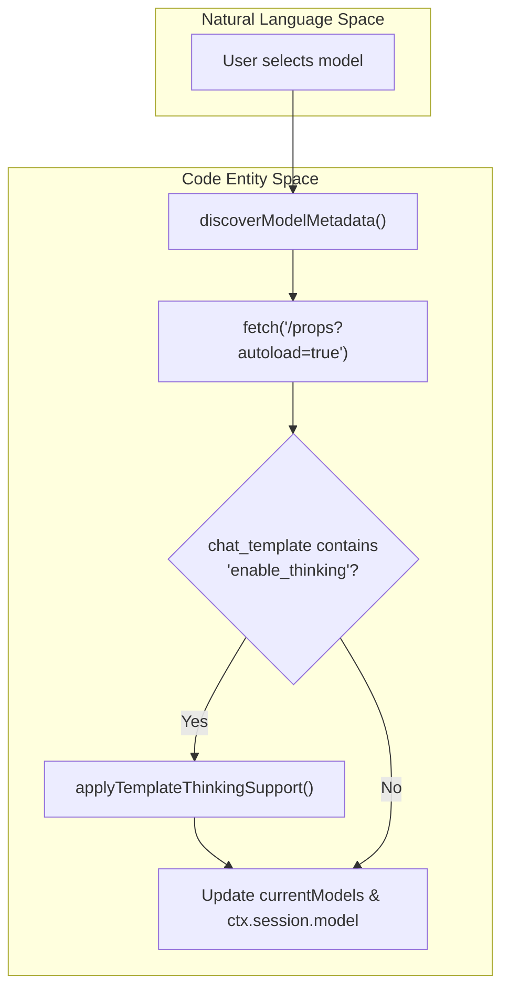
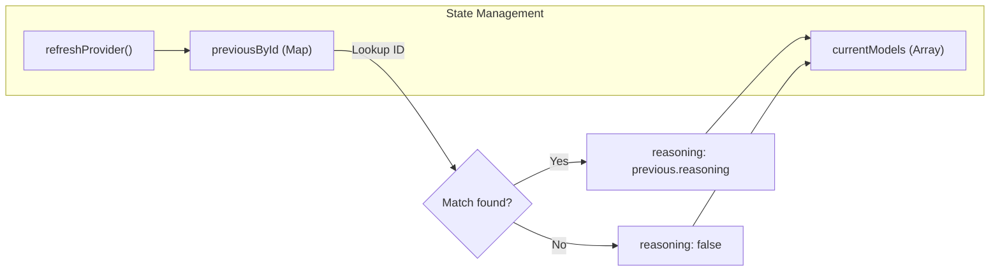

<!-- source: DeepWiki mcp.deepwiki.com · repo huggingface/pi-llama · page 2.5 Thinking and Reasoning Support · fetched 2026-10-26 -->

# Thinking and Reasoning Support

Relevant source files

The following files were used as context for generating this wiki page:

- [index.ts](index.ts)

The `pi-llama` extension provides specialized support for models that utilize a "thinking" or "reasoning" phase before generating a final response. This implementation leverages `llama.cpp`'s native `chat_template_kwargs.enable_thinking` control while maintaining compatibility with the `pi` coding agent's internal reasoning protocols.

## Implementation Overview

Reasoning support in `pi-llama` is handled through a combination of template detection and model metadata modification. Because `llama.cpp` treats thinking as a boolean toggle at the template level, the extension maps this to a simplified on/off state in the `pi` UI.

### Key Components

| Entity | Role |
| :--- | :--- |
| `applyTemplateThinkingSupport` | A utility function that modifies a model's metadata to enable reasoning features. |
| `TEMPLATE_THINKING_LEVEL_MAP` | A mapping object that restricts reasoning to a binary toggle (off/medium). |
| `qwen-chat-template` | The compatibility format used to signal thinking support to the `pi` core. |

Sources: [index.ts:105-110](), [index.ts:122-131]()

## Logic Flow: Detection to Configuration

The following diagram illustrates how the extension identifies reasoning capabilities during the model metadata discovery phase and applies the necessary configurations.

**Thinking Support Configuration Flow**

Sources: [index.ts:122-131](), [index.ts:258-278]()

## Detailed Implementation Details

### Detection Mechanism
The extension detects thinking support by inspecting the `chat_template` string returned by the `llama.cpp` `/props` endpoint. If the template contains the string `enable_thinking`, the extension assumes the model supports reasoning blocks.

### The `applyTemplateThinkingSupport` Function
When a reasoning model is detected, this function is called to update the `MutableModelMetadata` object:

1.  **`reasoning`**: Set to `true` to enable the "Reasoning" toggle in the `pi` user interface [index.ts:123-123]().
2.  **`thinkingLevelMap`**: Set to `TEMPLATE_THINKING_LEVEL_MAP`. This map explicitly sets `minimal`, `low`, `high`, and `xhigh` to `null` [index.ts:105-110](), which effectively collapses the granular reasoning levels found in other providers into a single toggle [index.ts:124-124]().
3.  **`compat.thinkingFormat`**: Set to `"qwen-chat-template"` [index.ts:129-129](). Despite the name, this is used as a generic signal to the `pi` agent to send the `enable_thinking` boolean within the `chat_template_kwargs` payload of the generation request [index.ts:127-128]().

### Metadata Persistence
Because the standard `/v1/models` endpoint in `llama.cpp` does not return template-specific metadata, the `refreshProvider` function is designed to preserve reasoning status across refreshes once it has been discovered via `/props`.

Sources: [index.ts:191-191](), [index.ts:215-217]()

## Summary of Constraints
- **On/Off Only**: Granular levels (`low`, `high`, etc.) are not supported because `llama.cpp` exposes reasoning as a simple boolean [index.ts:104-104]().
- **Template Dependent**: Support is strictly tied to the presence of `enable_thinking` in the Jinja2 chat template provided by the server [index.ts:276-278]().

Sources: [index.ts:104-110](), [index.ts:122-131](), [index.ts:276-278]()

---

