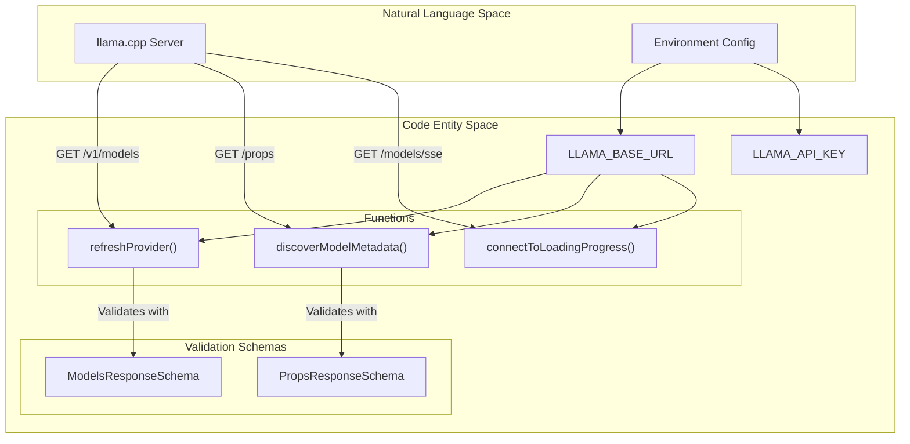

<!-- source: DeepWiki mcp.deepwiki.com · repo huggingface/pi-llama · page 3 API Integration with llama.cpp Server · fetched 2026-10-26 -->

# API Integration with llama.cpp Server

Relevant source files

The following files were used as context for generating this wiki page:

- [README.md](README.md)
- [index.ts](index.ts)

The `pi-llama` extension acts as a bridge between the **pi** coding agent and a running `llama-server` instance. It facilitates model discovery, capability detection (such as reasoning support), and real-time loading feedback by consuming specific HTTP and Server-Sent Events (SSE) endpoints provided by llama.cpp.

Communication is governed by environment variables and validated using **TypeBox** schemas to ensure the extension remains resilient to variations in server responses.

### Communication Architecture

The extension interacts with the server through three primary channels. While the `pi` core handles the standard OpenAI-compatible `/chat/completions` traffic, this extension manages the lifecycle and metadata via the following endpoints:

1.  **Model Discovery (`GET /v1/models`)**: Used by `refreshProvider` to identify available GGUF models and their current status (e.g., loaded, unloaded).
2.  **Metadata & Autoloading (`GET /props`)**: Used by `discoverModelMetadata` to fetch specific generation settings, chat templates, and trigger model loading.
3.  **Loading Progress (`GET /models/sse`)**: Used by `connectToLoadingProgress` to stream real-time weight loading percentages to the pi TUI.

#### Data Flow and Schema Validation

To ensure type safety when interacting with the external `llama-server`, the extension defines strict schemas using `TypeBox` [index.ts:25-58](). These schemas are compiled into validators that check every response before the data is mapped to the `LlamaModel` type used by the extension state.

**Entity Mapping Diagram**

**Sources:**
- [index.ts:15-22]() (Constants and defaults)
- [index.ts:25-72]() (TypeBox schemas and validators)
- [index.ts:171-172]() (Environment variable handling)

---

### Endpoints Reference

The extension relies on a mix of standard OpenAI-compatible endpoints and llama.cpp-specific internal endpoints to provide a rich user experience.

*   **Model Listing**: Fetches the list of all models the server is aware of. The extension parses the `status.value` to determine if a model is already in memory [index.ts:195-206]().
*   **Properties & Templates**: Fetches the `chat_template` to detect if the model supports reasoning/thinking modes [index.ts:62-72]().
*   **SSE Stream**: Listens for `ApiModelsSseEvent` messages to update the `Loader` widget during model initialization [index.ts:89-93]().

For detailed response shapes and schema definitions, see **[Endpoints Reference](#3.1)**.

**Sources:**
- [index.ts:74-99]() (SSE types and labels)
- [index.ts:174-189]() (Refresh logic)

---

### Configuration and Authentication

The extension is configured primarily through environment variables. It defaults to a local instance but can be pointed to remote servers or protected instances.

| Variable | Default | Purpose |
| :--- | :--- | :--- |
| `LLAMA_BASE_URL` | `http://localhost:8080/v1` | The root URL for the API. The extension automatically handles trailing slashes and `/v1` stripping for internal endpoints like `/props` [index.ts:171](). |
| `LLAMA_API_KEY` | `no-key` | The Bearer token used for all requests. This is passed to `pi.registerProvider` to ensure standard chat requests are authenticated [index.ts:172](). |

For details on URL normalization and how keys are forwarded to the provider, see **[Configuration and Authentication](#3.2)**.

**Sources:**
- [index.ts:171-172]() (Variable assignment)
- [README.md:35-40]() (Documentation of variables)

---

