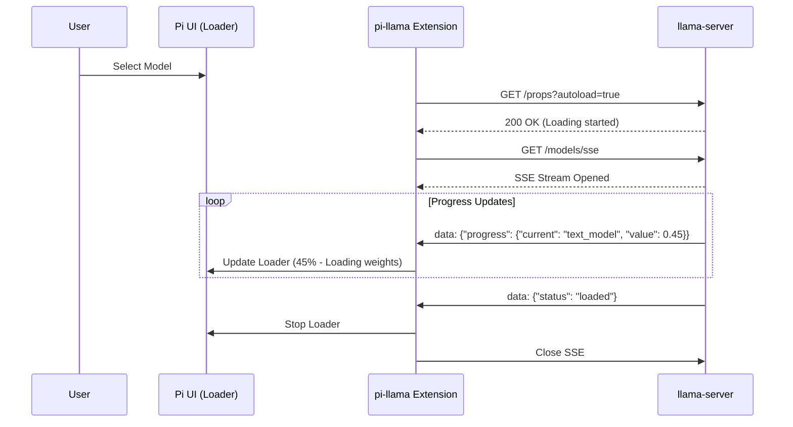

<!-- source: DeepWiki mcp.deepwiki.com · repo huggingface/pi-llama · page 3.1 Endpoints Reference · fetched 2026-10-26 -->

# Endpoints Reference

<details>
<summary>Relevant source files</summary>

The following files were used as context for generating this wiki page:

- [index.ts](index.ts)

</details>


The `pi-llama` extension interacts with a running `llama-server` instance through three primary HTTP endpoints. These endpoints allow the extension to discover available models, retrieve detailed generation metadata (like chat templates and context windows), and provide real-time feedback during model loading via Server-Sent Events (SSE).

## Endpoint Overview and Schema Validation

The extension uses [TypeBox](https://github.com/sinclairzx81/typebox) to define schemas and [TypeBox/compile](https://github.com/sinclairzx81/typebox) to generate high-performance validators. This ensures that the extension fails gracefully or logs warnings if the `llama-server` version is incompatible or returns unexpected data shapes.

### Data Flow: Extension to llama-server

The following diagram illustrates how the extension's internal functions map to specific `llama-server` endpoints and the resulting code entities.

**Endpoint Mapping Diagram**
```mermaid
graph TD
    subgraph "pi-llama Extension"
        RF["refreshProvider()"]
        DM["discoverModelMetadata()"]
        CL["connectToLoadingProgress()"]
        LV["llama-version command"]
    end

    subgraph "llama-server API"
        M_EP["GET /v1/models"]
        P_EP["GET /props"]
        S_EP["GET /models/sse"]
    end

    subgraph "Validation & Storage"
        MRS["ModelsResponseSchema"]
        PRS["PropsResponseSchema"]
        CM["currentModels: LlamaModel[]"]
        DM_CACHE["discoveredMetadata: Map"]
    end

    RF -->|fetch| M_EP
    M_EP -->|JSON| MRS
    MRS -->|Map| CM

    DM -->|fetch?autoload=true| P_EP
    LV -->|fetch| P_EP
    P_EP -->|JSON| PRS
    PRS -->|Update| DM_CACHE

    CL -->|SSE Stream| S_EP
    S_EP -->|Parse| SSE_TYPE["ApiModelsSseEvent"]
end
```
Sources: [index.ts:25-72](), [index.ts:143-169](), [index.ts:174-210](), [index.ts:285-300](), [index.ts:375-390]()

---

## 1. GET /v1/models
**Purpose:** Discovers the list of available models and their current operational status.

This endpoint is polled by `refreshProvider()` to populate the model picker in the Pi interface. It provides basic metadata such as model IDs, aliases, and whether a model is currently resident in memory.

### Response Shape
The extension expects a JSON object matching `ModelsResponseSchema` [index.ts:25-58]().

| Field | Type | Description |
| :--- | :--- | :--- |
| `data` | `Array` | List of model objects. |
| `data[].id` | `string` | The unique identifier for the model. |
| `data[].status.value` | `string` | Status: `unloaded`, `loading`, `loaded`, `sleeping`, or `unknown`. |
| `data[].architecture.input_modalities` | `string[]` | Used to detect vision support (e.g., `["text", "image"]`). |
| `data[].meta.n_ctx` | `number` | The context window size reported by the model file. |

### Implementation Details
* **Status Mapping:** If `status.value` is `"loaded"`, the extension appends `(loaded)` to the display name [index.ts:195-206]().
* **Vision Support:** If `input_modalities` includes `"image"`, the extension appends `(image)` to the display name and configures the provider to allow image uploads [index.ts:196-203]().
* **Fallback Context:** If `meta.n_ctx` is missing, it defaults to `DEFAULT_CONTEXT_WINDOW` (8192) [index.ts:17-18](), [index.ts:207-208]().

Sources: [index.ts:25-60](), [index.ts:174-210]()

---

## 2. GET /props
**Purpose:** Retrieves detailed generation settings and triggers model autoloading.

The extension calls this endpoint in two scenarios:
1.  **Metadata Discovery:** When a user selects a model, `discoverModelMetadata()` calls `/props?autoload=true` [index.ts:296-300](). The `autoload=true` query parameter instructs `llama-server` to load the model if it is currently offline.
2.  **Version Check:** The `llama-version` command fetches `/props` to display build information [index.ts:143-150]().

### Response Shape
The response is validated against `PropsResponseSchema` [index.ts:62-70]().

| Field | Type | Description |
| :--- | :--- | :--- |
| `default_generation_settings.n_ctx` | `number` | The active context window size. |
| `chat_template` | `string` | The Jinja2 chat template. Used to detect reasoning/thinking support. |
| `build_info` | `string` | Build version and commit hash (e.g., `b4612-8f2a1b`). |

### Thinking Support Detection
The extension parses the `chat_template` string. If it contains the substring `enable_thinking`, the extension automatically enables reasoning capabilities for that model by calling `applyTemplateThinkingSupport` [index.ts:122-131](), [index.ts:316-320]().

Sources: [index.ts:62-72](), [index.ts:143-169](), [index.ts:285-320]()

---

## 3. GET /models/sse
**Purpose:** Provides a real-time stream of model loading progress.

When a model transition is detected, `connectToLoadingProgress()` opens a Server-Sent Events (SSE) connection to this endpoint [index.ts:375-385](). This allows the extension to display a progress bar and stage labels in the Pi TUI while `llama-server` loads large model weights into VRAM.

### SSE Event Structure
The stream sends events of type `ApiModelsSseEvent` [index.ts:89-93]().

| Field | Type | Description |
| :--- | :--- | :--- |
| `event` | `string` | Usually `"progress"`. |
| `data.status` | `string` | The high-level status (e.g., `"loading"`). |
| `data.progress.current` | `string` | The current loading stage (`text_model`, `spec_model`, `mmproj_model`). |
| `data.progress.value` | `number` | A float between 0.0 and 1.0 representing completion percentage. |

### Stage Labels
The extension maps internal `llama-server` stage names to user-friendly labels via `MODEL_LOAD_STAGE_LABELS` [index.ts:95-99]():
*   `text_model` $\rightarrow$ "Loading weights"
*   `spec_model` $\rightarrow$ "Loading draft"
*   `mmproj_model` $\rightarrow$ "Loading projector"

### Sequence Diagram: SSE Loading
This diagram shows the interaction between the Pi TUI, the extension, and the server during a model load.

**Model Loading Sequence**

Sources: [index.ts:74-99](), [index.ts:375-430]()

---

