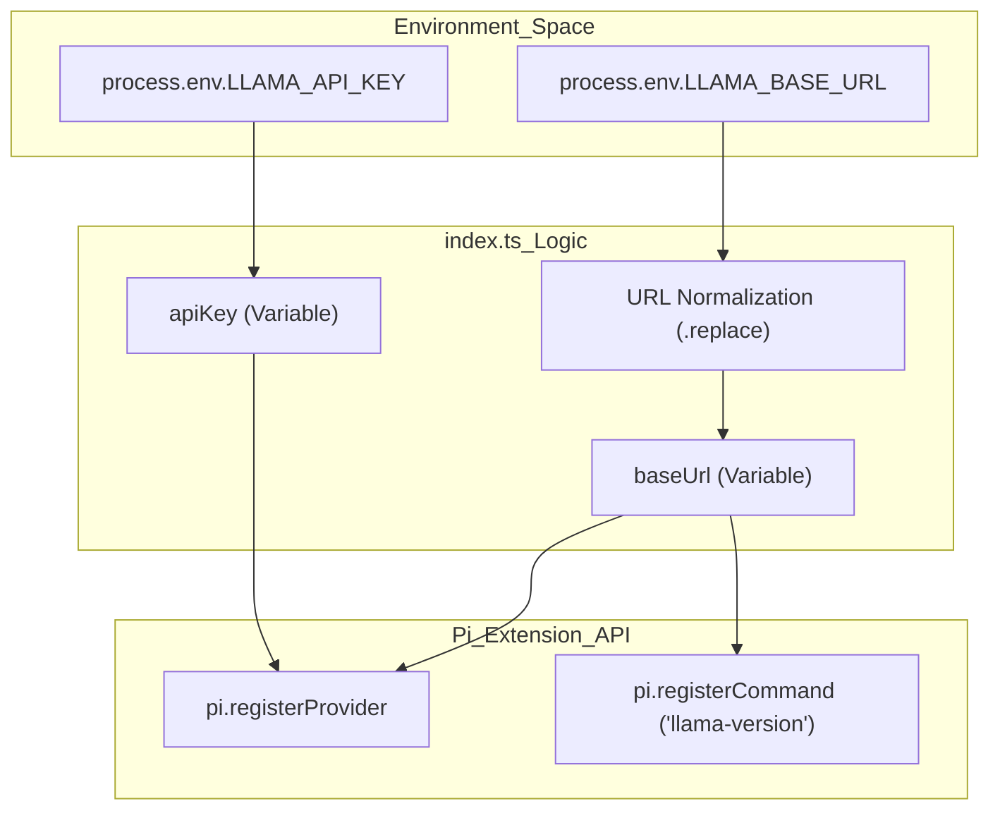
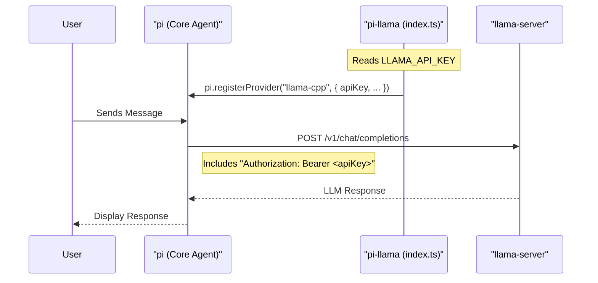

<!-- source: DeepWiki mcp.deepwiki.com · repo huggingface/pi-llama · page 3.2 Configuration and Authentication · fetched 2026-10-26 -->

# Configuration and Authentication

<details>
<summary>Relevant source files</summary>

The following files were used as context for generating this wiki page:

- [README.md](README.md)
- [index.ts](index.ts)

</details>


This section details how the `pi-llama` extension manages its connection to the `llama-server`. It covers the environment variables used for configuration, the logic for normalizing URLs to ensure API compatibility, and the authentication mechanism used when forwarding requests to the provider.

## Environment Variables

The extension relies on two primary environment variables to locate and authenticate with the `llama.cpp` server. These variables are read during the extension's initialization phase [index.ts:171-172]().

| Variable | Description | Default Value |
| :--- | :--- | :--- |
| `LLAMA_BASE_URL` | The base URL where the `llama-server` is listening. | `http://localhost:8080/v1` |
| `LLAMA_API_KEY` | The API key required by the server (if any). | `no-key` |

> [index.ts:16-16](), [index.ts:171-172](), [README.md:39-40]()

## URL Normalization

To ensure consistent behavior across different user configurations, the extension performs automated cleanup and normalization on the `LLAMA_BASE_URL`.

1.  **Trailing Slash Removal**: The extension uses a regular expression `.replace(/\/+$/, "")` to strip any trailing slashes from the provided URL [index.ts:171-171]().
2.  **V1 Prefix Handling**: While the standard `baseUrl` used for model listing and chat completions typically includes the `/v1` suffix (e.g., `http://localhost:8080/v1`), certain llama.cpp-specific endpoints like `/props` exist at the root level.
3.  **Root URL Derivation**: When calling non-OpenAI-compatible endpoints, the extension dynamically strips the `/v1` suffix to reach the server root [index.ts:146-146]().

### Data Flow: URL and Key Resolution

The following diagram illustrates how environment variables are processed and distributed to the internal systems of the extension.

**Configuration and API Key Distribution**

**Sources:** [index.ts:143-146](), [index.ts:171-172](), [index.ts:223-228]()

## Provider Authentication

Authentication is handled by passing the `apiKey` to the `pi.registerProvider` function. This ensures that every request generated by the `pi` agent to this provider includes the necessary credentials in the HTTP headers (typically as a `Bearer` token).

### Request Signing Flow

When a user selects a model registered by `pi-llama`, the `pi` core uses the credentials provided during registration to sign outgoing requests.

**Authentication Forwarding Flow**

**Sources:** [index.ts:172-172](), [index.ts:223-228](), [README.md:40-40]()

## Implementation Details

### Default Values
If no environment variables are provided, the extension defaults to a local setup. The `DEFAULT_BASE_URL` is set to `http://localhost:8080/v1` [index.ts:16-16](). If no `LLAMA_API_KEY` is found, it defaults to the string `"no-key"` [index.ts:172-172]().

### API Registration
The registration occurs within the exported default function. The `apiKey` and `baseUrl` are passed as part of the configuration object to `pi.registerProvider` [index.ts:223-228](). This configuration tells the Pi agent how to route requests for the `llama-cpp` provider ID.

```typescript
// Example of the registration call
pi.registerProvider(PROVIDER_ID, {
    baseUrl,
    apiKey,
    models: currentModels,
});
```
**Sources:** [index.ts:15-15](), [index.ts:223-228]()

### Build Info Access
The `llama-version` command specifically demonstrates the URL normalization logic. It takes the `baseUrl`, strips the `/v1` suffix if present, and appends `/props` to fetch server metadata [index.ts:143-146](). This allows the extension to retrieve the build number and commit hash of the underlying `llama.cpp` instance [index.ts:161-167]().

**Sources:** [index.ts:143-169]()

---

