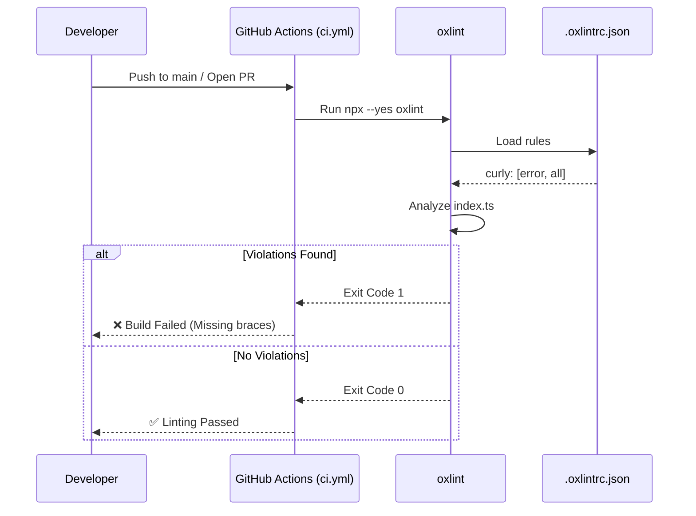

<!-- source: DeepWiki mcp.deepwiki.com · repo huggingface/pi-llama · page 4.2 Linting · fetched 2026-10-26 -->

# Linting

<details>
<summary>Relevant source files</summary>

The following files were used as context for generating this wiki page:

- [.oxlintrc.json](.oxlintrc.json)

</details>


The `pi-llama` project utilizes `oxlint` for high-performance static analysis. The linting strategy is intentionally focused on code clarity and preventing common logical errors by enforcing strict structural requirements on control-flow statements.

## Linting Configuration

The project configuration is defined in `.oxlintrc.json`. Unlike standard ESLint configurations that may contain hundreds of rules, this project adopts a minimalist approach, specifically targeting the `curly` rule to ensure structural consistency across the TypeScript codebase.

| Rule | Severity | Option | Description |
| :--- | :--- | :--- | :--- |
| `curly` | `error` | `all` | Requires curly braces for all control-flow statements, including single-line blocks. |

### Implementation Details

The configuration is defined as follows:

```json
{
	"rules": {
		"curly": ["error", "all"]
	}
}
```
[.oxlintrc.json:1-5]()

**Sources:**
- [.oxlintrc.json:1-5]()

## Rationale for Mandatory Curly Braces

The enforcement of `curly: [error, all]` is a deliberate architectural decision to mitigate "goto fail" style bugs and improve the maintainability of the `index.ts` file, which contains the core extension logic.

### Comparison of Control Flow Structures

The following table illustrates the transformation enforced by the linter:

| Statement Type | Non-Compliant (Error) | Compliant (Required) |
| :--- | :--- | :--- |
| **If Statement** | `if (condition) doAction();` | `if (condition) { doAction(); }` |
| **Else Statement** | `else doOther();` | `else { doOther(); }` |
| **While Loop** | `while (active) poll();` | `while (active) { poll(); }` |

### Data Flow: Linting in the Development Lifecycle

The linting process acts as a gatekeeper between the "Natural Language Space" (developer intent) and the "Code Entity Space" (the `pi-llama` extension).

```mermaid
graph TD
    subgraph "Developer Environment"
        "Developer" -- "Writes Code" --> "index.ts"
        "index.ts" -- "Triggers" --> "oxlint_binary[oxlint]"
    end

    subgraph "Rule Engine"
        "oxlint_binary" -- "Reads" --> "config[.oxlintrc.json]"
        "config" -- "Enforces" --> "curly_rule[curly: all]"
    end

    subgraph "CI/CD Pipeline"
        "GitHub_Action[.github/workflows/ci.yml]" -- "Executes" --> "npx_oxlint[npx --yes oxlint]"
        "npx_oxlint" -- "Validates" --> "index.ts"
    }

    "curly_rule" -- "Blocks Commit if Missing Braces" --> "GitHub_Action"
```

**Sources:**
- [.oxlintrc.json:1-5]()
- [.github/workflows/ci.yml:18-18]()

## CI Integration and Enforcement

Linting is a mandatory step in the Continuous Integration (CI) pipeline. Any violation of the rules defined in `.oxlintrc.json` will cause the CI build to fail, preventing the merging of code that does not meet the project's structural standards.

### Execution Mechanism

The linting process is executed via `npx` to ensure the latest version of `oxlint` is used without requiring manual installation by every contributor.

1.  **Command**: `npx --yes oxlint`
2.  **Environment**: The command runs within the `check` job on an `ubuntu-latest` runner.
3.  **Scope**: The linter scans the entire repository, focusing on the `.ts` files (primarily `index.ts`).



**Sources:**
- [.oxlintrc.json:3-3]()
- [.github/workflows/ci.yml:11-18]()

---

