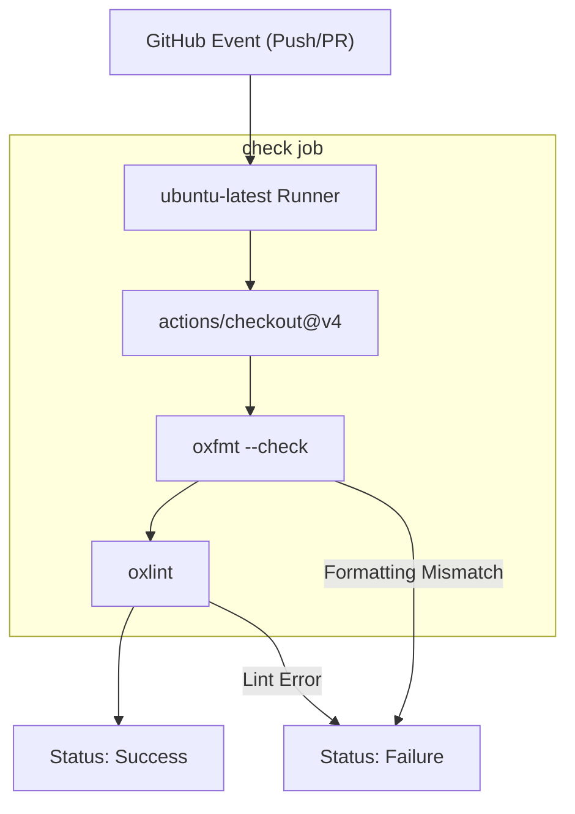
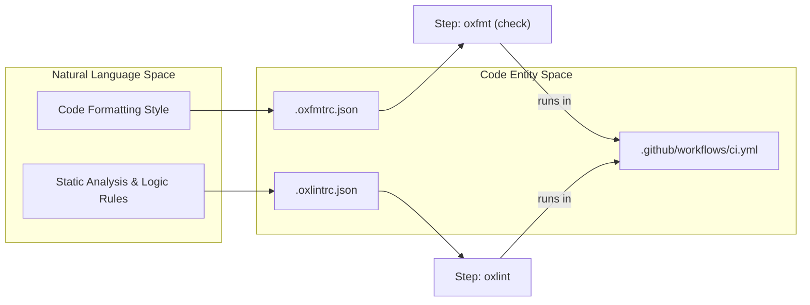

<!-- source: DeepWiki mcp.deepwiki.com · repo huggingface/pi-llama · page 4.3 Continuous Integration Pipeline · fetched 2026-10-26 -->

# Continuous Integration Pipeline

Relevant source files

The following files were used as context for generating this wiki page:

- [.github/workflows/ci.yml](.github/workflows/ci.yml)

The `pi-llama` project utilizes GitHub Actions to ensure code quality and consistency across all contributions. The CI pipeline is designed to be lightweight and fast, focusing on static analysis and formatting verification using the `oxc` toolsuite.

### Workflow Triggers and Environment

 The CI workflow is defined in [.github/workflows/ci.yml:1-19](). It is configured to execute automatically under two primary conditions:
1.  **Push to main**: Any code merged or pushed directly to the `main` branch [.github/workflows/ci.yml:4-5]().
2.  **Pull Requests**: Any pull request opened or updated against the repository [.github/workflows/ci.yml:6-6]().

The pipeline executes a single job named `check` which runs on the `ubuntu-latest` virtual environment [.github/workflows/ci.yml:9-10]().

### Job Execution Flow

The `check` job consists of three sequential steps to validate the codebase. It uses `npx --yes` to execute tools without interactive prompts, ensuring the pipeline does not hang waiting for user confirmation in the CI environment [.github/workflows/ci.yml:15-18]().

| Step | Command | Purpose |
| :--- | :--- | :--- |
| **Checkout** | `actions/checkout@v4` | Clones the repository into the runner [.github/workflows/ci.yml:12-12](). |
| **oxfmt (check)** | `npx --yes oxfmt --check .` | Verifies that all files adhere to the project's formatting rules (tabs, etc.) [.github/workflows/ci.yml:14-15](). |
| **oxlint** | `npx --yes oxlint .` | Runs static analysis to catch syntax errors and enforce linting rules like mandatory curly braces [.github/workflows/ci.yml:17-18](). |

### Logic and Data Flow Diagram

The following diagram illustrates how the GitHub Actions runner transitions from a trigger event to a successful build status by invoking the specific linting and formatting tools.

**CI Pipeline Execution Logic**

Sources: [.github/workflows/ci.yml:3-19]()

### Tool Integration

The pipeline maps directly to the developer tooling configurations defined in the repository.

*   **oxfmt**: The `oxfmt --check .` command [.github/workflows/ci.yml:15-15]() validates the project against the settings in `.oxfmtrc.json`. If a developer has not formatted their code with tabs before pushing, this step will fail the CI build.
*   **oxlint**: The `oxlint .` command [.github/workflows/ci.yml:18-18]() applies the ruleset defined in `.oxlintrc.json`. This ensures that logic-related requirements, such as the `curly` rule for control flow, are strictly enforced before code can be merged.

**Code Entity to CI Step Mapping**

Sources: [.github/workflows/ci.yml:14-18]()

### CI Configuration Summary

| Property | Value |
| :--- | :--- |
| **Workflow Name** | `CI` [.github/workflows/ci.yml:1-1]() |
| **Operating System** | `ubuntu-latest` [.github/workflows/ci.yml:10-10]() |
| **Node Executor** | `npx --yes` (avoids interactive prompts) [.github/workflows/ci.yml:15-18]() |
| **Scope** | Recursive directory check (`.`) [.github/workflows/ci.yml:15-18]() |

Sources: [.github/workflows/ci.yml:1-19]()

---

