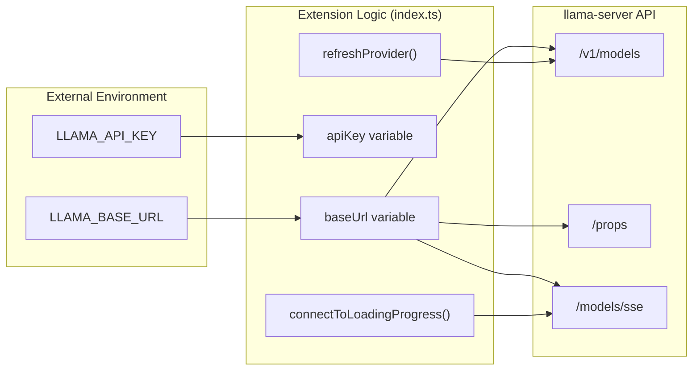

<!-- source: DeepWiki mcp.deepwiki.com · repo huggingface/pi-llama · page 5 Glossary · fetched 2026-10-26 -->

# Glossary

<details>
<summary>Relevant source files</summary>

The following files were used as context for generating this wiki page:

- [.github/workflows/ci.yml](.github/workflows/ci.yml)
- [.oxfmtrc.json](.oxfmtrc.json)
- [.oxlintrc.json](.oxlintrc.json)
- [README.md](README.md)
- [index.ts](index.ts)
- [package.json](package.json)

</details>


This glossary provides definitions for codebase-specific terms, domain concepts, and technical abbreviations used within the `pi-llama` extension. It is intended to help onboarding engineers navigate the integration between the `pi` coding agent and the `llama.cpp` server.

## Domain Concepts & Abbreviations

### llama-server
The HTTP API server provided by `llama.cpp`. It serves models via an OpenAI-compatible API and additional custom endpoints for metadata and state management [README.md:48-52]().

### Provider
A registered entity within the `pi` ecosystem that supplies language model capabilities. This extension registers itself under the ID `llama-cpp` [index.ts:15-15]().

### Autoloading
A feature of the `llama.cpp` server where a model is loaded into memory only when requested. The extension triggers this by appending `autoload=true` to the `/props` endpoint [index.ts:316-318]().

### Thinking / Reasoning
Support for models that output internal "thought" chains (e.g., DeepSeek-R1, Qwen-2.5-7B-Instruct). The extension detects this via the `enable_thinking` key in chat templates and maps it to the `qwen-chat-template` compatibility layer [index.ts:121-131]().

### Stale Context
A condition where an `ExtensionCtx` (provided by `pi`) becomes invalid because the user started a new session or replaced the current one. The extension detects this via `isStaleContextError` to halt background tasks like SSE polling [index.ts:133-138]().

---

## Technical Entities & Code Symbols

The following table defines key types and variables used to manage model state and API communication.

| Symbol | Type | Description |
| :--- | :--- | :--- |
| `currentModels` | `LlamaModel[]` | The local state array storing the list of models discovered from the server [index.ts:141-141](). |
| `discoveredMetadata` | `Map<string, MutableModelMetadata>` | A cache of model capabilities (context window, reasoning support) fetched from `/props` [index.ts:245-245](). |
| `pendingMetadata` | `Set<string>` | A set used to track in-flight `/props` requests to prevent redundant network calls [index.ts:246-246](). |
| `sseAbortController` | `AbortController` | Used to terminate the Server-Sent Events stream when a model finishes loading or the session changes [index.ts:248-248](). |
| `LlamaModel` | `Type` | The TypeScript representation of a model as expected by `pi.registerProvider` [index.ts:101-101](). |

### Data Flow: Discovery to Registration

The following diagram bridges the "Natural Language Space" of user actions to the "Code Entity Space" of internal functions and API calls.

**Model Discovery and Registration Flow**
```mermaid
graph TD
  subgraph "Natural Language Space"
    "User starts pi" --> "Poll Models"
    "User selects model" --> "Fetch Metadata"
  end

  subgraph "Code Entity Space (index.ts)"
    "Poll Models" --> refreshProvider["refreshProvider()"]
    refreshProvider --> fetchModels["fetch /v1/models"]
    fetchModels --> validateModelsResponse["validateModelsResponse()"]
    validateModelsResponse --> registerProvider["pi.registerProvider()"]

    "Fetch Metadata" --> discoverModelMetadata["discoverModelMetadata()"]
    discoverModelMetadata --> fetchProps["fetch /props?autoload=true"]
    fetchProps --> connectToLoadingProgress["connectToLoadingProgress()"]
    connectToLoadingProgress --> sseStream["GET /models/sse"]
  end
```
**Sources:** [index.ts:174-210](), [index.ts:311-330](), [index.ts:376-385]()

---

## API & Schema Definitions

The extension uses `TypeBox` to validate responses from the `llama.cpp` server.

### ModelsResponseSchema
Validates the output of `GET /v1/models`. It tracks model `id`, `aliases`, and `status` (e.g., `loaded`, `loading`, `unloaded`) [index.ts:25-58]().

### PropsResponseSchema
Validates the output of `GET /props`. It extracts `n_ctx` (context window), `chat_template` (for reasoning detection), and `build_info` [index.ts:62-70]().

### SSE Progress Stages
When a model is loading, the server emits events categorized by these stages:
*   `text_model`: Loading the primary LLM weights [index.ts:96-96]().
*   `spec_model`: Loading a draft model for speculative decoding [index.ts:97-97]().
*   `mmproj_model`: Loading a multi-modal projector (for vision support) [index.ts:98-98]().

### System Architecture Mapping

This diagram maps the high-level system components to the specific files and environment variables that configure them.

**System Configuration Mapping**

**Sources:** [index.ts:171-172](), [index.ts:176-176](), [index.ts:316-316](), [index.ts:385-385](), [README.md:37-40]()

---

## Tooling & CI Terms

### oxfmt
The tool used for code formatting. It is configured via `.oxfmtrc.json` to use tabs [index.ts:1-240](), [.oxfmtrc.json:1-3]().

### oxlint
The static analysis tool used to enforce code quality. It specifically enforces the use of curly braces for all control flow statements via the `curly` rule [.oxlintrc.json:1-5]().

### CI Workflow
The GitHub Actions pipeline defined in `.github/workflows/ci.yml`. It runs on every push to `main` and all pull requests, executing `oxfmt --check` and `oxlint` [.github/workflows/ci.yml:1-19]().

**Sources:** [.oxfmtrc.json:1-3](), [.oxlintrc.json:1-5](), [.github/workflows/ci.yml:1-19]()