# Page: Overview

# Overview

<details>
<summary>Relevant source files</summary>

The following files were used as context for generating this wiki page:

- [README.md](README.md)
- [package.json](package.json)

</details>


The `pi-llama` extension bridges the gap between the [pi](https://pi.dev) coding agent and a running `llama-server` (from the `llama.cpp` project). It enables `pi` to auto-discover local or remote models, handle real-time loading progress via Server-Sent Events (SSE), and manage model-specific metadata such as context windows and reasoning capabilities.

## System Purpose

The primary goal of `pi-llama` is to register `llama.cpp` as a first-class provider within the `pi` ecosystem. It eliminates the need for manual configuration by polling the `llama-server` API and dynamically registering available models with the `pi` runtime.

### Key Capabilities
- **Auto-Discovery**: Periodically polls the `llama.cpp` `/v1/models` endpoint to detect available models [index.ts:250-252]().
- **Metadata Management**: Fetches model-specific properties (context window, chat templates) via the `/props` endpoint [index.ts:312-315]().
- **Progress Tracking**: Provides visual feedback in the `pi` TUI while a model is being loaded into VRAM by consuming the `/models/sse` stream [index.ts:401-404]().
- **Reasoning Support**: Detects and enables "thinking" modes for models like Qwen or DeepSeek based on their chat templates [index.ts:161-163]().

## System Architecture

The extension is designed as a lightweight ESM module that interacts with two main entities: the `pi` global runtime and the external `llama-server` process.

### Logical Component Mapping

The following diagram illustrates how the natural language concepts of "Provider Registration" and "Model Loading" map to specific code entities and API interactions.

**Diagram: System Interaction Flow**
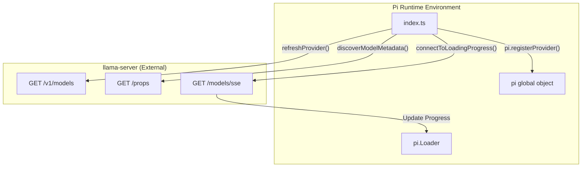
Sources: [index.ts:250-275](), [index.ts:312-320](), [index.ts:401-410](), [index.ts:440-450]()

### Code Entity Space

The extension logic is contained entirely within `index.ts`. It uses a set of internal state variables and event hooks to manage the lifecycle of the provider.

**Diagram: Code Entity Relationships**
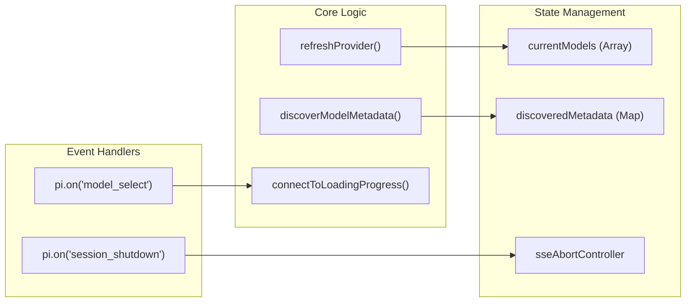
Sources: [index.ts:130-135](), [index.ts:137-142](), [index.ts:501-510](), [index.ts:543-550]()

## Project Structure

The repository follows the standard `pi-package` structure, allowing it to be installed directly via Git.

| File | Role |
| :--- | :--- |
| `index.ts` | The entrypoint and entire implementation of the extension logic [package.json:13](). |
| `package.json` | Defines the `pi-package` manifest and optional peer dependencies [package.json:12-20](). |
| `.oxlintrc.json` | Configuration for static analysis (enforcing curly braces) [package.json:1-5](). |
| `.oxfmtrc.json` | Configuration for the `oxfmt` formatter (tab-based indentation). |

## Navigation

For detailed information on specific areas of the codebase, refer to the following child pages:

- **[Getting Started](#1.1)**: Instructions for installation via `pi install` or developer mode, and environment variable configuration (`LLAMA_BASE_URL`).
- **[Extension Architecture Overview](#1.2)**: Details on the `pi-package` manifest format, ESM requirements, and how the extension integrates with the `pi` plugin system.

Sources: [README.md:6-30](), [package.json:12-14]()

---

# Page: Getting Started

# Getting Started

<details>
<summary>Relevant source files</summary>

The following files were used as context for generating this wiki page:

- [README.md](README.md)
- [package.json](package.json)

</details>


This page provides a technical guide for installing, configuring, and running the `pi-llama` extension. It covers the standard installation path for end-users, developer mode for contributors, and the environment variables that govern communication between the extension and the `llama-server`.

## Installation Methods

The `pi-llama` extension can be installed either as a persistent package or loaded temporarily for development. The extension is identified by the `pi` field in its `package.json` [package.json:12-14](), which points to the entrypoint `index.ts`.

### Standard Installation
The standard installation clones the repository into the local pi agent directory and registers it for all future sessions.

| Method | Command | Effect |
| :--- | :--- | :--- |
| **Shell** | `pi install git:github.com/huggingface/pi-llama` | Clones to `~/.pi/agent/packages/pi-llama/` [README.md:10-15](). |
| **Interactive** | `!pi install git:github.com/huggingface/pi-llama` | Installs from within a `pi` session; requires `/reload` [README.md:20-23](). |

### Developer Mode
For developers modifying `index.ts`, use the `-e` flag to load the extension from a local path without permanent installation. This is useful for rapid iteration as it only affects the current session [README.md:25-33]().

```bash
git clone https://github.com/huggingface/pi-llama ~/code/pi-llama
pi -e ~/code/pi-llama/index.ts
```

Sources: [README.md:6-33](), [package.json:12-14]()

## Configuration and Environment

The extension relies on environment variables to locate and authenticate with the `llama.cpp` server. These variables are read during the extension's initialization phase to configure the base URL for API requests.

### Environment Variables

| Variable | Default Value | Description |
| :--- | :--- | :--- |
| `LLAMA_BASE_URL` | `http://localhost:8080/v1` | The base URL of the `llama-server`. The extension handles URL normalization (e.g., stripping trailing slashes) [README.md:39](). |
| `LLAMA_API_KEY` | `no-key` | The API key passed in the `Authorization` header if the server requires it [README.md:40](). |

### Data Flow: Installation to Execution

The following diagram illustrates how the `pi` CLI interacts with the filesystem and the `llama-server` to activate the extension.

**System Initialization Flow**
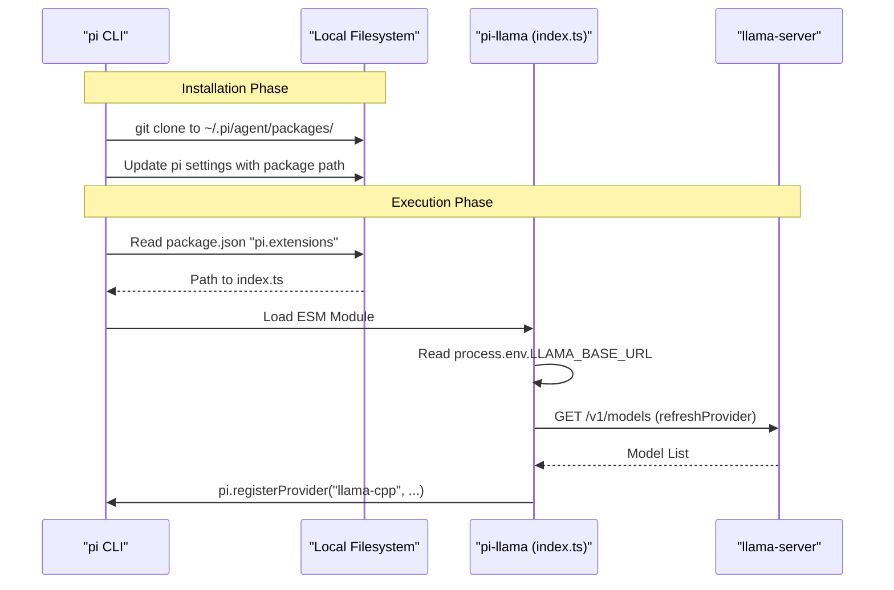

Sources: [README.md:1-15](), [README.md:35-40](), [package.json:12-14]()

## Running the Extension

To use the extension, a `llama-server` must be active and accessible via the configured `LLAMA_BASE_URL`.

### Step-by-Step Execution
1.  **Start llama-server**: Ensure the server is running (e.g., via `llama serve`) [README.md:45-49]().
2.  **Configure Environment**: (Optional) If the server is remote, export `LLAMA_BASE_URL` [README.md:51-52]().
3.  **Launch Pi**: Run the `pi` command in your terminal [README.md:54-55]().
4.  **Select Model**: Use the `/model` command within the interactive session and search for `llama-cpp` to browse discovered models [README.md:57-58]().

### Code-Space Mapping: Provider Registration

The extension registers itself with the `pi` core using the `pi.registerProvider` function. The following diagram maps the logical "Provider" concept to the specific code entities in `index.ts`.

**Provider Registration Entities**
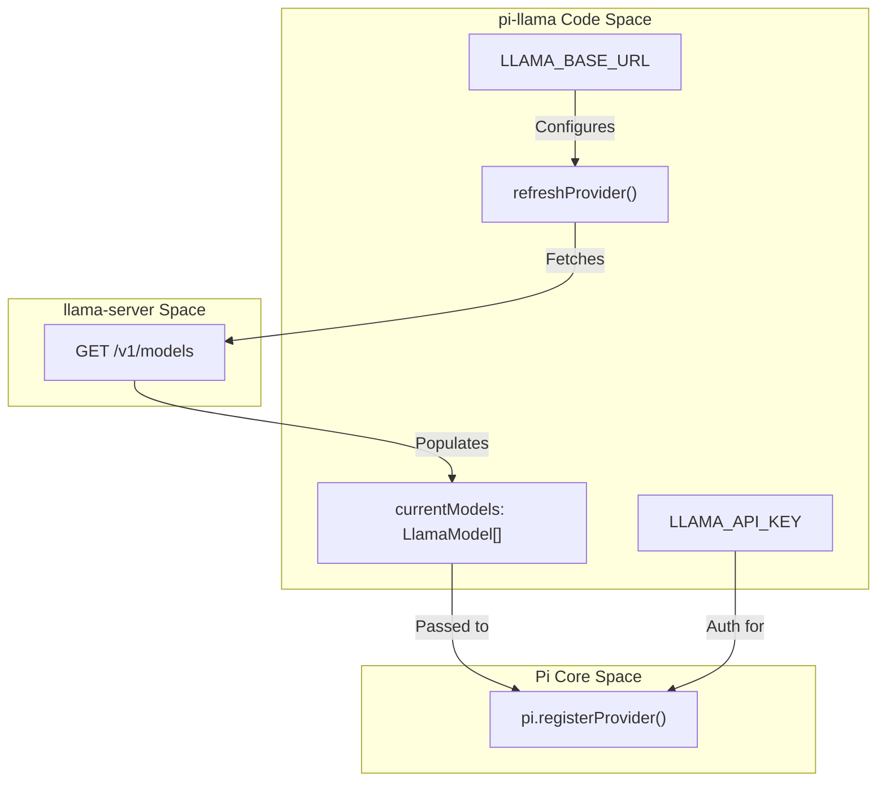

Sources: [README.md:35-59](), [package.json:1-14]()

---

# Page: Extension Architecture Overview

# Extension Architecture Overview

<details>
<summary>Relevant source files</summary>

The following files were used as context for generating this wiki page:

- [index.ts](index.ts)
- [package.json](package.json)

</details>


The `pi-llama` extension is a specialized provider for the `pi` ecosystem that enables seamless integration with `llama-server` (from the [llama.cpp](https://github.com/ggerganov/llama.cpp) project). It acts as a bridge, translating `llama.cpp`'s specific API endpoints and model states into the standardized `ExtensionAPI` format used by `pi`.

## The pi-package Manifest

The extension is defined as a `pi-package` via its `package.json`. This manifest informs the `pi` host how to load and execute the extension code.

| Field | Value | Purpose |
| :--- | :--- | :--- |
| `type` | `"module"` | Specifies the use of the ESM (ECMAScript Modules) format [package.json:5-5](). |
| `pi.extensions` | `["./index.ts"]` | Declares the entrypoint for the extension logic [package.json:12-14](). |
| `peerDependencies` | `@earendil-works/pi-coding-agent` | Provides type definitions for the `ExtensionAPI` [package.json:15-17](). |

The `@earendil-works/pi-coding-agent` dependency is marked as optional in `peerDependenciesMeta` [package.json:18-20](), as the actual API is provided by the `pi` host at runtime.

Sources: [package.json:1-22]()

## Module Format and Entrypoint

`pi-llama` follows the ESM module standard. It exports a single default asynchronous function as its entrypoint within `index.ts`.

### The `index.ts` Entrypoint
The entrypoint function receives an instance of `ExtensionAPI` (aliased as `pi`), which serves as the primary interface for registering commands, providers, and event hooks [index.ts:140-140]().

### Extension Lifecycle and Data Flow
The following diagram illustrates how the extension initializes and interacts with both the `pi` host and the external `llama-server`.

**Diagram: pi-llama Extension Initialization and Data Flow**
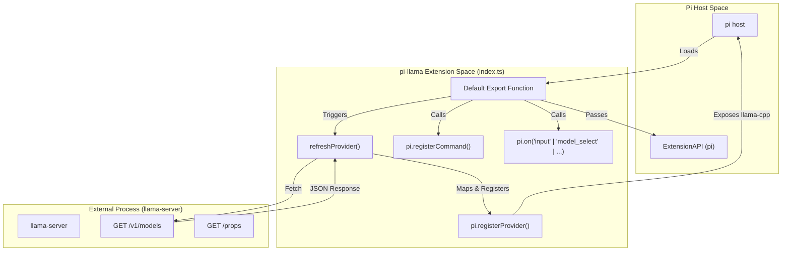
Sources: [index.ts:140-143](), [index.ts:174-177](), [index.ts:221-221]()

## Key Architectural Components

### 1. Provider Registration
The core responsibility of `pi-llama` is to register itself as a provider with the ID `llama-cpp` [index.ts:15-15](). It does this by polling the `llama-server` `/v1/models` endpoint and mapping the results to the `LlamaModel` type [index.ts:101-101](), [index.ts:176-176]().

### 2. Type-Safe Validation
To ensure robustness against variations in `llama-server` versions, the extension uses `TypeBox` for schema validation:
*   `ModelsResponseSchema`: Validates the list of available models and their statuses [index.ts:25-58]().
*   `PropsResponseSchema`: Validates detailed model metadata and server build info [index.ts:62-70]().

### 3. State Management
The extension maintains internal state to track models and avoid redundant network calls:
*   `currentModels`: An array of `LlamaModel` objects currently registered with the host [index.ts:141-141]().
*   `discoveredMetadata`: A `Map` caching metadata (like context window and chat templates) retrieved via the `/props` endpoint [index.ts:213-215]().

### 4. Natural Language to Code Mapping
The extension bridges user-facing model concepts (Natural Language Space) to the underlying `llama-server` structures (Code Entity Space).

**Diagram: Model Metadata Mapping**
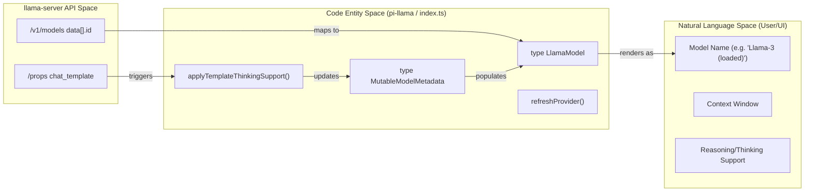
Sources: [index.ts:101-101](), [index.ts:113-119](), [index.ts:122-131](), [index.ts:204-212]()

## Peer Dependencies and Environment
The extension relies on environment variables for configuration, allowing it to adapt to different network environments without code changes:
*   `LLAMA_BASE_URL`: The root URL of the `llama-server` (defaults to `http://localhost:8080/v1`) [index.ts:16-16](), [index.ts:171-171]().
*   `LLAMA_API_KEY`: The API key for authenticated requests (defaults to `no-key`) [index.ts:172-172]().

Sources: [index.ts:15-23](), [index.ts:171-172]()

---

# Page: Core Extension Logic

# Core Extension Logic

<details>
<summary>Relevant source files</summary>

The following files were used as context for generating this wiki page:

- [index.ts](index.ts)

</details>


The `pi-llama` extension is implemented as a single-file ESM module that bridges the gap between the Pi coding agent and a local or remote `llama.cpp` server. It acts as a specialized adapter for the `llama-cpp` provider, handling model discovery, real-time loading feedback, and reasoning capabilities.

The core logic resides entirely in `index.ts` [[index.ts:1-8]](). It manages the lifecycle of the provider by polling the server's state, registering available models with the Pi system, and intercepting session events to ensure the UI remains synchronized with the backend model status.

### System Architecture Overview

The following diagram illustrates how the core logic in `index.ts` orchestrates the interaction between the Pi Extension API and the `llama-server` endpoints.

**Extension Component Interaction**
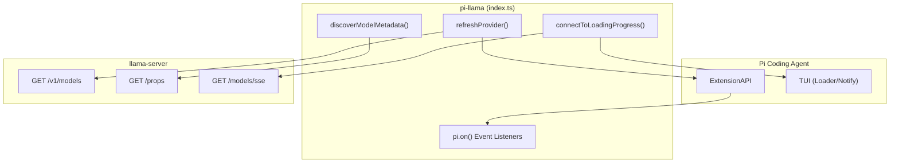
Sources: [index.ts:140-143](), [index.ts:174-176](), [index.ts:251-255](), [index.ts:318-322]()

---

### Key Subsystems

The extension logic is divided into several functional areas, each managed by the main entry point function [[index.ts:140]]().

#### Provider Registration and Model Discovery
The extension identifies as the `llama-cpp` provider [[index.ts:15]](). It periodically polls the `/v1/models` endpoint to detect available GGUF models. These models are validated against a TypeBox schema (`ModelsResponseSchema`) and transformed into the `LlamaModel` type required by Pi.
*   For details, see [Provider Registration and Model Discovery](#2.1)

#### Model Metadata Discovery and Autoloading
While `/v1/models` provides a list of files, specific capabilities like context window size and chat templates are fetched via the `/props` endpoint. The `discoverModelMetadata` function handles this, including triggering the `autoload=true` parameter to force the server to load a model into memory when selected.
*   For details, see [Model Metadata Discovery and Autoloading](#2.2)

#### Real-Time Loading Progress
Since LLMs can take significant time to load from disk to VRAM, the extension utilizes the `/models/sse` stream. It parses Server-Sent Events to provide the user with a visual progress bar and stage labels (e.g., "Loading weights") using the Pi `Loader` widget.
*   For details, see [Real-Time Loading Progress via SSE](#2.3)

#### Event Hooks and Lifecycle
The extension responds to several Pi system events via `pi.on(...)`. This includes `model_select` for triggering loads, `input` for ensuring metadata is fresh before a prompt is sent, and `session_shutdown` for cleanup. It also manages `AbortController` instances to cancel pending network requests if the user switches models rapidly.
*   For details, see [Event Hooks and Lifecycle Management](#2.4)

#### Thinking and Reasoning Support
The extension detects if a model supports reasoning by inspecting the `chat_template` for `enable_thinking` markers. It maps these to Pi's reasoning UI, allowing users to toggle "Thinking" mode for models that support it (like DeepSeek-R1 or specialized Qwen variants).
*   For details, see [Thinking and Reasoning Support](#2.5)

---

### State Management and Data Flow

The extension maintains internal state to track known models and prevent redundant network calls. The primary state resides in `currentModels` and metadata caches.

**Data Flow: Discovery to Registration**
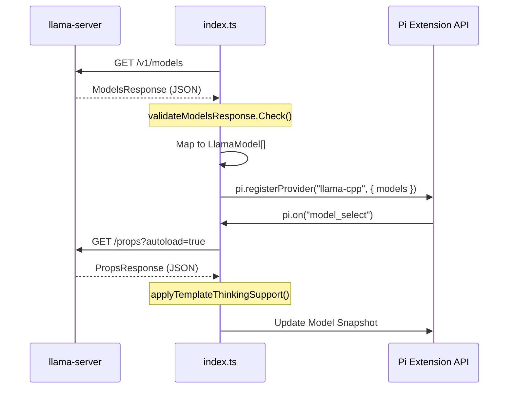
Sources: [index.ts:60-61](), [index.ts:174-210](), [index.ts:251-260](), [index.ts:400-410]()

### Core Configuration Constants
The extension relies on several default values when the server does not provide explicit metadata:

| Constant | Value | Description |
| :--- | :--- | :--- |
| `PROVIDER_ID` | `"llama-cpp"` | The unique ID used to register the provider in Pi. |
| `DEFAULT_BASE_URL` | `http://localhost:8080/v1` | Default endpoint if `LLAMA_BASE_URL` is unset. |
| `DEFAULT_CONTEXT_WINDOW` | `8192` | Fallback if `n_ctx` is missing from the server. |
| `DEFAULT_MAX_TOKENS` | `16384` | Fallback for output token limits. |
| `PROPS_TIMEOUT_MS` | `120,000` | 2-minute timeout for model property discovery. |

Sources: [index.ts:15-23]()

---

# Page: Provider Registration and Model Discovery

# Provider Registration and Model Discovery

<details>
<summary>Relevant source files</summary>

The following files were used as context for generating this wiki page:

- [index.ts](index.ts)

</details>


The `pi-llama` extension integrates `llama.cpp` as a first-class model provider within the `pi` ecosystem. This process involves establishing a connection to a running `llama-server`, validating its capabilities, and dynamically registering available models so they appear in the `pi` user interface.

## Provider Registration Flow

Registration is handled within the extension's entry point. The extension normalizes the `LLAMA_BASE_URL` and uses the `LLAMA_API_KEY` to authenticate with the `llama.cpp` server [index.ts:171-172](). 

The core of the registration logic resides in `refreshProvider()`, which polls the server's OpenAI-compatible `/v1/models` endpoint [index.ts:174-176](). Once models are retrieved and validated, the extension calls `pi.registerProvider` to inform `pi` about the `llama-cpp` provider and its associated models [index.ts:227-234]().

### Registration Logic and Data Flow

The following diagram illustrates the sequence from extension initialization to successful provider registration.

**Provider Initialization Sequence**
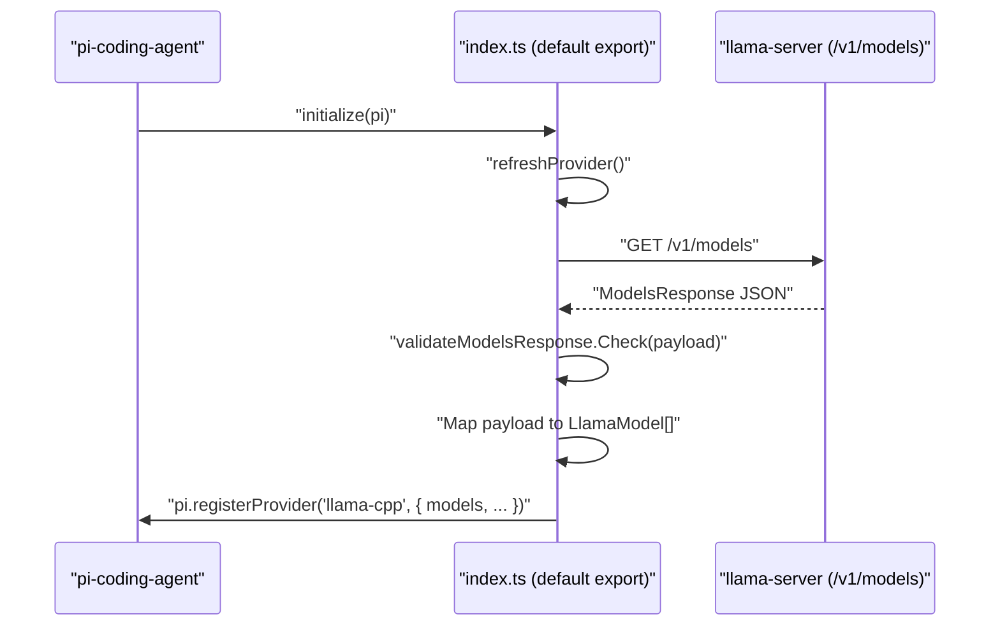
**Sources:** [index.ts:140-141](), [index.ts:174-177](), [index.ts:183-193](), [index.ts:227-234]()

## Model Discovery and Mapping

The extension maintains a local state array `currentModels` to track the models reported by the server [index.ts:141](). When `refreshProvider()` is called, it performs a diffing and mapping operation to transform the `llama.cpp` internal representation into the `LlamaModel` type required by the `ExtensionAPI` [index.ts:191-225]().

### Mapping Logic
1.  **Identity**: The `id` is taken directly from the llama.cpp model ID [index.ts:211]().
2.  **Display Name**: The name is derived from `aliases[0]` or the `id`, appended with suffixes like `(image)` if the architecture supports vision, or `(loaded)` if the model is currently in memory [index.ts:200-212]().
3.  **Context Window**: Prefers `meta.n_ctx` from the API, falling back to previously discovered values or the `DEFAULT_CONTEXT_WINDOW` (8192) [index.ts:18-208]().
4.  **Capabilities**: Input modalities are filtered to include only `text` and `image` [index.ts:197-199]().

### Code Entity Mapping
This diagram bridges the network response objects to the internal TypeScript types used for registration.

**Data Transformation Map**
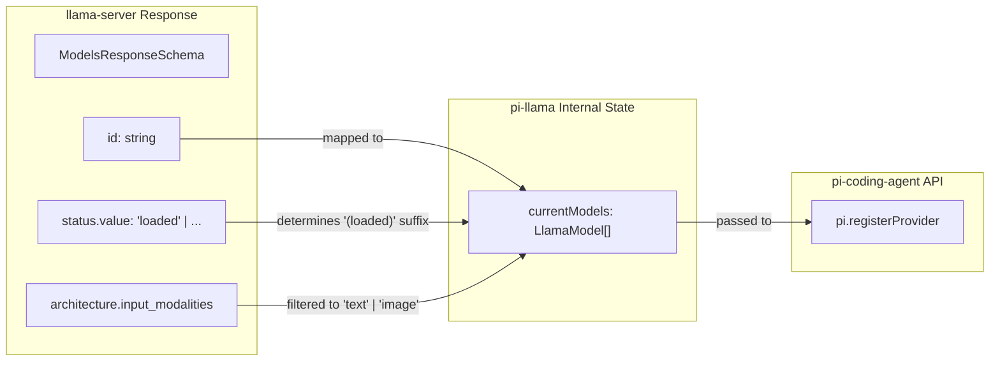
**Sources:** [index.ts:25-58](), [index.ts:101-101](), [index.ts:141-141](), [index.ts:193-225]()

## Schema Validation via TypeBox

To ensure stability against various `llama-server` versions, `pi-llama` uses `TypeBox` for runtime schema validation. This prevents the extension from crashing if the server returns unexpected JSON structures.

| Schema | Purpose | Key Fields Validated |
| :--- | :--- | :--- |
| `ModelsResponseSchema` | Validates the `/v1/models` payload. | `data`, `id`, `status.value`, `architecture.input_modalities`, `meta.n_ctx` |
| `PropsResponseSchema` | Validates the `/props` payload. | `default_generation_settings.n_ctx`, `chat_template`, `build_info` |

The validation is performed using `validateModelsResponse.Check(payload)` [index.ts:60-183](). If validation fails, the extension logs the specific validation errors to the console and aborts the refresh to prevent corrupting the model registry [index.ts:184-189]().

**Sources:** [index.ts:25-58](), [index.ts:60-60](), [index.ts:62-70](), [index.ts:72-72](), [index.ts:183-189]()

## Polling and State Persistence

`refreshProvider` is called during the initial setup and can be triggered by lifecycle events. Because `/v1/models` does not return advanced metadata (like reasoning capabilities or specific chat templates), the mapping logic is designed to preserve metadata discovered via the `/props` endpoint across refreshes [index.ts:213-216]().

*   **`currentModels`**: An array of `LlamaModel` objects representing the current known state of the provider [index.ts:141]().
*   **`previousById`**: A temporary map created during `refreshProvider` to allow the extension to carry over `reasoning`, `contextWindow`, and `maxTokens` from the existing state if the new API response is missing them [index.ts:191-225]().

**Sources:** [index.ts:141-141](), [index.ts:191-191](), [index.ts:213-225]()

---

# Page: Model Metadata Discovery and Autoloading

# Model Metadata Discovery and Autoloading

<details>
<summary>Relevant source files</summary>

The following files were used as context for generating this wiki page:

- [index.ts](index.ts)

</details>


This section describes the `discoverModelMetadata` function and its supporting logic. While `refreshProvider` polls the standard `/v1/models` endpoint for basic model listing, `discoverModelMetadata` performs deep inspection of a specific model's capabilities and triggers the server-side loading process.

## Metadata Discovery Lifecycle

The discovery process is responsible for bridging the gap between the generic OpenAI-compatible `/v1/models` response and the rich internal state of `llama-server`. It manages model-specific configuration like context window sizes and advanced features like reasoning/thinking support.

### The `discoverModelMetadata` Function

The `discoverModelMetadata` function [index.ts:333-408]() is invoked whenever a model is selected or a request is about to be made. It performs the following sequence:

1.  **Cache Check**: It checks `discoveredMetadata` [index.ts:241]() to see if the model has already been fully inspected.
2.  **Concurrency Management**: If a request for the same model is already in flight (tracked in `pendingMetadata` [index.ts:242]()), it returns the existing promise to avoid redundant network traffic.
3.  **Request Initiation**: It constructs a request to the `/props` endpoint [index.ts:353](). Crucially, it appends `autoload=true` to the query parameters [index.ts:353](). This triggers `llama-server` to begin loading the model into VRAM if it is currently in an `unloaded` state.
4.  **Schema Validation**: The response is validated against `PropsResponseSchema` [index.ts:62-70]() using the `validatePropsResponse` compiler [index.ts:72]().
5.  **Capability Mapping**: It extracts the `n_ctx` (context window) and inspects the `chat_template` to detect advanced features like reasoning.

### Data Flow: Metadata Extraction

| Data Point | Source Path in `/props` | Fallback Logic |
| :--- | :--- | :--- |
| **Context Window** | `default_generation_settings.n_ctx` [index.ts:63-67]() | `DEFAULT_CONTEXT_WINDOW` (8192) [index.ts:18]() |
| **Max Tokens** | N/A (llama.cpp is unbounded) | `DEFAULT_MAX_TOKENS` (16384) [index.ts:22]() |
| **Reasoning Support** | `chat_template` string [index.ts:68]() | `false` |

**Sources:** [index.ts:15-23](), [index.ts:62-72](), [index.ts:333-408]()

## System Architecture: Discovery and Autoloading

The following diagram illustrates how the extension logic interacts with the `llama-server` and the internal cache state.

### Metadata Flow and Cache State
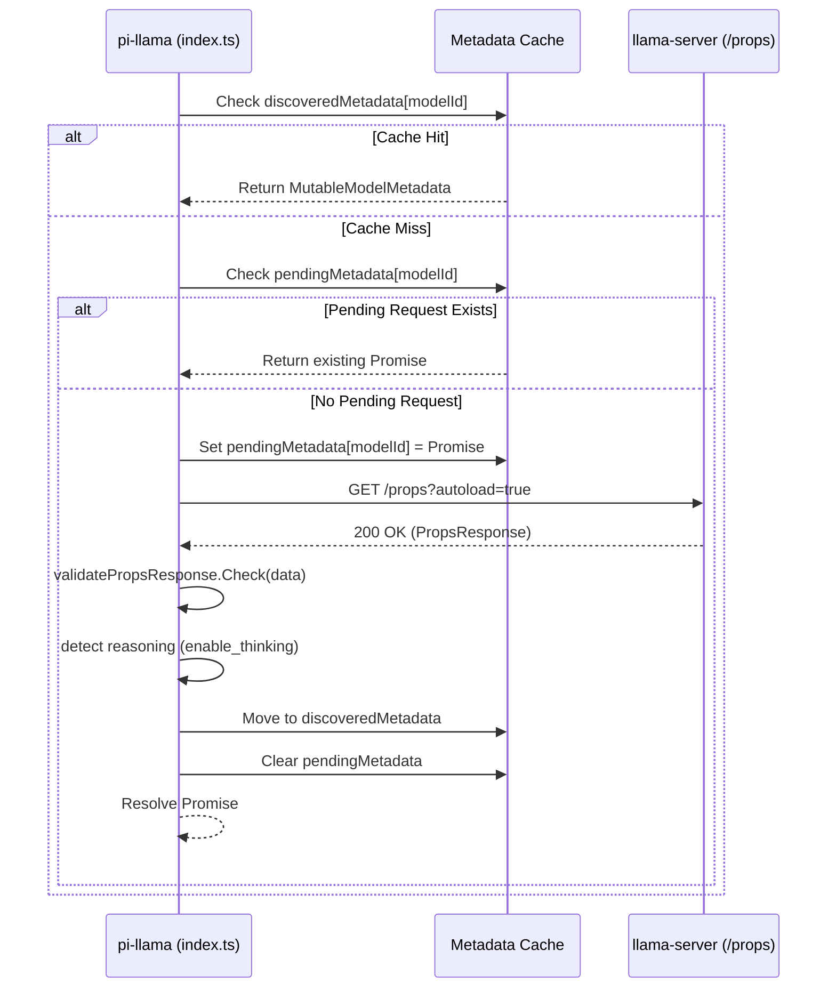
**Sources:** [index.ts:241-242](), [index.ts:333-408]()

## Thinking and Reasoning Detection

The extension automatically detects if a model supports "thinking" (reasoning) by inspecting the Jinja2 `chat_template` returned by the server.

### Template Inspection
The function `discoverModelMetadata` searches for the string `enable_thinking` within the `chat_template` [index.ts:377](). If found, it invokes `applyTemplateThinkingSupport` [index.ts:122-131]().

### Thinking Configuration
When reasoning is detected, the model's metadata is updated with:
*   **`reasoning: true`**: Enables the reasoning UI in the Pi interface [index.ts:123]().
*   **`thinkingLevelMap`**: Maps Pi's thinking levels to llama.cpp's boolean toggle [index.ts:105-110]().
*   **`thinkingFormat: "qwen-chat-template"`**: Tells the Pi core to use the `chat_template_kwargs` structure for sending the thinking toggle to the provider [index.ts:129]().

**Sources:** [index.ts:105-110](), [index.ts:122-131](), [index.ts:377-380]()

## Redundant Request Management

To ensure performance and stability, the extension employs several strategies to manage the lifecycle of metadata requests.

### Cache Structures
The extension maintains two primary state variables for metadata:
1.  `discoveredMetadata`: A `Map<string, MutableModelMetadata>` [index.ts:241]() that stores finalized information about models, ensuring that `/props` is only called once per model per session.
2.  `pendingMetadata`: A `Map<string, Promise<MutableModelMetadata>>` [index.ts:242]() that stores active requests. This prevents "thundering herd" issues where multiple event hooks (e.g., `model_select` and `before_provider_request`) trigger simultaneous fetches for the same model.

### Lifecycle Hooks
Discovery is triggered by two main Pi event hooks:
*   `pi.on("model_select", ...)` [index.ts:468-472](): Triggers discovery as soon as a user selects a model in the UI.
*   `pi.on("before_provider_request", ...)` [index.ts:474-480](): Acts as a safety net to ensure metadata (especially context window size) is loaded before a prompt is sent.

### Abort Handling
To prevent race conditions when a user rapidly switches models, the extension uses `propsAbortController` [index.ts:244](). Before starting a new discovery request, any existing request is aborted [index.ts:348-351]().

### Implementation Entities
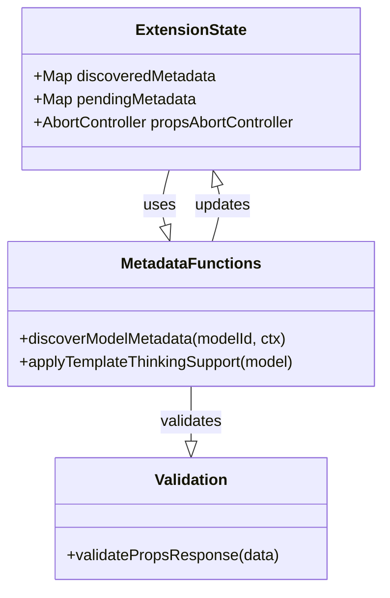
**Sources:** [index.ts:241-244](), [index.ts:333-351](), [index.ts:468-480]()

---

# Page: Real-Time Loading Progress via SSE

# Real-Time Loading Progress via SSE

<details>
<summary>Relevant source files</summary>

The following files were used as context for generating this wiki page:

- [index.ts](index.ts)

</details>


The `pi-llama` extension provides real-time feedback during model instantiation by consuming the `llama-server` Server-Sent Events (SSE) stream. This ensures that when a user selects a model that is not yet in memory, the Pi TUI displays a progress bar and stage-specific information rather than appearing frozen.

### Architecture and Data Flow

The loading progress system bridges the gap between the asynchronous loading process in `llama-server` and the Pi Terminal User Interface (TUI). It utilizes a dedicated SSE endpoint to receive granular updates about weight loading, draft models, and vision projectors.

#### System Interaction Diagram

This diagram illustrates how the `connectToLoadingProgress` function mediates between the server stream and the Pi UI components.

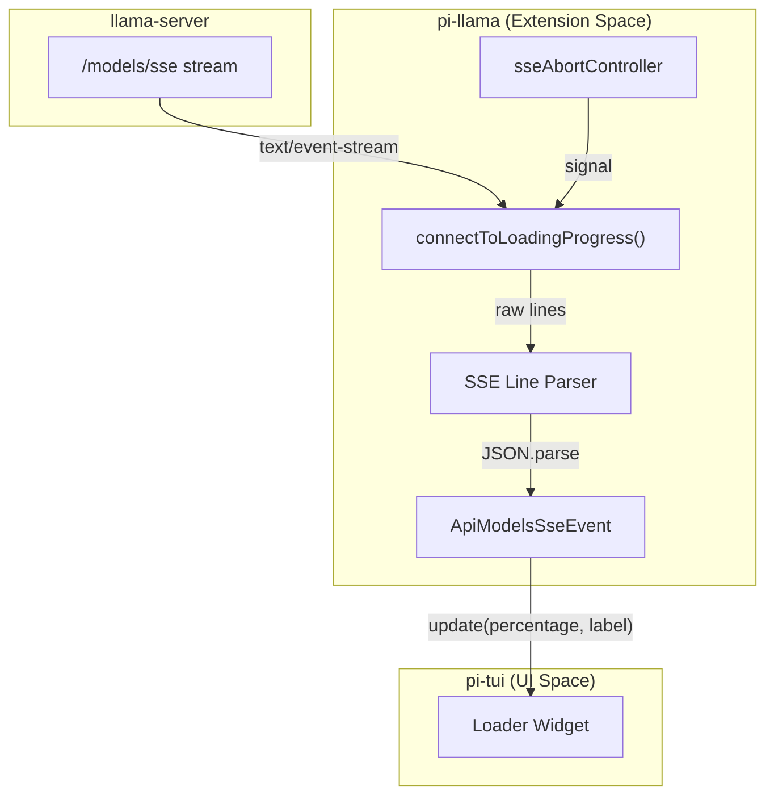
**Sources:** [index.ts:74-93](), [index.ts:285-300](), [index.ts:320-330]()

---

### Data Structures and Types

The extension defines specific types to handle the structured data returned by the llama.cpp SSE endpoint.

#### SSE Event Types
The stream emits events containing status updates and progress metrics:

*   **`ApiModelLoadStage`**: Defines the specific component being loaded.
    *   `text_model`: The primary LLM weights.
    *   `spec_model`: Draft model weights for speculative decoding.
    *   `mmproj_model`: Multi-modal projection weights (e.g., for vision support).
*   **`ApiModelsSseProgress`**: Contains the numeric progress and stage list.
    *   `value`: A float from `0.0` to `100.0`.
    *   `current`: The active `ApiModelLoadStage`.
*   **`ApiModelsSseEvent`**: The top-level object representing a single SSE message.

**Sources:** [index.ts:75-93]()

#### Stage Labels
To make the technical stage names user-friendly, the extension maps them to human-readable strings via `MODEL_LOAD_STAGE_LABELS`:

| Stage (`ApiModelLoadStage`) | UI Label |
| :--- | :--- |
| `text_model` | "Loading weights" |
| `spec_model` | "Loading draft" |
| `mmproj_model` | "Loading projector" |

**Sources:** [index.ts:95-99]()

---

### Implementation Details

#### The `connectToLoadingProgress` Function
This function manages the lifecycle of the SSE connection. It is responsible for fetching the stream, handling errors, and updating the UI loader.

1.  **Connection Management**: It initializes a `fetch` request to `${baseUrl.replace(/\/v1$/, "")}/models/sse` [index.ts:291-292]().
2.  **Stream Parsing**: It reads the response body as a stream and splits the incoming chunks into individual lines [index.ts:303-313]().
3.  **Event Filtering**: It looks for lines starting with `data: ` and parses the subsequent JSON [index.ts:316-320]().
4.  **UI Updates**:
    *   If the event contains `progress` data, it calculates the display string using `MODEL_LOAD_STAGE_LABELS` [index.ts:321-325]().
    *   It updates the `Loader` widget with the current percentage and the stage label [index.ts:327-327]().
5.  **Termination**: The loop breaks if the `status` in the event data is `"loaded"`, `"unloaded"`, or if an `exit_code` is present [index.ts:332-334]().

**Sources:** [index.ts:285-350]()

#### Lifecycle and Abort Handling
To prevent multiple progress streams from overlapping (e.g., if a user switches models twice rapidly), the extension uses a global `sseAbortController`.

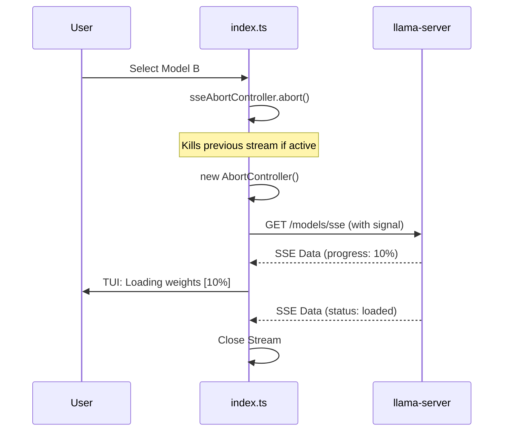

**Sources:** [index.ts:286-292](), [index.ts:352-355]()

### Error Handling
The implementation includes robust error checking for the SSE stream:
*   **Stale Contexts**: If the Pi session is replaced during loading, `isStaleContextError` catches the exception to prevent extension crashes [index.ts:136-138](), [index.ts:344-347]().
*   **Network Failures**: If the SSE endpoint is unreachable or returns a non-OK status, the function exits silently, as the model discovery polling will eventually reflect the state [index.ts:293-296]().

**Sources:** [index.ts:285-350]()

---

# Page: Event Hooks and Lifecycle Management

# Event Hooks and Lifecycle Management

<details>
<summary>Relevant source files</summary>

The following files were used as context for generating this wiki page:

- [index.ts](index.ts)

</details>


This section describes how the `pi-llama` extension manages its lifecycle and responds to user interactions through the Pi extension event system. The extension utilizes four primary event hooks to ensure the local `llama-server` state remains synchronized with the Pi interface and to manage asynchronous operations safely.

## Overview of Event Listeners

The extension registers four listeners using the `pi.on(...)` API. These hooks handle everything from model discovery on startup to resource cleanup when the session terminates.

| Event | Purpose | Implementation |
| :--- | :--- | :--- |
| `input` | Triggers a provider refresh when the user types, ensuring new models are discovered. | [index.ts:246-248]() |
| `model_select` | Triggers metadata discovery and autoloading when a user selects a `llama-cpp` model. | [index.ts:250-252]() |
| `before_provider_request` | Ensures model metadata is loaded before a generation request is dispatched. | [index.ts:254-263]() |
| `session_shutdown` | Cleans up active SSE streams and pending metadata fetches. | [index.ts:265-269]() |

### Lifecycle Flow Diagram

The following diagram illustrates the relationship between user actions, event hooks, and the internal state of the extension.

**Event-Driven Model Lifecycle**
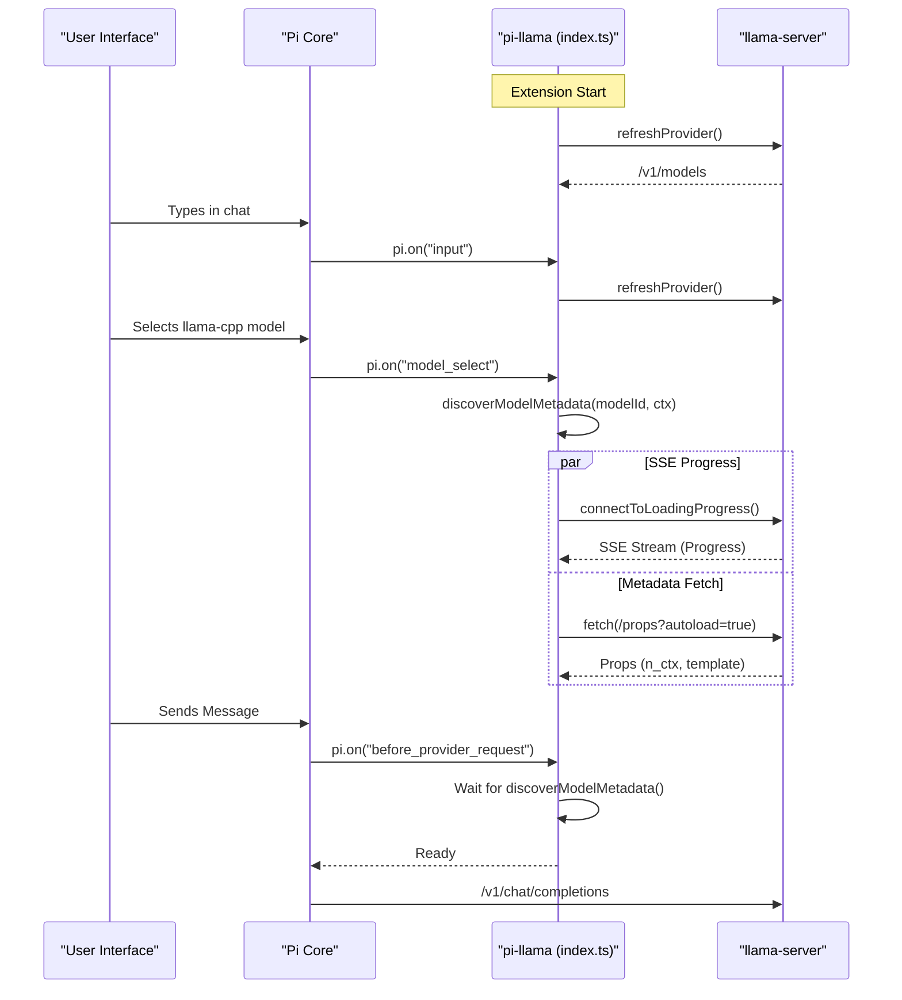
**Sources:** [index.ts:140-143](), [index.ts:246-269](), [index.ts:272-340]()

---

## Race Condition Prevention

Rapid model switching or session resets can lead to "stale context" errors or race conditions where multiple metadata fetches compete for the same model. `pi-llama` employs `AbortController` instances and state tracking to mitigate these issues.

### Abort Management

The extension maintains two specific `AbortController` instances within the extension scope:
1.  `sseAbortController`: Used to terminate the Server-Sent Events stream for loading progress when a model finishes loading or a new model is selected [index.ts:238-244]().
2.  `propsAbortController`: Used to cancel pending `/props` requests if the user switches models before the previous request completes [index.ts:342-345]().

### Stale Context Handling

When a Pi session is replaced (e.g., via a `new_session` command), existing context (`ctx`) objects become invalid. The helper function `isStaleContextError` identifies these failures so the extension can stop background tasks quietly without crashing the UI [index.ts:136-138]().

**Resource Cleanup Logic**
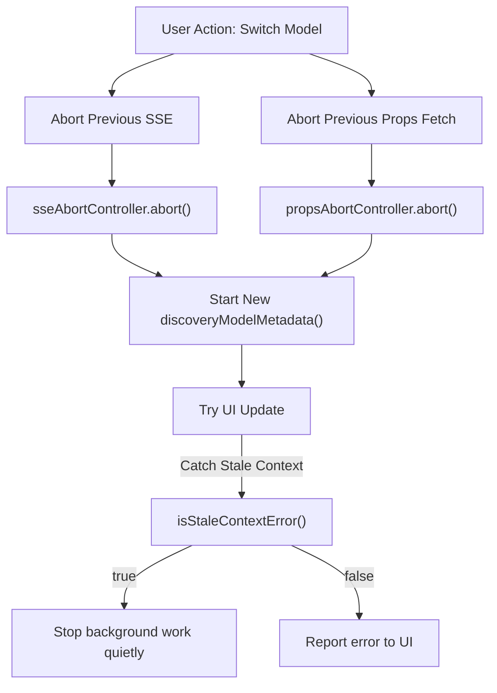
**Sources:** [index.ts:136-138](), [index.ts:238-244](), [index.ts:342-345]()

---

## Command: `llama-version`

In addition to event hooks, the extension registers a management command to help users debug their local `llama-server` environment.

*   **Registration**: Registered via `pi.registerCommand("llama-version", ...)` [index.ts:143-169]().
*   **Implementation**: It fetches the `/props` endpoint from the base URL (stripping the `/v1` suffix) to access the `build_info` field [index.ts:146-152]().
*   **Parsing**: It uses a regex `^b([a-zA-Z0-9]+)-([a-zA-Z0-9]+)$` to extract the build number and commit hash from the server response [index.ts:161-167]().

---

## Technical Implementation Details

### `before_provider_request`
This hook is critical for ensuring that generation parameters (like `contextWindow`) are accurate before Pi sends the request to the provider. If a model selection is still being processed (tracked in `pendingMetadata`), this hook `await`s that specific promise [index.ts:257-262]().

### `session_shutdown`
Ensures that when the extension is unloaded or the session ends, all active network connections are severed. It calls `.abort()` on both controllers and clears the `pendingMetadata` map [index.ts:265-269]().

### `model_select`
This listener serves as the entry point for the heavy lifting of model preparation. It calls `discoverModelMetadata`, which handles the parallel tasks of tracking SSE progress and fetching generation settings [index.ts:250-252]().

**Sources:**
- Event Registration: [index.ts:246-269]()
- Command Implementation: [index.ts:143-169]()
- Metadata Logic: [index.ts:342-380]()
- Error Handling: [index.ts:136-138]()

---

# Page: Thinking and Reasoning Support

# Thinking and Reasoning Support

<details>
<summary>Relevant source files</summary>

The following files were used as context for generating this wiki page:

- [index.ts](index.ts)

</details>


The `pi-llama` extension provides specialized support for models that utilize a "thinking" or "reasoning" phase before generating a final response. This implementation leverages `llama.cpp`'s native `chat_template_kwargs.enable_thinking` control while maintaining compatibility with the `pi` coding agent's internal reasoning protocols.

## Implementation Overview

Reasoning support in `pi-llama` is handled through a combination of template detection and model metadata modification. Because `llama.cpp` treats thinking as a boolean toggle at the template level, the extension maps this to a simplified on/off state in the `pi` UI.

### Key Components

| Entity | Role |
| :--- | :--- |
| `applyTemplateThinkingSupport` | A utility function that modifies a model's metadata to enable reasoning features. |
| `TEMPLATE_THINKING_LEVEL_MAP` | A mapping object that restricts reasoning to a binary toggle (off/medium). |
| `qwen-chat-template` | The compatibility format used to signal thinking support to the `pi` core. |

Sources: [index.ts:105-110](), [index.ts:122-131]()

## Logic Flow: Detection to Configuration

The following diagram illustrates how the extension identifies reasoning capabilities during the model metadata discovery phase and applies the necessary configurations.

**Thinking Support Configuration Flow**

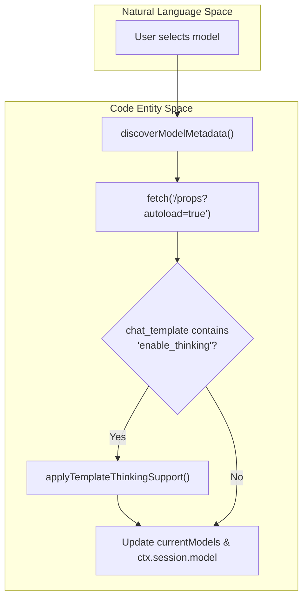

Sources: [index.ts:122-131](), [index.ts:258-278]()

## Detailed Implementation Details

### Detection Mechanism
The extension detects thinking support by inspecting the `chat_template` string returned by the `llama.cpp` `/props` endpoint. If the template contains the string `enable_thinking`, the extension assumes the model supports reasoning blocks.

### The `applyTemplateThinkingSupport` Function
When a reasoning model is detected, this function is called to update the `MutableModelMetadata` object:

1.  **`reasoning`**: Set to `true` to enable the "Reasoning" toggle in the `pi` user interface [index.ts:123-123]().
2.  **`thinkingLevelMap`**: Set to `TEMPLATE_THINKING_LEVEL_MAP`. This map explicitly sets `minimal`, `low`, `high`, and `xhigh` to `null` [index.ts:105-110](), which effectively collapses the granular reasoning levels found in other providers into a single toggle [index.ts:124-124]().
3.  **`compat.thinkingFormat`**: Set to `"qwen-chat-template"` [index.ts:129-129](). Despite the name, this is used as a generic signal to the `pi` agent to send the `enable_thinking` boolean within the `chat_template_kwargs` payload of the generation request [index.ts:127-128]().

### Metadata Persistence
Because the standard `/v1/models` endpoint in `llama.cpp` does not return template-specific metadata, the `refreshProvider` function is designed to preserve reasoning status across refreshes once it has been discovered via `/props`.

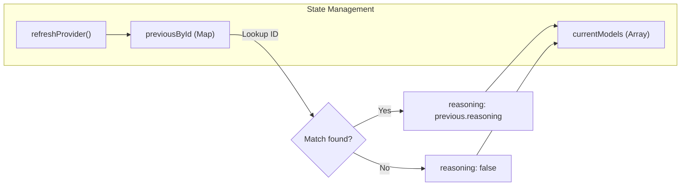

Sources: [index.ts:191-191](), [index.ts:215-217]()

## Summary of Constraints
- **On/Off Only**: Granular levels (`low`, `high`, etc.) are not supported because `llama.cpp` exposes reasoning as a simple boolean [index.ts:104-104]().
- **Template Dependent**: Support is strictly tied to the presence of `enable_thinking` in the Jinja2 chat template provided by the server [index.ts:276-278]().

Sources: [index.ts:104-110](), [index.ts:122-131](), [index.ts:276-278]()

---

# Page: API Integration with llama.cpp Server

# API Integration with llama.cpp Server

<details>
<summary>Relevant source files</summary>

The following files were used as context for generating this wiki page:

- [README.md](README.md)
- [index.ts](index.ts)

</details>


The `pi-llama` extension acts as a bridge between the **pi** coding agent and a running `llama-server` instance. It facilitates model discovery, capability detection (such as reasoning support), and real-time loading feedback by consuming specific HTTP and Server-Sent Events (SSE) endpoints provided by llama.cpp.

Communication is governed by environment variables and validated using **TypeBox** schemas to ensure the extension remains resilient to variations in server responses.

### Communication Architecture

The extension interacts with the server through three primary channels. While the `pi` core handles the standard OpenAI-compatible `/chat/completions` traffic, this extension manages the lifecycle and metadata via the following endpoints:

1.  **Model Discovery (`GET /v1/models`)**: Used by `refreshProvider` to identify available GGUF models and their current status (e.g., loaded, unloaded).
2.  **Metadata & Autoloading (`GET /props`)**: Used by `discoverModelMetadata` to fetch specific generation settings, chat templates, and trigger model loading.
3.  **Loading Progress (`GET /models/sse`)**: Used by `connectToLoadingProgress` to stream real-time weight loading percentages to the pi TUI.

#### Data Flow and Schema Validation

To ensure type safety when interacting with the external `llama-server`, the extension defines strict schemas using `TypeBox` [index.ts:25-58](). These schemas are compiled into validators that check every response before the data is mapped to the `LlamaModel` type used by the extension state.

**Entity Mapping Diagram**

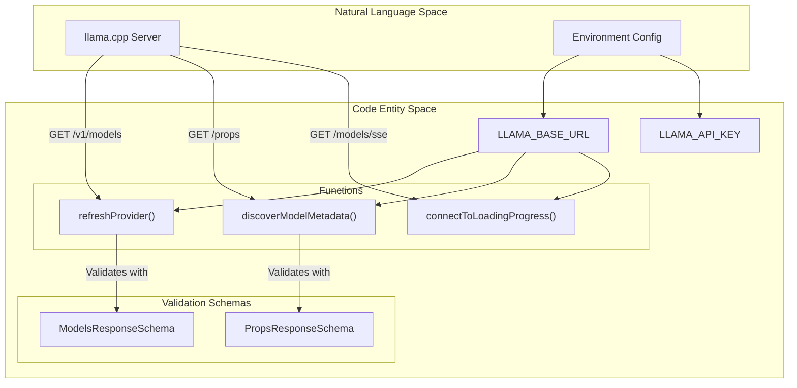

**Sources:**
- [index.ts:15-22]() (Constants and defaults)
- [index.ts:25-72]() (TypeBox schemas and validators)
- [index.ts:171-172]() (Environment variable handling)

---

### Endpoints Reference

The extension relies on a mix of standard OpenAI-compatible endpoints and llama.cpp-specific internal endpoints to provide a rich user experience.

*   **Model Listing**: Fetches the list of all models the server is aware of. The extension parses the `status.value` to determine if a model is already in memory [index.ts:195-206]().
*   **Properties & Templates**: Fetches the `chat_template` to detect if the model supports reasoning/thinking modes [index.ts:62-72]().
*   **SSE Stream**: Listens for `ApiModelsSseEvent` messages to update the `Loader` widget during model initialization [index.ts:89-93]().

For detailed response shapes and schema definitions, see **[Endpoints Reference](#3.1)**.

**Sources:**
- [index.ts:74-99]() (SSE types and labels)
- [index.ts:174-189]() (Refresh logic)

---

### Configuration and Authentication

The extension is configured primarily through environment variables. It defaults to a local instance but can be pointed to remote servers or protected instances.

| Variable | Default | Purpose |
| :--- | :--- | :--- |
| `LLAMA_BASE_URL` | `http://localhost:8080/v1` | The root URL for the API. The extension automatically handles trailing slashes and `/v1` stripping for internal endpoints like `/props` [index.ts:171](). |
| `LLAMA_API_KEY` | `no-key` | The Bearer token used for all requests. This is passed to `pi.registerProvider` to ensure standard chat requests are authenticated [index.ts:172](). |

For details on URL normalization and how keys are forwarded to the provider, see **[Configuration and Authentication](#3.2)**.

**Sources:**
- [index.ts:171-172]() (Variable assignment)
- [README.md:35-40]() (Documentation of variables)

---

# Page: Endpoints Reference

# Endpoints Reference

<details>
<summary>Relevant source files</summary>

The following files were used as context for generating this wiki page:

- [index.ts](index.ts)

</details>


The `pi-llama` extension interacts with a running `llama-server` instance through three primary HTTP endpoints. These endpoints allow the extension to discover available models, retrieve detailed generation metadata (like chat templates and context windows), and provide real-time feedback during model loading via Server-Sent Events (SSE).

## Endpoint Overview and Schema Validation

The extension uses [TypeBox](https://github.com/sinclairzx81/typebox) to define schemas and [TypeBox/compile](https://github.com/sinclairzx81/typebox) to generate high-performance validators. This ensures that the extension fails gracefully or logs warnings if the `llama-server` version is incompatible or returns unexpected data shapes.

### Data Flow: Extension to llama-server

The following diagram illustrates how the extension's internal functions map to specific `llama-server` endpoints and the resulting code entities.

**Endpoint Mapping Diagram**
```mermaid
graph TD
    subgraph "pi-llama Extension"
        RF["refreshProvider()"]
        DM["discoverModelMetadata()"]
        CL["connectToLoadingProgress()"]
        LV["llama-version command"]
    end

    subgraph "llama-server API"
        M_EP["GET /v1/models"]
        P_EP["GET /props"]
        S_EP["GET /models/sse"]
    end

    subgraph "Validation & Storage"
        MRS["ModelsResponseSchema"]
        PRS["PropsResponseSchema"]
        CM["currentModels: LlamaModel[]"]
        DM_CACHE["discoveredMetadata: Map"]
    end

    RF -->|fetch| M_EP
    M_EP -->|JSON| MRS
    MRS -->|Map| CM

    DM -->|fetch?autoload=true| P_EP
    LV -->|fetch| P_EP
    P_EP -->|JSON| PRS
    PRS -->|Update| DM_CACHE

    CL -->|SSE Stream| S_EP
    S_EP -->|Parse| SSE_TYPE["ApiModelsSseEvent"]
end
```
Sources: [index.ts:25-72](), [index.ts:143-169](), [index.ts:174-210](), [index.ts:285-300](), [index.ts:375-390]()

---

## 1. GET /v1/models
**Purpose:** Discovers the list of available models and their current operational status.

This endpoint is polled by `refreshProvider()` to populate the model picker in the Pi interface. It provides basic metadata such as model IDs, aliases, and whether a model is currently resident in memory.

### Response Shape
The extension expects a JSON object matching `ModelsResponseSchema` [index.ts:25-58]().

| Field | Type | Description |
| :--- | :--- | :--- |
| `data` | `Array` | List of model objects. |
| `data[].id` | `string` | The unique identifier for the model. |
| `data[].status.value` | `string` | Status: `unloaded`, `loading`, `loaded`, `sleeping`, or `unknown`. |
| `data[].architecture.input_modalities` | `string[]` | Used to detect vision support (e.g., `["text", "image"]`). |
| `data[].meta.n_ctx` | `number` | The context window size reported by the model file. |

### Implementation Details
* **Status Mapping:** If `status.value` is `"loaded"`, the extension appends `(loaded)` to the display name [index.ts:195-206]().
* **Vision Support:** If `input_modalities` includes `"image"`, the extension appends `(image)` to the display name and configures the provider to allow image uploads [index.ts:196-203]().
* **Fallback Context:** If `meta.n_ctx` is missing, it defaults to `DEFAULT_CONTEXT_WINDOW` (8192) [index.ts:17-18](), [index.ts:207-208]().

Sources: [index.ts:25-60](), [index.ts:174-210]()

---

## 2. GET /props
**Purpose:** Retrieves detailed generation settings and triggers model autoloading.

The extension calls this endpoint in two scenarios:
1.  **Metadata Discovery:** When a user selects a model, `discoverModelMetadata()` calls `/props?autoload=true` [index.ts:296-300](). The `autoload=true` query parameter instructs `llama-server` to load the model if it is currently offline.
2.  **Version Check:** The `llama-version` command fetches `/props` to display build information [index.ts:143-150]().

### Response Shape
The response is validated against `PropsResponseSchema` [index.ts:62-70]().

| Field | Type | Description |
| :--- | :--- | :--- |
| `default_generation_settings.n_ctx` | `number` | The active context window size. |
| `chat_template` | `string` | The Jinja2 chat template. Used to detect reasoning/thinking support. |
| `build_info` | `string` | Build version and commit hash (e.g., `b4612-8f2a1b`). |

### Thinking Support Detection
The extension parses the `chat_template` string. If it contains the substring `enable_thinking`, the extension automatically enables reasoning capabilities for that model by calling `applyTemplateThinkingSupport` [index.ts:122-131](), [index.ts:316-320]().

Sources: [index.ts:62-72](), [index.ts:143-169](), [index.ts:285-320]()

---

## 3. GET /models/sse
**Purpose:** Provides a real-time stream of model loading progress.

When a model transition is detected, `connectToLoadingProgress()` opens a Server-Sent Events (SSE) connection to this endpoint [index.ts:375-385](). This allows the extension to display a progress bar and stage labels in the Pi TUI while `llama-server` loads large model weights into VRAM.

### SSE Event Structure
The stream sends events of type `ApiModelsSseEvent` [index.ts:89-93]().

| Field | Type | Description |
| :--- | :--- | :--- |
| `event` | `string` | Usually `"progress"`. |
| `data.status` | `string` | The high-level status (e.g., `"loading"`). |
| `data.progress.current` | `string` | The current loading stage (`text_model`, `spec_model`, `mmproj_model`). |
| `data.progress.value` | `number` | A float between 0.0 and 1.0 representing completion percentage. |

### Stage Labels
The extension maps internal `llama-server` stage names to user-friendly labels via `MODEL_LOAD_STAGE_LABELS` [index.ts:95-99]():
*   `text_model` $\rightarrow$ "Loading weights"
*   `spec_model` $\rightarrow$ "Loading draft"
*   `mmproj_model` $\rightarrow$ "Loading projector"

### Sequence Diagram: SSE Loading
This diagram shows the interaction between the Pi TUI, the extension, and the server during a model load.

**Model Loading Sequence**
```mermaid
sequenceDiagram
    participant User
    participant Pi as Pi UI (Loader)
    participant Ext as pi-llama Extension
    participant Srv as llama-server

    User->>Pi: Select Model
    Ext->>Srv: GET /props?autoload=true
    Srv-->>Ext: 200 OK (Loading started)
    Ext->>Srv: GET /models/sse
    Srv-->>Ext: SSE Stream Opened
    loop Progress Updates
        Srv->>Ext: data: {"progress": {"current": "text_model", "value": 0.45}}
        Ext->>Pi: Update Loader (45% - Loading weights)
    end
    Srv->>Ext: data: {"status": "loaded"}
    Ext->>Pi: Stop Loader
    Ext->>Srv: Close SSE
```
Sources: [index.ts:74-99](), [index.ts:375-430]()

---

# Page: Configuration and Authentication

# Configuration and Authentication

<details>
<summary>Relevant source files</summary>

The following files were used as context for generating this wiki page:

- [README.md](README.md)
- [index.ts](index.ts)

</details>


This section details how the `pi-llama` extension manages its connection to the `llama-server`. It covers the environment variables used for configuration, the logic for normalizing URLs to ensure API compatibility, and the authentication mechanism used when forwarding requests to the provider.

## Environment Variables

The extension relies on two primary environment variables to locate and authenticate with the `llama.cpp` server. These variables are read during the extension's initialization phase [index.ts:171-172]().

| Variable | Description | Default Value |
| :--- | :--- | :--- |
| `LLAMA_BASE_URL` | The base URL where the `llama-server` is listening. | `http://localhost:8080/v1` |
| `LLAMA_API_KEY` | The API key required by the server (if any). | `no-key` |

> [index.ts:16-16](), [index.ts:171-172](), [README.md:39-40]()

## URL Normalization

To ensure consistent behavior across different user configurations, the extension performs automated cleanup and normalization on the `LLAMA_BASE_URL`.

1.  **Trailing Slash Removal**: The extension uses a regular expression `.replace(/\/+$/, "")` to strip any trailing slashes from the provided URL [index.ts:171-171]().
2.  **V1 Prefix Handling**: While the standard `baseUrl` used for model listing and chat completions typically includes the `/v1` suffix (e.g., `http://localhost:8080/v1`), certain llama.cpp-specific endpoints like `/props` exist at the root level.
3.  **Root URL Derivation**: When calling non-OpenAI-compatible endpoints, the extension dynamically strips the `/v1` suffix to reach the server root [index.ts:146-146]().

### Data Flow: URL and Key Resolution

The following diagram illustrates how environment variables are processed and distributed to the internal systems of the extension.

**Configuration and API Key Distribution**
```mermaid
graph TD
    subgraph "Environment_Space"
        ENV_URL["process.env.LLAMA_BASE_URL"]
        ENV_KEY["process.env.LLAMA_API_KEY"]
    end

    subgraph "index.ts_Logic"
        BASE_URL["baseUrl (Variable)"]
        API_KEY["apiKey (Variable)"]
        NORM["URL Normalization (.replace)"]
    end

    subgraph "Pi_Extension_API"
        REG_PROV["pi.registerProvider"]
        REG_CMD["pi.registerCommand ('llama-version')"]
    end

    ENV_URL --> NORM
    NORM --> BASE_URL
    ENV_KEY --> API_KEY

    BASE_URL --> REG_PROV
    API_KEY --> REG_PROV
    BASE_URL --> REG_CMD
```
**Sources:** [index.ts:143-146](), [index.ts:171-172](), [index.ts:223-228]()

## Provider Authentication

Authentication is handled by passing the `apiKey` to the `pi.registerProvider` function. This ensures that every request generated by the `pi` agent to this provider includes the necessary credentials in the HTTP headers (typically as a `Bearer` token).

### Request Signing Flow

When a user selects a model registered by `pi-llama`, the `pi` core uses the credentials provided during registration to sign outgoing requests.

**Authentication Forwarding Flow**
```mermaid
sequenceDiagram
    participant User
    participant PiAgent as "pi (Core Agent)"
    participant Ext as "pi-llama (index.ts)"
    participant LlamaServer as "llama-server"

    Note over Ext: Reads LLAMA_API_KEY
    Ext->>PiAgent: pi.registerProvider("llama-cpp", { apiKey, ... })
    
    User->>PiAgent: Sends Message
    PiAgent->>LlamaServer: POST /v1/chat/completions
    Note right of PiAgent: Includes "Authorization: Bearer <apiKey>"
    LlamaServer-->>PiAgent: LLM Response
    PiAgent-->>User: Display Response
```
**Sources:** [index.ts:172-172](), [index.ts:223-228](), [README.md:40-40]()

## Implementation Details

### Default Values
If no environment variables are provided, the extension defaults to a local setup. The `DEFAULT_BASE_URL` is set to `http://localhost:8080/v1` [index.ts:16-16](). If no `LLAMA_API_KEY` is found, it defaults to the string `"no-key"` [index.ts:172-172]().

### API Registration
The registration occurs within the exported default function. The `apiKey` and `baseUrl` are passed as part of the configuration object to `pi.registerProvider` [index.ts:223-228](). This configuration tells the Pi agent how to route requests for the `llama-cpp` provider ID.

```typescript
// Example of the registration call
pi.registerProvider(PROVIDER_ID, {
    baseUrl,
    apiKey,
    models: currentModels,
});
```
**Sources:** [index.ts:15-15](), [index.ts:223-228]()

### Build Info Access
The `llama-version` command specifically demonstrates the URL normalization logic. It takes the `baseUrl`, strips the `/v1` suffix if present, and appends `/props` to fetch server metadata [index.ts:143-146](). This allows the extension to retrieve the build number and commit hash of the underlying `llama.cpp` instance [index.ts:161-167]().

**Sources:** [index.ts:143-169]()

---

# Page: Developer Tooling and CI

# Developer Tooling and CI

<details>
<summary>Relevant source files</summary>

The following files were used as context for generating this wiki page:

- [.github/workflows/ci.yml](.github/workflows/ci.yml)
- [.oxfmtrc.json](.oxfmtrc.json)
- [.oxlintrc.json](.oxlintrc.json)
- [.prettierignore](.prettierignore)

</details>


This section provides an overview of the developer experience and automated quality assurance for the `pi-llama` codebase. The project prioritizes high-performance tooling to maintain code quality with minimal overhead.

The toolchain is centered around the `oxc` suite (Oxc Compiler), utilizing `oxfmt` for code formatting and `oxlint` for static analysis. These tools are integrated into a GitHub Actions pipeline to ensure that every contribution adheres to the project's standards.

### Tooling Architecture and Workflow

The following diagram illustrates how local configuration files guide the tooling during development and within the CI environment.

**Developer Tooling Flow**
```mermaid
graph TD
    subgraph "Local Environment"
        ["Developer Code"] -- "Formatting" --> ["oxfmt"]
        ["Developer Code"] -- "Linting" --> ["oxlint"]
        [".oxfmtrc.json"] -. "Configures" .-> ["oxfmt"]
        [".oxlintrc.json"] -. "Configures" .-> ["oxlint"]
    end

    subgraph "Continuous Integration (GitHub Actions)"
        ["ci.yml"] -- "Runs" --> ["check Job"]
        ["check Job"] -- "npx --yes oxfmt --check ." --> ["oxfmt CI"]
        ["check Job"] -- "npx --yes oxlint ." --> ["oxlint CI"]
    end

    ["oxfmt CI"] -- "Failure" --> ["Block Merge"]
    ["oxlint CI"] -- "Failure" --> ["Block Merge"]
```
Sources: [`.oxfmtrc.json:1-3`](), [`.oxlintrc.json:1-5`](), [`.github/workflows/ci.yml:1-19`]()

---

### Code Formatting
The project uses `oxfmt` to enforce a consistent coding style. A notable configuration choice is the use of tabs for indentation, as specified in the configuration file [`.oxfmtrc.json:1-3`](). 

To prevent conflicts between different formatting tools, certain file types are excluded from processing. For instance, JSON files are explicitly ignored via the Prettier ignore configuration [`.prettierignore:1-2`]().

For details on configuration and editor integration, see [Code Formatting](#4.1).

### Linting
Static analysis is handled by `oxlint`, which is configured to catch common errors and enforce specific logic structures. The primary rule enforced across the repository is the mandatory use of curly braces for all control-flow statements, such as `if`, `while`, and `for` loops [`.oxlintrc.json:3-3`](). This reduces ambiguity and prevents bugs during code refactoring.

For details on the rationale and full rule list, see [Linting](#4.2).

### Continuous Integration Pipeline
The CI pipeline is automated via GitHub Actions and is triggered on every push to the `main` branch and for all pull requests [`.github/workflows/ci.yml:3-7`](). The pipeline executes a single `check` job on an `ubuntu-latest` runner [`.github/workflows/ci.yml:9-10`]().

The pipeline uses `npx --yes` to execute the tools without requiring a local `node_modules` installation or interactive prompts, ensuring a fast and clean execution environment for the following steps:
1. **Formatting Check**: Verifies that all files comply with `oxfmt` rules [`.github/workflows/ci.yml:14-15`]().
2. **Linting Check**: Runs `oxlint` to identify any code quality or logic violations [`.github/workflows/ci.yml:17-18`]().

For details on the workflow configuration and trigger conditions, see [Continuous Integration Pipeline](#4.3).

**Tooling to Code Entity Mapping**
| Tool | Configuration File | CI Step Name | Purpose |
| :--- | :--- | :--- | :--- |
| `oxfmt` | [`.oxfmtrc.json`]() | `oxfmt (check)` | Enforces tab-based indentation |
| `oxlint` | [`.oxlintrc.json`]() | `oxlint` | Enforces mandatory curly braces |
| `GitHub Actions` | [`.github/workflows/ci.yml`]() | `check` | Orchestrates the quality gate |

Sources: [`.oxfmtrc.json:1-3`](), [`.oxlintrc.json:1-5`](), [`.github/workflows/ci.yml:8-19`]()

---

# Page: Code Formatting

# Code Formatting

<details>
<summary>Relevant source files</summary>

The following files were used as context for generating this wiki page:

- [.oxfmtrc.json](.oxfmtrc.json)
- [.prettierignore](.prettierignore)

</details>


The `pi-llama` project utilizes a modern, high-performance toolchain for maintaining code consistency. Formatting is primarily handled by `oxfmt` (part of the Oxc toolchain), which is configured to enforce specific whitespace rules and ignore non-source files.

## Formatter Configuration

The project uses `oxfmt` as its primary formatter. Unlike standard Prettier configurations that often default to spaces, `pi-llama` enforces the use of tabs for indentation.

### Tab Indentation
The core configuration is defined in `.oxfmtrc.json`.

| Property | Value | Description |
| :--- | :--- | :--- |
| `useTabs` | `true` | Enforces the use of hard tabs (`\t`) for indentation across all supported files. |

**Sources:**
- [.oxfmtrc.json:1-4]()

### File Exclusions
While `oxfmt` handles the formatting logic, the project maintains a `.prettierignore` file to prevent the formatter from modifying specific file types. Specifically, JSON files (including hidden configuration JSONs) are excluded from formatting to maintain their original structure or to avoid conflicts with other tools that might expect specific JSON layouts.

**Sources:**
- [.prettierignore:1-2]()

## Integration and Workflow

The formatting strategy is designed to be "zero-config" for contributors while remaining strictly enforced during the development lifecycle.

### Data Flow: Formatting Lifecycle

The following diagram illustrates how formatting rules move from configuration to enforcement in both local development and Continuous Integration (CI) environments.

**Formatting Enforcement Pipeline**
```mermaid
graph TD
    subgraph "Configuration Space"
        [".oxfmtrc.json"] --> |"useTabs: true"| OXFMT["oxfmt Engine"]
        [".prettierignore"] --> |"Ignore *.json"| OXFMT
    end

    subgraph "Local Development"
        DEV["Developer"] --> |"npx oxfmt ."| OXFMT
        OXFMT --> |"Writes to"| TS_FILES["index.ts"]
    end

    subgraph "CI Pipeline (.github/workflows/ci.yml)"
        CI_TRIGGER["GitHub Actions"] --> |"npx --yes oxfmt --check ."| CI_CHECK["oxfmt Check Mode"]
        TS_FILES --> CI_CHECK
        CI_CHECK --> |"Success"| PASS["Merge Allowed"]
        CI_CHECK --> |"Failure"| FAIL["Block PR"]
    end
```

**Sources:**
- [.oxfmtrc.json:1-4]()
- [.prettierignore:1-2]()

### Editor Integration
By using `oxfmt`, developers can leverage standard editor extensions (like the Oxc VS Code extension) which automatically detect the `.oxfmtrc.json` file. This ensures that:
1. "Format on Save" uses hard tabs as defined in [/.oxfmtrc.json:2-2]().
2. JSON files remain untouched as specified in [/.prettierignore:1-2]().

### CI Enforcement
Formatting is a blocking requirement for all Pull Requests. The CI pipeline executes `oxfmt --check .` to verify that all code adheres to the tab-based indentation rule. If a developer uses spaces, the `check` command returns a non-zero exit code, failing the build.

**Sources:**
- [.oxfmtrc.json:2-2]()
- [.prettierignore:1-2]()

## Rationale for Tabs
The decision to use `useTabs: true` [/.oxfmtrc.json:2-2]() is based on two primary technical considerations:
1. **Accessibility**: Tabs allow individual developers to configure the visual width of indentation in their local editors (e.g., 2-space width vs 4-space width) without altering the underlying source code.
2. **File Size**: Using a single character (`\t`) per indentation level reduces the byte size of the source file compared to multiple space characters.

**Sources:**
- [.oxfmtrc.json:1-4]()

---

# Page: Linting

# Linting

<details>
<summary>Relevant source files</summary>

The following files were used as context for generating this wiki page:

- [.oxlintrc.json](.oxlintrc.json)

</details>


The `pi-llama` project utilizes `oxlint` for high-performance static analysis. The linting strategy is intentionally focused on code clarity and preventing common logical errors by enforcing strict structural requirements on control-flow statements.

## Linting Configuration

The project configuration is defined in `.oxlintrc.json`. Unlike standard ESLint configurations that may contain hundreds of rules, this project adopts a minimalist approach, specifically targeting the `curly` rule to ensure structural consistency across the TypeScript codebase.

| Rule | Severity | Option | Description |
| :--- | :--- | :--- | :--- |
| `curly` | `error` | `all` | Requires curly braces for all control-flow statements, including single-line blocks. |

### Implementation Details

The configuration is defined as follows:

```json
{
	"rules": {
		"curly": ["error", "all"]
	}
}
```
[.oxlintrc.json:1-5]()

**Sources:**
- [.oxlintrc.json:1-5]()

## Rationale for Mandatory Curly Braces

The enforcement of `curly: [error, all]` is a deliberate architectural decision to mitigate "goto fail" style bugs and improve the maintainability of the `index.ts` file, which contains the core extension logic.

### Comparison of Control Flow Structures

The following table illustrates the transformation enforced by the linter:

| Statement Type | Non-Compliant (Error) | Compliant (Required) |
| :--- | :--- | :--- |
| **If Statement** | `if (condition) doAction();` | `if (condition) { doAction(); }` |
| **Else Statement** | `else doOther();` | `else { doOther(); }` |
| **While Loop** | `while (active) poll();` | `while (active) { poll(); }` |

### Data Flow: Linting in the Development Lifecycle

The linting process acts as a gatekeeper between the "Natural Language Space" (developer intent) and the "Code Entity Space" (the `pi-llama` extension).

```mermaid
graph TD
    subgraph "Developer Environment"
        "Developer" -- "Writes Code" --> "index.ts"
        "index.ts" -- "Triggers" --> "oxlint_binary[oxlint]"
    end

    subgraph "Rule Engine"
        "oxlint_binary" -- "Reads" --> "config[.oxlintrc.json]"
        "config" -- "Enforces" --> "curly_rule[curly: all]"
    end

    subgraph "CI/CD Pipeline"
        "GitHub_Action[.github/workflows/ci.yml]" -- "Executes" --> "npx_oxlint[npx --yes oxlint]"
        "npx_oxlint" -- "Validates" --> "index.ts"
    }

    "curly_rule" -- "Blocks Commit if Missing Braces" --> "GitHub_Action"
```

**Sources:**
- [.oxlintrc.json:1-5]()
- [.github/workflows/ci.yml:18-18]()

## CI Integration and Enforcement

Linting is a mandatory step in the Continuous Integration (CI) pipeline. Any violation of the rules defined in `.oxlintrc.json` will cause the CI build to fail, preventing the merging of code that does not meet the project's structural standards.

### Execution Mechanism

The linting process is executed via `npx` to ensure the latest version of `oxlint` is used without requiring manual installation by every contributor.

1.  **Command**: `npx --yes oxlint`
2.  **Environment**: The command runs within the `check` job on an `ubuntu-latest` runner.
3.  **Scope**: The linter scans the entire repository, focusing on the `.ts` files (primarily `index.ts`).

```mermaid
sequenceDiagram
    participant Dev as Developer
    participant CI as GitHub Actions (ci.yml)
    participant Lint as oxlint
    participant Rule as .oxlintrc.json

    Dev->>CI: Push to main / Open PR
    CI->>Lint: Run npx --yes oxlint
    Lint->>Rule: Load rules
    Rule-->>Lint: curly: [error, all]
    Lint->>Lint: Analyze index.ts
    alt Violations Found
        Lint-->>CI: Exit Code 1
        CI-->>Dev: ❌ Build Failed (Missing braces)
    else No Violations
        Lint-->>CI: Exit Code 0
        CI-->>Dev: ✅ Linting Passed
    end
```

**Sources:**
- [.oxlintrc.json:3-3]()
- [.github/workflows/ci.yml:11-18]()

---

# Page: Continuous Integration Pipeline

# Continuous Integration Pipeline

<details>
<summary>Relevant source files</summary>

The following files were used as context for generating this wiki page:

- [.github/workflows/ci.yml](.github/workflows/ci.yml)

</details>


The `pi-llama` project utilizes GitHub Actions to ensure code quality and consistency across all contributions. The CI pipeline is designed to be lightweight and fast, focusing on static analysis and formatting verification using the `oxc` toolsuite.

### Workflow Triggers and Environment

 The CI workflow is defined in [.github/workflows/ci.yml:1-19](). It is configured to execute automatically under two primary conditions:
1.  **Push to main**: Any code merged or pushed directly to the `main` branch [.github/workflows/ci.yml:4-5]().
2.  **Pull Requests**: Any pull request opened or updated against the repository [.github/workflows/ci.yml:6-6]().

The pipeline executes a single job named `check` which runs on the `ubuntu-latest` virtual environment [.github/workflows/ci.yml:9-10]().

### Job Execution Flow

The `check` job consists of three sequential steps to validate the codebase. It uses `npx --yes` to execute tools without interactive prompts, ensuring the pipeline does not hang waiting for user confirmation in the CI environment [.github/workflows/ci.yml:15-18]().

| Step | Command | Purpose |
| :--- | :--- | :--- |
| **Checkout** | `actions/checkout@v4` | Clones the repository into the runner [.github/workflows/ci.yml:12-12](). |
| **oxfmt (check)** | `npx --yes oxfmt --check .` | Verifies that all files adhere to the project's formatting rules (tabs, etc.) [.github/workflows/ci.yml:14-15](). |
| **oxlint** | `npx --yes oxlint .` | Runs static analysis to catch syntax errors and enforce linting rules like mandatory curly braces [.github/workflows/ci.yml:17-18](). |

### Logic and Data Flow Diagram

The following diagram illustrates how the GitHub Actions runner transitions from a trigger event to a successful build status by invoking the specific linting and formatting tools.

**CI Pipeline Execution Logic**
```mermaid
graph TD
    Trigger["GitHub Event (Push/PR)"] --> Runner["ubuntu-latest Runner"]
    subgraph "check job"
        Runner --> Checkout["actions/checkout@v4"]
        Checkout --> FormatCheck["oxfmt --check"]
        FormatCheck --> LintCheck["oxlint"]
    end
    LintCheck --> Success["Status: Success"]
    
    FormatCheck -- "Formatting Mismatch" --> Fail["Status: Failure"]
    LintCheck -- "Lint Error" --> Fail
```
Sources: [.github/workflows/ci.yml:3-19]()

### Tool Integration

The pipeline maps directly to the developer tooling configurations defined in the repository.

*   **oxfmt**: The `oxfmt --check .` command [.github/workflows/ci.yml:15-15]() validates the project against the settings in `.oxfmtrc.json`. If a developer has not formatted their code with tabs before pushing, this step will fail the CI build.
*   **oxlint**: The `oxlint .` command [.github/workflows/ci.yml:18-18]() applies the ruleset defined in `.oxlintrc.json`. This ensures that logic-related requirements, such as the `curly` rule for control flow, are strictly enforced before code can be merged.

**Code Entity to CI Step Mapping**
```mermaid
graph LR
    subgraph "Natural Language Space"
        Formatting["Code Formatting Style"]
        StaticAnalysis["Static Analysis & Logic Rules"]
    end

    subgraph "Code Entity Space"
        FmtConfig[".oxfmtrc.json"]
        LintConfig[".oxlintrc.json"]
        CIWorkflow[".github/workflows/ci.yml"]
    end

    Formatting --> FmtConfig
    StaticAnalysis --> LintConfig
    
    FmtConfig --> CI_Step_1["Step: oxfmt (check)"]
    LintConfig --> CI_Step_2["Step: oxlint"]
    
    CI_Step_1 -- "runs in" --> CIWorkflow
    CI_Step_2 -- "runs in" --> CIWorkflow
```
Sources: [.github/workflows/ci.yml:14-18]()

### CI Configuration Summary

| Property | Value |
| :--- | :--- |
| **Workflow Name** | `CI` [.github/workflows/ci.yml:1-1]() |
| **Operating System** | `ubuntu-latest` [.github/workflows/ci.yml:10-10]() |
| **Node Executor** | `npx --yes` (avoids interactive prompts) [.github/workflows/ci.yml:15-18]() |
| **Scope** | Recursive directory check (`.`) [.github/workflows/ci.yml:15-18]() |

Sources: [.github/workflows/ci.yml:1-19]()

---

# Page: Glossary

# Glossary

<details>
<summary>Relevant source files</summary>

The following files were used as context for generating this wiki page:

- [.github/workflows/ci.yml](.github/workflows/ci.yml)
- [.oxfmtrc.json](.oxfmtrc.json)
- [.oxlintrc.json](.oxlintrc.json)
- [README.md](README.md)
- [index.ts](index.ts)
- [package.json](package.json)

</details>


This glossary provides definitions for codebase-specific terms, domain concepts, and technical abbreviations used within the `pi-llama` extension. It is intended to help onboarding engineers navigate the integration between the `pi` coding agent and the `llama.cpp` server.

## Domain Concepts & Abbreviations

### llama-server
The HTTP API server provided by `llama.cpp`. It serves models via an OpenAI-compatible API and additional custom endpoints for metadata and state management [README.md:48-52]().

### Provider
A registered entity within the `pi` ecosystem that supplies language model capabilities. This extension registers itself under the ID `llama-cpp` [index.ts:15-15]().

### Autoloading
A feature of the `llama.cpp` server where a model is loaded into memory only when requested. The extension triggers this by appending `autoload=true` to the `/props` endpoint [index.ts:316-318]().

### Thinking / Reasoning
Support for models that output internal "thought" chains (e.g., DeepSeek-R1, Qwen-2.5-7B-Instruct). The extension detects this via the `enable_thinking` key in chat templates and maps it to the `qwen-chat-template` compatibility layer [index.ts:121-131]().

### Stale Context
A condition where an `ExtensionCtx` (provided by `pi`) becomes invalid because the user started a new session or replaced the current one. The extension detects this via `isStaleContextError` to halt background tasks like SSE polling [index.ts:133-138]().

---

## Technical Entities & Code Symbols

The following table defines key types and variables used to manage model state and API communication.

| Symbol | Type | Description |
| :--- | :--- | :--- |
| `currentModels` | `LlamaModel[]` | The local state array storing the list of models discovered from the server [index.ts:141-141](). |
| `discoveredMetadata` | `Map<string, MutableModelMetadata>` | A cache of model capabilities (context window, reasoning support) fetched from `/props` [index.ts:245-245](). |
| `pendingMetadata` | `Set<string>` | A set used to track in-flight `/props` requests to prevent redundant network calls [index.ts:246-246](). |
| `sseAbortController` | `AbortController` | Used to terminate the Server-Sent Events stream when a model finishes loading or the session changes [index.ts:248-248](). |
| `LlamaModel` | `Type` | The TypeScript representation of a model as expected by `pi.registerProvider` [index.ts:101-101](). |

### Data Flow: Discovery to Registration

The following diagram bridges the "Natural Language Space" of user actions to the "Code Entity Space" of internal functions and API calls.

**Model Discovery and Registration Flow**
```mermaid
graph TD
  subgraph "Natural Language Space"
    "User starts pi" --> "Poll Models"
    "User selects model" --> "Fetch Metadata"
  end

  subgraph "Code Entity Space (index.ts)"
    "Poll Models" --> refreshProvider["refreshProvider()"]
    refreshProvider --> fetchModels["fetch /v1/models"]
    fetchModels --> validateModelsResponse["validateModelsResponse()"]
    validateModelsResponse --> registerProvider["pi.registerProvider()"]

    "Fetch Metadata" --> discoverModelMetadata["discoverModelMetadata()"]
    discoverModelMetadata --> fetchProps["fetch /props?autoload=true"]
    fetchProps --> connectToLoadingProgress["connectToLoadingProgress()"]
    connectToLoadingProgress --> sseStream["GET /models/sse"]
  end
```
**Sources:** [index.ts:174-210](), [index.ts:311-330](), [index.ts:376-385]()

---

## API & Schema Definitions

The extension uses `TypeBox` to validate responses from the `llama.cpp` server.

### ModelsResponseSchema
Validates the output of `GET /v1/models`. It tracks model `id`, `aliases`, and `status` (e.g., `loaded`, `loading`, `unloaded`) [index.ts:25-58]().

### PropsResponseSchema
Validates the output of `GET /props`. It extracts `n_ctx` (context window), `chat_template` (for reasoning detection), and `build_info` [index.ts:62-70]().

### SSE Progress Stages
When a model is loading, the server emits events categorized by these stages:
*   `text_model`: Loading the primary LLM weights [index.ts:96-96]().
*   `spec_model`: Loading a draft model for speculative decoding [index.ts:97-97]().
*   `mmproj_model`: Loading a multi-modal projector (for vision support) [index.ts:98-98]().

### System Architecture Mapping

This diagram maps the high-level system components to the specific files and environment variables that configure them.

**System Configuration Mapping**
```mermaid
graph LR
  subgraph "External Environment"
    ENV_URL["LLAMA_BASE_URL"]
    ENV_KEY["LLAMA_API_KEY"]
  end

  subgraph "Extension Logic (index.ts)"
    baseUrl["baseUrl variable"]
    apiKey["apiKey variable"]
    refresh["refreshProvider()"]
    sse["connectToLoadingProgress()"]
  end

  subgraph "llama-server API"
    M_EP["/v1/models"]
    P_EP["/props"]
    S_EP["/models/sse"]
  end

  ENV_URL --> baseUrl
  ENV_KEY --> apiKey
  baseUrl --> M_EP
  baseUrl --> P_EP
  baseUrl --> S_EP
  refresh --> M_EP
  sse --> S_EP
```
**Sources:** [index.ts:171-172](), [index.ts:176-176](), [index.ts:316-316](), [index.ts:385-385](), [README.md:37-40]()

---

## Tooling & CI Terms

### oxfmt
The tool used for code formatting. It is configured via `.oxfmtrc.json` to use tabs [index.ts:1-240](), [.oxfmtrc.json:1-3]().

### oxlint
The static analysis tool used to enforce code quality. It specifically enforces the use of curly braces for all control flow statements via the `curly` rule [.oxlintrc.json:1-5]().

### CI Workflow
The GitHub Actions pipeline defined in `.github/workflows/ci.yml`. It runs on every push to `main` and all pull requests, executing `oxfmt --check` and `oxlint` [.github/workflows/ci.yml:1-19]().

**Sources:** [.oxfmtrc.json:1-3](), [.oxlintrc.json:1-5](), [.github/workflows/ci.yml:1-19]()