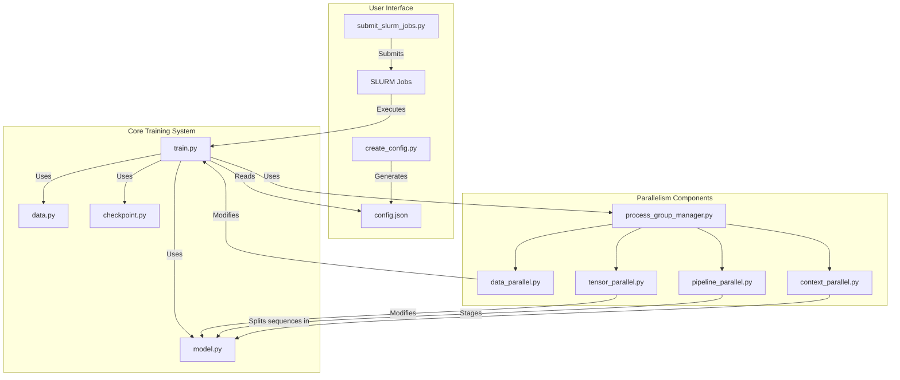
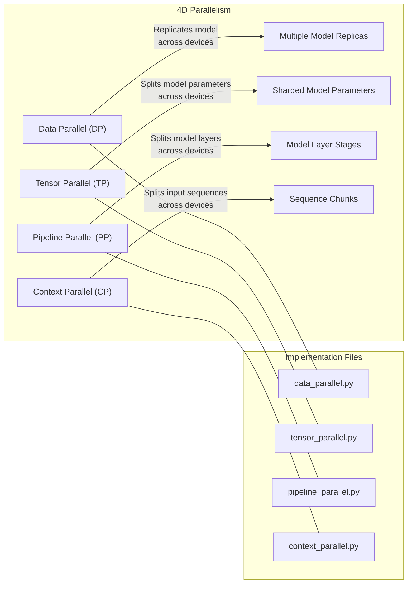
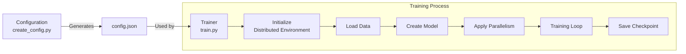

<!-- source: DeepWiki mcp.deepwiki.com · repo huggingface/picotron · page 1 Overview · fetched 2026-10-26 -->

# Overview

<details>
<summary>Relevant source files</summary>

The following files were used as context for generating this wiki page:

- [CITATION.cff](CITATION.cff)
- [README.md](README.md)
- [requirements.txt](requirements.txt)

</details>


Picotron is a minimalist repository designed for pre-training Llama-like models using 4D Parallelism techniques. This document provides an introduction to the system, its architecture, and core components.

## Purpose and Scope

Picotron is primarily an educational tool created in the spirit of [NanoGPT](https://github.com/karpathy/nanoGPT) but focused on distributed training techniques for large language models (LLMs). It implements four complementary parallelism strategies (Data, Tensor, Pipeline, and Context) while maintaining code simplicity and readability.

The system is designed to help researchers and engineers learn about distributed training techniques through clear, concise implementations rather than optimizing for maximum performance. For a more production-focused implementation, see [System Architecture](#2).

Sources: [README.md:1-8]()

## Key Features

- **4D Parallelism Implementation**: Supports Data, Tensor, Pipeline, and Context parallelism in a modular design
- **Educational Focus**: Core files are under 300 lines of code each, prioritizing readability
- **Llama-like Model Support**: Compatible with Hugging Face transformer models
- **Distributed Training**: Works across multiple GPUs and nodes via SLURM integration
- **Checkpoint Management**: Handles distributed model state saving and loading

Sources: [README.md:4-8]()

## System Architecture Overview

Picotron follows a modular architecture with clear separation between different components:



Sources: [README.md:5]()

## Parallelism Strategies

Picotron implements four complementary parallelism strategies to efficiently distribute training across multiple devices:



Each parallelism strategy addresses different scaling challenges:

| Strategy | What It Splits | Primary Benefit | Implementation |
|----------|----------------|-----------------|----------------|
| Data Parallel | Training data | Handles more samples | `data_parallel.py` |
| Tensor Parallel | Model parameters | Reduces memory per device | `tensor_parallel.py` |
| Pipeline Parallel | Model layers | Reduces memory, enables larger models | `pipeline_parallel.py` |
| Context Parallel | Input sequences | Processes longer sequences | `context_parallel.py` |

Sources: [README.md:2]()

## Training Workflow

The training workflow in Picotron follows a straightforward process:



Sources: [README.md:25-47]()

## Installation and Quick Start

Picotron requires PyTorch and related libraries. The installation is straightforward:

```
pip install -e .
```

Basic usage involves two steps:
1. Creating a configuration file using `create_config.py`
2. Running training using `train.py` with the generated configuration

For a simple data-parallel training run:

```bash
# Create configuration
python create_config.py --out_dir tmp --exp_name llama-1B --dp 8 \
  --model_name HuggingFaceTB/SmolLM-1.7B --num_hidden_layers 15 \
  --grad_acc_steps 32 --mbs 4 --seq_len 1024 --hf_token <HF_TOKEN>

# Run training
torchrun --nproc_per_node 8 train.py --config tmp/llama-1B/config.json
```

For more advanced training scenarios including multiple parallelism strategies, see [Usage Guide](#7).

Sources: [README.md:16-47]()

## Repository Structure

Picotron maintains simplicity with a flat repository structure. Key files include:

| File | Purpose |
|------|---------|
| `train.py` | Main training orchestrator |
| `model.py` | Llama model implementation |
| `data_parallel.py` | Data parallelism implementation |
| `tensor_parallel.py` | Tensor parallelism implementation |
| `pipeline_parallel.py` | Pipeline parallelism implementation |
| `context_parallel.py` | Context parallelism implementation |
| `checkpoint.py` | Checkpoint management |
| `process_group_manager.py` | Distributed process group management |
| `create_config.py` | Configuration file creator |
| `submit_slurm_jobs.py` | SLURM job submission utility |

Sources: [README.md:5](), [requirements.txt:1-8]()

## Dependencies

Picotron relies on several key libraries:

| Library | Purpose |
|---------|---------|
| PyTorch | Core deep learning framework |
| Triton | GPU kernel optimization |
| Transformers | Hugging Face model implementations |
| Datasets | Data loading and processing |
| Flash-Attention | Optimized attention implementation |
| Wandb | Experiment tracking |

Sources: [requirements.txt:1-8]()

For detailed information about specific components, please refer to the corresponding wiki pages in the system architecture section.

---

