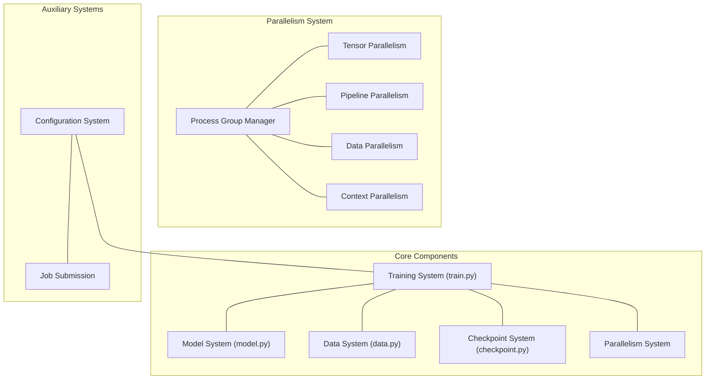
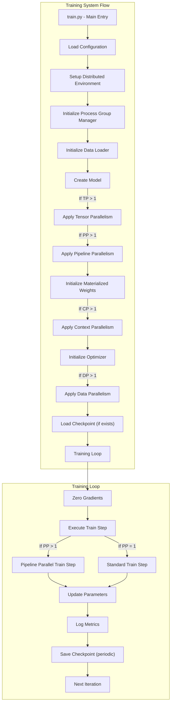
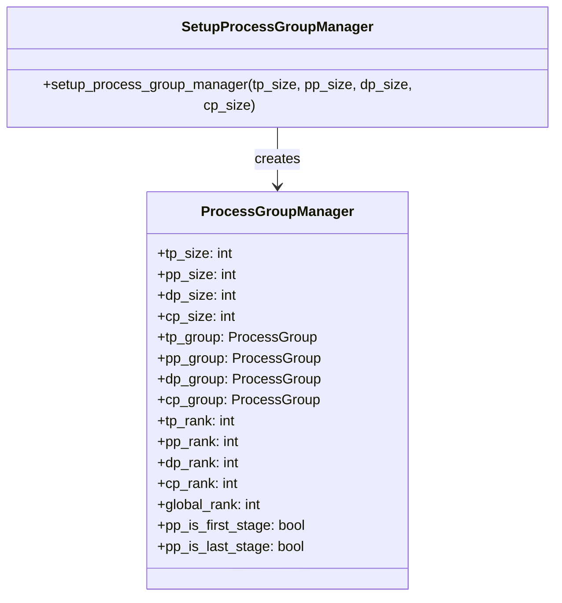
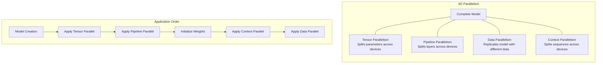
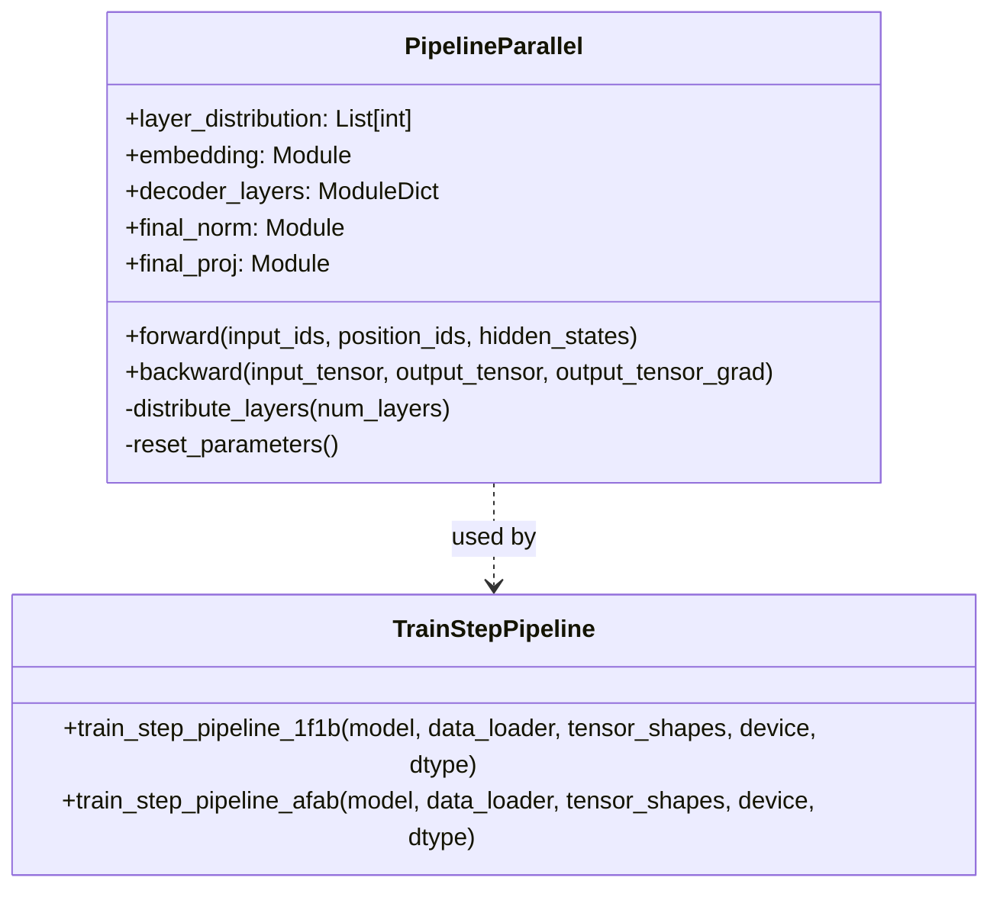
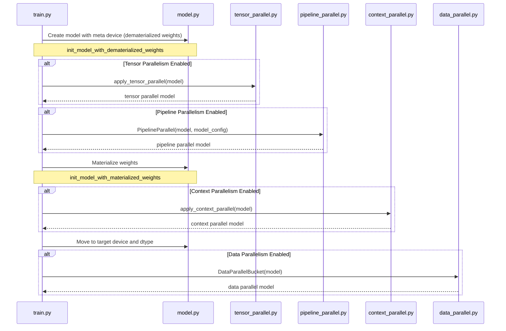
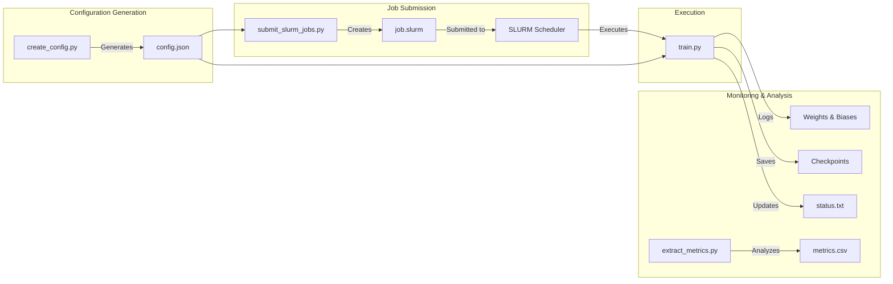
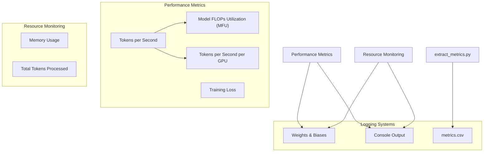

<!-- source: DeepWiki mcp.deepwiki.com · repo huggingface/picotron · page 2 System Architecture · fetched 2026-10-26 -->

# System Architecture

Relevant source files

The following files were used as context for generating this wiki page:

- [CITATION.cff](CITATION.cff)
- [README.md](README.md)
- [extract_metrics.py](extract_metrics.py)
- [picotron/pipeline_parallel/pipeline_parallel.py](picotron/pipeline_parallel/pipeline_parallel.py)
- [picotron/utils.py](picotron/utils.py)
- [train.py](train.py)

## Purpose and Scope

This document provides a comprehensive overview of Picotron's system architecture, explaining the core components and their interactions. It focuses on the high-level design principles, system organization, and the relationships between different subsystems. For detailed information about the 4D parallelism approach, see [4D Parallelism Design](#2.1).

## Overview

Picotron is designed as a minimalist, educational framework for pre-training Llama-like models at scale using 4D parallelism. The architecture prioritizes simplicity and readability while maintaining the capability to train large language models across distributed environments.

Sources: [train.py](), [README.md]()

## Core Components

The system architecture consists of several interconnected components, each responsible for specific aspects of the training process:

| Component | Primary Responsibility | Key Files |
|-----------|------------------------|-----------|
| Training System | Orchestrates the overall training process | train.py |
| Model System | Defines and implements the Llama model architecture | model.py |
| Data System | Handles data loading and preprocessing | data.py |
| Parallelism System | Implements the 4D parallelism strategies | tensor_parallel.py, pipeline_parallel.py, data_parallel.py, context_parallel.py |
| Checkpoint System | Manages saving and loading model states | checkpoint.py |
| Configuration System | Handles training configuration generation | create_config.py, base_config.json |
| Job Management | Handles job submission and monitoring | submit_slurm_jobs.py, extract_metrics.py |

Sources: [train.py:5-27](), [README.md:1-17]()

## Training System Architecture

The training system serves as the central orchestrator, bringing together all components for the training process.

Sources: [train.py:57-281]()

### Key Training Components and Workflow

The training system follows a clear workflow:

1. **Configuration Loading**: Loads training parameters from a JSON configuration file
2. **Distributed Environment Setup**: Initializes the distributed training environment and process groups
3. **Data Loading**: Sets up data loaders with appropriate batch sizes and sequence lengths
4. **Model Initialization**: Creates the model and applies appropriate parallelism transformations
5. **Training Loop**: Executes forward and backward passes, optimizer steps, and tracks metrics

The training loop handles different execution paths based on the parallelism configuration, with specialized code paths for pipeline parallelism (using either 1F1B or AFAB scheduling algorithms).

Sources: [train.py:57-104](), [train.py:217-277]()

## Process Group Manager

The Process Group Manager is a central component that organizes and coordinates the different parallelism strategies. It creates and manages process groups for each dimension of parallelism, enabling coordinated communication between related processes.

The Process Group Manager maintains:
- The size of each dimension (tp_size, pp_size, dp_size, cp_size)
- Process groups for collective operations within each parallelism dimension
- The rank of the current process in each dimension
- Helper flags such as identifying the first or last pipeline stage

Sources: [train.py:94-101](), [picotron/utils.py:52-80]()

## 4D Parallelism Architecture

Picotron implements four complementary parallelism strategies to enable efficient training of large models:

Key parallelism implementations:

1. **Tensor Parallelism** (TP): Splits individual model parameters across devices, particularly for large matrices in attention and MLP layers.
2. **Pipeline Parallelism** (PP): Distributes model layers across devices, with each device handling a subset of the model's layers.
3. **Data Parallelism** (DP): Replicates the model across devices with each device processing different data.
4. **Context Parallelism** (CP): Splits input sequences across devices, enabling processing of longer contexts.

These strategies are applied in a specific order during model initialization, as shown in the diagram above.

Sources: [train.py:174-193](), [picotron/pipeline_parallel/pipeline_parallel.py:8-76]()

### Pipeline Parallelism Implementation

The pipeline parallelism strategy splits model layers across multiple devices, with each device responsible for processing a subset of the model's layers.

Picotron supports two pipeline scheduling algorithms:
1. **1F1B (One-Forward-One-Backward)**: Interleaves forward and backward passes for better GPU utilization
2. **AFAB (All-Forward-All-Backward)**: Completes all forward passes before starting backward passes

The `PipelineParallel` class transforms a standard model by distributing its layers across devices in the pipeline. Each device's pipeline stage is responsible for a subset of layers, with the first stage handling the embedding and the last stage handling the final normalization and projection.

Sources: [picotron/pipeline_parallel/pipeline_parallel.py:8-76](), [picotron/pipeline_parallel/pipeline_parallel.py:77-121](), [picotron/pipeline_parallel/pipeline_parallel.py:122-215]()

## Model Initialization Process

The model initialization process in Picotron follows a specific sequence to accommodate the various parallelism strategies:

This initialization sequence is critical for properly applying the different parallelism strategies:
1. First, the model is created with dematerialized weights (meta device) to reduce memory usage during initialization
2. Tensor and Pipeline parallelism transformations are applied to the model structure
3. Weights are materialized (loaded) from checkpoint files
4. Context parallelism is applied to handle sequence splitting
5. The model is moved to the target device and data type
6. Finally, data parallelism is applied to enable processing different batches on multiple devices

Sources: [train.py:170-196]()

## Configuration and Execution Flow

The training process begins with configuration generation and job submission, following through to execution and monitoring:

The configuration file (config.json) is the central artifact that defines all training parameters, including:
- Model specifications
- Parallelism configuration
- Training hyperparameters
- Dataset details
- Environment variables

This configuration is passed to the training script, which uses it to set up the entire training process.

Sources: [train.py:57-68](), [extract_metrics.py:8-196]()

## Resource Management and Performance Tracking

Picotron includes utilities for tracking resource usage and performance metrics:

The system calculates key performance metrics:
- **Tokens per Second**: Overall throughput
- **Tokens per Second per GPU**: Per-device efficiency
- **Model FLOPs Utilization (MFU)**: Percentage of theoretical peak performance achieved
- **Memory Usage**: GPU memory consumption

These metrics are logged to Weights & Biases (if enabled) and to the console, providing visibility into training progress and efficiency.

Sources: [train.py:242-270](), [picotron/utils.py:28-49](), [extract_metrics.py:25-90]()

## System Requirements and Interactions

Picotron is designed to work with specific external systems and has specific requirements for operation:

| Component | Requirement | Purpose |
|-----------|-------------|---------|
| PyTorch | 2.0+ | Core training framework |
| CUDA | Compatible with PyTorch | GPU acceleration |
| Hugging Face Hub | Access token | Model and dataset access |
| SLURM (optional) | Cluster access | Distributed job management |
| Weights & Biases (optional) | Account | Training monitoring |

The system is designed to be compatible with Hugging Face's ecosystem, allowing easy access to models and datasets. It is optimized for running on SLURM-managed clusters but can also run on local machines for development and small-scale experiments.

Sources: [train.py:68-75](), [README.md:17-47]()

## Summary

Picotron's architecture is designed to be modular, educational, and capable of handling large-scale model training. The system implements 4D parallelism (Tensor, Pipeline, Data, and Context) to enable efficient distributed training of large language models. The architecture prioritizes simplicity and readability while maintaining the capability to scale to significant model sizes.

The key strengths of the architecture include:
1. Clear separation of concerns between components
2. Modular design that allows for flexible configuration
3. Support for multiple parallelism strategies
4. Integration with established ML infrastructure (Hugging Face, Weights & Biases)
5. Educational focus with readable, well-structured code

For detailed information about the training pipeline, see [Training Pipeline](#3), and for information about using the system, see [Usage Guide](#7).

---

