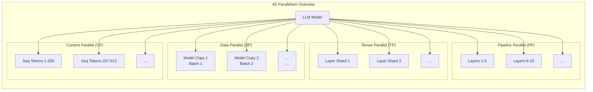
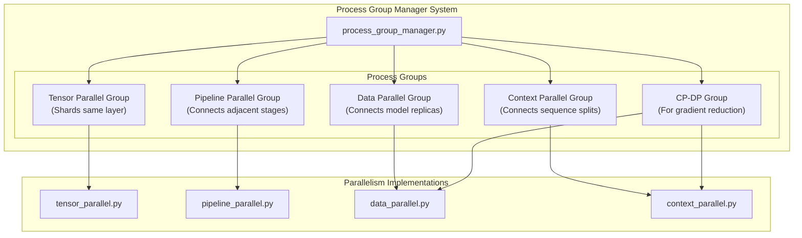
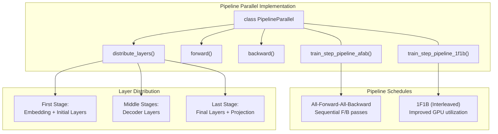
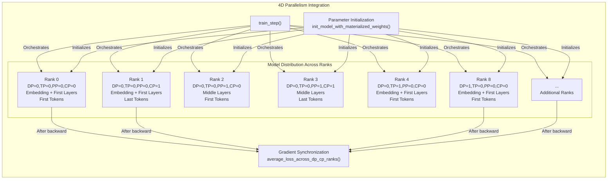
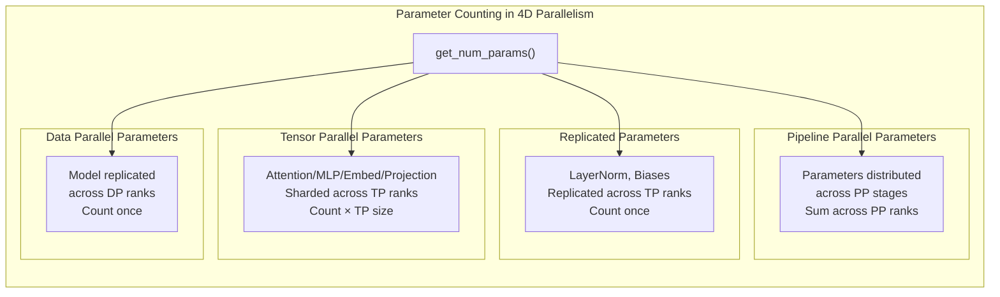
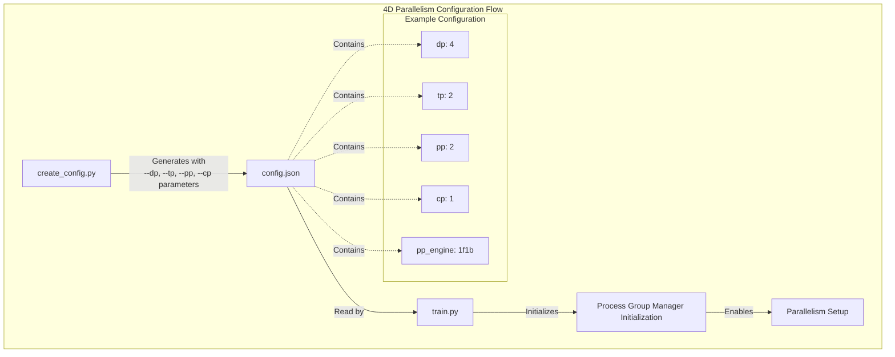

<!-- source: DeepWiki mcp.deepwiki.com · repo huggingface/picotron · page 2.1 4D Parallelism Design · fetched 2026-10-26 -->

# 4D Parallelism Design

Relevant source files

The following files were used as context for generating this wiki page:

- [CITATION.cff](CITATION.cff)
- [README.md](README.md)
- [extract_metrics.py](extract_metrics.py)
- [picotron/pipeline_parallel/pipeline_parallel.py](picotron/pipeline_parallel/pipeline_parallel.py)
- [picotron/utils.py](picotron/utils.py)

## Purpose and Scope
This document explains the 4D Parallelism architecture in Picotron, a minimalist framework for pre-training Llama-like models. The four dimensions of parallelism—Data Parallel (DP), Tensor Parallel (TP), Pipeline Parallel (PP), and Context Parallel (CP)—work together to efficiently distribute training across multiple GPUs or nodes. This page focuses on the design principles and components of the 4D parallelism system. For implementation details of specific parallelism strategies, see the respective pages: [Tensor Parallelism](#5.1), [Pipeline Parallelism](#5.2), [Data Parallelism](#5.3), and [Context Parallelism](#5.4).

Sources: [README.md:1-10]()

## Introduction to 4D Parallelism

4D Parallelism addresses the fundamental challenge of training Large Language Models (LLMs) that exceed the memory and computational capabilities of a single GPU. Each dimension addresses a different aspect of model distribution:

1. **Data Parallelism (DP)**: Replicates the model across devices, each processing different batches of data
2. **Tensor Parallelism (TP)**: Splits individual model layers across devices
3. **Pipeline Parallelism (PP)**: Distributes model layers sequentially across devices
4. **Context Parallelism (CP)**: Splits input sequences across devices

Together, these four dimensions enable efficient scaling of model training across large GPU clusters, allowing the training of models with billions of parameters.

Sources: [README.md:1-10](), [utils.py:51-80]()

## Process Group Manager Architecture

The Process Group Manager is the central component that organizes the different process groups required for 4D parallelism. Each parallelism strategy requires its own process group to facilitate communication between the relevant processes.

Sources: [utils.py:10-11](), [utils.py:78-79](), [utils.py:94-99](), [pipeline_parallel.py:6-7]()

## Each Dimension of Parallelism

### Data Parallelism (DP)

Data Parallelism is the simplest form of distributed training, where the model is replicated across multiple GPUs, each processing different batches of data. Gradients are synchronized across replicas to ensure consistency.

**Key characteristics:**
- Full model is replicated on each DP rank
- Each rank processes different mini-batches
- Gradient synchronization occurs after backward pass
- Memory usage scales linearly with model size
- Computation scales linearly with batch size

### Tensor Parallelism (TP)

Tensor Parallelism splits individual model layers across devices, allowing layers that are too large for a single GPU to be distributed. In Picotron, this primarily splits attention heads and MLP layers.

**Key characteristics:**
- Individual layers are sharded across TP ranks
- Primarily targets attention blocks and MLPs
- Requires collective communication within forward/backward passes
- Reduces memory per GPU linearly with TP size

### Pipeline Parallelism (PP)

Pipeline Parallelism distributes model layers sequentially across GPUs, with each GPU responsible for a subset of the model's layers.

**Key characteristics:**
- Sequential layers are assigned to different PP ranks
- Supports different pipeline schedules (AFAB and 1F1B)
- Reduces memory per GPU linearly with PP size
- Introduces pipeline bubbles (idle time)

Sources: [pipeline_parallel.py:8-76](), [pipeline_parallel.py:77-214]()

### Context Parallelism (CP)

Context Parallelism splits input sequences across GPUs, allowing for processing of longer contexts than would fit on a single GPU.

**Key characteristics:**
- Input sequence is split across CP ranks
- Each rank processes a portion of the tokens
- Requires communication for attention across sequence boundaries
- Particularly useful for models with very long context lengths

## Integration of 4D Parallelism

The four dimensions of parallelism can be combined to maximize efficiency based on the training configuration. The Process Group Manager ensures that communication between various ranks is properly coordinated.

Sources: [utils.py:94-99](), [pipeline_parallel.py:77-214]()

## Parameter Counting in 4D Parallelism

The `get_num_params` function in Picotron illustrates how parameters are distributed across the different dimensions of parallelism:

Sources: [utils.py:51-80]()

## Performance Metrics

The 4D Parallelism implementation in Picotron is measured using two key metrics:

1. **Tokens/s/GPU**: Measures throughput in terms of tokens processed per second per GPU
2. **MFU (Model FLOPs Utilization)**: Measures how efficiently the hardware's theoretical FLOP capacity is utilized

The `get_mfu` function calculates the MFU based on tokens per second, accounting for all four dimensions of parallelism.

| Parallelism Strategy | Memory Benefit | Communication Overhead | When to Use |
|----------------------|----------------|------------------------|-------------|
| Data Parallel (DP)   | None - full model on each rank | Low - gradients only | When model fits in memory and more throughput is needed |
| Tensor Parallel (TP) | ~Linear with TP size | Medium - activation transfers within layer | When individual layers are too large |
| Pipeline Parallel (PP)| ~Linear with PP size | Low - activations between stages | When model depth is significant |
| Context Parallel (CP) | ~Linear with CP size | Medium-High - attention communication | When context length is very long |
| Combined 4D          | Near-optimal with tuning | Complex - requires careful balancing | For largest models with longest contexts |

Sources: [utils.py:40-49](), [extract_metrics.py:8-23](), [extract_metrics.py:56-69]()

## Configuration and Setup

Setting up 4D Parallelism requires configuring the dimensions appropriately. In Picotron, this is done through the configuration system:

Sources: [README.md:25-47]()

## Conclusion

Picotron's 4D Parallelism design provides a comprehensive framework for distributed training of large language models. By combining Data, Tensor, Pipeline, and Context parallelism strategies, it enables efficient scaling across GPU clusters. The educational focus of the implementation makes it an excellent resource for understanding the principles of distributed deep learning at scale.

The modular design with clear separation between the different parallelism strategies allows users to configure the system according to their specific hardware setup and model requirements. This flexibility, combined with the simplicity of the codebase, makes Picotron an ideal starting point for experimenting with distributed training techniques.

Sources: [README.md:1-10](), [README.md:14-18]()

---

