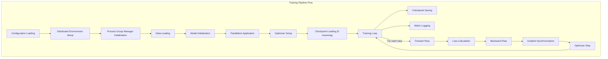
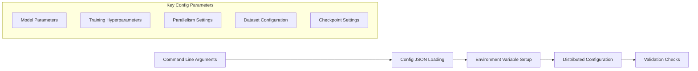
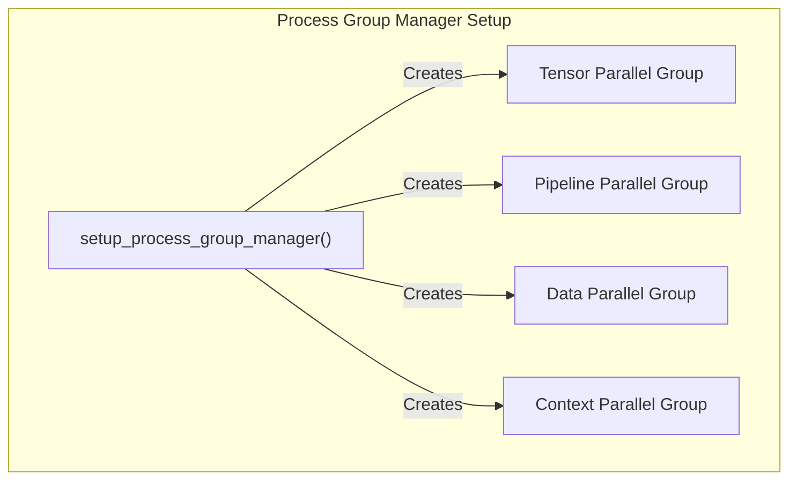
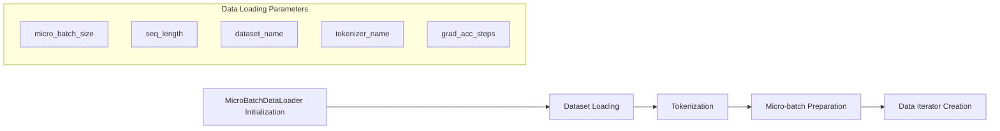
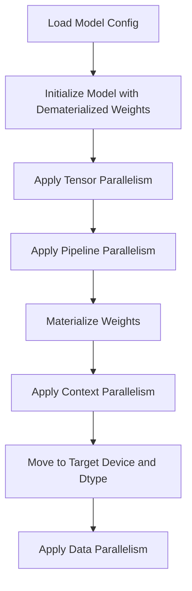
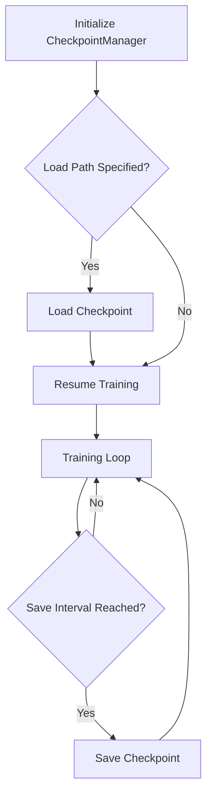
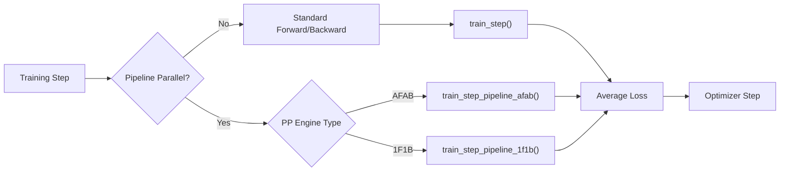
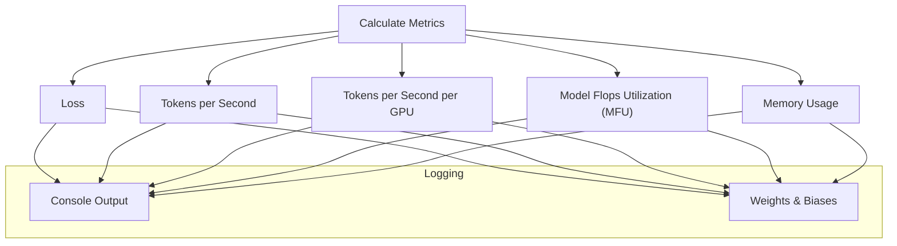
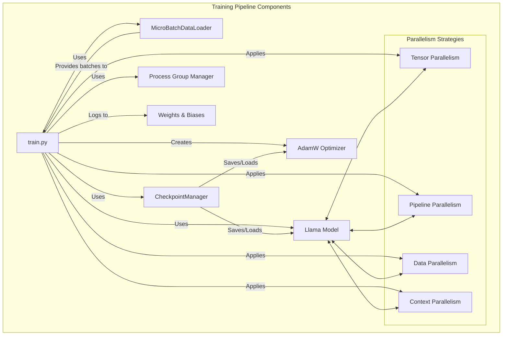
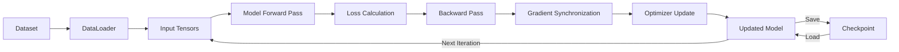

<!-- source: DeepWiki mcp.deepwiki.com · repo huggingface/picotron · page 3 Training Pipeline · fetched 2026-10-26 -->

# Training Pipeline

<details>
<summary>Relevant source files</summary>

The following files were used as context for generating this wiki page:

- [train.py](train.py)

</details>


The Training Pipeline in Picotron orchestrates the end-to-end process of pre-training Llama-like models using 4D parallelism. This document explains the main training script and workflow, covering configuration loading, distributed environment setup, data loading, model initialization, training loop execution, optimization, and checkpoint management.

For information about the configuration system specifically, see [Configuration System](#3.1).

## Overview of the Training Pipeline

The training pipeline is implemented primarily in `train.py`, which serves as the central orchestrator for the entire training process. The pipeline handles distributed training across multiple GPUs and nodes, applying various parallelism strategies to efficiently train large language models.



Sources: [train.py:5-56](), [train.py:57-281]()

## Pipeline Initialization

### Configuration Loading

The training pipeline begins by loading a configuration file that specifies all training parameters, model architecture, dataset details, and distributed training settings.



Sources: [train.py:57-77]()

### Distributed Environment Setup

The pipeline initializes the distributed training environment using PyTorch's distributed module. It sets up the backend (NCCL for GPU, Gloo for CPU) and prepares the device for each process.

```python
# Process rank and world size initialization
local_rank = int(os.environ["LOCAL_RANK"])
global_rank = int(os.environ["RANK"])
world_size = int(os.environ["WORLD_SIZE"])

# Initialize distributed process group
dist.init_process_group(rank=global_rank, world_size=world_size, backend=backend)
```

Sources: [train.py:79-94]()

### Process Group Management

A key component of the pipeline is the Process Group Manager, which organizes processes into different parallel groups:



Sources: [train.py:95-102]()

## Data Loading System

The pipeline initializes a specialized `MicroBatchDataLoader` that handles:
- Breaking data into micro-batches for gradient accumulation
- Sequence length partitioning for context parallelism
- Dataset loading and tokenization
- Device placement of input tensors



Sources: [train.py:105-118](), [train.py:28-55]()

## Model Creation and Parallelization

The model initialization process involves several sophisticated steps:



The initialization uses a two-phase approach:
1. **Dematerialized initialization**: Creates the model structure without loading weights
2. **Materialization**: Loads and distributes weights according to the parallelism strategy

Sources: [train.py:152-194]()

## Optimization Setup

The pipeline initializes the AdamW optimizer, potentially using a fused implementation for better performance:

```python
# Optimizer initialization with potential fused implementation
extra_args = dict()
if config["model"]["use_fused_adam"]:
    fused_available = 'fused' in inspect.signature(torch.optim.AdamW).parameters
    use_fused = fused_available and device == 'cuda'
    extra_args = dict(fused=True) if use_fused else dict()

optimizer = AdamW(model.parameters(), lr=config["training"]["learning_rate"], **extra_args)
```

Sources: [train.py:201-209]()

## Checkpoint Management

The `CheckpointManager` handles loading and saving model checkpoints, enabling training to be resumed from a saved state:



Sources: [train.py:211-216](), [train.py:272-273]()

## Training Loop

The heart of the pipeline is the training loop, which iteratively processes batches, computes gradients, and updates model parameters:

### Standard vs. Pipeline-Parallel Training

The pipeline handles two distinct training modes:



For pipeline-parallel training, the pipeline supports two scheduling algorithms:
- **1F1B**: One-Forward-One-Backward scheduling
- **AFAB**: All-Forward-All-Backward scheduling

Sources: [train.py:219-241]()

### Metrics Tracking and Logging

The training loop calculates and logs various performance metrics:



Sources: [train.py:242-270]()

## Key Components and Interactions

The following diagram shows the key components of the training pipeline and their interactions:



Sources: [train.py:5-26](), [train.py:57-281]()

## Training Pipeline Data Flow

This diagram illustrates the data flow through the training pipeline:



Sources: [train.py:28-55](), [train.py:219-241]()

## Pipeline Configuration Options

The training pipeline can be configured with various options from the config file:

| Configuration Category | Key Parameters | Description |
|------------------------|----------------|-------------|
| Model | `name`, `num_hidden_layers`, `num_attention_heads` | Model architecture parameters |
| Training | `learning_rate`, `max_tokens`, `seq_length`, `micro_batch_size` | Training hyperparameters |
| Distributed | `tp_size`, `pp_size`, `dp_size`, `cp_size`, `pp_engine` | Parallelism configuration |
| Checkpoint | `save_frequency`, `save_dir`, `load_path` | Checkpoint management |
| Logging | `use_wandb`, `run_name` | Metrics logging options |
| Dataset | `name`, `num_workers`, `num_proc`, `subset_name` | Data source configuration |

Sources: [train.py:57-77](), [train.py:152-166]()

## End-to-End Execution Flow

The following diagram captures the end-to-end execution flow of the training pipeline:

```mermaid
sequenceDiagram
    participant CLI as Command Line
    participant Train as train.py
    participant Config as Config File
    participant PGM as Process Group Manager
    participant Data as DataLoader
    participant Model as Llama Model
    participant Opt as Optimizer
    participant CM as Checkpoint Manager
    participant WB as Weights & Biases
    
    CLI->>Train: Start training with config path
    Train->>Config: Load configuration
    Train->>PGM: Initialize process groups
    Train->>Data: Initialize data loader
    Train->>Model: Initialize model structure
    Train->>Model: Apply parallelism strategies
    Train->>Model: Materialize weights
    Train->>Opt: Initialize optimizer
    Train->>CM: Try load checkpoint
    
    loop Training Loop
        Train->>Data: Get next batch
        Data->>Train: Return input tensors
        Train->>Model: Forward pass
        Model->>Train: Return logits
        Train->>Train: Calculate loss
        Train->>Model: Backward pass
        Train->>Opt: Step optimizer
        Train->>WB: Log metrics
        
        alt Save Checkpoint Interval
            Train->>CM: Save checkpoint
        end
        
        alt Max Tokens or Steps Reached
            Train->>Train: Exit training loop
        end
    end
    
    Train->>WB: Finish logging
    Train->>Train: Destroy process group
```

Sources: [train.py:57-281]()

In summary, the Training Pipeline in Picotron is a sophisticated system that orchestrates the entire training process for large language models. It leverages 4D parallelism to efficiently distribute computation across multiple devices, handles data loading and preprocessing, manages model initialization and optimization, and provides checkpointing and logging capabilities.

---

