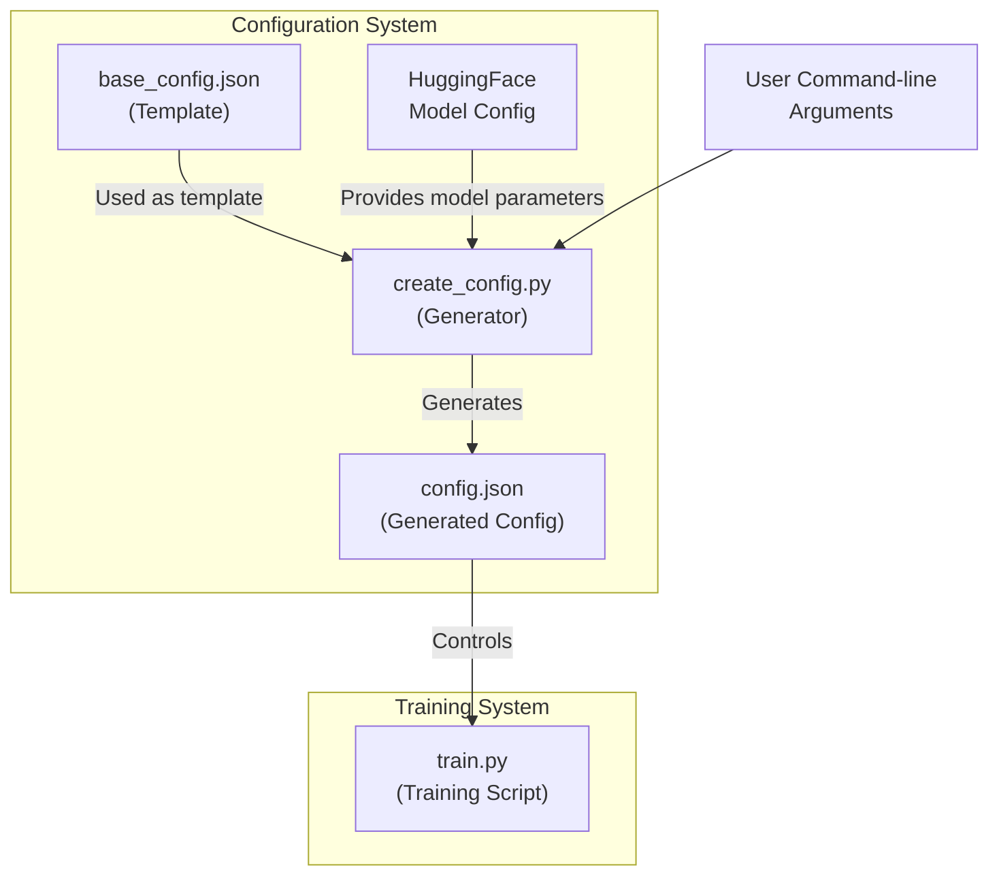
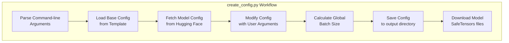
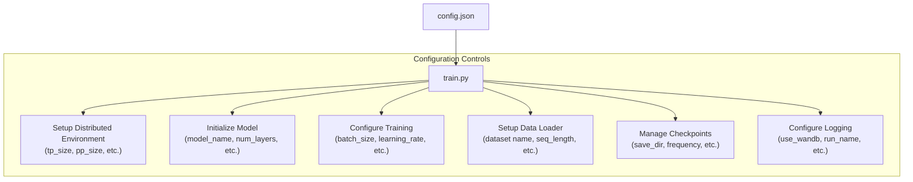

<!-- source: DeepWiki mcp.deepwiki.com · repo huggingface/picotron · page 3.1 Configuration System · fetched 2026-10-26 -->

# Configuration System

<details>
<summary>Relevant source files</summary>

The following files were used as context for generating this wiki page:

- [create_config.py](create_config.py)
- [template/base_config.json](template/base_config.json)

</details>


## Purpose and Scope

The Configuration System in Picotron is responsible for creating, managing, and applying configuration files that define all aspects of the training process. This system provides a structured way to specify model architecture, parallelism strategies, training hyperparameters, dataset options, and environment settings in a centralized JSON configuration file.

This page focuses on how configurations are created and structured. For information about how configurations are used in the training pipeline, see [Training Pipeline](#3).

## Configuration System Overview

The configuration system consists of two main components:
1. A base configuration template (`template/base_config.json`)
2. A configuration creation script (`create_config.py`)

These components work together to generate customized configuration files that control Picotron's training behavior.



Sources: [create_config.py:10-42](), [template/base_config.json:1-52]()

## Configuration File Structure

The configuration file is organized into several sections, each controlling a different aspect of the training process:

```mermaid
classDiagram
    class "config.json" {
        distributed
        model
        training
        dataset
        checkpoint
        logging
        environment
    }
    
    class "distributed" {
        tp_size: int
        cp_size: int
        pp_size: int
        dp_size: int
        pp_engine: string
        backend: string
        use_cpu: boolean
    }
    
    class "model" {
        name: string
        num_hidden_layers: int
        num_attention_heads: int
        num_key_value_heads: int
        dtype: string
        use_flash_attention: boolean
        use_fused_adam: boolean
    }
    
    class "training" {
        seed: int
        learning_rate: float
        total_train_steps: int
        seq_length: int
        micro_batch_size: int
        gradient_accumulation_steps: int
        num_samples: int
        max_tokens: int|null
    }
    
    class "dataset" {
        name: string
        subset_name: string|null
        num_workers: int
        num_proc: int
    }
    
    class "checkpoint" {
        save_dir: string
        save_frequency: int
        load_path: string
    }
    
    class "logging" {
        use_wandb: boolean
        project_name: string
        run_name: string|null
    }
    
    class "environment" {
        OMP_NUM_THREADS: string
        TOKENIZERS_PARALLELISM: string
        FLASH_ATTEN: string
        HF_TOKEN: string|null
    }
    
    "config.json" --> "distributed"
    "config.json" --> "model"
    "config.json" --> "training"
    "config.json" --> "dataset"
    "config.json" --> "checkpoint"
    "config.json" --> "logging"
    "config.json" --> "environment"
```

Sources: [template/base_config.json:1-52]()

### Section Details

| Section | Purpose | Key Fields |
|---------|---------|------------|
| `distributed` | Defines parallelism settings | `tp_size`, `cp_size`, `pp_size`, `dp_size`, `pp_engine`, `backend` |
| `model` | Specifies model architecture | `name`, `num_hidden_layers`, `num_attention_heads`, `num_key_value_heads` |
| `training` | Controls training hyperparameters | `learning_rate`, `total_train_steps`, `seq_length`, `micro_batch_size` |
| `dataset` | Configures training dataset | `name`, `subset_name`, `num_workers`, `num_proc` |
| `checkpoint` | Manages checkpointing behavior | `save_dir`, `save_frequency`, `load_path` |
| `logging` | Sets up logging options | `use_wandb`, `project_name`, `run_name` |
| `environment` | Defines environment variables | `OMP_NUM_THREADS`, `TOKENIZERS_PARALLELISM`, `FLASH_ATTEN` |

Sources: [template/base_config.json:1-52]()

## Creating Configurations

### Using `create_config.py`

The `create_config.py` script is the primary tool for generating configuration files. It takes command-line arguments that specify training parameters, reads the base configuration template, modifies it according to the provided arguments, and writes the resulting configuration to a JSON file.



Sources: [create_config.py:14-137]()

### Key Parameters and Default Values

The configuration script supports numerous parameters to customize the training process:

#### Parallelism Settings
- `--tp`: Tensor parallelism size (default: 1)
- `--cp`: Context parallelism size (default: 1)
- `--dp`: Data parallelism size (default: 1)
- `--pp`: Pipeline parallelism size (default: 1)
- `--pp_engine`: Pipeline parallel engine (default: "1f1b")

#### Model Configuration
- `--model_name`: HuggingFace model name (default: "HuggingFaceTB/SmolLM-360M-Instruct")
- `--num_hidden_layers`: Number of transformer layers (default: fetched from model config)
- `--num_attention_heads`: Number of attention heads (default: fetched from model config)
- `--num_key_value_heads`: Number of key-value heads for grouped-query attention (default: fetched from model config)

#### Training Parameters
- `--grad_acc_steps`: Gradient accumulation steps (default: 1)
- `--mbs`: Micro batch size (default: 1)
- `--seq_len`: Sequence length (default: 1024)

#### Other Settings
- `--out_dir`: Output directory for configuration (default: "tmp")
- `--exp_name`: Experiment name (default: "dummy_exp")
- `--subset_name`: Dataset subset name (default: None)
- `--use_wandb`: Enable Weights & Biases logging (flag)
- `--use_cpu`: Use CPU for training instead of GPU (flag)
- `--use_fused_adam`: Use fused Adam optimizer (flag)
- `--hf_token`: HuggingFace API token (optional)

Sources: [create_config.py:87-106]()

### Example Usage

To create a configuration for a training run with 2-way tensor parallelism, 2-way pipeline parallelism, and a custom model:

```
python create_config.py \
    --out_dir experiments \
    --exp_name tp2_pp2_test \
    --tp 2 \
    --pp 2 \
    --model_name meta-llama/Llama-2-7b \
    --mbs 8 \
    --seq_len 2048 \
    --grad_acc_steps 4 \
    --use_wandb
```

This will:
1. Create a directory at `experiments/tp2_pp2_test/`
2. Generate a `config.json` file in that directory with the specified settings
3. Download the model safetensors files for later use in training

Sources: [create_config.py:3-4](), [create_config.py:108-136]()

## Configuration Creation Process

The configuration creation process follows these steps:

1. **Load Base Template**: The script starts by loading the base configuration template from `template/base_config.json`.

2. **Apply Model Configuration**: 
   - The script fetches the model configuration from HuggingFace using `AutoConfig.from_pretrained()`
   - Model parameters like number of layers and attention heads are either taken from the HuggingFace config or overridden by user arguments

3. **Set Distributed Training Parameters**:
   - Tensor Parallelism (TP) size
   - Context Parallelism (CP) size
   - Data Parallelism (DP) size
   - Pipeline Parallelism (PP) size
   - Pipeline parallel engine type

4. **Configure Training Settings**:
   - Micro batch size
   - Gradient accumulation steps
   - Sequence length
   - Global batch size is calculated as: `dp * mbs * grad_acc_steps`

5. **Set Other Parameters**:
   - Experiment name
   - Output directory
   - Wandb logging options
   - CPU/GPU training mode
   - Environment variables

6. **Save Configuration**: The final configuration is saved as a JSON file at the specified location.

7. **Download Model Files**: The script downloads the model safetensors files for use during training.

Sources: [create_config.py:14-136]()

## Integration with Training Pipeline

Once created, the configuration file serves as the central control point for the training process. The main training script (`train.py`) reads this configuration to set up all aspects of the training run:



Sources: [create_config.py:42-69](), [template/base_config.json:2-51]()

## Relationship to Parallelism Strategies

The configuration system plays a crucial role in setting up Picotron's 4D parallelism approach:

| Parallelism Type | Configuration Parameter | Description |
|------------------|-------------------------|-------------|
| Tensor Parallelism | `distributed.tp_size` | Number of devices to split model tensors across |
| Context Parallelism | `distributed.cp_size` | Number of devices to split sequences across |
| Data Parallelism | `distributed.dp_size` | Number of model replicas processing different data |
| Pipeline Parallelism | `distributed.pp_size` | Number of devices to split model layers across |

For more details on how these parallelism strategies are implemented, see [4D Parallelism Design](#2.1).

Sources: [template/base_config.json:2-10](), [create_config.py:58-62]()

## Summary

The Configuration System in Picotron provides a flexible and comprehensive way to specify all parameters needed for distributed training of large language models. By centralizing configuration in a single JSON file, the system enables:

1. Easy experimentation with different model architectures and training setups
2. Consistent configuration across distributed processes
3. Simple version control of training parameters
4. Streamlined automation of training runs

The system's design reflects the need to handle multiple aspects of large-scale distributed training, from model architecture details to parallelism strategies and environment settings.

---

