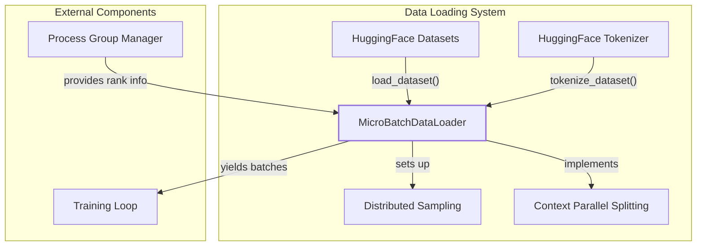
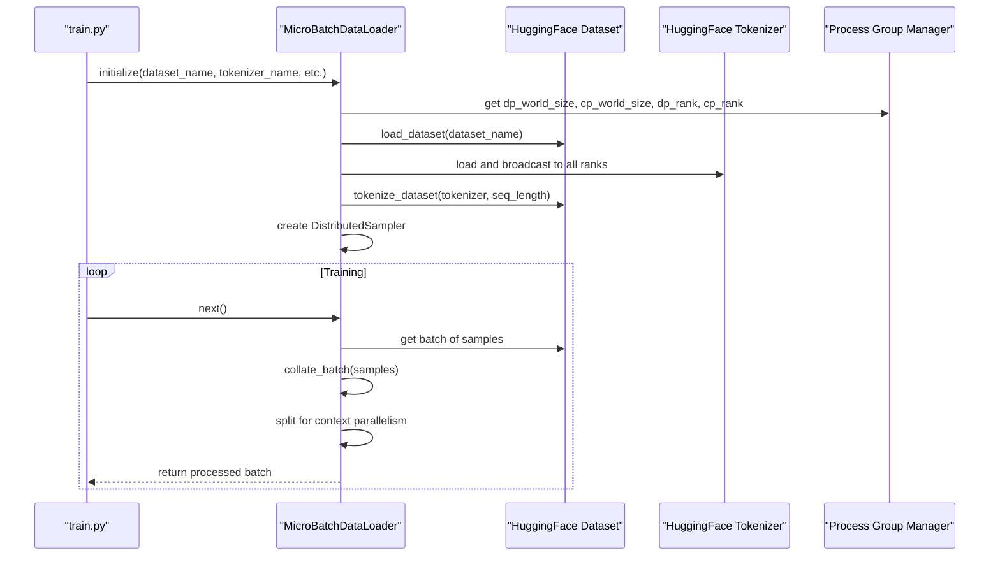
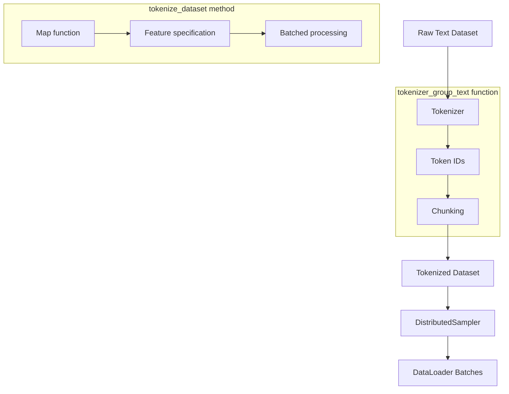
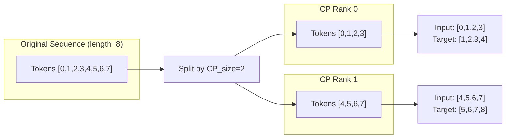
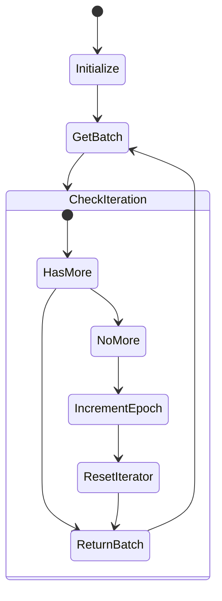
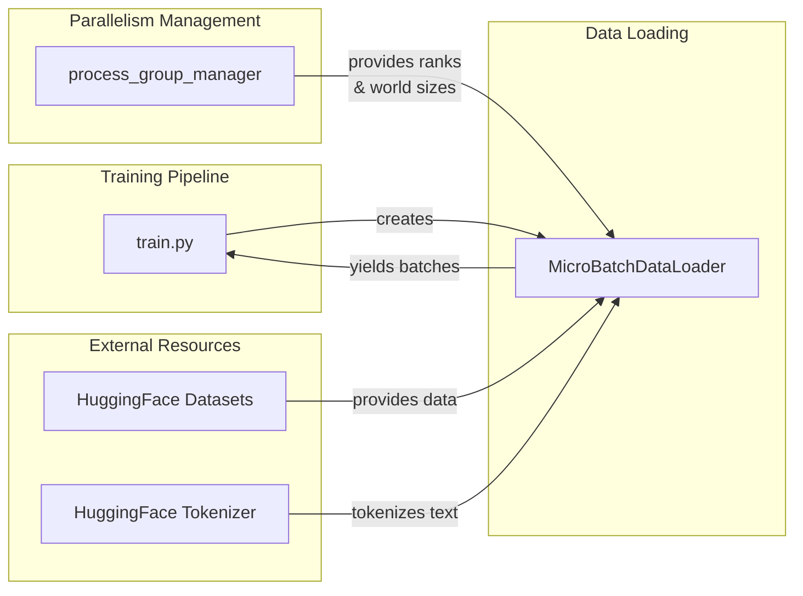

<!-- source: DeepWiki mcp.deepwiki.com · repo huggingface/picotron · page 3.2 Data Loading and Processing · fetched 2026-10-26 -->

# Data Loading and Processing

<details>
<summary>Relevant source files</summary>

The following files were used as context for generating this wiki page:

- [picotron/data.py](picotron/data.py)
- [tests/test_dataloader.py](tests/test_dataloader.py)

</details>


## Purpose and Scope

This document describes the data loading and processing system in Picotron, which is responsible for fetching, tokenizing, and preparing training data for large language models in a distributed training environment. The system is designed specifically to support Picotron's 4D parallelism approach, with special handling for context parallelism where input sequences are split across devices.

For information about how this system integrates with the broader training pipeline, see [Training Pipeline](#3).

Sources: [picotron/data.py:1-137]()

## System Overview

The data loading system in Picotron is built around the `MicroBatchDataLoader` class, which extends PyTorch's native `DataLoader`. It incorporates support for Hugging Face datasets and tokenizers while adding specialized functionality for distributed training scenarios.



Sources: [picotron/data.py:12-137]()

## Data Loading Architecture

The `MicroBatchDataLoader` handles the entire data pipeline, from loading raw text data to producing batched, tokenized, and properly distributed sequences for model training.



Sources: [picotron/data.py:12-55](), [picotron/data.py:118-137]()

## Key Components

### Dataset Loading

The system uses Hugging Face's `load_dataset` function to fetch the training data. This provides access to a wide range of public datasets, with flexibility to specify particular subsets and splits.

```python
self.dataset = load_dataset(dataset_name, split=split, name=subset_name)
```

If `num_samples` is specified, the dataset is truncated to that size, which is useful for debugging or small-scale experiments.

Sources: [picotron/data.py:21-35]()

### Tokenization Process

The tokenization process consists of two main parts:

1. **Tokenizer Creation**: A tokenizer is created on rank 0 and broadcast to all other ranks to ensure consistency across distributed processes.

2. **Dataset Tokenization**: The dataset is tokenized and chunked into segments of length `sequence_length + 1` (the extra token is used for the target in the next step).



Sources: [picotron/data.py:57-100]()

### Batch Collation

The `collate_batch` method transforms raw tokenized samples into the format expected by the model:

1. Stacks individual samples into batches
2. Splits sequences according to context parallelism rank
3. Prepares input IDs, target IDs (shifted by one position), and position IDs
4. Returns a structured dictionary with all necessary tensors

Sources: [picotron/data.py:102-116]()

## Data Distribution and Parallelism

### Data Parallelism

The system implements data parallelism using PyTorch's `DistributedSampler`, which ensures that:

1. Each data-parallel rank receives a unique subset of the data
2. The entire dataset is processed across all ranks
3. No sample is processed more than once per epoch

```python
self.sampler = DistributedSampler(
    self.tokenized_dataset, 
    num_replicas=pgm.process_group_manager.dp_world_size, 
    rank=pgm.process_group_manager.dp_rank, 
    shuffle=False
)
```

Sources: [picotron/data.py:40-45]()

### Context Parallelism

A key feature of this dataloader is its support for context parallelism, where input sequences are split across multiple devices:



The sequence is split as follows:

1. Calculate `seq_length_per_gpu = seq_length // cp_world_size`
2. Determine start and end indices based on the context parallel rank
3. Extract the corresponding portion of the input sequence
4. Create target IDs by shifting the sequence by one position

Sources: [picotron/data.py:20](), [picotron/data.py:102-116](), [tests/test_dataloader.py:136-179]()

## Batch Structure and Format

Each batch returned by the dataloader is a dictionary with the following structure:

| Key | Shape | Description |
|-----|-------|-------------|
| `input_ids` | `[batch_size, seq_length_per_gpu]` | Token IDs for model input |
| `target_ids` | `[batch_size, seq_length_per_gpu]` | Token IDs for prediction targets (shifted by 1) |
| `position_ids` | `[batch_size, seq_length_per_gpu]` | Position embeddings indices |
| `hidden_states` | `None` | Placeholder for pipeline parallelism |

The positional encoding is adjusted based on the context parallel rank:

```python
position_ids = torch.arange(start_idx, end_idx, dtype=torch.long).unsqueeze(0).expand(batch_size, -1).contiguous()
```

This ensures that each device "knows" the absolute positions within the full sequence despite only processing a portion of it.

Sources: [picotron/data.py:102-116]()

## Continuous Training Loop

The dataloader implements an "infinite iterator" pattern by overriding the `__next__` method. When the dataset is exhausted, it:

1. Resets the epoch counter in the sampler
2. Reinitializes the iterator
3. Continues providing batches

This feature enables continuous training without manual epoch management in the training loop.



Sources: [picotron/data.py:118-137](), [tests/test_dataloader.py:181-211]()

## Integration with Training Pipeline

The dataloader integrates with the broader training system in the following ways:

1. **Process Group Manager**: Uses the process group manager to determine parallel world sizes and ranks
2. **Batch Size Calculation**: Computes the global batch size based on micro batch size, gradient accumulation steps, and data parallel world size
3. **Device Handling**: Ensures proper device placement of tensors for efficient processing



Sources: [picotron/data.py:10-19]()

## Performance Considerations

The dataloader implementation includes several performance optimizations:

1. **Tokenizer Broadcasting**: Creates the tokenizer only on rank 0 and broadcasts it to other ranks to avoid redundant loading
2. **Caching**: Uses Hugging Face's caching system with `load_from_cache_file=True`
3. **Parallel Processing**: Supports multi-process tokenization via the `num_proc` parameter
4. **Pin Memory**: Optional pinned memory for faster CPU to GPU transfers
5. **Workers**: Configurable number of worker processes via the `num_workers` parameter

Sources: [picotron/data.py:23-32](), [picotron/data.py:95-98]()

---

